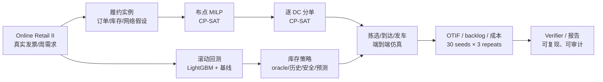

# 供应链 / 履约算法作品集 · 一页版

> 用公开真实交易数据（UCI Online Retail II）做**可复现的履约与库存实验**：先跑出数字，再主动检验数字在什么条件下不成立。
>
> 不是生产系统，也不是“LLM 聊天 demo”。完整材料见 [`README.md`](README.md)。

## 一句话

在 400 张真实发票、30 个种子、3 次重复的端到端履约实例上，比较**布点、分单、库存、成本、预测**五类决策；最重要的产出不是某个漂亮指标，而是发现：**布点效应只有 0.1–0.3pp，而库存一旦从“目标周实际需求”换成可部署基准，target OTIF 会从 100% 掉到 70–85%。**

## 九个可验证结论

| 问题 | 方法 | 真实结果 | 诚实边界 |
|---|---|---|---|
| 需求预测 | 滚动起点回测；6 个基线 + 全局 LightGBM | SKU 级 LightGBM WMAPE **73.3%**，Naive 89.4%；仓库总量 Seasonal Naive 21.1% 最好，LightGBM 31.9% | 批发数据 17.96% SKU-周为 0；两个口径不能只看一个数 |
| 布点/分单 | CP-SAT 布点 + 逐 DC 分单，10%–60% 份额约束 | baseline target 96.7%/all 98.8%；stock 140% 到 100%/99.9% | 库存是 oracle；布点对 baseline 仅 0.1–0.3pp，不稳健 |
| 库存基准 | 目标周需求 vs 前 6 周均值 vs 安全库存 vs LightGBM 预测 | 历史 140%：target **70.0%**/all 93.9%；安全 z=2.326：79.2%/97.1%；预测 160%：85.0%/91.6%；oracle 140%：**100%/99.9%** | 预测只覆盖 200 个主 SKU；target +2.5pp 落在 3.3pp 重跑噪声内 |
| SKU 结构 | 同总量换结构 / 同结构加总量 | 同样 44,824 单位：实际结构 100.0%，历史结构 70.0%；历史结构加到 64,039 也只 82.5% | “实际结构”仍是 oracle；只隔离 per-SKU 总量，不是可部署政策 |
| 预测结构 | 固定历史总量，换成 LightGBM 预测份额 | 44,826 单位：预测结构 70.0%/all 87.3%，与历史结构相同；加到 51,221 也只 74.2% | 预测只覆盖 200 SKU；没有 SKU×DC 模型，结构缺口仍未解 |
| 前一周结构 | 固定历史总量，换成前一周实际份额 | 44,833 单位：target 49.2%/all 84.6%，比历史均值 70.0%/93.9% 更差 | 相邻周+季节切换，是压力案例；简单结构外推失败 |
| 目的国 DC 结构 | 固定总量，目的国历史 SKU 需求映射到最近 DC | 44,824 单位：target 71.7%/all 92.0%，对比历史 70.0%/93.9% 只是 ~2pp 交换 | 目的国≠DC 需求；库存集中 90%/7%/2%，不是稳健改进 |
| 成本决策 | `h×stock + p×backlog` 的 break-even | in-sample `p/h` 阈值 **71.9 / 90.3 / 1,646**；OOS **56.7 / 176.9** | 阈值是区域不是锐线；`h` 是示例，未计 lost sales/资金/跌价 |
| Agent / RAG | Plan DAG + Verifier + Replan；15 条检索查询 | 30 任务三策略消融；检索有 Recall@k/MRR | **默认 planner 是脚本 DAG**；无 API Key 时嵌入是词袋，不冒充语义能力 |

## 最有价值的负结果

1. **布点不是主杠杆。** 固定总量下重摆 DC 份额，target 只动 0.1–0.3pp；库存总量和 SKU 结构才是。
2. **Weeks 45–48 的库存前沿是 oracle 上界。** 库存量乘的是目标周实际需求，不是周前可执行库存；Week49 用历史均值重跑，140% 时 target 只有 70%。
3. **加总量补不上结构。** Week52 同样 44,824 单位，实际 SKU 结构 target 100.0%、历史结构 70.0%；历史结构加到 64,039（+19,215 单位）也只有 82.5%。Week53 固定总量换成 LightGBM 预测结构仍是 70.0%，加到 51,221 也只 74.2%；Week54 前一周结构只有 49.2%；Week55 目的国 DC 结构 71.7%/92.0%，只是 ~2pp 交换。Week50 安全库存 223% 覆盖只到 79.2%；Week51 LightGBM 预测 160% 到 85.0%，all 只有 91.6%。
4. **Agent 评测的是运行时，不是 LLM 规划能力。** 30 任务的三策略对比是工程骨架；真实模型评测必须单独报告方差和成本。

## 架构



## 如果把它做成生产

1. **SKU×DC 级预测 + 层级协调**：不是只预测 Top-200 的总量；要做 SKU×DC、偏差监控、断货/新品/促销处理。
2. **多周补货闭环**：前置期、MOQ、在途、持有/缺货/资金成本、服务水平约束；当前库存仍是单周快照。
3. **成本口径产品化**：缺货损失、lost sales、跌价、运费、仓容；用真实财务口径替代示例 `h`。
4. **实验平台**：每次策略变更都跑配对种子、置信区间、尾部风险，防止把 2–3pp 噪声当收益。
5. **护栏与监控**：库存上限、DC 份额、承诺可达性、求解超时降级；模型/规则双轨回滚。

## 岗位匹配

- **供应链/履约算法**：强。库存、布点、分单、波次、发车、成本与稳健性都有真实数据和可复现实验。
- **运筹优化**：强。CP-SAT/MILP、滚动时域、随机场景、CVaR、配对比较。
- **LLM/Agent 工程**：中上。Plan DAG/Verifier/Replan/工具契约完整；但真实 LLM 规划评测仍待补，不能把脚本 DAG 当模型能力。
- **数据科学**：中上。滚动回测、WMAPE/Bias、误差分解；但库存策略只验证了一个目标周。

## 入口

- 完整说明：[`README.md`](README.md)
- 最终审计与面试要点：[`docs/FINAL_AUDIT.md`](docs/FINAL_AUDIT.md)
- 库存布点模型卡：[`docs/model_cards/access_placement.md`](docs/model_cards/access_placement.md)
- 库存基准（oracle 问题）：[`benchmarks/ACCESS_STOCK_BASIS_REPORT.md`](benchmarks/ACCESS_STOCK_BASIS_REPORT.md)
- 安全库存：[`benchmarks/ACCESS_STOCK_SAFETY_REPORT.md`](benchmarks/ACCESS_STOCK_SAFETY_REPORT.md)
- LightGBM 预测库存：[`benchmarks/ACCESS_STOCK_FORECAST_REPORT.md`](benchmarks/ACCESS_STOCK_FORECAST_REPORT.md)
- SKU 结构分解：[`benchmarks/ACCESS_STOCK_MIX_REPORT.md`](benchmarks/ACCESS_STOCK_MIX_REPORT.md)
- 预测结构检验：[`benchmarks/ACCESS_FORECAST_SHARE_REPORT.md`](benchmarks/ACCESS_FORECAST_SHARE_REPORT.md)
- 前一周结构检验：[`benchmarks/ACCESS_LAST_WEEK_REPORT.md`](benchmarks/ACCESS_LAST_WEEK_REPORT.md)
- 目的国 DC 结构：[`benchmarks/ACCESS_DC_MIX_REPORT.md`](benchmarks/ACCESS_DC_MIX_REPORT.md)
- 预测回测：[`benchmarks/REPORT.md`](benchmarks/REPORT.md)
- Agent v2：[`benchmarks/AGENT_V2_REPORT.md`](benchmarks/AGENT_V2_REPORT.md)
- 检索：[`benchmarks/RETRIEVAL_REPORT.md`](benchmarks/RETRIEVAL_REPORT.md)

## 复现

```bash
export PYTHONPATH=src:.        # Windows: $env:PYTHONPATH='src;.'
python scripts/run_e2e_access.py --stock-basis forecast --forecast-model lightgbm \
  --forecast-calibrate --stock-factor 1.6 --load-aware --load-basis covered \
  --repeats 3 --stem ACCESS_FORECAST16 --week 51
python scripts/build_access_stock_forecast.py
python tests/test_e2e_access.py
```

当前材料：**56 层评测、6 份 model card、47 个测试文件；本地 `pytest` 342 passed**（8 个依赖弃用 warning）；CI 覆盖核心 smoke。最近提交见 `git log`，尚未 push。
