# 供应链智能体（Supply Chain Agent）

一个面向**电商仓配/履约算法**岗位的作品集项目：在自实现 RAG 管线与供应链工具链基础上，接入了公开真实交易数据、滚动回测框架、LightGBM 全局需求预测，以及**库存策略仿真 / 多周期补货 MILP / DC→门店分配 LP / 仓网选址 CFLP / 车辆路径 CVRP·VRPTW / 仓储槽位与拣选路径 / 多仓订单履约分单 / 波次拣选与订单合并 / 截单感知的波次释放排程 / 班中插单与在线波次释放 / 分单→逐 DC 拣选→在线释放的端到端联动 / 端到端 Monte Carlo 稳健性（置信区间 · 尾部风险 · 配对比较） / 库存布点执行风险反事实 / 班中回写恢复（锁定已开工波次 · 跨 DC 调拨未开工票据） / 分单-布点联合优化（目的地历史布点 · 产能封顶 · 计划驱动上界） / 不确定性下的两阶段随机布点（6 周需求场景 · E[unmet] + CVaR · 峰值拣选分钟平局决胜） / 经验日内到达曲线回放（前 6 周发票时间戳 · 留出周诊断 · 8 个回放格） / 承运商发车截止与月台合并（车道凑批 · 承诺感知 · 单/双班敏感性） / 月台门位与装车资源（门位预算 · 装车工时 · 与凑批/晚班的交互） / 承诺报价与 ATP（库存快照 · 报价-截单解耦 · 共同 SLA） / 多日滚动与补货（日订单流 · 库存结转 · 前置期）**，并用 **LLM Function Calling** 把数据、预测、补货、报告与知识检索暴露为可校验、可审计的工具调用，附 12 用例 Agent 评测、15 条中文查询的检索质量评测、120 张真实发票的履约分单基准、200 张真实发票的波次拣选与 EDF/CP-SAT 排程基准、60/120/200 张发票的在线到达仿真基准，以及 400 张真实发票的端到端 OTIF 基准、30 种子 × 8 压力格的稳健性基准、4 种库存布点 × 30 种子的执行风险基准、3 种布点 × 30 种子 × 4 压力格的班中回写基准、5 种分单-布点场景 × 30 种子 × 4 压力格的联合优化基准与 5 种布点 × 30 种子 × 4 压力格 × 3 次分单复现的随机/CVaR 布点基准、400 张真实发票 × 前 6 周经验曲线的到达校准/回放基准、400 张真实发票 × 10 个回放格 × 30 种子的出库发车基准与 400 张真实发票 × 11 个回放格 × 30 种子的月台门位基准，400 张真实发票 × 5 个工作日 × 5 种补货策略的多日滚动基准，400 张真实发票 × 30 种子 × 3 种补货策略的多日滚动端到端基准，400 张真实发票 × 30 种子 × 2 种补货策略 × 0/1/2 门位的日滚动门位基准，400 张真实发票 × 30 种子 × 2 种补货策略 × 3 种报价策略的日滚动重报价基准，400 张真实发票 × 30 种子 × 6 种报价策略的承诺-服务前沿，400 张真实发票 × 30 种子 × 5 种接单场景的订单接受基准，4 种报价策略 × 0/1/2 门位的承诺-门位交互测试，同日两班之间集批发车的服务/成本权衡，用真实发票收入复算“接单率 vs 收入保留”，高价值订单破例的价值分层接单，以及价值阈值从 Top5% 到 accept-all 的整条前沿扫描，“高价值订单承诺升级”能否买回服务，在分单 MILP 中给高价值订单更高缺货/迟到权重的库存优先级，高价值票据在发车排序中插队的作业优先级，高价值票据优先进入拣选波次的拣选优先级，用第二个拣货员检验拣选产能，把高价值/全部订单提前到仓的到达加急，85%→100% 的库存上界，以及 1×/2×/10× 的 DC 产能上界。

## 诚实声明（先读这个）

这个项目**不是生产系统**，用之前请了解以下事实：

1. **数据来源分两层**——演示流程仍可用 `generate_realistic_data` 合成数据；需求预测、库存与仓配基准使用 UCI **Online Retail II** 真实交易数据（2009-12 至 2011-12，1,067,371 条；清洗后 1,014,625 行、4,707 个 SKU、104 个完整周），按销售额取 Top-200 SKU 聚合为周度面板。公开数据只有需求/价格/日历，**没有库存、提前期、仓网、车队、仓库布局、波次容量、拣选工时、履约时效、客户承诺与拣货员班次**；库存、网络、履约、波次与排程模块把这些全部放进显式假设层，并在报告中逐项标注“observed / assumed”。唯一新增的观测信号是发票时间戳：它只用于估计日内到达形状，是开票时间而不是仓内收货扫描。
2. **预测已从玩具模型升级为可回测的基线 + ML 模型**——支持 Naive、Seasonal Naive、MA(4/8)、Croston-SBA、Holt，以及单模型直接多步（direct multi-horizon）的全局 LightGBM；所有结果都在滚动起点（rolling-origin）回测下用 WMAPE/Bias/MAE/RMSE/RMSSE 评估。旧的 `ForecastEngine` 三模型集成仍保留给演示链路。
3. **Agent 已升级为 Function Calling 编排**——6 个工具以 JSON Schema 暴露，支持 OpenAI 兼容端点的原生 `tools/tool_calls` 循环；无 API Key 时回退到确定性规则规划器，演示与评测可离线复现。护栏包括工具 allowlist、参数 schema 校验、写操作开关与步数上限。但它仍不是长程自主规划：评测只有 12 个确定性用例，不代表模型在开放场景中的规划能力。
4. **Mock 嵌入只反映词汇重合**——无 API Key 时使用确定性词袋哈希向量（token 哈希到维度桶），检索按词汇重叠度排序，**无语义理解能力**（"库存"与"存货"不匹配）。配置 `OPENAI_API_KEY` 后自动切换真实嵌入。
5. **评估覆盖三十七层，但仍是小样本**——预测有样本外滚动回测，库存有独立窗口的 replay + 300 条 Monte Carlo，Agent 有 12 用例的工具选择/参数/状态/引用正确性评测，检索有 15 条中文查询的 Recall@k/MRR 评测（含纯向量 vs 标题加权对比），履约分单有 120 张真实发票的贪心 vs MILP 对比（OTIF/满足率/拆单/成本），波次拣选有 200 张真实发票的按单/FCFS/节省算法/CP-SAT 对比（波次、行走距离、拣选工时），波次排程有同一批订单在 1/2/3 名拣货员下的 EDF vs CP-SAT 对比（准时率、迟到订单分钟、makespan/加班），在线释放有 60/120/200 张发票 × 5 种发波策略的班中到达仿真（准时率、等待、空闲产能、makespan），端到端联动有 400 张真实发票上 4 种分单 × 4 种释放策略 × 1/2/3 名拣货员的 OTIF/成本对比，端到端稳健性有 30 个到达种子 × 8 个压力格 × 3 种分单的 Monte Carlo（95% CI、P10/P90、最差 10% 均值、配对胜率），库存布点有 4 种 DC 库存占比 × 30 种子 × 4 压力格的反事实（每个布点重解分单，比较分单上界与端到端执行），班中回写有 3 种布点 × 30 种子 × 4 压力格 × 4 策略的两阶段重放（锁定已开工波次、同种子重放剩余班次，比较无回写 / 迟到调动 / 全队列再平衡 / 先知上界），分单-布点联合有 5 种场景 × 30 种子 × 4 压力格的联合 CP-SAT（目的地历史 / 产能封顶 / 计划驱动上界，比较“一起解”与“先布点再分单”），随机布点有前 6 周等权场景 × 5 种布点 × 30 种子 × 4 压力格 × 3 次分单复现（E[unmet]/CVaR 预测 vs 端到端 OTIF，λ 扫描与求解器噪声分离）；但检索语料只有 2 篇文档 / 34 个片段，标注是“最小必需片段”而非全量相关性判断，标题加权也只处理字面重合；履约的库存与时效是假设、MILP 在时间预算内返回可行解而非证明最优；波次的仓库布局、波次容量与拣选工时是假设，CP-SAT 只在候选池内证明最优；排程的承诺分层、截单时间、拣货员数量与目标权重同样是假设，CP-SAT 在时间预算内为 `FEASIBLE`；在线释放的班中到达时间、开班前到达占比与等待窗口是假设，离线参考只对同一条节省规则成立，不是跨规则下界；端到端的分单-拣选联动用“累计拣选分钟”线性代理接入 MILP，不是真实的波次仿真，且 CP-SAT 在 400 单上 gap 很大；稳健性只重抽样到达与拣选时长，分单/库存/槽位固定，尖峰与拥堵分布是声明值而非拟合值；布点反事实固定订单集与库存总量、只改 DC 占比，且每个布点重解 MILP，求解器差异会与布点效应混合；回写只调动审核时点后未开工的票据，投影为确定性 EDF，先知策略也只预知迟到集合，调拨前置时间/费用与库存随票据转移是声明假设，且不重新分单；随机布点的场景由前 6 周等权重缩放得到（不是拟合的预测分布），可服务需求按声明承诺与转运天数计算，第二层是无订单身份的流体分配，拣选分钟是线性代理，且只验证一个目标周；经验到达只校准日内形状（发票时间戳代理），承诺窗口/班前占比/截单/拣选噪声仍是声明值，且同样只有 1 个目标周；出库发车有 400 张发票 × 10 个回放格 × 30 种子（单/双班、承运商截止、凑批与承诺感知），但发车时刻/装车截止/车道划分/车辆上限/月台费率都是声明值，月台装卸与司机等待未建模（门位在 Week 17 单独补上），且这条实例上分单上界（53.0%）主导、月台本身丢单为 0.0pp，绝对水平不可迁移；月台门位有 400 张发票 × 11 个回放格 × 30 种子（0/1/2/4 门位、480 分钟日装车预算、75 分钟/车 + 0.5 分钟/票），但门位数量/装车工时/窗口是声明值，门位按每日分钟预算而非具体门位占用建模，未模拟叉车、装卸工排班与司机等待；承诺报价有 400 张发票 × 11 个回放格 × 30 种子（ATP vs 固定 2/3/5 混合、2/3 天封顶、5 天缓冲、固定优先级），但 ATP 只用当前库存快照与声明转运日，不预留库存、不跨订单竞争，报价只允许 2/3/5 天三档，且 400 单下 ATP 把 2 天档全部挤掉、共同 SLA 反而下降，说明承诺不能替代库存与作业优先级；多日滚动有 400 张发票 × 5 个工作日 × 5 种补货策略（初始 85% 周库存、order-up-to 剩余周 cover、1/2 天前置期），但只重放分单层、不重跑拣选/发车/月台，订单日按发票日期映射、周末并入周五，单周快照与日滚动的 MILP 预算不同（60s vs 8s/天），且只有 1 个目标周；多日端到端有 400 张发票 × 30 种子 × 3 种补货策略（日滚动分单 → 经验到达 → EDF 拣选 → 当天 13:00/19:00 发车，按绝对承诺日重算 OTIF），但门位/装车/承运商合并不重跑，日滚动只允许当天发车（`max_days=0`）而单周基线允许 3 天且把所有订单视作周一，两者不是同一发车自由度；30 个种子在本配置下的 OTIF 完全相同（拣选总能在末班前完成），配对 CI 为 0，因此它是一次确定性边界结果而不是 30 个独立 OTIF 样本，且同样只有 1 个目标周；日滚动门位有 400 张发票 × 30 种子 × 2 种补货策略 × 0/1/2 门位/DC（480 分钟日装车预算、75 分钟/车 + 0.5 分钟/票），但门位仍是每日分钟预算而非具体门位占用，未模拟叉车、装卸工排班与司机等待，日滚动与单周基线的发车自由度不同，分单后不接收拣选/发车/门位失败的回写，且只有 1 个目标周、1 套库存/布局/劳动力；日滚动重报价有 400 张发票 × 30 种子 × 2 种补货策略 × 3 种报价策略，但 ATP 只按当天在库报价、不预留在途补货/未来到达/跨订单库存，旧订单不重报价，不模拟客户接受/取消，且报价同时改变分单截止期——quoted OTIF 与原 SLA 必须一起读，30 个种子在该格仍完全相同、CI 为 0；承诺-服务前沿有 400 张发票 × 30 种子 × 6 种报价策略，但二维前沿只在本次策略集合内成立，`all_2/all_3/all_5` 是压力测试而非商业菜单，报价策略同时改变分单截止期，且同样受 CP-SAT 时间预算噪声影响（同一配置不同运行可差约 1pp）；订单接受有 400 张发票 × 30 种子 × 5 种场景，但被拒订单按即期流失处理、不重试/不转替代品/不计收入，接受池 OTIF 与全量 OTIF 是两个分母，且 ATP 的 2 天档在 400 单下为 0、`cutoff=2` 会拒掉全部需求；30 个种子下接单率与流失量也是确定性的；承诺×门位有 400 张发票 × 30 种子 × 4 种报价 × 0/1/2 门位，门位是每日分钟预算而非具体门位占用，未模拟叉车/装卸工/司机等待，且每个报价策略都重解分单、门位差异与分单差异混合；0 门表示没有门位分钟预算而非无限真实装卸能力，2 门能恢复服务不等于 2 门经济最优；all_3 的 −0.4pp 落在求解噪声内，只能结合 blocked 车数读；同日集批有 400 张发票 × 30 种子 × 2 种报价 × 1/2 门位 × 3 种发车方式，但只在当天 13:00/19:00 两班之间等待（`max_days=0`），没有跨日留单/跨 lane 拼车；`min_load` 是 lane 门槛，容量 300 单/车、实测装载率约 3%，节省来自减少发车事件而非装满车；dock 成本只含发车 220/车 + 等待 0.15/单/小时，不含门位固定成本/司机/承运商阶梯价/迟到赔付，且 blocked 车没发，不能跨门位比较成本；static 1 门服务增益只有 0.1pp 且重复运行在 85.7–86.4% 间变化，ATP 的 2.8→0 blocked 更稳；1 门凑 12 的门位利用 66.8%，2 门只有 33.4%，确定性运行里 1 门够用不等于 2 门没有峰值/波动价值；收入口径接单有 400 张发票 × 30 种子 × 6 个场景，收入来自真实发票行但只是毛收入（无 COGS/退货/履约成本/客户终身价值），被拒订单按即期流失、不重试/不转替代品，接受池 OTIF 与全量 OTIF 是两个分母，ATP 只接 ≤3 天订单接单 71.2% 但收入只保留 52.5%（拒单平均收入 705 vs 接受 314），说明订单/单位口径会高估收入保留，而 static 只接 ≤3 天是 80.0% 订单 / 82.0% 收入、被拒订单更低价值，两个方向都不能只看一个分母；30 个种子下接受率/收入仍是确定性的，且只验证 1 周、1 套库存/布局/劳动力；价值分层接单有 400 张发票 × 30 种子 × 7 个场景，但阈值是本次 400 单的收入分位数（Top10/Top25，样本内、非外推最优），只改“是否接受”、不预留库存/不提高分单优先级，收入仍是毛收入（无 COGS/退货/履约成本/客户终身价值），且高价值长承诺订单接受后仍可能迟到——ATP Top10 破例收入 51.9%→78.2%、接受池 OTIF 100%→99.0%、全量 OTIF 70.5%→76.5%，Top25 收入 88.3% 但接受池 OTIF 97.6%，两个分母必须并列；30 个种子下接单率/收入仍是确定性的；价值阈值前沿有 400 张发票 × 30 种子 × 9 个点（Top5…Top40 + accept-all），但所有门槛都是同一批 400 单的样本内收入分位数、没有 train/test 切分，前沿只是敏感性检查；Top0→5 收入 +20.4pp/接受池 OTIF −0.7pp 是本轮最佳边际，但 0.7pp 已在求解噪声附近；Top30 被 Top40 支配（收入 92.6% vs 90.4%、OTIF 96.6% vs 96.2%，差 0.4pp），曲线不干净单调；accept-all 收入 100% 但原 SLA 83.8%，低于每个价值阈值；高价值破例仍不预留库存/不提高优先级，收入非利润；真实模型下的 open-ended agent 评测仍待补（可用 `--planner openai` 单独跑，需 API Key）。

## 架构一览

```mermaid
flowchart LR
    A[Online Retail II<br/>106 万行原始交易] --> B[清洗 / ABC / 补周<br/>200 SKU × 104 周面板]
    B --> C[滚动起点回测<br/>LightGBM + 经典基线]
    B --> D[库存策略仿真<br/>replay + Monte Carlo]
    C --> E[CP-SAT 补货 MILP]
    C --> F[CFLP 选址 / CVRP·VRPTW]
    B --> F
    F --> G[ABC 槽位 / 拣选路径]
    G --> M[波次合并<br/>容量 / 行走 / 工时]
    M --> N[截单感知排程<br/>EDF / CP-SAT]
    C --> L[多仓履约分单<br/>OTIF / 拆单 / 成本]
    F --> L
    L --> P[拣选票据<br/>每单每 DC 一张]
    N --> O[班中到达 / 在线释放<br/>single / fill / re-batch / wait]
    P --> O
    O --> H[Function Calling Agent<br/>schema / allowlist / 轨迹]
    O --> Q[Monte Carlo 稳健性<br/>30 种子 × 8 压力格]
    Q --> R[库存布点反事实<br/>4 布点 × 30 种子]
    R --> S[班中回写<br/>锁定波次 + 跨 DC 调动]
    S --> T[分单-布点联合<br/>历史 / 封顶 / 计划驱动]
    T --> U[随机布点<br/>6 周场景 + CVaR]
    U --> H
    O --> V[经验日内到达<br/>6 周曲线 + 留出诊断]
    V --> W[承运商发车截止<br/>车道凑批 + 承诺感知]
    W --> X[月台门位与装车资源<br/>门位预算 + 装车工时]
    X --> Y[承诺报价 ATP<br/>库存快照 + 共同 SLA]
    Y --> Z[多日滚动与补货<br/>日订单流 + 库存结转]
    Z --> Z2[多日滚动端到端<br/>分单 + 拣选 + 发车]
    Z2 --> Z3[日滚动门位<br/>门位分钟预算]
    Z3 --> Z4[日滚动重报价<br/>ATP + 双口径]
    Z4 --> Z5[承诺-服务前沿<br/>原 SLA vs quoted]
    Z5 --> Z6[订单接受/拒绝<br/>接单上限 + 流失口径]
    Z6 --> Z7[承诺策略 × 门位<br/>瓶颈是否转移]
    Z7 --> Z8[同日集批<br/>两班凑批 vs 加门]
    Z8 --> Z9[收入口径接单<br/>订单/单位/收入三分母]
    Z9 --> Z10[价值分层接单<br/>高价值长承诺破例]
    Z10 --> Z11[价值阈值前沿<br/>Top5%…accept-all 扫描]
    Z11 --> Z12[高价值承诺升级<br/>目标/非目标 OTIF]
    Z12 --> Z13[高价值分单优先级<br/>3×/10× 权重]
    Z13 --> Z14[高价值发车插队<br/>EDF vs priority]
    Z14 --> Z15[高价值优先拣选<br/>EDF vs pick priority]
    Z15 --> Z16[第二拣货员<br/>1p vs 2p]
    Z16 --> Z17[到达加急<br/>目标/全部 onsite t=0]
    Z17 --> Z18[库存上界<br/>85%→100%]
    Z18 --> Z19[DC 产能上界<br/>1×/2×/10×]
    Z19 --> H
    S --> H
    I[知识库文档] --> J[RAG 检索<br/>来源 + 检索分数引用]
    D --> H
    E --> H
    G --> H
    L --> H
    J --> H
    H --> K[FastAPI /run /ask /agent]
```



数据侧全部来自公开交易或显式假设层；每个模块都有独立基准脚本与报告，Agent 只编排已有工具，不绕过参数校验与写操作开关。

## 功能

| 模块 | 能力 |
|---|---|
| 数据 | 模拟数据生成 / CSV·JSON 导入 / SQLite 持久化；Online Retail II 下载、清洗、ABC Top-N 周度面板 |
| 预测 | 滚动回测（WMAPE/Bias/RMSE/RMSSE）+ 6 个经典基线 + 全局 LightGBM 直接多步预测；SKU 级与仓库总量双口径 |
| 库存 | 显式假设层 + SKU 经济参数（EOQ/MOQ/安全库存）；（s,Q）/（R,S）/（s,S）三种策略的周度仿真、replay 与 300 路径 Monte Carlo（缺货率/周转/成本） |
| 补货优化 | OR-Tools CP-SAT 多 SKU × 多周期 MILP：提前期、MOQ、固定订货费、共享仓储/入库产能、缺货惩罚；支持完美信息与滚动时域（可选 z·σ 安全缓冲 API） |
| 仓配分配 | OR-Tools GLOP 运输 LP：2 DC × 8 门店 × SKU，DC 库存上限、门店收货容量、优先级加权缺货 |
| 仓网选址 | OR-Tools CP-SAT 容量约束选址（CFLP）：固定成本 + 运输成本、全开基线、固定成本敏感性 |
| 车辆路径 | OR-Tools CVRP/VRPTW + Clarke-Wright + 精确子集 DP；容量、车辆数、收货时间窗 |
| 仓储拣选 | ABC/随机槽位、return / S-shape / 最优 TSP 三种拣选路径、真实订单行 |
| 波次拣选 | 按单 / FCFS / Clarke-Wright 订单节省 / 候选池集合划分 CP-SAT；波次订单与行容量、行走距离、setup 与拣选工时、容量敏感性 |
| 波次排程 | 承诺分层（特快/标准/经济）+ 截单时间；同层节省合并、EDF 列表排程、并行拣货员 CP-SAT（迟到订单分钟 + makespan）、1/2/3 名拣货员敏感性 |
| 在线释放 | 班中到达过程（按承诺层的开班前占比 + 到达窗口）+ 事件驱动仿真：按单 / EDF 即时装满 / 节省重批 / 等待凑波 / 离线参考；准时率、等待、空闲产能、makespan，以及 60/120/200 订单负载与等待参数敏感性 |
| 履约分单 | 多 DC 订单-仓分配：CP-SAT（库存/产能/每单拆单上限/OTIF 权重）+ 时效优先贪心基线；输出 OTIF、订单/件数满足率、拆单率、迟到与成本拆分 |
| 端到端联动 | 分单结果拆成“每单每 DC”拣选票据 → 逐 DC 在线释放；端到端 OTIF = 整单满足 ∩ 承诺达标 ∩ 每张票据在 12:00/16:00/18:00 前完成；分单 MILP 可选累计拣选容量代理，并做释放策略与 1/2/3 名拣货员敏感性 |
| 稳健性 | 端到端 Monte Carlo：30 个到达种子 × 8 个压力格（均匀/尖峰到达、EDF/节省重批、拣选时长噪声 σ=0.25/0.40、加拣货员）× 3 种分单；输出 95% CI、P10/P50/P90、最差 10% 均值、超班次概率与配对胜率 |
| 库存布点 | 4 种 DC 库存占比（默认 / 均衡 / Rotterdam 偏重 / London 偏重）× 30 种子 × 4 压力格；每个布点重解拣选容量感知 MILP，比较分单上界、端到端 OTIF 分布、逐 DC 负载与加人后的排序反转 |
| 班中回写 | 审核时点锁定已开工波次 → 投影各 DC 剩余队列 → 跨 DC 调动未开工票据（无回写 / 迟到调动 / 全队列再平衡 / 先知上界）；库存随票据转移、调拨前置时间与费用、目标产能/时效校验；比较 OTIF、拣选准时、迟到分钟、makespan、调动票数与回写成本 |
| 联合优化 | 分单-布点联合 CP-SAT（目的地历史 / 产能封顶 / 计划驱动上界）+ 30 种子 × 4 压力格配对比较；量化“一起解 vs 先布点再分单”，并区分已知周上界与可部署布点 |
| 随机布点 | 前 6 周等权需求场景（按目标周总量缩放）+ 两阶段整数规划：单次布点 × 场景流体分配，目标 `(1-λ)·E[unmet] + λ·CVaR`，覆盖与峰值拣选分钟平局决胜；λ 扫描 + 30 种子 × 3 次分单复现 + 4 压力格，分离布点效应与求解器噪声 |
| 经验到达 | 从 Online Retail II 前 6 周发票时间戳拟合周一至周五 08:00–18:00 小时曲线（目标周留出诊断）；曲线进入到达层后固定分单/库存/承诺/截单，8 个回放格 × 30 种子对比均匀/尖峰/平均/逐周曲线、释放策略、拣选噪声与加人 |
| 出库发车 | 拣选完成 → 车道（DC × 目的国）→ 13:00/19:00 发车；装车截止为发车前 30 分钟，错过的票据滚下一班；即时 / 凑 6 单 / 承诺感知 6·10 单三种规则 + 单班 13/15/19 点敏感性；按“发车日 + 转运日 ≤ 承诺”重算交付 OTIF，并输出车次、每车票据、等车分钟、滚存率、发车/等待成本 |
| 月台门位 | 每 DC 0/1/2/4 个门位 × 480 分钟日装车预算；每车 75 分钟 + 每票 0.5 分钟的装车工时，门位预算耗尽时车道等下一班/次日；输出门位利用率、阻塞次数、单车装车分钟，并对比凑批、单班 19:00、加拣货员与更快装车的替代效果 |
| 承诺报价 | ATP：1 个处理日 + 最慢订单行在“有库存 DC”中的最快转运日，映射 2/3/5 天；11 个回放格 × 30 种子对比固定混合、封顶、缓冲、固定截单优先级；按报价 OTIF 与共同 SLA 双口径，量化承诺长度、分单目标与截单映射各自贡献 |
| 多日滚动 | 400 张发票按真实开票日拆成 5 个工作日；每日对未结订单/剩余库存重解 MILP；order-up-to 剩余周 cover + 1/2 天前置期 + 每 2 天批量；对比单周快照、不补货、每日/批量补货的 OTIF、backlog、库存与周内衰减 |
| 多日端到端 | 日滚动分单后，每天接经验到达 + EDF 拣选 + 13:00/19:00 两次发车，按绝对承诺日重算 OTIF；对比单周快照、不补货、1/2 天补货，检验分单收益在拣选/发车层保留多少 |
| 日滚动门位 | 在日滚动端到端上扫 0/1/2 个门位/DC（480 分钟/日、75 分钟/车 + 0.5 分钟/票）；对比单周快照与不补货/每日补货，检验库存改善后瓶颈是否转到月台 |
| 日滚动重报价 | 每天新订单用当前在库做 ATP 重报价（2/3/5 档），旧订单保留绝对承诺日；对比固定 2/3/5 与 ATP 加缓冲，同时看“按新报价 OTIF”和“按原固定 SLA OTIF”，拆开承诺长度与服务改善 |
| 承诺-服务前沿 | 同一条日滚动上扫 `static / ATP / ATP+缓冲 / all_2 / all_3 / all_5`，用平均承诺 vs 原 SLA、平均承诺 vs quoted OTIF 两条二维前沿判断谁真正非支配；重点检查 ATP 是否只是“把自己报长” |
| 订单接受 | 新订单报价超过接单上限就拒绝（`≤2/≤3/全部`），被拒订单不占库存、不进分单/发车；同时看“接受池 OTIF”和“全量 OTIF + 流失订单/单位”，检验拒绝长承诺能否提升服务、代价是多少 |
| 承诺×门位 | 4 种报价策略（static/ATP/all_3/all_5）× 0/1/2 门位/DC，在日滚动上重跑分单-拣选-发车-门位；检查 fill 提高后门位是否从二阶变成瓶颈，以及 2 门能否恢复服务 |
| 同日集批 | 在 1/2 门位下比较立即发车、同日凑 6 单、同日凑 12 单（只在当天 13:00/19:00 两班之间等待，`max_days=0`）；同时看 OTIF、blocked、发车数、等待、dock 成本，检验“凑批能否替代第二个门” |
| 收入口径接单 | 用 Online Retail II 真实发票 `quantity × UnitPrice` 复算 Week 24 的接单场景；同时看订单接单率、单位接单率、收入接单率、被拒订单平均收入，检验“接受池 OTIF 100%”是否以高收入大单为代价 |
| 价值分层接单 | 在 ≤3 天上限上加“收入 Top 10%/25% 破例”：长承诺但高收入的订单仍接受；比较收入恢复、接受池 OTIF、全量 OTIF 与流失收入，检验价值分层是否优于一刀切放宽上限 |
| 价值阈值前沿 | 把破例门槛从 Top5% 扫到 Top40% + accept-all，画收入/接受池 OTIF/原 SLA 前沿；检查 Week28 的 Top10 是否偶然、边际收益在哪一段、是否有被支配点 |
| 高价值承诺升级 | 对 Top10/25 高价值单把承诺从 ATP 的 4/5 天压到 3 天，看目标客群 OTIF 是否改善、非目标是否被挤占、收入是否不变；验证“缩短承诺”是不是真的服务改善 |
| 高价值分单优先级 | 在日滚动分单 MILP 中给 Top10/25 高价值订单 3×/10× 的缺货/迟到权重，让稀缺库存优先给高价值；测目标 OTIF、非目标 OTIF、接单/收入反馈，验证“加权重”能否买回服务 |
| 高价值发车插队 | 同一 prepared flow 下，高价值票据在同一车道内优先装车、其余仍 EDF；测目标/非目标 OTIF 是否变化，并说明“排序”只有在批次/门位真正卡容量时才有因果作用 |
| 高价值优先拣选 | 同一 prepared flow 下，高价值已到票据先进入拣选波次、其余仍 EDF；测目标/非目标 OTIF 与等待，验证“上游排序”能否改善服务，还是仍受拣选/到达产能约束 |
| 第二拣货员 | 同一 prepared flow 下 1→2 拣货员/DC，再加“2 拣货员 + 高价值优先拣选”；测目标/非目标 OTIF、拣选跨度/劳动分钟，判断拣选人力到底是不是约束 |
| 到达加急 | 同一 prepared flow 下把目标订单（或全部订单）的入库到达提前到班次开始；测目标/非目标 OTIF 与发车数，判断迟到到底是不是“货没到” |
| 库存上界 | ATP accept-all 同一批 400 单，库存 85% vs 100%；接受集/需求分母相同，只改物理可用量，判断库存本身是不是最后约束 |
| DC 产能上界 | 100% 库存、ATP accept-all 同一批 400 单，DC 周产能 1×/2×/10×；判断 3–4pp 残差是不是 DC 吞吐 |
| 报告 | 模板化决策报告 + 可选 LLM 执行摘要 + 预测/库存基准报告（Markdown/JSON/CSV） |
| 知识库 | 文档加载 → 分节切分 → 嵌入 → 向量检索 → 标题加权重排 → RAG 问答（返回来源/标题/检索分数引用） |
| Agent | 6 工具 Function Calling（JSON Schema）+ 原生 tool calling / 离线规则规划器 + allowlist / 参数校验 / 写操作开关 + 结构化引用 + 12 用例评测 |
| API | FastAPI：`/run` 决策流程、`/ask` 知识问答、`/agent` Function Calling、`/data` 数据操作 |
| 界面 | Streamlit：对话式 Agent、工具轨迹、引用表、只读开关（可选依赖） |

## 快速开始

环境要求：Python 3.9+（开发验证用 3.12/3.13）。

```bash
pip install -r requirements.txt

# 1) 下载公开数据并构建周度面板（首次约 45 MB，UCI 源较慢）
python scripts/prepare_data.py
#   已有 xlsx 时可跳过下载：
#   python scripts/prepare_data.py --xlsx data/raw/online_retail_II.xlsx

# 2) 跑滚动回测，输出 benchmarks/REPORT.md + summary/predictions
python scripts/run_backtest.py
#   只跑基线：python scripts/run_backtest.py --no-lgbm
#   调整窗口：python scripts/run_backtest.py --horizon 8 --folds 5

# 3) 跑库存/补货基准（策略仿真 + Monte Carlo + MILP + DC→门店分配）
PYTHONPATH=src;. python scripts/run_inventory_benchmark.py
#   小规模试跑：--sims 50 --milp-skus 5 --milp-weeks 8
#   跳过优化：--skip-milp --skip-allocation
#   输出：benchmarks/INVENTORY_REPORT.md + inventory_summary.json + inventory_policy_detail.csv

# 4) 跑仓网/路径/仓储基准
PYTHONPATH=src;. python scripts/run_network_benchmark.py
#   快速试跑：--orders 50 --routing-time 1 --location-time 2
#   输出：benchmarks/NETWORK_REPORT.md + network_summary.json

# 5) 跑多仓履约分单基准（真实订单 + 显式库存/时效假设）
PYTHONPATH=src;. python scripts/run_fulfillment_benchmark.py
#   快速试跑：--orders 60 --milp-time 5
#   输出：benchmarks/FULFILLMENT_REPORT.md + fulfillment_summary.json

# 6) 跑波次拣选基准（真实订单 + ABC 槽位 + 波次容量/工时假设）
PYTHONPATH=src;. python scripts/run_wave_benchmark.py
#   快速试跑：--orders 60 --milp-time 5 --skip-sensitivity
#   输出：benchmarks/WAVE_REPORT.md + wave_summary.json

# 7) 跑截单感知的波次释放排程（分层合并 + EDF / CP-SAT + 拣货员敏感性）
PYTHONPATH=src;. python scripts/run_wave_schedule_benchmark.py
#   快速试跑：--orders 60 --schedule-time 3 --skip-sensitivity
#   输出：benchmarks/WAVE_SCHEDULE_REPORT.md + wave_schedule_summary.json

# 8) 跑班中插单与在线波次释放（订单到达 + 事件驱动仿真 + 负载/等待敏感性）
PYTHONPATH=src;. python scripts/run_dynamic_wave_benchmark.py
#   快速试跑：--orders 60 --loads 60 --tuning-waits 0 15 --tuning-fills 4 6
#   输出：benchmarks/DYNAMIC_WAVE_REPORT.md + dynamic_wave_summary.json

# 9) 跑端到端履约联动（分单 → 逐 DC 拣选票据 → 在线释放）
PYTHONPATH=src;. python scripts/run_e2e_benchmark.py
#   快速试跑：--orders 100 --milp-time 5 --workers 4 --pickers 1 --picker-sweep 2
#   输出：benchmarks/E2E_REPORT.md + e2e_summary.json

# 10) 跑端到端稳健性（30 种子 × 8 压力格 × 3 分单的 Monte Carlo）
PYTHONPATH=src;. python scripts/run_e2e_robustness.py
#   快速试跑：--orders 80 --seeds 3 --milp-time 5 --workers 4
#   输出：benchmarks/E2E_ROBUSTNESS_REPORT.md + e2e_robustness_summary.json

# 11) 跑库存布点执行风险（4 布点 × 30 种子 × 4 压力格）
PYTHONPATH=src;. python scripts/run_e2e_deployment.py
#   快速试跑：--orders 80 --seeds 2 --milp-time 3 --service-time 2 --plans baseline,balanced
#   输出：benchmarks/STOCK_DEPLOYMENT_REPORT.md + stock_deployment_summary.json

# 12) 跑班中回写恢复（3 布点 × 30 种子 × 4 压力格 × 4 策略）
PYTHONPATH=src;. python scripts/run_e2e_recovery.py
#   快速试跑：--orders 80 --seeds 2 --milp-time 3 --service-time 2 --placements baseline,balanced --skip-review-sweep
#   输出：benchmarks/RECOVERY_REPORT.md + recovery_summary.json

# 13) 跑分单-布点联合优化（5 场景 × 30 种子 × 4 压力格）
PYTHONPATH=src;. python scripts/run_e2e_joint.py
#   快速试跑：--orders 80 --seeds 2 --milp-time 3 --service-time 2
#   输出：benchmarks/JOINT_PLACEMENT_REPORT.md + joint_placement_summary.json

# 14) 跑不确定性下的两阶段随机布点（6 周场景 × 5 布点 × 30 种子 × 3 次分单）
PYTHONPATH=src;. python scripts/run_e2e_stochastic.py
#   快速试跑：--orders 80 --seeds 2 --reps 1 --milp-time 3 --service-time 2 --scenario-time 5 --score-time 3
#   调整场景窗口/CVaR：--lookback-weeks 6 --cvar-weight 0.5 --cvar-alpha 0.8
#   输出：benchmarks/STOCHASTIC_PLACEMENT_REPORT.md + stochastic_placement_summary.json

# 15) 跑经验日内到达回放（前 6 周发票时间戳 → 到达曲线 × 8 个回放格）
PYTHONPATH=src;. python scripts/run_e2e_empirical_arrivals.py
#   快速试跑：--orders 80 --seeds 2 --milp-time 3 --service-time 2
#   调整曲线窗口：--lookback-weeks 6 --start-hour 8 --end-hour 18
#   输出：benchmarks/EMPIRICAL_ARRIVALS_REPORT.md + empirical_arrivals_summary.json

# 16) 跑承运商发车截止与月台合并（10 个回放格 × 30 种子）
PYTHONPATH=src;. python scripts/run_e2e_dispatch.py
#   快速试跑：--orders 80 --seeds 2 --milp-time 3 --service-time 2
#   调整月台：--min-load 6 --capacity 300 --dispatch-cost 220 --holding-cost 0.15
#   输出：benchmarks/DISPATCH_REPORT.md + dispatch_summary.json

# 17) 跑月台门位与装车资源（11 个回放格 × 30 种子）
PYTHONPATH=src;. python scripts/run_e2e_dock.py
#   快速试跑：--orders 80 --seeds 2 --milp-time 3 --service-time 2
#   调整月台：--door-window 480 --load-minutes-per-truck 75 --load-minutes-per-ticket 0.5
#   输出：benchmarks/DOCK_REPORT.md + dock_summary.json

# 18) 跑承诺报价与 ATP（11 个回放格 × 30 种子）
PYTHONPATH=src;. python scripts/run_e2e_quote.py
#   快速试跑：--orders 80 --seeds 2 --milp-time 3 --service-time 2
#   调整报价：--stock-factor 0.85 --capacity 300
#   输出：benchmarks/QUOTE_REPORT.md + quote_summary.json

# 19) 跑多日滚动与补货（5 个工作日 × 5 种补货策略）
PYTHONPATH=src;. python scripts/run_e2e_rolling.py
#   快速试跑：--orders 80 --milp-time 3 --service-time 2
#   调整补货：--stock-factor 0.85 --safety 0.10
#   输出：benchmarks/ROLLING_REPORT.md + rolling_summary.json

# 20) 跑多日滚动端到端（5 个工作日 × 3 种补货策略 × 30 种子）
PYTHONPATH=src;. python scripts/run_e2e_rolling_e2e.py
#   快速试跑：--orders 80 --seeds 3 --milp-time 2 --service-time 1
#   调整到达/拣选噪声：--noise 0.15 --pickers 1
#   输出：benchmarks/ROLLING_E2E_REPORT.md + rolling_e2e_summary.json

# 21) 跑多日滚动门位（5 个工作日 × 2 种补货策略 × 0/1/2 门位）
PYTHONPATH=src;. python scripts/run_e2e_rolling_dock.py
#   快速试跑：--orders 80 --seeds 3 --milp-time 2 --service-time 1
#   调整门位：--doors 0,1,2 --pickers 1 --noise 0.15
#   输出：benchmarks/ROLLING_DOCK_REPORT.md + rolling_dock_summary.json

# 22) 跑日滚动重报价（5 个工作日 × 2 种补货策略 × 3 种报价策略）
PYTHONPATH=src;. python scripts/run_e2e_rolling_quote.py
#   快速试跑：--orders 80 --seeds 3 --milp-time 2 --service-time 1
#   调整报价：--quote-policies static,atp,atp_buffer
#   输出：benchmarks/ROLLING_QUOTE_REPORT.md + rolling_quote_summary.json

# 23) 跑承诺-服务前沿（每日 1 天补货 × 6 种报价策略）
PYTHONPATH=src;. python scripts/run_e2e_promise_frontier.py
#   快速试跑：--orders 80 --seeds 3 --milp-time 2 --service-time 1
#   调整报价：--quote-policies static,atp,atp_buffer,all_2,all_3,all_5
#   输出：benchmarks/PROMISE_FRONTIER_REPORT.md + promise_frontier_summary.json

# 24) 跑订单接受/拒绝（每日补货 × 5 种接单场景）
PYTHONPATH=src;. python scripts/run_e2e_order_acceptance.py
#   快速试跑：--orders 80 --seeds 3 --milp-time 2 --service-time 1
#   调整场景：--scenarios static_all,atp_all,atp_3,atp_2,static_3
#   输出：benchmarks/ORDER_ACCEPTANCE_REPORT.md + order_acceptance_summary.json

# 25) 跑承诺策略 × 门位交互（4 种报价 × 0/1/2 门位）
PYTHONPATH=src;. python scripts/run_e2e_promise_door.py
#   快速试跑：--orders 80 --seeds 3 --milp-time 2 --service-time 1
#   调整策略：--quote-policies static,atp,all_3,all_5 --doors 0,1,2
#   输出：benchmarks/PROMISE_DOOR_REPORT.md + promise_door_summary.json

# 26) 跑同日集批发车（1/2 门位 × 立即/凑 6 单/凑 12 单）
PYTHONPATH=src;. python scripts/run_e2e_consolidation.py
#   快速试跑：--orders 80 --seeds 3 --milp-time 2 --service-time 1
#   调整场景：--quote-policies static,atp --doors 1,2 --modes immediate,same6,same12
#   输出：benchmarks/SAME_DAY_CONSOLIDATION_REPORT.md + same_day_consolidation_summary.json

# 27) 跑收入口径接单（订单/单位/收入三个分母）
PYTHONPATH=src;. python scripts/run_e2e_revenue_acceptance.py
#   快速试跑：--orders 80 --seeds 3 --milp-time 2 --service-time 1
#   输出：benchmarks/REVENUE_ACCEPTANCE_REPORT.md + revenue_acceptance_summary.json

# 28) 跑价值分层接单（≤3 天 + 收入 Top 10%/25% 破例）
PYTHONPATH=src;. python scripts/run_e2e_value_acceptance.py
#   快速试跑：--orders 80 --seeds 3 --milp-time 2 --service-time 1
#   输出：benchmarks/VALUE_ACCEPTANCE_REPORT.md + value_acceptance_summary.json

# 29) 跑价值阈值前沿（Top5/10/15/20/25/30/40 + accept-all）
PYTHONPATH=src;. python scripts/run_e2e_value_frontier.py
#   快速试跑：--orders 80 --seeds 3 --milp-time 2 --service-time 1
#   输出：benchmarks/VALUE_FRONTIER_REPORT.md + value_frontier_summary.json

# 30) 跑高价值承诺升级（Top10/25 破例 + 强制 3 天承诺，目标/非目标 OTIF）
PYTHONPATH=src;. python scripts/run_e2e_service_upgrade.py
#   快速试跑：--orders 80 --seeds 3 --milp-time 2 --service-time 1
#   输出：benchmarks/SERVICE_UPGRADE_REPORT.md + service_upgrade_summary.json

# 31) 跑高价值分单优先级（Top10/25 + 3×/10× 缺货/迟到权重，目标/非目标 OTIF）
PYTHONPATH=src;. python scripts/run_e2e_value_priority.py
#   快速试跑：--orders 80 --seeds 3 --milp-time 2 --service-time 1
#   输出：benchmarks/VALUE_PRIORITY_REPORT.md + value_priority_summary.json

# 32) 跑高价值发车插队（同一 flow：EDF vs 同车道高价值优先）
PYTHONPATH=src;. python scripts/run_e2e_dispatch_priority.py
#   快速试跑：--orders 80 --seeds 3 --milp-time 2 --service-time 1
#   输出：benchmarks/DISPATCH_PRIORITY_REPORT.md + dispatch_priority_summary.json

# 33) 跑高价值优先拣选（同一 flow：EDF vs 高价值先入波次）
PYTHONPATH=src;. python scripts/run_e2e_pick_priority.py
#   快速试跑：--orders 80 --seeds 3 --milp-time 2 --service-time 1
#   输出：benchmarks/PICK_PRIORITY_REPORT.md + pick_priority_summary.json

# 34) 跑第二拣货员（同一 flow：1p vs 2p vs 2p+优先拣选）
PYTHONPATH=src;. python scripts/run_e2e_capacity.py
#   快速试跑：--orders 80 --seeds 3 --milp-time 2 --service-time 1
#   输出：benchmarks/CAPACITY_REPORT.md + capacity_summary.json

# 35) 跑到达加急（同一 flow：基准 vs 目标/全部 onsite t=0）
PYTHONPATH=src;. python scripts/run_e2e_arrival.py
#   快速试跑：--orders 80 --seeds 3 --milp-time 2 --service-time 1
#   输出：benchmarks/ARRIVAL_REPORT.md + arrival_summary.json

# 36) 跑库存上界（ATP accept-all：85% vs 100% 库存）
PYTHONPATH=src;. python scripts/run_e2e_stock.py
#   快速试跑：--orders 80 --seeds 3 --milp-time 2 --service-time 1
#   输出：benchmarks/STOCK_REPORT.md + stock_summary.json

# 37) 跑 DC 产能上界（100% 库存、ATP accept-all：1×/2×/10×）
PYTHONPATH=src;. python scripts/run_e2e_dc_capacity.py
#   快速试跑：--orders 80 --seeds 3 --milp-time 2 --service-time 1
#   输出：benchmarks/DC_CAPACITY_REPORT.md + dc_capacity_summary.json

# 38) 一键演示：数据→预测→库存→报告→RAG→Function Calling（无需 API Key）
PYTHONPATH=src;. python scripts/demo.py        # Windows
PYTHONPATH=src:. python scripts/demo.py        # Linux/macOS

# 39) Agent 评测（12 个确定性用例：工具选择/参数/护栏/引用）
PYTHONPATH=src;. python scripts/run_agent_eval.py
#   输出：benchmarks/AGENT_REPORT.md + agent_summary.json
#   真实模型评测：python scripts/run_agent_eval.py --planner openai

# 40) 检索评测（15 条查询：纯向量 vs 标题加权；Recall@1/3/5 + MRR）
PYTHONPATH=src;. python scripts/run_retrieval_eval.py
#   输出：benchmarks/RETRIEVAL_REPORT.md + retrieval_summary.json
#   真实嵌入：python scripts/run_retrieval_eval.py --embeddings openai

# 41) 测试（四十二件套；UI 项需 streamlit，未安装会自动跳过）
PYTHONPATH=src;. python tests/quick_test.py
PYTHONPATH=src;. python tests/test_rag.py
PYTHONPATH=src;. python tests/test_comprehensive.py
PYTHONPATH=src;. python tests/test_supply.py
PYTHONPATH=src;. python tests/test_forecasting.py
PYTHONPATH=src;. python tests/test_inventory.py
PYTHONPATH=src;. python tests/test_network.py
PYTHONPATH=src;. python tests/test_fulfillment.py
PYTHONPATH=src;. python tests/test_wave.py
PYTHONPATH=src;. python tests/test_wave_schedule.py
PYTHONPATH=src;. python tests/test_dynamic_wave.py
PYTHONPATH=src;. python tests/test_e2e.py
PYTHONPATH=src;. python tests/test_e2e_robustness.py
PYTHONPATH=src;. python tests/test_e2e_deployment.py
PYTHONPATH=src;. python tests/test_e2e_recovery.py
PYTHONPATH=src;. python tests/test_e2e_joint.py
PYTHONPATH=src;. python tests/test_e2e_stochastic.py
PYTHONPATH=src;. python tests/test_e2e_arrivals.py
PYTHONPATH=src;. python tests/test_e2e_dispatch.py
PYTHONPATH=src;. python tests/test_e2e_dock.py
PYTHONPATH=src;. python tests/test_e2e_quote.py
PYTHONPATH=src;. python tests/test_e2e_rolling.py
PYTHONPATH=src;. python tests/test_e2e_rolling_e2e.py
PYTHONPATH=src;. python tests/test_e2e_rolling_dock.py
PYTHONPATH=src;. python tests/test_e2e_rolling_quote.py
PYTHONPATH=src;. python tests/test_e2e_promise_frontier.py
PYTHONPATH=src;. python tests/test_e2e_order_acceptance.py
PYTHONPATH=src;. python tests/test_e2e_promise_door.py
PYTHONPATH=src;. python tests/test_e2e_consolidation.py
PYTHONPATH=src;. python tests/test_e2e_revenue_acceptance.py
PYTHONPATH=src;. python tests/test_e2e_value_acceptance.py
PYTHONPATH=src;. python tests/test_e2e_value_frontier.py
PYTHONPATH=src;. python tests/test_e2e_service_upgrade.py
PYTHONPATH=src;. python tests/test_e2e_value_priority.py
PYTHONPATH=src;. python tests/test_e2e_dispatch_priority.py
PYTHONPATH=src;. python tests/test_e2e_pick_priority.py
PYTHONPATH=src;. python tests/test_e2e_capacity.py
PYTHONPATH=src;. python tests/test_e2e_arrival.py
PYTHONPATH=src;. python tests/test_e2e_stock.py
PYTHONPATH=src;. python tests/test_e2e_dc_capacity.py
PYTHONPATH=src;. python tests/test_function_agent.py
PYTHONPATH=src;. python tests/test_ui_smoke.py

# 42) API 服务
PYTHONPATH=src;. uvicorn app.main:app --reload --port 8000
# 文档: http://localhost:8000/docs

# 43) 交互界面（可选）
pip install "streamlit>=1.49"
streamlit run app/streamlit_app.py
# 浏览器打开 http://localhost:8501
```

### 接入真实 LLM（OpenAI 兼容端点）

设置环境变量即可，代码零改动；未设置时自动走 Mock：

```bash
# OpenAI
export OPENAI_API_KEY=sk-xxx

# DeepSeek（或任何 OpenAI 兼容服务）
export OPENAI_API_KEY=sk-xxx
export OPENAI_BASE_URL=https://api.deepseek.com
export LLM_MODEL=deepseek-chat
```

## 需求预测基准（Online Retail II）

**数据与清洗**：剔除取消单（`C` 开头）、非商品编码（POST/D/M 等）、非正数量/价格，以及两张年度表重叠期的重复行（22,252 条），得到 1,014,625 行、4,707 个 SKU；只保留完整自然周（周一为周起点），补零成 `SKU × 104 周` 面板。按销售额做 ABC 分析，保留 Top-200（至少 26 个非零周）。

**任务设定**：4 折滚动起点回测，每折预测未来 13 周；首折训练 52 周，后续递增。SKU 若在某折训练窗口内非零周数 < 13，则不进入该折评估（新品上市应走独立流程）。

**防泄漏**：滞后/滚动特征整体 shift 1 周；SKU 统计量使用截至当前周的扩展窗口（前 52 周封顶）；同周去年锚点（`target_week − 51/52/53 周`）只在训练中有覆盖时才启用；目标周日历特征（周序、月份、Q4、距圣诞周数）是确定性的。

**指标**：WMAPE/Bias 按需求量加权；RMSE/RMSSE 按行/序列汇总；RMSSE 使用 M5 的季节朴素尺度。

**结果（2026-10-27 实测，200 SKU / 104 周 / 4 折 × 13 周）**：

| 模型 | SKU 级 WMAPE | Bias | 仓库周度总量 WMAPE |
|---|---|---|---|
| LightGBM（全局直接多步） | **73.34%** | +8.53% | 31.93% |
| MA(8) | 80.68% | +8.27% | 39.51% |
| Croston-SBA | 83.02% | +11.73% | 29.66% |
| MA(4) | 85.22% | +15.10% | 45.09% |
| Seasonal Naive | 86.75% | +2.13% | **21.08%** |
| Naive | 89.44% | +0.30% | 53.27% |
| Holt | 97.10% | +30.84% | 50.05% |

**怎么读这张表**：

- **SKU 级（补货口径）**：LightGBM 比 Naive 低 18%（73.3% vs 89.4%），比 MA(8) 低 9%。
- **仓库总量（仓容/人力口径）**：把 200 个 SKU 的周需求加总，SKU 级误差部分抵消；Seasonal Naive 21.1% 最好，LightGBM 31.9%。两个口径服务不同决策，不能只看一个数。
- **绝对误差偏高的原因**：这是批发商的周度销售，17.96% 的 SKU-周需求为 0，且 2010-11 至 2011-01 有明显旺季断层。首折测试窗口（2010-12 至 2011-02）正好跨圣诞，Seasonal Naive 靠“去年同周”锚点最稳；第二折 LightGBM 略逊于 MA(8)（67.4% vs 64.7%），第三、四折 LightGBM 领先（63.9% / 56.4%）。
- **下一步动机**：预测窗口跨已知需求断层时，用季节锚点兜底、常规周用 ML 模型，比单模型更合理。

完整结果（Overall、仓库总量、按预测步长、按折、特征重要性、训练耗时）见 [`benchmarks/REPORT.md`](benchmarks/REPORT.md)。重新生成：

```bash
python scripts/prepare_data.py && python scripts/run_backtest.py
```

## 库存与补货优化基准（Week 2）

**评估设计**：用前 52 周估计 SKU 经济参数，最后 52 周（2010-12-06 → 2011-11-28）做样本外评估。200 个 SKU 中 175 个满足“历史非零周 ≥ 13 且周均需求 ≥ 1”，其余 25 个（新品/长尾/停售）不进入库存评估，避免用没有历史的需求去评价补货策略。预测同时跑 Seasonal Naive 与 Week-1 LightGBM 的样本外结果，默认用 LightGBM。

**显式假设层**（公开数据没有这些字段，全部可配置）：

| 参数 | 取值 | 说明 |
|---|---|---|
| 提前期 | 3 周 | 另做 2/4/6 周敏感性 |
| 目标周期服务水平 | 95% | 业务输入，不是优化结果；另做 80%–99% 扫描 |
| 持有成本 | 单位成本的 22%/年 | |
| 单次订货成本 | €75 | |
| 单位成本 | 售价的 60% | 隐含 40% 毛利 |
| 缺货成本 | 丢失毛利 × 1.0 | |
| 初始库存 | 3 周需求 | 按评估窗口首周预测计算 |
| MOQ | 0.5 周需求，最低 1 件 | |
| 复核周期 | 2 周 | 仅 (R,S) / (s,S) 使用 |
| Monte Carlo | 300 条路径，seed 42 | 零膨胀对数正态，情景均值 = 预测 |

**预测质量（175 SKU 评估子集）**：LightGBM WMAPE **74.18%**、bias **+11.77%**；Seasonal Naive 85.72%、+9.20%。与 Week-1 的 200 SKU 全量结果（73.34% / +8.53%）略有差异，原因是这里只保留有足够历史、均值 ≥ 1 的 SKU。Bias 定义为 `Σ(预测−实际)/Σ实际`，正值表示整体高估。

**策略对比（52 周 replay，单条真实需求路径）**：

| 策略 | Fill rate | SKU-周有货率 | 平均库存 | 年化周转 | 总成本 | 单位成本 |
|---|---|---|---|---|---|---|
| (s, Q) 连续补货 | **93.30%** | 95.51% | 241,424 | 5.65 | **258,764** | 0.190 |
| (R, S) 周期补货 | 91.57% | 94.40% | 141,844 | 9.44 | 481,359 | 0.360 |
| (s, S) 最小-最大 | 89.06% | 92.31% | 126,211 | 10.32 | 372,748 | 0.286 |

300 条 Monte Carlo 路径下，Fill rate 均值分别为 **91.65% / 90.21% / 88.15%**，P5–P95 区间约 2.5–3 个百分点；(s,Q) 同时给出最高的 fill 与最低的总成本，是本数据集上的强基线。

**多周期补货 MILP（OR-Tools CP-SAT）**：取历史均值最大的 20 个 SKU × 13 周，约束包括提前期、MOQ、固定订货费、共享仓储（5× 周均需求）与入库吞吐（3× 周均需求），目标为持有 + 订货 + 缺货成本。

| 方法 | Fill rate | 总成本 | 单位成本 | 年化周转 | 订货次数 | 求解时间 |
|---|---|---|---|---|---|---|
| 策略 (s, Q)（同一窗口） | 85.16% | **15,350** | 0.124 | 8.10 | 35 | — |
| 策略 (R, S) | 85.69% | 21,125 | 0.170 | 17.36 | 140 | — |
| 策略 (s, S) | 82.87% | 18,961 | 0.158 | 18.38 | 82 | — |
| MILP：滚动时域（点预测） | 76.97% | 21,083 | 0.189 | 17.98 | 45 | 52.9 s |
| MILP：完美信息（上界） | **93.17%** | **7,887** | 0.058 | 21.46 | 33 | 43.6 s |

**怎么读**：

- 完美信息与滚动时域的差距（93.2% vs 77.0%）主要来自**预测误差**，不是求解器：同一份真实需求下，完美信息能把总成本压到 (s,Q) 的约一半（7,887 vs 15,350）。
- 滚动 MILP 在本窗口**同时输给**规则策略：它直接按点预测规划，没有为预测误差备货；而共享仓储/入库吞吐是硬约束，MOQ 与固定订货费又限制了小批量补货。结果是缺货成本高于 (s,Q)，fill 也更低。这不是求解器质量问题，而是"点预测 + 确定性优化"缺少安全库存层。
- 带 `z·σ` 缓冲的滚动变体作为 API 保留（`rolling_horizon(..., safety_stock=...)`），但没有放进主表：在 13 周 × 20 SKU 的硬容量下，缓冲计划多次不可行（回退到无缓冲仍受容量约束），结果随求解预算漂移，不适合作为可复现的基准数字。
- 共享入库吞吐在旺季接近打满（滚动 97.0%，完美信息 99.7%），仓储峰值约 84%，说明约束确实在起作用。
- 求解用单 worker + 固定 seed + CP-SAT **确定性时间预算 10**，重跑计划与成本一致；表中求解时间是 wall-clock 耗时，会随机器负载波动（本次 52.9 s / 43.6 s）。结果仍是"预算内最优可行解"，不是已证明的最优解，加大预算可能改变计划。

**DC → 门店分配（OR-Tools GLOP）**：2 个 DC × 8 个门店 × SKU；DC 总库存覆盖 90% 门店需求，门店收货容量为自身需求的 95%，优先级按门店分层（1.6 / 1.0 / 0.6）。

| 场景 | Fill rate | 运输成本 | 缺货成本 | 总成本 |
|---|---|---|---|---|
| 无约束（成本下界） | 100.00% | 2,889 | 0 | 2,889 |
| 容量约束，等权重 | 90.00% | 3,238 | 22,493 | 25,732 |
| 容量约束，优先级加权 | 90.00% | 3,277 | **20,767** | **24,044** |

优先级不改变物理可供量（fill 都是 90%），但把短缺从高优先级门店转移到低优先级门店，缺货成本下降约 7.7%。线性目标会把短缺集中到某个低优先级门店（示例中 S7 为 0%），这是模型的已知行为，不是推荐策略；生产系统应加每店最低服务水平约束。

完整结果与假设表见 [`benchmarks/INVENTORY_REPORT.md`](benchmarks/INVENTORY_REPORT.md)。重新生成：

```bash
PYTHONPATH=src;. python scripts/run_inventory_benchmark.py
```

## 仓网、路径与仓储基准（Week 3）

**数据与假设**：沿用同一份 Top-200 面板，取最后 52 周（2010-12-06 → 2011-11-28）的年化单位需求；按国家聚合的真实需求覆盖 14 个国家、**97.44%** 的选定单位。订单行来自面板最后完整周 `2011-11-28`（200 张发票、5 条中位行数、179 个 SKU）。国家坐标、候选仓、运输费率、门店位置、车队与仓库布局都是假设，集中在 `src/supply/network/instances.py` 一处声明：

| 参数 | 取值 | 说明 |
|---|---|---|
| 国家坐标 | 20 个欧洲国家近似质心 | 仅用于构造运输距离 |
| 候选仓 | 8 个欧洲城市，容量 40–100 万 units/年 | 年固定成本 €19–38 万 |
| 运输成本 | €0.00018 / unit / road-km，道路系数 1.25 | |
| 门店网络 | 8 个门店，份额 28/19/14/11/9/7/6/6% | 周需求来自真实周篮子 |
| 车队 | 4 辆，容量 10,950 units，40 km/h | 20 min 服务、480 min 时窗 |
| 仓库布局 | 8 巷道 × 16 货位 × 2 侧 = 256 槽位 | bay 1.2 m，巷道间距 2.5 m |

**CFLP 选址（OR-Tools CP-SAT，整数单位流）**：

| 方法 | 状态 | 开放仓 | 固定成本 | 运输成本 | 总成本 | 平均陆运 km |
|---|---|---|---|---|---|---|
| 全部开放 + 最近分配 | HEURISTIC | 8 | 2,220,000 | 84,311 | 2,304,311 | 273 |
| CFLP 最优 | OPTIMAL | 2 | 710,000 | 150,315 | **860,315** | 486 |

CFLP 只保留 **London + Rotterdam**，年成本比全开方案低 **62.66%**。London 满载 100 万 units，Rotterdam 用掉 89.68% 容量。代价是平均陆运里程从 273 km 升到 486 km、运输成本增加约 6.6 万——但省下 151 万固定成本，在本假设下是明显的净收益。这个结论高度依赖“英国需求占 86.7%”这一真实分布，以及固定成本假设，所以同时做了敏感性：

| 固定成本倍率 | 开放仓 | 总成本 | 开放方案 |
|---|---|---|---|
| 0.25x | 3 | 318,168 | London, Manchester, Warsaw |
| 0.5x | 2 | 505,315 | London, Rotterdam |
| 1x | 2 | **860,315** | London, Rotterdam |
| 2x | 2 | 1,570,315 | London, Rotterdam |
| 4x | 2 | 2,990,315 | London, Rotterdam |

固定成本很低时，多开 Manchester/Warsaw 能把运输成本从 150,315 降到 110,668；在 0.5x–4x 区间，2 仓方案稳定占优。这不是“真实最优仓网”，而是把开放/关闭的权衡显式化。

**车辆路径（CVRP / VRPTW）**：

| 方法 | 距离 km | 车辆 | 最大装载 | 路径分钟 | 可行 |
|---|---|---|---|---|---|
| 每店一车 | 544.8 | 8 | 9,491 | 977 | 否（只有 4 车） |
| Clarke-Wright 节约法 | 365.3 | 4 | 9,491 | 708 | 是 |
| 精确子集 DP | 365.3 | 4 | 9,491 | 708 | 是 |
| OR-Tools CVRP | 365.3 | 4 | 9,491 | 708 | 是 |
| OR-Tools CVRP + 时间窗 | 413.4 | 4 | 10,508 | 780 | 是 |

精确 DP 与 OR-Tools 在 365.335 km **完全一致**，说明建模没有漏约束；Clarke-Wright 在这个 8 门店实例上也恰好达到同一解，所以“局部搜索的增量”在这里是 0，真正有价值的是相对每店一车的合并（544.8 → 365.3，且 4 车可行）。加入两小时收货时窗后，距离上升 **13.2%** 到 413.4 km，最大装载升到 10,508 units，说明时窗约束确实在改变路径结构。

**仓储槽位与拣选**（200 张真实发票，ABC 按 52 周速度排序）：

| 槽位策略 | return m | S-shape m | optimal m | return 节省 | optimal 节省 |
|---|---|---|---|---|---|
| random | 122.7 | 120.4 | 90.6 | — | — |
| ABC | **87.4** | 116.5 | **79.7** | **28.75%** | **12.02%** |

ABC 把高频 SKU 放到 1–2 号货位、离发货口 2.5–3.6 m，return 拣选距离下降 28.75%；在最优 TSP 路径下仍有 12.02% 的节省，说明槽位本身就是大头。S-shape 在这个场景反而更差：平均 6.3 行分散在 256 个槽位里，整条巷道穿越带来大量空走；它更适合密集拣选。

完整结果（逐仓吞吐、国家需求、敏感性与逐车路径）见 [`benchmarks/NETWORK_REPORT.md`](benchmarks/NETWORK_REPORT.md)。重新生成：

```bash
PYTHONPATH=src;. python scripts/run_network_benchmark.py --orders 200 --routing-time 2 --location-time 5
```

## Agent、护栏与评估（Week 4）

**工具契约**：6 个工具以 JSON Schema 声明参数、类型和上下界，模型只能调用这些工具；写操作单独标记，便于按请求收紧权限。

| 工具 | 参数 | 写操作 | 说明 |
|---|---|---|---|
| `get_data_stats` | — | 否 | 产品 / 需求 / 预测 / 订单计数 |
| `generate_data` | `weeks` 4–520，`products` 1–26 | 是 | 生成模拟周度需求（重置旧数据，避免脏产品残留） |
| `forecast_demand` | `horizon` 1–52 | 是 | 需求预测并写入预测表 |
| `plan_inventory` | `horizon` 1–52 | 是 | 安全库存 / 目标库存 / EOQ → 订单表 |
| `build_report` | — | 否 | 汇总预测与补货建议的 Markdown 报告 |
| `search_knowledge` | `question` 必填，`top_k` 1–10 | 否 | RAG 检索，返回来源 / 标题 / 检索分数引用 |

**两种规划器，同一套执行与护栏**：

- `openai`：调用 `chat.completions` 原生 `tools/tool_calls`，把助手消息与工具结果回填为 `tool` 消息，最多 8 步；配置 `OPENAI_API_KEY` 即启用（兼容 DeepSeek/Moonshot/vLLM 等端点）。
- `rules`：无 Key 时的确定性规划器，按中英文分号 / 换行 / “然后”切分意图，用正则抽取周数、产品数和 horizon。它只负责“选工具 + 填参数”，执行、校验、拦截和 trace 与 LLM 路径完全共用，因此评测可离线复现。

**护栏与可审计性**：

| 层 | 行为 |
|---|---|
| allowlist | 未注册工具直接拒绝，不进入执行 |
| 参数校验 | 类型 / 必填 / 上下界 / `additionalProperties`；`weeks=9999` 在边界被拦 |
| 写操作开关 | `allow_writes=false` 时 `generate_data`/`forecast_demand`/`plan_inventory` 被拦 |
| 危险意图 | 删除、清空、SQL、shell、`rm -rf` 等在任何工具执行前拒绝 |
| 步数上限 | `max_steps` 防止规划死循环 |
| 引用约束 | 知识类回答必须带检索引用，且 top-1 引用需命中期望片段；没有引用时明确说明“未检索到可引用内容” |
| 执行轨迹 | 每步记录工具名、参数、状态（success/blocked/error）与拦截原因 |

**评测结果（12 个确定性用例，离线规则规划器）**：

| 指标 | 结果 |
|---|---|
| 通过率 | **12/12（100%）** |
| 工具选择准确率 | **100%** |
| 参数准确率 | **100%** |
| 状态判定准确率 | **100%** |
| 引用覆盖率 | **100%**（2 个知识用例均带引用） |
| 引用正确率 | **100%**（2 个知识用例的 top-1 引用均命中期望片段） |
| 护栏用例 | **3/3 全部拦截**（删除、SQL、非法参数） |

用例覆盖单工具（统计 / 生成 / 预测 / 补货 / 报告 / 知识）、多步组合（统计→知识、生成→预测）、三种拦截（破坏性请求、SQL、非法参数）和无匹配输入。引用正确性要求知识类回答的 top-1 引用标题包含期望片段（如“安全库存（Safety Stock）”），而不只是“有引用”。**这组数字衡量的是编排、schema 校验、检索落地与护栏，不是模型质量分数**；真实模型请单独跑 `--planner openai`，结果依赖模型且会产生 token 成本。

**交互界面（Streamlit，可选）**：`streamlit run app/streamlit_app.py` 提供浏览器界面，包含对话式 Agent、状态 / 规划器 / 步数指标、逐步工具轨迹表、引用来源表，以及“允许写操作 / 最大步数”侧边栏开关和数据库概况。关闭写操作后，生成 / 预测 / 补货会被护栏直接拦截并显示原因。界面与 API 共用同一个 `FunctionCallingAgent`，写操作会持久化到 `data/supply_chain.db`。另有 `tests/test_ui_smoke.py`，用 Streamlit `AppTest` 在无浏览器环境下验证页面渲染、引用表与只读拦截。

**API 调用示例**：

```bash
curl -X POST http://localhost:8000/agent \
  -H "Content-Type: application/json" \
  -d '{"prompt": "生成 8 周、3 个产品的数据，再预测未来 6 周", "use_llm": false}'
```

响应包含 `status`（success / blocked / error / no_match）、`answer`、`planner`、`steps`、逐步 `tool_calls`（工具名 / 参数 / 状态）、`citations` 与 `blocked` 原因；`/ask` 也同步返回结构化 `citations`。

**Docker**：

```bash
docker compose up --build
# 或
docker build -t supply-chain-agent . && docker run -p 8000:8000 supply-chain-agent
```

容器内 `PYTHONPATH=/app/src:/app`，`data/` 通过 volume 挂载；未注入 `OPENAI_API_KEY` 时 Agent 自动走规则规划器，`/agent` 可直接调用。Streamlit 是可选本地依赖，未打包进默认镜像。

完整用例表、护栏说明与局限见 [`benchmarks/AGENT_REPORT.md`](benchmarks/AGENT_REPORT.md)。重新生成：

```bash
PYTHONPATH=src;. python scripts/run_agent_eval.py
```

**检索质量评测（15 条中文查询）**：知识库为 2 篇文档、按标题切成 34 个片段。每条查询标注“回答该问题所必需的最少片段”，用标题子串匹配计算 Recall@k 与 MRR。默认走离线 Mock 词袋嵌入，结果可复现；评测同时跑纯向量基线与标题加权重排：

| Retriever | Recall@1 | Recall@3 | Recall@5 | MRR@5 |
|---|---|---|---|---|
| 纯向量（Mock 词袋） | 86.7% | 90.0% | 100.0% | 0.917 |
| + 标题加权重排（boost=0.3） | **96.7%** | **96.7%** | **100.0%** | **1.000** |

这组对比是“先评测、再改进”的闭环。纯向量基线里，“安全库存怎么计算”只排第 4，前 3 是“服务水平 / 再订货点 / 库存管理”——“服务水平”片段同样反复出现“安全库存”，词袋无法区分它在讲哪个概念。标题里直接包含“安全库存”的片段经词重合加分后排到 **第 1**；“供应商选择要看哪些指标”的相关片段也从第 2 升到第 1。标题加权只加一个词法信号（查询词与首行标题的重合比例），不改变嵌入或语料。

仍有边界：供应商查询标注了两个相关片段，top-3 只覆盖其中一个，所以该条 Recall@3 为 0.5；标题加权对“同义改写”无效，真实语义检索请跑 `--embeddings openai`。作为参照，34 个片段随机取 3 个的期望 Recall@3 约 3/34 ≈ **8.8%**。`--title-boost 0` 可复现纯向量基线。

指标函数（Recall@k / MRR / 命中率）与标题加权检索器分别在 `src/rag/evaluation.py`、`src/rag/retrievers/title_boost.py`，用例集与标注校验有测试覆盖。完整逐条结果见 [`benchmarks/RETRIEVAL_REPORT.md`](benchmarks/RETRIEVAL_REPORT.md)。

## 多仓履约分单基准（Week 5）

**实例**：取面板最后完整周 `2011-11-28` 的 **120 张真实发票**当作订单（542 行、8,771 units、155 个 SKU），目的国当作收货地，配 3 个 DC（London / Rotterdam / Frankfurt）。库存覆盖需求的 **85%**，按 34/28/38 分配并叠加每 SKU 的确定性偏斜；DC 周产能为总件数的 55/40/35%。承诺分层为 2 天 30% / 3 天 50% / 5 天 20%，转运 = 1 天处理 + ceil(road km / 700)，实际落在 **2–5 天**。库存、产能、时效与费率都是显式假设，逐项写在 [`src/supply/fulfillment/instances.py`](src/supply/fulfillment/instances.py)：

| 参数 | 取值 | 说明 |
|---|---|---|
| 订单 | 120 张真实发票、542 行、8,771 units | 行数量与 SKU 组合来自交易数据 |
| DC 库存 | 需求的 85%，34/28/38 分配 + SKU 偏斜 | 制造 SKU×DC 错配 |
| DC 产能 | 总件数的 55/40/35% | 周吞吐上限 |
| 转运 | 1 天处理 + ceil(road km / 700) | 2–5 天 |
| 承诺 | 2 天 30%、3 天 50%、5 天 20% | 发票级 SLA 假设 |
| 运输成本 | road km × €0.0006 / unit + 每仓 handling | |
| 固定发运费 | €25 / shipment | 拆单的直接代价 |
| 惩罚 | 迟到 €0.35 / unit / day；缺货 €6 / unit | |

**方法**：贪心基线按承诺最紧优先，先找能整单满足的准时 DC，没有再按“准时 → 便宜”拆到最多 2 个 DC；MILP 用 CP-SAT 做行级整数分配，约束 DC 库存、周产能与每单最多 1/2 个 DC，目标含运输、固定发运费、按件天迟到惩罚与缺货惩罚，可选订单级 OTIF 奖励。

| 方案 | 件数满足 | 整单满足 | OTIF | 拆单率 | 发运数 | 运输 | 固定 | 迟到 | 缺货 | 总成本 |
|---|---|---|---|---|---|---|---|---|---|---|
| 贪心（时效优先） | 61.18% | 32.50% | 25.00% | 70.00% | 204 | 2,089 | 5,100 | 151 | 20,430 | 27,770 |
| MILP，每单最多 1 仓 | 47.04% | 14.17% | 12.50% | 0% | 119 | 1,710 | 2,975 | 50 | 27,870 | 32,606 |
| MILP，每单最多 2 仓 | 67.88% | 15.00% | 15.00% | 79.17% | 212 | 2,726 | 5,300 | 106 | 16,902 | **25,034** |
| MILP，2 仓 + OTIF 权重 | **69.29%** | 32.50% | **30.83%** | 89.17% | 224 | 2,825 | 5,600 | 132 | 16,164 | **24,721** |

> 固定发运费与发运数按“订单 × DC”计（Week 9 统一了评估口径与 MILP 目标），因此与早期版本按“行 × DC”计的数字不同；历史报告已同步重跑。

**怎么读这组结果**：

1. **成本优先 MILP** 把总成本从 27,770 降到 **25,034**（-9.9%），件数满足率从 61.2% 提到 67.9%，但 OTIF 只有 15%——目标只按件惩罚，模型愿意把订单拆开、让少部分件迟到，整单口径就掉了。
2. **服务优先 MILP** 在同一套约束上给每张订单加 OTIF 奖励并放大迟到权重：OTIF 从 25.0% 提到 **30.8%**，件数满足 **69.3%** 高于贪心的 61.2%，总成本 24,721，比贪心低 11.0%。这不是“免费提升”，而是把 SLA 权重显式化后的服务/成本前沿。
3. **不允许拆单**时件数满足只剩 47.0%：库存按 SKU 分散在 3 个仓，多行订单很难落在同一个仓。“允许拆几单”本身是业务决策，不是算法细节。
4. **85% 的库存只换来 69% 的件数满足**，差额来自 SKU×DC 错配与产能约束——把库存放对位置和把库存放够同样重要。
5. 迟到集中在 2 天承诺层（367 units），5 天层为 0，3 天层仅 9 units；OTIF 的上限主要由整单满足率和 2 天层的库存位置决定。

MILP 在 25s / 单 worker 下返回 `FEASIBLE`，不是证明最优；报告同时保留 solver bound。逐单差异、分承诺时效与各仓负载见 [`benchmarks/FULFILLMENT_REPORT.md`](benchmarks/FULFILLMENT_REPORT.md)。重新生成：

```bash
PYTHONPATH=src;. python scripts/run_fulfillment_benchmark.py
# 快速试跑：--orders 60 --milp-time 5
```

## 波次拣选与订单合并基准（Week 6）

**实例**：取面板最后完整周 `2011-11-28` 的 **200 张真实发票**（1,269 行、18,748 units、179 个 SKU），沿用 Week 3 的 ABC 槽位落到 8 aisle × 16 bay × 2 side 的仓库。波次容量、行走速度、拣选与 setup 工时都是显式假设，逐项写在 [`src/supply/wave/instances.py`](src/supply/wave/instances.py)：

| 参数 | 取值 | 说明 |
|---|---|---|
| 订单 | 200 张真实发票、1,269 行、18,748 units | 订单行与 SKU 组合来自交易数据 |
| 槽位 | ABC，8×16×2 = 256 槽 | Week 3 的 slotting 结果 |
| 波次容量 | 8 单 / 40 行 | 拣选车/周转箱容量假设 |
| 行走速度 | 72 m/min | 1.2 m/s，带车步行 |
| 拣选工时 | 0.35 min/行 + 0.02 min/unit | 假设 |
| 波次 setup | 3 min/波 | 释放、周转箱上线 |
| 人工成本 | 0.45 /min | 全负荷人工费率 |

**方法**：按单拣选作为基线；FCFS 按合成到达顺序填满波次；Clarke-Wright 订单节省在“合并后 return 路径更短”时合并订单，并受单数/行数上限约束；CP-SAT 在候选池（单订单、高节省订单对、多组随机节省解）上做集合划分，目标为行走分钟 + 波次 setup。候选池由节省解构造，并且把节省解作为 hint 注入，因此求解结果不会劣于启发式。

| 方案 | 波次 | 单/波 | 行/波 | 每单行走 | 行走节省 | 单均工时 | 工时节省 | 单/工时 | 成本 |
|---|---|---|---|---|---|---|---|---|---|
| 按单拣选 | 200 | 1.0 | 6.3 | 87.4 m | 0% | 8.31 min | 0% | 7.2 | 748 |
| FCFS 波次 | 37 | 5.4 | 34.3 | 36.5 m | 58.3% | 5.16 min | 37.9% | 11.6 | 464 |
| 节省算法波次 | 36 | 5.6 | 35.2 | 28.6 m | 67.3% | 5.03 min | 39.4% | 11.9 | **453** |
| 集合划分 CP-SAT | 36 | 5.6 | 35.2 | 28.6 m | 67.3% | 5.03 min | 39.4% | 11.9 | **453** |

**容量敏感性**（同一批订单，收紧波次容量后重跑；MIP 预算 8s）：

| 容量（单/行） | 节省波次 | MIP 波次 | 波次变化 | 节省单均工时 | MIP 单均工时 | 工时变化 | MIP 状态 |
|---|---|---|---|---|---|---|---|
| 8/25 | 53 | 53 | 0 | 5.420 | 5.420 | 0.00% | FEASIBLE |
| 4/19 | 74 | 71 | -3 | 5.872 | 5.822 | -0.86% | FEASIBLE |
| 3/19 | 81 | 75 | -6 | 6.000 | 5.903 | -1.62% | FEASIBLE |

**怎么读这组结果**：

1. **合并订单的收益主要来自行走与 setup**：200 个订单按单拣选要走 87.4 m/单、付 200 次 3 分钟 setup；合并成 36 波后行走降到 28.6 m/单（**-67.3%**），单均工时从 8.31 降到 5.03 分钟（**-39.4%**），每小时可处理订单从 7.2 提到 11.9。这里拣选时间本身不变，差异全部来自路径与波次管理。
2. **FCFS 不够**：同样 37 波，FCFS 的每单行走是 36.5 m，比按槽位邻近合并的 28.6 m 高 28%。波次释放需要合并规则，不能只按到达顺序装满。
3. **CP-SAT 在宽松容量下证明了节省解已最优**：主场景 2,516 个候选波次，`OPTIMAL`、gap 0。这不是“求解器一定更强”，而是说明 Clarke-Wright 在这个规模上已经接近候选池最优；把它作为生产基线是合理的。
4. **容量收紧后求解器才有重排空间**：3 单/19 行时，节省算法产生 81 波，CP-SAT 压到 75 波，单均工时从 6.000 降到 5.903 分钟；4 单/19 行时 74→71 波（-0.86%）。当行容量成为瓶颈时，启发式的贪心合并会留下碎片，集合划分能重新打包。
5. **setup 与容量是对冲的**：只按 8 单/波算，波次下界是 25；但 1,269 行 / 40 行上限把下界抬到 32，实际 36 波。行容量与拣选路径阻止无限合并，波次容量不是免费的旋钮，必须和拣选区容量一起调。

主场景 CP-SAT 在 15s 内返回 `OPTIMAL`（候选池口径）；敏感性场景在 8s 内均为 `FEASIBLE`，换机器或重跑可能落在不同可行解上。逐波明细、最大波次构成与完整假设见 [`benchmarks/WAVE_REPORT.md`](benchmarks/WAVE_REPORT.md)。重新生成：

```bash
PYTHONPATH=src;. python scripts/run_wave_benchmark.py
# 快速试跑：--orders 60 --milp-time 5 --skip-sensitivity
```

## 波次释放排程与截单时间基准（Week 7）

**实例**：直接复用 Week 6 的 200 张真实发票与 36 个全量合并波次，给每张发票加一层**承诺/截单假设**（特快 20% 截单 12:00、标准 50% 截单 16:00、经济 30% 截单 18:00，按种子随机分配），并假设 08:00 开班、2 名同质拣货员、班次 600 分钟；加班不禁止，只作为指标报告。排程参数与目标权重集中在 [`src/supply/wave/scheduling.py`](src/supply/wave/scheduling.py)。

**方法**：

- **按单拣选 + EDF**：200 个波次，每个订单独立释放。
- **全量合并 + EDF**：沿用 Week 6 的 36 波，按波次内最早截单时间做 EDF 列表排程。
- **全量合并 + CP-SAT**：并行机可选区间、同一拣货员不重叠，目标为“订单迟到分钟 × 100 + makespan”；EDF 作为整数一致的 hint 注入。
- **承诺分层合并 + EDF/CP-SAT**：Clarke-Wright 只在同一承诺层内合并，禁止跨截单时间拼波。

| 方案 | 波次 | 单均工时 | 准时率 | 迟到单 | 迟到订单分钟 | Makespan | 加班 | 状态 |
|---|---|---|---|---|---|---|---|---|
| 按单拣选 + EDF | 200 | 8.31 min | 50.0% | 100 | 10,950 | 833 | 233 | HEURISTIC |
| 全量合并 + EDF | 36 | 5.03 min | 86.5% | 27 | 1,707 | 504 | 0 | HEURISTIC |
| 全量合并 + CP-SAT | 36 | 5.03 min | 86.5% | 27 | 1,707 | 504 | 0 | FEASIBLE |
| 承诺分层合并 + EDF | 36 | 5.05 min | **100.0%** | **0** | **0** | 509 | 0 | HEURISTIC |
| 承诺分层合并 + CP-SAT | 36 | 5.05 min | **100.0%** | **0** | **0** | **505** | 0 | FEASIBLE |

**承诺分层看全量合并的代价**：特快订单准时率只有 **47.5%**（19/40），标准 **94.0%**（94/100），经济 **100%**（60/60）。也就是说，合并本身没有让订单变慢，而是把特快订单和更晚截单的订单绑在同一波，波次完成时间被后者拉长。

**拣货员数量敏感性**（同一分层波次，EDF vs CP-SAT）：

| 拣货员 | EDF 准时率 | EDF 迟到分钟 | CP-SAT 准时率 | CP-SAT 迟到分钟 | CP-SAT makespan |
|---|---|---|---|---|---|
| 1 | 41.5% | 24,794 | **53.0%** | **22,130** | 1,011 |
| 2 | 100.0% | 0 | 100.0% | 0 | 505 |
| 3 | 100.0% | 0 | 100.0% | 0 | 342 |

**怎么读这组结果**：

1. **合并省工时，但会把截单时间绑在一起**：按单拣选 8.31 min/单，全量合并降到 5.03 min/单；代价是特快订单只有 47.5% 准时。省下来的 39% 工时不能直接兑现成服务水平。
2. **按承诺层合并几乎是免费的**：同样 36 波，分层合并的单均工时只从 5.03 涨到 5.05 分钟，却把准时率从 86.5% 提到 **100%**。这说明瓶颈不是“合并”本身，而是“跨截单时间合并”；修复点在分波规则，不在加人。
3. **容量宽松时 EDF 已足够**：2 名拣货员下 EDF 已 100% 准时，CP-SAT 只把 makespan 从 509 压到 505 分钟。此时排程优化的空间很小，先把分波做对更重要。
4. **容量紧张时排程才值钱**：1 名拣货员时 EDF 准时率 41.5%、迟到 24,794 订单分钟；CP-SAT 把准时率提到 **53.0%**、迟到降 **10.7%**。EDF 只看最早截单，容易把长波次塞进关键路径；集合划分式排程能重排整条时间线。
5. **必须保留的诚实说明**：承诺分层、截单时间、拣货员数量与 100:1 的目标权重都是假设；订单池是一周静态数据，没有班中到达、二次调度与拣货员请假；CP-SAT 在 10s 内为 `FEASIBLE`，混合目标的 bound 很松（约 90% gap），不能宣称最优。排程结论只对这套假设成立。

完整假设、分承诺层明细、逐波开始/结束时间与局限见 [`benchmarks/WAVE_SCHEDULE_REPORT.md`](benchmarks/WAVE_SCHEDULE_REPORT.md)。重新生成：

```bash
PYTHONPATH=src;. python scripts/run_wave_schedule_benchmark.py
# 快速试跑：--orders 60 --schedule-time 3 --skip-sensitivity
```

## 班中插单与在线波次释放基准（Week 8）

**实例**：复用 Week 6/7 的 200 张真实发票与同一套承诺分层，但订单不再在开班前全部到达：特快 70%、标准 50%、经济 40% 的订单在 08:00 前到达，其余在各自窗口内均匀到达（特快 120 min、标准 360 min、经济 480 min，均早于对应截单时间），最终 **102 张开班前 + 98 张班中到达**。假设 2 名同质拣货员、600 分钟班次；到达过程、等待窗口与最小成波单数都是显式假设。代码在 [`src/supply/wave/dynamic.py`](src/supply/wave/dynamic.py)。

**方法**：事件驱动仿真，在线策略只能看到“已到达且未拣”的订单。

- **按单释放**：有空闲拣货员就发一张发票，不合并。
- **EDF 即时装满**：取最早截单的可用订单，用同承诺层的可用订单补满波次容量后立即释放。
- **节省重批**：对当前可用池重跑同层 Clarke-Wright，释放包含最早订单的簇。
- **等待凑波**：同一簇规则，但候选波次小于最小成波单数且下一张订单在窗口内时，空闲拣货员继续等待。
- **离线参考**：开班时已知全部订单，做一次同层节省合并 + EDF；它只隔离“未来信息”的价值，不是跨规则下界。

| 方案（200 单） | 波次 | 单均工时 | 准时率 | 迟到订单分钟 | 平均等待 | 空闲分钟 | Makespan |
|---|---|---|---|---|---|---|---|
| 按单释放 | 200 | 8.31 min | 57.5% | 8,632 | 319.4 | 1 | 831 |
| EDF 即时装满 | 35 | 5.10 min | **100.0%** | **0** | 147.5 | 6 | 513 |
| 节省重批 | 41 | 5.16 min | **100.0%** | **0** | 150.4 | 14 | 524 |
| 节省 + 等待（15 min / ≥4 单） | 39 | 5.13 min | **100.0%** | **0** | 170.6 | 100 | 563 |
| 节省 + 激进等待（30 min / ≥6 单） | 36 | 5.07 min | 71.0% | 2,048 | 244.2 | 356 | 685 |
| 离线参考（全量已知） | 36 | 5.05 min | **100.0%** | **0** | — | 6 | 509 |

**负载敏感性**（同一到达假设，改变订单池大小）：

| 订单数 | 策略 | 波次 | 单均工时 | 准时率 | 迟到订单分钟 | 平均等待 | Makespan |
|---|---|---|---|---|---|---|---|
| 60 | 按单释放 | 60 | 9.12 min | 100.0% | 0 | 54.9 | 373 |
| 60 | 节省重批 | 32 | 7.35 min | 100.0% | 0 | 30.0 | 373 |
| 60 | 激进等待（30 min / ≥6 单） | 15 | 6.26 min | 100.0% | 0 | 91.8 | 378 |
| 60 | 离线参考 | 13 | 6.09 min | 100.0% | 0 | — | 185 |
| 120 | 按单释放 | 120 | 8.46 min | 100.0% | 0 | 162.9 | 510 |
| 120 | 节省重批 | 36 | 5.77 min | 100.0% | 0 | 71.6 | 467 |
| 120 | 激进等待（30 min / ≥6 单） | 24 | 5.34 min | 100.0% | 0 | 174.3 | 500 |
| 120 | 离线参考 | 24 | 5.32 min | 100.0% | 0 | — | 319 |
| 200 | 按单释放 | 200 | 8.31 min | 57.5% | 8,632 | 319.4 | 831 |
| 200 | 节省重批 | 41 | 5.16 min | 100.0% | 0 | 150.4 | 524 |
| 200 | 激进等待（30 min / ≥6 单） | 36 | 5.07 min | 71.0% | 2,048 | 244.2 | 685 |
| 200 | 离线参考 | 36 | 5.05 min | 100.0% | 0 | — | 509 |

**怎么读这组结果**：

1. **先合并再谈在线**：200 单时按单释放只有 57.5% 准时（8,632 迟到订单分钟），EDF 即时装满把波次压到 35、单均工时降到 5.10 min，并保持 100% 准时；它没有使用任何未来信息。60/120 单时按单释放也能 100%，说明真正的瓶颈是产能与合波，而不是“信息是否提前”。
2. **在线装满已接近离线参考**：同一次运行中，EDF 装满 35 波 / 5.10 min/单 / 100%，离线参考 36 波 / 5.05 min/单 / 100%，单均工时差 1.0%。但两者使用不同的分波规则，这不是同规则上界，也不能证明在线规则最优。
3. **未来信息在节省规则下值 5 个波次**：同为节省规则，离线看到全部订单可把 41 波压到 36 波、单均工时从 5.16 降到 5.05（-0.11 min/单）；在线版本仍 100% 准时，因此在这个负载下信息差体现在工时而非服务。
4. **等待凑波不是免费工时旋钮**：15 min / ≥4 单只省 0.03 min/单（0.6%），却增加 20.3 min 平均等待、86 空闲拣货员分钟与 40 min makespan；30 min / ≥6 单省 0.09 min/单（1.8%），但准时率跌到 71.0%、迟到 2,048 订单分钟。等待窗口应被视为服务水平决策。
5. **同样的激进等待随负载翻转**：60 单时它仍 100% 准时并省 1.09 min/单（7.35 → 6.26）；120 单时 24 波 / 5.34 min/单，与离线参考的 24 波 / 5.32 基本持平；200 单时同样参数把准时率打到 71.0%。固定等待窗口无法同时适配低负载与高负载。
6. **必须保留的诚实说明**：班中到达时间、开班前到达占比、等待窗口与最小成波单数都是假设；订单到达是分层均匀抽样，没有日内尖峰、取消/改址与二次调度；离线参考只对同一条节省规则成立；单周、单布局、单种子，未报告置信区间。

完整假设、到达画像、等待参数网格（4 个窗口 × 3 个填单目标）、逐波明细与局限见 [`benchmarks/DYNAMIC_WAVE_REPORT.md`](benchmarks/DYNAMIC_WAVE_REPORT.md)。重新生成：

```bash
PYTHONPATH=src;. python scripts/run_dynamic_wave_benchmark.py
# 快速试跑：--orders 60 --loads 60 --tuning-waits 0 15 --tuning-fills 4 6
```

## 端到端履约联动基准（Week 9）

**实例**：取面板最后完整周 `2011-11-28` 的 **400 张真实发票**（2,477 行、33,060 units、189 个 SKU），沿用 Week 5 的 3 个 DC 与 85% 库存覆盖、Week 6 的 ABC 槽位与波次工时。Week 9 的关键设计是**只保留一个承诺字段**：承诺 2/3/5 天同时决定分单的迟到惩罚与仓库的拣选截单（12:00 / 16:00 / 18:00，即开班后 240/480/600 分钟）。开班前到达占比为特快 70%、标准 50%、经济 40%，其余在 120/360/480 分钟窗口内均匀到达，得到 **216 张开班前 + 184 张班中到达**；每 DC 1 名拣货员、600 分钟班次、波次容量 8 单/40 行。代码在 [`src/supply/e2e/instances.py`](src/supply/e2e/instances.py) 与 [`src/supply/e2e/pipeline.py`](src/supply/e2e/pipeline.py)。

**方法**：

- **分单（Week 5）**：每单最多 2 个 DC，约束库存、周产能与拆单上限；对比时效优先贪心、成本 MILP、服务优先 MILP（迟到权重 ×5 + OTIF 奖励）。
- **票据层**：每条已发运的订单行变成一张“发票@DC”票据，拆单订单在每个 DC 各有一张；数量直接来自分单结果，不重新优化。
- **在线释放（Week 8）**：逐 DC 用事件驱动仿真，把已到达订单合成波次并分配给该 DC 的拣货员；票据在波次完成时判定是否早于截单。
- **端到端 OTIF**：整单全部发运 ∩ 所有已发运件都在承诺内 ∩ 每张票据都在截单前完成。因此分单 OTIF 是端到端 OTIF 的**上界**。
- **拣选容量感知分单**：在 MILP 里按 DC 加累计拣选分钟预算（240/480/600），每行 0.35 min、每件 0.02 min、每 shipment 0.5 min；超载是软约束，按 €5/拣选分钟计价，并用服务优先解热启动。
- **敏感性**：同一分单重放 4 种释放策略，并对比每 DC 1/2/3 名拣货员，把“分单问题”和“仓内执行问题”拆开。

| 方案（400 单，1 拣货员/DC，EDF） | 分单 OTIF | 端到端 OTIF | 拣选准时 | 拣选丢失单 | 票据 | 波次 | 单票工时 | Makespan | 分单成本 | 拣选成本 | 总成本 |
|---|---|---|---|---|---|---|---|---|---|---|---|
| 贪心（时效优先） | 35.0% | 31.5% | 89.2% | 14 | 576 | 79 | 2.98 min | 665 | 69,281 | 772 | 70,054 |
| MILP 成本最优 | 28.2% | 17.5% | 74.4% | 43 | 602 | 83 | 3.23 min | 732 | 62,962 | 875 | 63,837 |
| MILP 服务优先 | **54.5%** | 38.0% | 77.5% | 66 | 619 | 85 | 3.19 min | 737 | 61,370 | 888 | 62,258 |
| MILP 拣选容量感知 | **54.5%** | **39.0%** | 79.1% | **62** | 617 | 84 | 3.19 min | 734 | **61,309** | 885 | **62,194** |

**拣选容量感知分单的逐 DC 负载**：

| DC | 票据 | 波次 | 拣选工时 | 准时票据 | 迟到票据 | 迟到分钟 | Makespan |
|---|---|---|---|---|---|---|---|
| London | 233 | 31 | 733.8 | 148 | 85 | 5,958 | 734 |
| Rotterdam | 181 | 24 | 542.1 | 181 | 0 | 0 | 542 |
| Frankfurt | 203 | 29 | 690.0 | 159 | 44 | 1,762 | 690 |

**释放策略扫描**（同一份拣选容量感知分单）：

| 释放策略 | 波次 | 单票工时 | 拣选准时 | 迟到票据 | 迟到分钟 | Makespan | 端到端 OTIF | 总成本 |
|---|---|---|---|---|---|---|---|---|
| 按单释放 | 617 | 6.37 min | 24.1% | 468 | 164,758 | 1,482 | 9.5% | 63,079 |
| EDF 即时装满 | 84 | 3.19 min | 79.1% | 129 | 7,720 | 734 | 39.0% | 62,194 |
| 节省重批 | 92 | 3.17 min | **81.8%** | **112** | **6,960** | **729** | **43.0%** | 62,189 |
| 节省 + 等待凑波（15 min / ≥4 单） | 91 | 3.16 min | 77.6% | 138 | 9,450 | 742 | 40.5% | 62,188 |

**拣货员敏感性**（同一份分单与到达）：

| 每 DC 拣货员 | 分单 OTIF | 拣选准时 | 端到端 OTIF | 拣选丢失单 | 波次 | 单票工时 | 拣选工时 | Makespan |
|---|---|---|---|---|---|---|---|---|
| 1 | 54.5% | 79.1% | 39.0% | 62 | 84 | 3.19 min | 1,966 | 734 |
| 2 | 54.5% | **100%** | **54.5%** | 0 | 142 | 3.54 min | 2,187 | 476 |
| 3 | 54.5% | **100%** | **54.5%** | 0 | 214 | 3.97 min | 2,446 | 476 |

**怎么读这组结果**：

1. **分单 OTIF 是端到端 OTIF 的上界，链路会改写方案排序。** 1 名拣货员/DC 时，拣选容量感知分单有 54.5% 的订单在分单层达标，但只有 **39.0%** 同时在仓内截单前完成，62 单丢在拣选层；贪心的分单 OTIF 只有 35.0%，票据更少（576 vs 617）、单票工时更低，端到端仍有 31.5%，反而高于成本 MILP 的 17.5%。只看分单指标会选错方案。
2. **“成本优先”的分单目标不等于“履约最优的分单”。** 成本 MILP 把分单成本从贪心的 69,281 降到 62,962，但拆单多、票据多（602），拣选准时率只有 74.4%，端到端 OTIF 跌到 17.5%；服务/容量感知分单的分单成本更低（61.3–61.4k），分单 OTIF 54.5%，端到端 38.0–39.0%。60s 内成本 MILP 的 gap 为 0.32，它没有收敛到真正的最低成本解，这一行说明的是“时间预算内的可行解质量”，不是成本目标的极限。
3. **线性拣选代理只买到 1 个百分点。** 容量感知比服务优先的端到端 OTIF 高 1.0 pp（38.0% → 39.0%）、拣选丢失少 4 单，但 DC 仍不均衡：London 733.8 分钟、85 张迟到票据，Rotterdam 只有 542 分钟且全部准时。代理是软的（€5/分钟），且未建模合波与行走共享，它只能提示“别把特快单堆到一个仓”，不能替代仓内仿真。
4. **释放策略比“再多跑一版分单”更值钱。** 同一分单下，节省重批把端到端 OTIF 从 EDF 的 39.0% 提到 **43.0%**，迟到票据从 129 降到 112；按单释放则跌到 9.5%，makespan 拉到 1,482 分钟（超过 600 分钟班次）。在这个负载下“等待凑波”反而更差（40.5%），因为积压已经很深，等待只会把更多订单推过截单。
5. **拣选产能是 1 名/DC 时的硬瓶颈。** 加到 2 名/DC 后拣选准时率 100%、端到端 OTIF 回到分单上界 54.5%，makespan 从 734 降到 476；代价是波次从 84 增到 142、拣选工时 +11%（1,966 → 2,187），因为更多拣货员会从同一个池里拆出更小的波次。3 名/DC 不再提升服务，只增加波次与工时。
6. **必须保留的诚实说明**：400 单的 CP-SAT 在 60s 预算内全部返回 `FEASIBLE`，gap 在 0.32–2.50 之间，重跑会落在不同可行解；容量代理是累计线性预算，不是真实波次；承诺→截单映射、到达过程、库存/产能与拣选工时都是假设；单周、单种子、单布局，没有置信区间（Week 10 用 30 个种子补上了区间，见下节）。

完整假设、逐 DC 负载、释放与拣货员扫描、解释与局限见 [`benchmarks/E2E_REPORT.md`](benchmarks/E2E_REPORT.md)。重新生成：

```bash
PYTHONPATH=src;. python scripts/run_e2e_benchmark.py
# 快速试跑：--orders 100 --milp-time 5 --workers 4 --pickers 1 --picker-sweep 2
# 只改释放策略参数：--policy savings --wait-minutes 10 --min-fill 4
```

## 端到端稳健性基准（Week 10）

**问题**：Week 9 只报了一个到达种子和确定性拣选时长，所以“39.0%”是一个点估计，不是区间。Week 10 固定同一份 400 单实例、同一份库存/槽位/分单，只重抽样**到达时间**与**拣选时长**，用 30 个种子 × 8 个压力格 × 3 种分单回答三个问题：单种子结果离均值多远？策略排序在种子上稳定吗？风险落在均值还是尾部？

**实例**：与 Week 9 相同的 `2011-11-28` 周 **400 张真实发票**（2,477 行、33,060 units、189 SKU）、3 个 DC、85% 库存覆盖、ABC 布局、波次容量 8 单/40 行、1 名拣货员/DC、600 分钟班次。三种分单的分单 OTIF 上界分别是贪心 35.0%、服务优先 MILP 54.5%、拣选容量感知 MILP 55.2%。代码在 [`src/supply/e2e/robustness.py`](src/supply/e2e/robustness.py) 与 [`src/supply/e2e/robustness_report.py`](src/supply/e2e/robustness_report.py)。

**随机性与压力格**：

- **到达重抽样**：每层（特快/标准/经济）保持 Week 9 的开班前占比，其余订单在该层到达窗口内重新抽样；种子 1–30。另有一个**尖峰画像**：每层 60% 的班中订单压到窗口相对位置 `0.50 ± 0.125` 内（声明式日内曲线，不是观测值）。
- **拣选时长噪声**：波次分钟数乘 `exp(σZ)`，截断在 `[0.5, 2.0]`；σ=0.25 为中度拥堵、σ=0.40 为重度，中位数不变、期望超时 `exp(σ²/2) − 1`。每个 DC 独立抽样。
- **压力格**：基准（均匀到达 · EDF）、节省重批、到达尖峰、尖峰 + 节省、拣选噪声 σ=0.25、尖峰 + 噪声、重度拥堵 σ=0.40、每 DC 加 1 名拣货员。
- **统计**：均值 ± 正态 95% CI、P10/P50/P90、最差 10% 均值（服务指标取下尾，时间/成本取上尾）、超班次概率，以及固定到达抽样的**配对**种子差值（胜/负/平率）。
- **不做的事**：分单在所有种子与压力格上固定，不模拟“发现晚点后再分单”的闭环；库存、槽位、布局也不变。Week 10 衡量的是**执行风险**，不是分单-不确定性联合优化。

**分单上界 vs 端到端均值（1 拣货员/DC，EDF 基准格）**：

| 分单方案 | 分单 OTIF（上界） | 端到端 OTIF 均值 | 95% CI | 最差 10% 均值 | 区间 |
|---|---|---|---|---|---|
| 贪心（时效优先） | 35.0% | 32.4% | ±0.2% | 31.5% | 31.2–34.0% |
| MILP 服务优先 | 54.5% | 38.5% | ±0.5% | 35.7% | 35.0–41.2% |
| MILP 拣选容量感知 | 55.2% | **39.1%** | ±0.5% | 36.0% | 35.5–41.5% |

**拣选容量感知分单的端到端 OTIF 分布**：

| 压力格 | 均值 | 95% CI | P10 | P50 | P90 | 最差 10% 均值 |
|---|---|---|---|---|---|---|
| 基准：均匀到达 · 确定性 | 39.1% | ±0.5% | 37.2% | 39.4% | 40.8% | 36.0% |
| 节省重批 · 均匀到达 | 39.5% | ±0.7% | 37.2% | 39.4% | 41.8% | 36.5% |
| 到达尖峰 · 确定性 | 39.5% | ±0.5% | 38.0% | 39.8% | 41.0% | 37.1% |
| 到达尖峰 · 节省重批 | **40.9%** | ±0.7% | 38.2% | 40.8% | 43.5% | 37.7% |
| 拣选噪声 σ=0.25 | 36.7% | ±0.9% | 33.9% | 36.5% | 40.0% | 32.7% |
| 尖峰 + 噪声 σ=0.25 | 37.0% | ±1.0% | 34.2% | 36.8% | 40.1% | 32.8% |
| 重度拥堵 σ=0.40 | 34.2% | ±1.3% | 30.8% | 33.8% | 38.8% | 28.6% |
| 加 1 名拣货员/DC · 均匀到达 | **55.2%** | ±0.0% | 55.2% | 55.2% | 55.2% | 55.2% |

**执行风险（同一分单）**：

| 压力格 | 拣选准时 | 迟到票据分钟 | Makespan 均值 | Makespan P90 | 超班次概率 |
|---|---|---|---|---|---|
| 基准 | 76.7% | 8,024 | 725 | 727 | 100% |
| 节省重批 | 78.0% | 7,000 | 721 | 724 | 100% |
| 拣选噪声 σ=0.25 | 72.2% | 11,274 | 756 | 800 | 100% |
| 重度拥堵 σ=0.40 | 68.1% | 15,872 | 788 | 860 | 100% |
| 加 1 名拣货员/DC | **100%** | **0** | **476** | 486 | **0%** |

**配对比较（同一到达种子，右 − 左）**：

| 对比 | 指标 | 差值均值 | 95% CI | 胜率 | 负率 |
|---|---|---|---|---|---|
| 节省 − EDF（均匀） | 端到端 OTIF | +0.4% | ±0.8% | 56.7% | 36.7% |
| 节省 − EDF（尖峰） | 端到端 OTIF | **+1.4%** | ±0.7% | **70.0%** | 30.0% |
| 尖峰 − 均匀 | 端到端 OTIF | +0.4% | ±0.4% | 60.0% | 20.0% |
| 含噪声 − 确定性 | 端到端 OTIF | −2.4% | ±0.9% | 23.3% | 76.7% |
| 重度拥堵 − 确定性 | 端到端 OTIF | −5.0% | ±1.3% | 10.0% | 90.0% |
| 2 名 − 1 名拣货员 | 端到端 OTIF | **+16.1%** | ±0.5% | 100% | 0% |

**怎么读这组结果**：

1. **Week 9 的单种子数字落在区间内，但单次运行不能当预测。** 容量感知分单的基准端到端 OTIF 是 39.1% ±0.5%，30 个种子从 35.5% 到 41.5%，最差 10% 均值 36.0%；Week 9 的 39.0% 只是其中一次抽样。对外报“约 39%”，同时给出 35–42% 的区间，才不误导。
2. **释放策略的排序依赖到达形态。** 均匀到达下节省重批只高 +0.4%（±0.8%，区间含 0），尖峰下高 +1.4%（±0.7%，胜率 70%），并且迟到票据分钟稳定下降（均匀 −1,024 分钟，尖峰 −1,157 分钟，负率 96.7%）。结论不是“节省永远更好”，而是“积压集中时节省的合并收益才显著”。
3. **1 名拣货员时，到达时点不是主因。** 尖峰相对均匀只改变 +0.4%（±0.4%），迟到分钟反而少 107；总产能不足时，订单在窗口内何时到达只改变排队顺序，不改变截单命中数。
4. **拥堵风险先出现在尾部。** σ=0.25 让端到端 OTIF 掉 2.4%，但迟到分钟 +3,249、makespan +30 分钟、P90 makespan 从 727 升到 800；σ=0.40 时 OTIF 掉 5.0%、P90 makespan 860、迟到分钟 15,872。均值被分单上界托住，真正的运营代价在迟到分布和加班时长。
5. **加人仍然是最强杠杆，但收益取决于分单。** 每 DC 加 1 名拣货员让容量感知分单的端到端 OTIF +16.1%（100% 种子获胜）、迟到分钟归零、makespan 476，正好回到分单上界 55.2%；贪心分单只提升 +2.6%，因为它的票据本来就少（576 张）。也就是说，“加人”买到的是**把分单上界兑现**，不是无条件提升。
6. **必须保留的诚实说明**：尖峰形状、拥堵 σ 与到达窗口都是声明值，不是从数据拟合；分单、库存、槽位固定，未建模“晚点后重新分单”；不同策略的拥堵抽样因波次结构不同而不同，配对只共享到达抽样；30 个种子的最差 10% 均值仍有噪声，尾部结论只作方向性参考。

完整假设、分单 × 压力格分布、执行风险、全部配对表与局限见 [`benchmarks/E2E_ROBUSTNESS_REPORT.md`](benchmarks/E2E_ROBUSTNESS_REPORT.md)。重新生成：

```bash
PYTHONPATH=src;. python scripts/run_e2e_robustness.py
# 快速试跑：--orders 80 --seeds 3 --milp-time 5 --workers 4
# 改噪声/尖峰：--noise-sigma 0.3 --severe-sigma 0.5 --spike-share 0.7 --spike-width 0.2
```

## 库存布点 × 执行风险基准（Week 11）

**问题**：Week 10 显示执行风险不是加人的免费替代品——1 名拣货员时拣选 makespan 100% 超过 600 分钟班次，且同一个分单里 London 730 分钟、Rotterdam 564 分钟。Week 11 把**库存布点本身**当作决策：订单集、库存总量、承诺、布局、槽位、拣货员与释放策略全部固定，只改三个 DC 的库存占比，回答三个问题：挪库存能否提升端到端服务？更高的分单上界能否穿过拣选层？排序在拥堵与加人后是否稳定？

**实例与布点**：仍是 `2011-11-28` 周 **400 张真实发票**（2,477 行、33,060 units、189 SKU）、85% 库存覆盖、ABC 布局、波次容量 8 单/40 行、1 名拣货员/DC、600 分钟班次。四种布点（London / Rotterdam / Frankfurt）：**基线 34/28/38**（Week 5 默认）、**均衡 33/33/34**、**Rotterdam 偏重 30/40/30**、**London 偏重 40/24/36**；库存总量不变，每 SKU 按最大余数法拆分并带确定性抖动，所以实际占比与声明值略有偏差。每个布点先用 30s 解服务优先 MILP，再用 60s 解拣选容量感知 MILP（累计 240/480/600 分钟预算，€5/拣选分钟软惩罚）。代码在 [`src/supply/e2e/deployment.py`](src/supply/e2e/deployment.py) 与 [`src/supply/e2e/deployment_report.py`](src/supply/e2e/deployment_report.py)。

**压力格与统计**：到达种子 1–30 × 4 个压力格（基准 EDF、拣选噪声 σ=0.25、重度拥堵 σ=0.40、每 DC 加 1 名拣货员）；均值 ± 正态 95% CI、P10/P50/P90、最差 10% 均值、超班次概率。不同布点的分单可行集不同，因此**不做逐种子配对**，只比较分布；每个布点重解 MILP，布点效应与求解器差异混合。

**分单结果**：

| 库存布点（L/R/F） | 声明占比 | 实际占比 | 票据 | 件数满足 | 分单 OTIF（上界） | 分单成本 (€) |
|---|---|---|---|---|---|---|
| 基线 34/28/38 | 34/28/38 | 35/28/37 | 647 | 83.2% | 53.8% | 62,332 |
| 均衡 33/33/34 | 33/33/34 | 34/33/33 | 673 | 82.8% | **55.5%** | 63,282 |
| Rotterdam 偏重 30/40/30 | 30/40/30 | 31/40/29 | 666 | 82.5% | 53.8% | 63,568 |
| London 偏重 40/24/36 | 40/24/36 | 41/24/35 | 668 | 83.2% | 54.0% | **62,264** |

**端到端 OTIF 分布**（1 拣货员/DC）：

| 库存布点 | 压力格 | 均值 | 95% CI | P10 | P50 | P90 | 最差 10% 均值 |
|---|---|---|---|---|---|---|---|
| 基线 | 基准 | **39.6%** | ±0.5% | 37.7% | 39.8% | 41.0% | 37.0% |
| 基线 | 噪声 σ=0.25 | 37.6% | ±1.0% | 34.7% | 37.6% | 41.0% | 32.8% |
| 基线 | 重度拥堵 σ=0.40 | **35.0%** | ±1.4% | 30.0% | 35.5% | 39.3% | 28.7% |
| 基线 | 加 1 名拣货员/DC | 53.7% | ±0.0% | 53.8% | 53.8% | 53.8% | 53.8% |
| 均衡 | 基准 | 38.8% | ±0.5% | 36.8% | 39.0% | 40.2% | 36.3% |
| 均衡 | 噪声 σ=0.25 | 35.8% | ±1.2% | 31.9% | 35.5% | 39.9% | 30.2% |
| 均衡 | 重度拥堵 σ=0.40 | 32.6% | ±1.6% | 27.5% | 32.5% | 37.1% | 24.8% |
| 均衡 | 加 1 名拣货员/DC | **55.5%** | ±0.0% | 55.5% | 55.5% | 55.5% | 55.5% |
| Rotterdam 偏重 | 基准 | 36.1% | ±0.5% | 33.8% | 36.4% | 38.0% | 33.6% |
| Rotterdam 偏重 | 噪声 σ=0.25 | 33.5% | ±1.0% | 30.5% | 33.9% | 36.9% | 28.7% |
| Rotterdam 偏重 | 重度拥堵 σ=0.40 | 31.6% | ±1.4% | 25.9% | 31.5% | 36.0% | 24.7% |
| Rotterdam 偏重 | 加 1 名拣货员/DC | 53.7% | ±0.0% | 53.8% | 53.8% | 53.8% | 53.8% |
| London 偏重 | 基准 | 37.3% | ±0.6% | 35.2% | 37.2% | 39.5% | 34.7% |
| London 偏重 | 噪声 σ=0.25 | 35.2% | ±1.1% | 31.0% | 35.2% | 39.6% | 30.8% |
| London 偏重 | 重度拥堵 σ=0.40 | 33.3% | ±1.4% | 28.2% | 33.2% | 38.6% | 27.3% |
| London 偏重 | 加 1 名拣货员/DC | 54.0% | ±0.0% | 54.0% | 54.0% | 54.0% | 54.0% |

**执行风险（基准 / 重度拥堵 / 加人）**：

| 库存布点 | 压力格 | 拣选准时 | 迟到票据分钟 | Makespan 均值 | Makespan P90 | 超班次概率 |
|---|---|---|---|---|---|---|
| 基线 | 基准 | 79.9% | 7,437 | 731 | 734 | 100% |
| 基线 | 重度拥堵 | 71.3% | 14,636 | 780 | 840 | 100% |
| 基线 | 加 1 名 | **100%** | **0** | **476** | 486 | **0%** |
| 均衡 | 基准 | 75.5% | 6,808 | 718 | 722 | 100% |
| 均衡 | 重度拥堵 | 65.6% | 16,198 | 771 | 819 | 100% |
| 均衡 | 加 1 名 | **100%** | **0** | 475 | 485 | **0%** |
| Rotterdam 偏重 | 基准 | 76.5% | 8,414 | 738 | 741 | 100% |
| Rotterdam 偏重 | 重度拥堵 | 67.8% | 17,174 | 792 | 837 | 100% |
| Rotterdam 偏重 | 加 1 名 | **100%** | **0** | 476 | 486 | **0%** |
| London 偏重 | 基准 | 78.2% | 9,484 | 756 | 757 | 100% |
| London 偏重 | 重度拥堵 | 71.6% | 16,683 | 801 | 855 | 100% |
| London 偏重 | 加 1 名 | **100%** | **0** | 476 | 486 | **0%** |

**逐 DC 负载（种子 1，基准格，1 拣货员/DC）**：

| 库存布点 | DC | 票据 | 波次 | 拣选工时 | 准时/迟到票据 | 迟到分钟 | Makespan |
|---|---|---|---|---|---|---|---|
| 基线 | London | 239 | 32 | 730.5 | 147 / 92 | 6,071 | 730.5 |
| 基线 | Rotterdam | 198 | 26 | 563.8 | 198 / 0 | 0 | 563.8 |
| 基线 | Frankfurt | 210 | 32 | 673.9 | 171 / 39 | 1,378 | 673.9 |
| 均衡 | London | 237 | 31 | 716.3 | 156 / 81 | 4,311 | 716.3 |
| 均衡 | Rotterdam | 231 | 30 | 647.6 | 176 / 55 | 1,495 | 647.6 |
| 均衡 | Frankfurt | 205 | 30 | 647.4 | 176 / 29 | 657 | 647.4 |
| Rotterdam 偏重 | London | 226 | 30 | 666.4 | 180 / 46 | 1,831 | 666.4 |
| Rotterdam 偏重 | Rotterdam | 242 | 31 | 735.5 | 144 / 98 | 5,863 | 735.5 |
| Rotterdam 偏重 | Frankfurt | 198 | 27 | 593.2 | 198 / 0 | 0 | 593.2 |
| London 偏重 | London | 249 | 33 | 756.6 | 147 / 102 | 7,571 | 756.6 |
| London 偏重 | Rotterdam | 207 | 27 | 555.7 | 207 / 0 | 0 | 555.7 |
| London 偏重 | Frankfurt | 212 | 34 | 687.3 | 171 / 41 | 1,957 | 687.3 |

**怎么读这组结果**：

1. **库存布点确实是服务杠杆，但默认布点已经在前沿。** 四种布点在基准格的端到端 OTIF 从 36.1% 到 39.6%，跨度 3.5 个百分点；最优仍是 Week 5 的 34/28/38（39.6%），均衡 38.8%、London 偏重 37.3%、Rotterdam 偏重 36.1%。基线 vs 均衡的 0.9pp 差距大于两侧 CI 的正态合成，说明“把库存平均分”不是免费改进。
2. **分单上界更高，不等于端到端更好。** 均衡布点把分单上界从 53.8% 抬到 55.5%（+1.7pp），但端到端反而低 0.9pp，并且多出 26 张拣选票据；Rotterdam 偏重的分单上界与基线相同（53.8%），端到端却低 3.5pp——它的 Rotterdam 仓在种子 1 就要 735.5 分钟、98 张迟到票据，而基线同一仓只有 563.8 分钟、0 张迟到。分单 MILP 的价格里没有“多出来的波次与单仓热点”。
3. **布点前沿不是单调的：往任一方向集中都会制造新瓶颈。** Rotterdam 偏重最差（36.1%），London 偏重次差（37.3%）；前者把压力推给 Rotterdam（735.5 分钟、98 张迟到），后者把压力推给 London（756.6 分钟、102 张迟到）。四种布点都呈现“一个仓过载、一个仓有余量”，只是热点落在哪个仓不同。
4. **拥堵不改变排序，但放大了代价。** σ=0.40 时基线 35.0% 仍领先 London 偏重 33.3%、均衡 32.6%、Rotterdam 偏重 31.6%；σ=0.25 让每个布点的端到端 OTIF 下降约 2pp，P90 makespan 从 722–757 升到 775–819。
5. **尾部排序与均值一致。** Rotterdam 偏重既有最低均值（36.1%）也有最低最差 10% 均值（33.6%），基线的最差 10% 均值是 37.0%；布点排序不是均值造成的假象。
6. **加人会把排序翻回分单上界。** 每 DC 加 1 名拣货员后，四种布点都回到各自的分单上界（最大偏差 0.0pp）；此时均衡布点以 55.5% 领先基线 53.7%。也就是说：**1 名拣货员时应保留默认布点；一旦拣选产能足够，均衡布点才变成更好的选择**——库存布点与拣选产能是联合决策，不能分开给结论。
7. **必须保留的诚实说明**：库存占比、每 SKU 抖动、DC 产能、转运天数与拣选工时都是声明值，不是观测库存；订单集与库存总量固定，未建模补货、DC 间调拨、需求迁移与供应商约束；每个布点重新求解 60s MILP，布点效应与求解器差异混合，四种布点之间不能做逐种子配对；30 个种子的正态 CI 与最差 10% 均值仍是近似；1 名拣货员时所有布点 100% 超班次，表中的服务水平是用未计价的加班换来的；单周、单布局、单劳动力模型，绝对 OTIF 不可迁移。

完整假设、16 行分布表、执行风险、逐 DC 负载、解释与局限见 [`benchmarks/STOCK_DEPLOYMENT_REPORT.md`](benchmarks/STOCK_DEPLOYMENT_REPORT.md)。重新生成：

```bash
PYTHONPATH=src;. python scripts/run_e2e_deployment.py
# 快速试跑：--orders 80 --seeds 2 --milp-time 3 --service-time 2 --plans baseline,balanced
# 只跑部分布点：--plans baseline,rotterdam --seeds 10
```

## 班中回写恢复基准（Week 12）

**问题**：Week 9–11 里分单一旦生成就冻结，拣选层只能报告“计划是否可执行”。Week 12 把链路改成两阶段：在声明的审核时点读取各 DC 的班中状态，锁定已开工波次，只把**未开工票据**跨 DC 调动，然后从审核状态重放剩余班次。回答三个问题：发现晚点后回写能救回多少端到端 OTIF？提前再平衡与只救迟到票据谁更好？回写能否替代拣选产能，或弥补库存布点的失衡？

**实例与协议**：仍是 `2011-11-28` 周 **400 张真实发票**（2,477 行、33,060 units、189 SKU）、85% 库存覆盖、ABC 布局、波次容量 8 单/40 行、1 名拣货员/DC、600 分钟班次。审核时点 **120 分钟**，调拨前置 **30 分钟**，调拨费 **€10/票据**，最小预计改善 **5 分钟**；每周产能与承诺时效仍作为硬约束。票据调动时**库存随票据内部调拨**到目标 DC，因此不要求目标 DC 有额外 SKU 库存，但受目标 DC 周产能约束，且目标 DC 的转运天数必须仍满足客户承诺。代码在 [`src/supply/e2e/recovery.py`](src/supply/e2e/recovery.py) 与 [`src/supply/e2e/recovery_report.py`](src/supply/e2e/recovery_report.py)。

**四种策略**：`none` 冻结分单但仍重放第二阶段；`reroute` 只动投影会迟到的票据；`balance` 动任何投影完成时间可改善的未开工票据；`oracle` 用第一阶段实际迟到集合作为候选（只预知“谁迟到”，不预知第二阶段噪声）。三种布点（**基线 34/28/38**、**均衡 33/33/34**、**London 偏重 40/24/36**）× 30 个到达种子 × 4 个压力格（基准 / 拣选噪声 σ=0.25 / 重度拥堵 σ=0.40 / 每 DC 加 1 名拣货员）。所有策略共享第二阶段同一噪声种子，差异只来自调动决策；策略与本策略的 `none` 在同一布点、同一压力格、同一种子上配对。

**分单上界**：

| 库存布点（L/R/F） | 实际占比 | 分单 OTIF（上界） | 分单成本 (€) |
|---|---|---|---|
| 基线 34/28/38 | 35/28/37 | 53.00% | 62,309 |
| 均衡 33/33/34 | 34/33/33 | 57.25% | 63,177 |
| London 偏重 40/24/36 | 41/24/35 | 54.50% | 62,612 |

**端到端 OTIF（30 种子均值；括号为相对同格 `none` 的配对差值）**：

| 库存布点 | 压力格 | 无回写（95% CI） | 迟到调动 | 全队列再平衡 | 先知上界 |
|---|---|---|---|---|---|
| 基线 | 基准 | 38.8% ±0.5% | 38.9% (+0.1%) | 38.9% (+0.1%) | 38.9% (+0.1%) |
| 基线 | 噪声 σ=0.25 | 36.7% ±1.1% | 36.8% (+0.1%) | 36.9% (+0.2%) | 36.8% (+0.0%) |
| 基线 | 重度拥堵 σ=0.40 | 34.1% ±1.4% | 34.1% (+0.0%) | 34.1% (+0.1%) | 34.1% (+0.0%) |
| 基线 | 加 1 名拣货员 | 53.0% ±0.0% | 53.0% (+0.0%) | 53.0% (+0.0%) | 53.0% (+0.0%) |
| 均衡 | 基准 | 44.1% ±0.5% | 44.1% (+0.0%) | 44.2% (+0.1%) | 44.1% (+0.0%) |
| 均衡 | 噪声 σ=0.25 | 40.5% ±1.4% | 40.4% (-0.0%) | 40.5% (+0.1%) | 40.4% (-0.0%) |
| 均衡 | 重度拥堵 σ=0.40 | 37.1% ±1.7% | 37.1% (+0.0%) | 37.1% (-0.0%) | 37.2% (+0.1%) |
| 均衡 | 加 1 名拣货员 | 57.3% ±0.0% | 57.3% (+0.0%) | 57.3% (+0.0%) | 57.3% (+0.0%) |
| London 偏重 | 基准 | 35.3% ±0.5% | **37.5% (+2.2%)** | **38.7% (+3.3%)** | 37.5% (+2.2%) |
| London 偏重 | 噪声 σ=0.25 | 33.2% ±0.9% | 35.2% (+2.0%) | **36.0% (+2.8%)** | 35.2% (+2.0%) |
| London 偏重 | 重度拥堵 σ=0.40 | 30.8% ±1.3% | 32.5% (+1.7%) | **32.9% (+2.1%)** | 32.5% (+1.7%) |
| London 偏重 | 加 1 名拣货员 | 54.5% ±0.0% | 54.5% (+0.0%) | 54.5% (+0.0%) | 54.5% (+0.0%) |

**调动行为（London 偏重；每种子均值，救回/丢失为 30 个种子合计）**：

| 压力格 | 策略 | 调动票据 | 调动件数 | 调拨费 (€) | 运输差 (€) | 救回/丢失订单 |
|---|---|---|---|---|---|---|
| 基准 | 迟到调动 | 16.7 | 586 | 167 | 90 | 259 / 0 |
| 基准 | 全队列再平衡 | 33.8 | 1,518 | 338 | 236 | 402 / 0 |
| 噪声 σ=0.25 | 迟到调动 | 16.5 | 570 | 165 | 87 | 245 / 3 |
| 噪声 σ=0.25 | 全队列再平衡 | 30.8 | 1,400 | 308 | 218 | 345 / 7 |
| 重度拥堵 σ=0.40 | 迟到调动 | 15.7 | 572 | 157 | 89 | 210 / 8 |
| 重度拥堵 σ=0.40 | 全队列再平衡 | 28.3 | 1,298 | 283 | 206 | 259 / 8 |
| 加 1 名拣货员 | 全队列再平衡 | 30.2 | 1,157 | 302 | 182 | 0 / 0 |

**审核时点扫描（`reroute`，每布点 30 种子）**：

| 库存布点 | 60 min | 120 min | 180 min | 240 min |
|---|---|---|---|---|
| 基线 | 38.83% | **38.87%** | 38.82% | 38.78% |
| 均衡 | 44.14% | 44.14% | 44.14% | 44.14% |
| London 偏重 | **37.77%** | 37.49% | 37.35% | 37.08% |

**怎么读这组结果**：

1. **回写的收益取决于布点是否留下“备用 DC”。** London 偏重时，基准格从 35.3% 提到 38.7%（+3.3pp，30/30 种子获胜）；而基线 34/28/38 与均衡 33/33/34 只提高 0.1pp 左右，且逐种子胜负接近平局。33/33/34 把每个 DC 都装到中等负载，没有明显空队列可接；London 偏重把 41% 库存压在 London，Rotterdam/Frankfurt 反而留有队列余量，回写才有地方送——**库存布点与班中回写是联合决策**。
2. **回写只能捞回拣选层的损失，碰不到分单上界。** London 偏重的分单上界是 54.5%，无回写端到端 35.3%，中间 19.2pp 全部丢在仓内；全队列再平衡拿回 3.3pp，只弥补了其中 17%。即使拣选层完全修复，端到端也只能到 54.5%——库存/时效不可行的订单不会因为调拨而变可行。
3. **提前再平衡优于只救迟到票据。** London 偏重基准格：`reroute` +2.2pp、`balance` +3.3pp；噪声格 +2.0pp vs +2.8pp；重度拥堵 +1.7pp vs +2.1pp。只动“已经投影迟到”的票据时，目标 DC 的截止窗口往往也已被占满；提前把队列搬空才留得出分钟。代价是调动量翻倍（16.7 → 33.8 票/班）、回写成本 €257 → €573/班，并且全队列再平衡在噪声/拥堵格分别出现 7/8 单“本来能赶上却被调走”的损失。
4. **预知迟到集合几乎不增加收益。** `oracle` 与 `reroute` 在三个布点、三个压力格上同值（London 基准 37.5% vs 37.5%），因为瓶颈是目标 DC 的可用拣选分钟与截止窗口，而不是“猜不到哪张票会晚”。这比“先知策略带来大幅提升”的叙事更可信：调度信息不是主要约束。
5. **加人仍然是最硬的杠杆，回写不能替代产能。** 每 DC 加 1 名拣货员后，三种布点的 `none` 都回到各自分单上界（53.0% / 57.3% / 54.5%），四种策略完全同值；London 偏重的 `balance` 仍会调 30.2 票/班，但救回 0 单——只是把已经在截止前完成的票搬来搬去。**队列再平衡不能创造拣选分钟。**
6. **审核时点要跟布点一起选。** London 偏重越早审核越好（60 min 37.8% → 240 min 37.1%，约 0.7pp）；基线在 120 min 略高；均衡完全平坦。早审核锁定波次少、可动票据多，但投影更长；晚审核信息更全、可动空间更小。没有跨布点通用的“最佳审核时点”。
7. **必须保留的诚实说明**：审核时点、调拨前置时间/费用、投影规则、承诺→截单映射与拣选工时都是声明值；回写不重新求解分单，不改变客户承诺、截单时间或总库存；库存随票据调拨在 lead time 内完成、调拨运力与装卸拥堵未建模；`oracle` 只预知第一阶段迟到集合；30 个种子的正态 CI 与最差 10% 均值仍是近似；3 种布点、4 个压力格、3 个审核时点的组合仍小于真实运营空间；1 名拣货员时所有格子仍 100% 超班次，表中的服务水平由未计价的加班换来。

完整假设、逐格分布、调动方向与逐 DC 负载见 [`benchmarks/RECOVERY_REPORT.md`](benchmarks/RECOVERY_REPORT.md)。重新生成：

```bash
PYTHONPATH=src;. python scripts/run_e2e_recovery.py
# 快速试跑：--orders 80 --seeds 2 --milp-time 3 --service-time 2 --placements baseline,balanced --skip-review-sweep
# 只跑部分布点/策略：--placements baseline,london --policies none,reroute,balance
```

## 分单-布点联合优化基准（Week 13）

**问题**：Week 9–12 里“库存放在哪个 DC”和“订单从哪个 DC 发货”始终是两步：Week 11 先定布点再重解分单，Week 12 只在审核时点回写票据。Week 13 把两者放进同一个决策，回答三个问题：如果库存可以跟着分单走（计划驱动），端到端 OTIF 能到多少？只用历史目的地信号、且按 DC 产能封顶的可部署布点能到多少？联合求解比“先布点、再分单”多拿多少？

**实例与场景**：仍是 `2011-11-28` 周 **400 张真实发票**（2,477 行、33,060 units、189 SKU）、3 个 DC、85% 库存覆盖、ABC 布局、波次容量 8 单/40 行、1 名拣货员/DC、600 分钟班次。五个场景共享订单集、承诺、到达种子与拥堵 σ：

| 场景 | 布点来源 | 实际占比 (L/R/F) | 说明 |
|---|---|---|---|
| `declared` | Week-5 基线 + 抖动 | 35/28/37 | 对照基线 |
| `destination` | 前 8 周 SKU×目的地 | 86/6/8 | 可部署但**不看产能**；UK→London，EU 按 45/55 声明拆分 |
| `destination_capped` | 同上，按 DC 周吞吐封顶 | 63/19/18 | 每 SKU 占比封顶 `产能/库存总量`，超额按剩余产能再分配；上限 L/R/F = 65%/47%/41% |
| `joint_placement` | 联合 MILP 的隐含布点 | 47/29/24 | 再解标准容量感知分单，隔离“放哪”与“怎么分” |
| `joint_plan` | 联合 MILP 一次求解 | 47/29/24 | 分单与布点同时决定；看到本周订单，是**已知周上界** |

每个非联合场景先用 30s 服务优先、再用 60s 拣选容量感知 MILP 重解分单；联合场景用 60s CP-SAT 同时决定分单与库存落位。代码在 [`src/supply/e2e/joint.py`](src/supply/e2e/joint.py) 与 [`src/supply/e2e/joint_report.py`](src/supply/e2e/joint_report.py)。

**分单结果**：

| 布点 | 件数满足 | 拣选票据 | 分单 OTIF（上界） | 分单成本 (€) |
|---|---|---|---|---|
| `declared` | 83.2% | 654 | 50.7% | 62,421 |
| `destination` | 66.5% | 498 | 43.5% | 85,615 |
| `destination_capped` | 79.0% | 608 | **58.2%** | 66,724 |
| `joint_placement` | 82.8% | 652 | 52.5% | 61,362 |
| `joint_plan` | **84.7%** | **515** | 45.0% | **55,096** |

成本不可跨布点直接比较：联合场景把库存放在计划发货的 DC，没有计移库成本，运输成本是乐观下界。

**端到端 OTIF（30 种子均值）**：

| 布点 | 基准 | 噪声 σ=0.25 | 重度拥堵 σ=0.40 | 加 1 名拣货员/DC |
|---|---|---|---|---|
| `declared` | 36.9% ±0.4% | 35.5% ±0.9% | 32.8% ±1.3% | 50.8% ±0.0% |
| `destination` | 18.7% ±0.4% | 17.6% ±0.6% | 16.5% ±0.9% | 43.5% ±0.0% |
| `destination_capped` | 30.2% ±0.5% | 29.1% ±0.7% | 27.8% ±1.0% | **58.2% ±0.0%** |
| `joint_placement` | 36.6% ±0.4% | 34.0% ±0.9% | 31.4% ±1.3% | 52.5% ±0.0% |
| `joint_plan` | **42.5% ±0.2%** | **41.2% ±0.6%** | **39.0% ±1.1%** | 45.0% ±0.0% |

**配对比较（同一到达种子，相对 `declared`）**：

| 对比 | 基准 | 噪声 | 重度拥堵 | 加人 | 基准胜/负/平 |
|---|---|---|---|---|---|
| `destination` | −18.2% | −17.9% | −16.3% | −7.3% | 0 / 100 / 0% |
| `destination_capped` | −6.7% | −6.4% | −5.0% | **+7.5%** | 0 / 100 / 0% |
| `joint_placement` | −0.3% | −1.5% | −1.4% | +1.8% | 40 / 56.7 / 3.3% |
| `joint_plan` | **+5.6%** | **+5.7%** | **+6.2%** | −5.8% | **100 / 0 / 0%** |
| `joint_plan − joint_placement` | **+5.9%** | **+7.3%** | **+7.6%** | −7.5% | **100 / 0 / 0%** |

**执行风险（基准格）**：

| 布点 | 拣选准时 | 迟到票据分钟 | Makespan 均值 | 超班次 |
|---|---|---|---|---|
| `declared` | 78.5% | 7,732 | 732 | 100% |
| `destination` | 65.8% | 39,753 | 1,056 | 100% |
| `destination_capped` | 69.1% | 44,213 | 1,078 | 100% |
| `joint_placement` | 81.0% | 10,480 | 781 | 100% |
| `joint_plan` | **91.7%** | **990** | **649** | 100% |

**怎么读这组结果**：

1. **联合求解买到 +5.6pp，但它是“已知周上界”。** `joint_plan` 在基准格把端到端 OTIF 从 36.9% 提到 42.5%（100% 种子获胜），噪声/拥堵格分别 +5.7pp/+6.2pp；代价是它看到了本周订单。报告把它与可部署布点分开列，不把上界当预测能力。
2. **目的地历史不能直接当布点。** 原始历史把 86% 库存压到 London，而 London 的周吞吐只够 65%；分单件数满足掉到 66.5%（基线 83.2%），端到端 18.7%（−18.2pp，30/30 种子全负）。需求信号 ≠ 可执行布点。
3. **按产能封顶能救回 11.5pp，但仍不是免费改进。** 封顶把 London 压到 63%，分单上界升到全场景最高的 58.2%，端到端回到 30.2%；1 名拣货员时仍比基线低 6.7pp——因为单位数封顶不等于拣选分钟封顶，UK 需求仍把 London 推到 1,080 分钟、180 张迟到票据。**每 DC 加到 2 名拣货员后，封顶布点反超到 58.2%（+7.5pp）**：它的高上界只有在拣选产能足够时才兑现。
4. **联合收益来自“一起解”，不是把布点挪对。** `joint_placement` 只把联合方案的库存位置拿来重解标准分单，基准格 −0.3pp（噪声 −1.5pp、拥堵 −1.4pp），与基线统计上不可区分；而 `joint_plan` 比它高 +5.9pp（100% 种子获胜）。说明 Week 9–12 的“先布点、再分单”两步法丢掉的不是位置，而是**分单与落位的交互**。
5. **更低的分单上界可以换来更高的端到端服务。** `joint_plan` 的分单 OTIF 只有 45.0%（基线 50.7%），但 94% 落到端到端；基线的 50.7% 只有 73% 兑现（36.9%）。联合模型少承诺 139 张票据（515 vs 654），拣选准时率 91.7%、迟到分钟 990，而基线是 78.5% / 7,732。**能拣完的计划比看起来更满的计划更有价值。**
6. **加人会把排序翻到布点质量上，但静态计划用不上新增产能。** 2 名拣货员时所有场景都回到各自分单上界、拣选准时 100%；封顶布点以 58.2% 领先，基线 50.8%，`joint_plan` 只有 45.0%（仅 +2.5pp）——它的分单与布点在求解后固定，加人无法让它重新优化。联合方案要享受产能变化，必须按新产能重解。
7. **拥堵不改变基准排序，但会吃掉联合方案的执行优势。** σ=0.40 时 `joint_plan` 仍以 39.0% 领先，但拣选准时率从 91.7% 降到 83.6%，超班次概率从 100% 降到 96.7%；`joint_placement` 与基线的排序不变。结论只对这套 600 分钟班次成立。
8. **必须保留的诚实说明**：目的地历史只用前 8 周、UK/EU 划分与欧盟内 45/55 拆分是声明的；产能封顶用的是周吞吐单位占比，不是 SKU 级储位/体积/拣选分钟约束；联合布点没有移库成本，运输成本不可与基线比较；联合目标含 OTIF bonus，目标值可能为负、bound 很松，**不报 gap**；两阶段分单与联合 MILP 都是 time-limited `FEASIBLE`；单周、单布局、单劳动力模型，绝对 OTIF 不可迁移。

完整假设、五场景分布、配对、执行风险、逐 DC 负载与局限见 [`benchmarks/JOINT_PLACEMENT_REPORT.md`](benchmarks/JOINT_PLACEMENT_REPORT.md)。重新生成：

```bash
PYTHONPATH=src;. python scripts/run_e2e_joint.py
# 快速试跑：--orders 80 --seeds 2 --milp-time 3 --service-time 2
# 调历史窗口/欧盟拆分：--lookback-weeks 12 --eu-split 0.4 0.6
```

## 不确定性下的随机布点基准（Week 14）

**问题**：Week 11–13 的布点都建立在“目标周订单已知”或“历史目的地占比”上。Week 13 的联合方案甚至看到了本周订单，是上界而不是可部署计划。Week 14 把布点移到周前：只用前 6 周需求场景，先决定每个 SKU 放在哪个 DC，再让 Week-9 分单对真实订单反应。问题变成：**在不知道本周 SKU × 目的地结构时，哪个布点能撑住执行？** CVaR 风险权重是否真的改变决策？

**实例与场景**：仍是 `2011-11-28` 周 **400 张真实发票**（2,477 行、33,060 units、189 SKU）、3 个 DC、ABC 布局、波次容量 8 单/40 行、1 名拣货员/DC、600 分钟班次。DC 周吞吐上限为 18,183 / 13,224 / 11,571 units（占库存总量 65% / 47% / 41%）。前 6 个完整周各自作为一个等权场景，按目标周总量缩放（周总量已知，SKU × 目的国结构未知）：

| 场景周 | 权重 | 原始 units | 缩放 | 活跃 SKU | 历史行 | 可服务 London | Rotterdam | Frankfurt |
|---|---|---|---|---|---|---|---|---|
| 2011-10-17 | 16.7% | 33,080 | 0.999 | 185 | 2,859 | 91.8% | 92.8% | 69.7% |
| 2011-10-24 | 16.7% | 44,799 | 0.738 | 187 | 3,195 | 95.8% | 96.5% | 71.8% |
| 2011-10-31 | 16.7% | 41,726 | 0.792 | 187 | 3,706 | 96.3% | 96.8% | 70.4% |
| 2011-11-07 | 16.7% | 55,345 | 0.597 | 188 | 4,400 | 97.9% | 98.3% | 70.4% |
| 2011-11-14 | 16.7% | 52,602 | 0.628 | 188 | 4,560 | 95.7% | 96.5% | 68.9% |
| 2011-11-21 | 16.7% | 45,550 | 0.726 | 188 | 4,281 | 95.5% | 96.1% | 70.1% |

每个 SKU 的库存总量取场景均值 × 85%（共 **28,115 units**），**不使用目标周自身的 SKU 结构**；可服务需求按声明承诺 30/50/20 与各 DC 转运天数计算，是一个假设层而不是承运商观测。

**模型**：第一阶段是单次整数布点 `z[k,d]`，每 SKU 总量固定；第二阶段是每个场景的流体分配 `y[s,k,d]`，受布点、可服务需求、DC 周吞吐与线性拣选分钟预算约束，未满足量闭合每个 SKU 的平衡。目标 `(1-λ)·E[unmet] + λ·CVaR_α(unmet)`（α=0.80，Uryasev 变量 + 经验插值），λ 从 0 扫到 1；服务系数大 6×10⁵ 倍，覆盖与峰值拣选分钟只在服务最优解之间打平局。代码在 [`src/supply/e2e/stochastic.py`](src/supply/e2e/stochastic.py) 与 [`src/supply/e2e/stochastic_report.py`](src/supply/e2e/stochastic_report.py)。

**布点与预测服务**（预测为场景流体评分，不是端到端 OTIF 预测）：

| 布点 | DC 占比 (L/R/F) | 库存 units | 峰值拣选分钟 | 峰值/班次 | 预测 E[unmet] | 预测 CVaR |
|---|---|---|---|---|---|---|
| `declared` Week-5 基线 | 35/28/37 | 9,781 / 7,916 / 10,418 | 828 | 138.1% | 32.0% | 32.1% |
| `destination` 目的地历史 | 83/8/9 | 23,370 / 2,129 / 2,616 | 1,858 | **309.7%** | 63.6% | 64.8% |
| `destination_capped` 产能封顶 | 62/19/19 | 17,404 / 5,368 / 5,343 | 1,384 | 230.7% | 45.7% | 46.9% |
| `stochastic_expected` λ=0 | 34/30/36 | 9,620 / 8,324 / 10,171 | 809 | 134.8% | 32.0% | 32.0% |
| `stochastic_cvar` λ=0.5 | 31/35/34 | 8,722 / 9,818 / 9,575 | **781** | **130.1%** | 32.0% | 32.0% |

**CVaR 权重扫描**（同一 MILP，只改 λ）：预测 E[unmet] 与 CVaR 全部在 **32.0%/32.0%**，最大差异 0.01%；但 DC 占比在每个 λ 都不同（34/30/36 → 33/33/35 → 31/35/34 → 33/33/33 → 33/32/35），峰值拣选分钟 747–809。目标几乎平坦，布点由覆盖/峰值平局决胜决定——**CVaR 在这组场景上不能被识别为风险收益**。

**分单结果**（3 次分单复现，time-limited `FEASIBLE`）：

| 布点 | 件数满足 | 拣选票据 | 分单 OTIF | OTIF 复现范围 | 成本 (€) |
|---|---|---|---|---|---|
| `declared` | 70.8% | 647 | **54.6%** | 52%–56% | 83,876 |
| `destination` | 67.2% | 566 | 46.6% | 42%–51% | 85,010 |
| `destination_capped` | 70.3% | 621 | 46.6% | 44%–48% | 82,706 |
| `stochastic_expected` | 70.8% | 638 | 54.0% | 53%–55% | 83,843 |
| `stochastic_cvar` | 69.8% | 641 | 47.3% | 45%–49% | 86,896 |

**端到端 OTIF（30 种子 × 3 次分单 = 90 次/格）**：

| 布点 | 基准 | 噪声 σ=0.25 | 重度拥堵 σ=0.40 | 加 1 名拣货员/DC |
|---|---|---|---|---|
| `declared` | 39.2% ±0.4% | 37.6% ±0.6% | 35.5% ±0.9% | **54.6% ±0.4%** |
| `destination` | 16.3% ±0.3% | 15.3% ±0.4% | 14.1% ±0.5% | 46.6% ±0.8% |
| `destination_capped` | 20.0% ±0.2% | 19.2% ±0.4% | 18.1% ±0.5% | 46.6% ±0.3% |
| `stochastic_expected` | 40.6% ±0.2% | 38.6% ±0.5% | 35.9% ±0.7% | 54.0% ±0.2% |
| `stochastic_cvar` | **43.1% ±0.4%** | **41.1% ±0.6%** | **37.8% ±0.9%** | 47.3% ±0.4% |

**配对比较（同一到达种子与复现序号）**：

| 对比 | Δ OTIF | 95% CI | 胜/负/平 |
|---|---|---|---|
| `destination` − `declared` | −22.8% | ±0.4% | 0 / 100 / 0% |
| `destination_capped` − `declared` | −19.2% | ±0.4% | 0 / 100 / 0% |
| `stochastic_expected` − `declared` | **+1.4%** | ±0.5% | 66.7 / 32.2 / 1.1% |
| `stochastic_cvar` − `declared` | **+3.9%** | ±0.4% | 98.9 / 0 / 1.1% |
| `stochastic_cvar` − `stochastic_expected` | **+2.5%** | ±0.4% | 84.4 / 10.0 / 5.6% |

**执行风险（基准格）**：

| 布点 | 拣选准时 | 迟到票据分钟 | Makespan 均值 | 超班次 |
|---|---|---|---|---|
| `declared` | 83.2% | 7,445 | 747 | 100% |
| `destination` | 56.5% | 61,733 | 1,169 | 100% |
| `destination_capped` | 65.3% | 48,198 | 1,075 | 100% |
| `stochastic_expected` | 84.5% | 5,893 | 729 | 100% |
| `stochastic_cvar` | **95.0%** | **819** | **653** | 100% |

**怎么读这组结果**：

1. **流体模型分不开四个可部署布点。** `declared`、λ=0 与 λ=0.5 的预测 E[unmet] 都是 32.0%，`destination_capped` 是 45.7%、`destination` 是 63.6%。前三个布点的差别不在服务目标，而在覆盖与峰值平局决胜——所以布点质量必须看执行层，不能看流体分数。
2. **目的地历史不能直接当布点。** 前 6 周目的地占比把 **83% 库存压到 London**，峰值拣选分钟是班次的 **310%**，端到端只有 **16.3%**（−22.8pp，30 个种子全负）。单位需求信号不等于可执行布点，和 Week 13 的结论一致。
3. **按周吞吐封顶只救回 3.7pp。** 封顶把 London 压到 62%，端到端回到 20.0%，仍比基线低 19.2pp；峰值仍是班次的 231%，分单 OTIF 46.6% 只有 43% 落到端到端。**按单位封顶不是按拣选分钟封顶**，UK 需求仍把 London 推爆。
4. **场景均值布点第一次把库存搬离 London。** 34/30/36 把峰值从 138% 降到 135%，拣选准时 83.2% → 84.5%，端到端 40.6%（+1.4pp，66.7% 种子获胜）。收益很小，方向是“执行平衡”而不是“预测更准”。
5. **CVaR 布点赢在执行，不是赢在风险模型。** 31/35/34 把峰值压到 130%、拣选准时提到 **95.0%**、迟到分钟从 7,445 降到 819，端到端 **43.1%**（对基线 +3.9pp、对 λ=0 +2.5pp）。但 λ 扫描的预测目标几乎不动（差异 0.01%），所以不能把它说成 CVaR 预测到了尾部；它是风险权重改变了布点，再由执行层兑现。
6. **分单 OTIF 不是端到端 OTIF。** `declared` 的分单上界 54.6% 只有 **39.2%** 落到端到端；`destination_capped` 的 46.6% 只有 **20.0%**。分单模型看不到波次合并与截单，两个指标不能互相替代。
7. **加人会把排序翻回分单质量。** 每 DC 2 名拣货员后五个布点都回到各自分单上界（54.6 / 46.6 / 46.6 / 54.0 / 47.3），CVaR 布点反而比基线低 **7.3pp**。它的执行优势只在 1 名拣货员时存在，这正是“布点 × 劳动力”的联合边界，而不是一个无条件更优的布点。
8. **必须保留的诚实说明**：场景只有 6 周、等权、按目标周总量缩放，周总量被当作已知；可服务矩阵、承诺分层与转运天数是假设；第二层是流体分配，没有订单身份、波次、截单与行走序列，拣选分钟是线性代理；CVaR 用 6 个观测做经验插值，尾部估计很粗，λ=0.5 是声明默认值；每个布点只做 1 次 10s 流体评分与 3 次 time-limited 分单，评分/端到端都不是 MILP 最优性的置信区间；只验证 1 个目标周，绝对 OTIF 不可迁移。

完整假设、六周场景、λ 扫描、逐 DC 负载、复现噪声与局限见 [`benchmarks/STOCHASTIC_PLACEMENT_REPORT.md`](benchmarks/STOCHASTIC_PLACEMENT_REPORT.md)。重新生成：

```bash
PYTHONPATH=src;. python scripts/run_e2e_stochastic.py
# 快速试跑：--orders 80 --seeds 2 --reps 1 --milp-time 3 --service-time 2 --scenario-time 5 --score-time 3
# 调场景窗口/CVaR：--lookback-weeks 6 --cvar-weight 0.5 --cvar-alpha 0.8
```

## 经验日内到达回放基准（Week 15）

**问题**：Week 9–14 的到达过程一直是声明值——均匀窗口，或把 60% 班中订单压到窗口相对位置 0.50±0.125 的尖峰。公开数据其实带发票时间戳，日内形状可以估计。Week 15 只替换到达形状：分单、库存、槽位、布局、承诺→截单映射、波次容量与拣货工时全部固定，回答三个问题：**声明的到达过程是否乐观？换成经验曲线后，释放策略的排序还成立吗？形状与产能谁主导端到端 OTIF？**

**实例与曲线**：仍是 `2011-11-28` 周的 **400 张真实发票**（2,477 行、33,060 units、189 SKU）、3 个 DC、85% 库存覆盖、ABC 布局、8 单/40 行波次容量、1 名拣货员/DC、600 分钟班次；分单用 Week-9 的拣选容量感知 MILP（60s 内 `FEASIBLE`，fill 83.2%、分单 OTIF 52.0%、666 张票据、€62,767）。曲线取目标周之前 **6 个完整周**（2011-10-17 → 2011-11-21）的**周一至周五 08:00–18:00 发票行**，按小时分 10 个桶；目标周 `2011-11-28` 是**留出周**，只报告诊断、不参与任何规划。每张班中订单先按承诺层进入 120/360/480 分钟窗口，再从该周曲线（缩放到窗口内）抽到达分钟；班前到达占比 70/50/40 与截单 12:00/16:00/18:00 仍是声明值。

| 诊断 | 数值 |
|---|---|
| 前 6 周逐周曲线 | 每周一个周一到周五 08:00–18:00 的小时分布，保留 92.0%–99.2% 的工作日行 |
| 周间形状差异 | 逐周两两 L1 均值 **0.216**（最大 0.330）；到均匀分布的 L1 均值 **0.222** |
| 留出周形状 | 峰值 **15:00 / 19.5%**，**65.6%** 的窗口内行发生在半天之后；97.6% 的工作日行落在窗口内，周末行占 10.9% |
| 留出周距离 | 到前 6 周均值 **0.161**，处在逐周两两距离的 **13 分位**（比 86.7% 的周对更近） |
| 观测钟点 vs 截单 | 目标周 **22.8%** 的行在 12:00 前、**77.7%** 在 16:00 前；前 6 周均值 24.9% / 84.1% |

**8 个回放格**（同一分单、同一库存与槽位，只改到达/释放/噪声/人数；每格 30 个种子）：

| 回放格 | 到达 | 释放 | 噪声 σ | 拣货员/DC | OTIF 均值 | 95% CI | 最差 10% |
|---|---|---|---|---|---|---|---|
| 均匀到达 · EDF（Week-10 对照） | 均匀（声明） | EDF | 0.00 | 1 | 37.4% | ±0.5% | 34.5% |
| 声明尖峰 · EDF（Week-10 对照） | 尖峰（声明） | EDF | 0.00 | 1 | 37.3% | ±0.5% | 34.8% |
| 前 6 周平均经验曲线 · EDF | 平均曲线 | EDF | 0.00 | 1 | 36.7% | ±0.5% | 34.3% |
| 逐周经验曲线 · EDF | 逐周曲线 | EDF | 0.00 | 1 | 36.7% | ±0.4% | 34.8% |
| 逐周经验曲线 · 节省重批 | 逐周曲线 | 节省重批 | 0.00 | 1 | **38.5%** | ±0.6% | 35.7% |
| 声明尖峰 · 节省重批 | 尖峰（声明） | 节省重批 | 0.00 | 1 | **38.6%** | ±0.7% | 35.6% |
| 逐周经验曲线 · 噪声 σ=0.25 | 逐周曲线 | EDF | 0.25 | 1 | 34.9% | ±1.0% | 31.1% |
| 逐周经验曲线 · 加 1 名拣货员/DC | 逐周曲线 | EDF | 0.00 | 2 | **52.0%** | ±0.0% | 52.0% |

**执行层**（1 名拣货员时所有格子都超过 600 分钟班次；加人后 0% 超班次）：

| 回放格 | 拣选准时 | 迟到票据分钟 | Makespan 均值 | P90 makespan |
|---|---|---|---|---|
| 均匀到达 · EDF | 78.3% | 8,032 | 731 | 735 |
| 声明尖峰 · EDF | 78.5% | 8,060 | 731 | 735 |
| 前 6 周平均经验曲线 · EDF | 78.0% | 8,228 | 731 | 734 |
| 逐周经验曲线 · EDF | 78.0% | 8,152 | 731 | 734 |
| 逐周经验曲线 · 节省重批 | 80.0% | 6,998 | 729 | 731 |
| 声明尖峰 · 节省重批 | 80.4% | 6,835 | 728 | 730 |
| 逐周经验曲线 · 噪声 σ=0.25 | 74.2% | 11,105 | 754 | 787 |
| 逐周经验曲线 · 加 1 名拣货员/DC | 100.0% | 0 | 466 | 483 |

**配对比较（同一批到达种子，右 − 左）**：

| 对比 | Δ OTIF | 95% CI | 胜率 | 负率 |
|---|---|---|---|---|
| 逐周经验曲线 − 均匀到达（EDF） | **−0.7%** | ±0.5% | 30.0% | 63.3% |
| 逐周经验曲线 − 声明尖峰（EDF） | **−0.6%** | ±0.5% | 23.3% | 60.0% |
| 逐周经验曲线 − 前 6 周平均曲线 | −0.0% | ±0.2% | 46.7% | 43.3% |
| 逐周经验曲线 · 节省重批 − 逐周经验曲线 · EDF | **+1.8%** | ±0.6% | 83.3% | 13.3% |
| 声明尖峰 · 节省重批 − 声明尖峰 · EDF | **+1.3%** | ±0.7% | 80.0% | 20.0% |
| 逐周经验曲线 · 噪声 σ=0.25 − 逐周经验曲线 · EDF | **−1.8%** | ±0.9% | 23.3% | 70.0% |
| 逐周经验曲线 · 加 1 名拣货员/DC − 逐周经验曲线 · EDF | **+15.3%** | ±0.4% | 100.0% | 0.0% |

**怎么读这组结果**：

1. **声明的均匀窗口确实偏乐观。** 观测到的班中订单平均落在窗口的 **55.5%**（均匀是 50.2%），**59.3%**（均匀 50.9%）发生在半天之后，平均到达分钟 191 vs 173。端到端 OTIF 从 37.4% 降到 36.7%（**−0.7% ±0.5%**，30 个种子里 63.3% 变差）：声明均匀窗口在这条实例上高估了端到端服务，Week 10 的均匀/尖峰压力格没有覆盖这种偏晚的日内形状。
2. **声明尖峰也不够晚。** 尖峰格是 37.3%，逐周曲线再低 **0.6% ±0.5%**（胜率仅 23.3%）。尖峰把订单压到窗口中点附近，而观测日在 15:00 才见顶，尾部更靠后。
3. **用一条平均曲线不会改变结论。** 平均曲线与“每个种子重抽一个历史周”的差是 **−0.0% ±0.2%**（46.7% 胜率），所以 Week 15 的其余格子可以放心用平均/逐周曲线互证；逐周曲线把周间形状噪声保留下来，是更保守的做法。
4. **节省重批的收益不是尖峰假象。** 在经验曲线下 +1.8% ±0.6%（83.3% 胜率），在声明尖峰下 +1.3% ±0.7%；两种到达族都为正，说明“按截单重批”是对到达形状不敏感的规则收益。
5. **到达校准不会消除执行风险。** 同一批经验曲线上加 σ=0.25 的拣选时长噪声，OTIF 再降 **1.8% ±0.9%**，迟到分钟从 8,152 涨到 11,105，P90 makespan 从 734 涨到 787；形状更真实并不等于班次更可控。
6. **产能仍然主导。** 每 DC 加 1 名拣货员把 OTIF 从 36.7% 推到 **52.0%**（**+15.3% ±0.4%**，100% 种子获胜），拣选准时率 100%、迟到分钟归零、makespan 466；这条链在 1 名拣货员时是容量约束，换什么到达形状都救不回来。
7. **观测钟点与承诺设计冲突，但这只是开票时间。** 目标周只有 **22.8%** 的行在 12:00 前开票、77.7% 在 16:00 前；12:00 的特快截单是声明政策，不是观测时序能满足的目标。`InvoiceDate` 是零售商开票时间而非 DC 收货扫描，所以这条只能当设计警告，不能当测得的服务水平。
8. **必须保留的诚实说明**：只校准了日内形状，承诺窗口、70/50/40 班前占比、截单映射、拣选时长与拥堵 σ 仍是 Week-9/10 声明值；曲线按承诺窗口缩放，晚高峰只会把短窗口内的到达推后，不会判为不可行；逐周曲线按种子重抽样，形状噪声与种子噪声混在一起；只验证一个目标周、一个布局、一套劳动力与一次分单，绝对 OTIF 不可迁移。

完整假设、逐周曲线、逐 DC 负载与局限见 [`benchmarks/EMPIRICAL_ARRIVALS_REPORT.md`](benchmarks/EMPIRICAL_ARRIVALS_REPORT.md)。重新生成：

```bash
PYTHONPATH=src;. python scripts/run_e2e_empirical_arrivals.py
# 快速试跑：--orders 80 --seeds 2 --milp-time 3 --service-time 2
# 调整曲线窗口/历史周数：--lookback-weeks 6 --start-hour 8 --end-hour 18
```

## 承运商发车截止与月台合并基准（Week 16）

**问题**：Week 9–15 的 OTIF 在拣选截单处结算——每张票据必须在 12:00/16:00/18:00 前完成。但客户收到货的时间是“发车日 + 转运日”，仓库按时完成拣选仍可能错过承运商提货。Week 16 在完全相同的分单、库存、槽位与经验到达曲线上加一层月台，回答三个问题：

1. **拣选截单口径高估还是低估了客户服务？** 同一批拣选结果改按送达日结算，OTIF 会变多少？
2. **合并发车能不能省钱而不丢服务？** 凑批/承诺感知把 30.8 车压到 26 车，交付 OTIF 是否守住分单上界？
3. **承运商截止提前会损失多少？** 单班 13:00 / 15:00 / 19:00 三点敏感性，量化“早截止”的服务代价。

**实例与月台假设**：仍是 `2011-11-28` 周 **400 张真实发票**（2,477 行、33,060 units、189 SKU）、3 个 DC、85% 库存覆盖、ABC 布局、8 单/40 行波次容量、1 名拣货员/DC、600 分钟班次；分单固定为 Week-9 拣选容量感知 MILP（60s `FEASIBLE`，fill **83.1%**、分单 OTIF **53.0%**、€62,465）。到达使用 Week-15 的逐周经验曲线（前 6 周拟合，目标周留出）。月台层全部是声明值：

| 项 | 假设 |
|---|---|
| 发车时刻 | 每 DC 13:00 与 19:00 两班；敏感性使用单班 13:00 / 15:00 / 19:00 |
| 装车截止 | 发车前 30 分钟（12:30 / 18:30）；错过的票据滚到下一班 |
| 车道 | DC × 目的国；同车道可凑批，不跨目的国拼车 |
| 车辆上限 | 300 单/车（本实例不绑定，因此比较的是时序而非配载） |
| 承诺截止 | 发车日 ≤ 承诺天数 − 转运天数；由 Week-8 承诺/转运几何推导 |
| 月台成本 | €220/车 + €0.15/单·小时（规划代理，不含分单里的干线运输成本） |
| 凑批规则 | 即时 / 凑 6 单或日终 / 承诺感知 6 单与 10 单 |

**10 个回放格 × 30 种子**（同一分单、同一经验曲线，只改月台规则）：

| 回放格 | 月台规则 | 拣选截单 OTIF | 交付 OTIF | 交付 − 截单 | 滚存率 | 平均等车 (min) |
|---|---|---|---|---|---|---|
| 仅拣选截单（Week-15 对照） | 无 | 36.8% | 36.8% | +0.0 pp | 0.0% | 0 |
| 双班 13:00/19:00 · 即时 | 有货就发 | 36.8% | **53.0%** | +16.2 pp | 9.3% | 275 |
| 双班 · 凑 6 单/日终 | 凑批 | 36.8% | **53.0%** | +16.2 pp | 9.3% | 283 |
| 双班 · 承诺感知 6 单 | 截止日凑批 | 36.8% | **53.0%** | +16.2 pp | 9.8% | 293 |
| 双班 · 承诺感知 10 单 | 截止日凑批 | 36.8% | **53.0%** | +16.2 pp | 9.7% | 295 |
| 单班 13:00 · 即时 | 早截止 | 36.8% | 40.5% | +3.8 pp | 60.6% | 830 |
| 单班 15:00 · 即时 | 中间截止 | 36.8% | 46.5% | +9.8 pp | 41.6% | 676 |
| 单班 19:00 · 即时 | 晚截止 | 36.8% | **53.0%** | +16.2 pp | 9.3% | 450 |
| 承诺感知 6 单 · 噪声 σ=0.25 | 截止日凑批 | 35.3% | **53.0%** | +17.7 pp | 11.4% | 305 |
| 承诺感知 6 单 · 加 1 名拣货员/DC | 截止日凑批 | **53.0%** | **53.0%** | +0.0 pp | 0.9% | 220 |

**车次与月台成本**（30 种子均值）：

| 回放格 | 车次/天 | 每车票据 | 发车成本 (€) | 等待成本 (€) | 月台成本 (€) |
|---|---|---|---|---|---|
| 双班 13:00/19:00 · 即时 | 30.8 | 21.1 | 6,769 | 447 | 7,215 |
| 双班 · 凑 6 单/日终 | 26.2 | 24.8 | 5,764 | 459 | 6,223 |
| 双班 · 承诺感知 6 单 | 26.1 | 24.9 | 5,735 | 475 | 6,210 |
| 双班 · 承诺感知 10 单 | 25.3 | 25.7 | 5,559 | 479 | 6,038 |
| 单班 13:00 · 即时 | 27.5 | 23.6 | 6,050 | 1,346 | 7,396 |
| 单班 15:00 · 即时 | 26.4 | 24.6 | 5,808 | 1,097 | 6,905 |
| 单班 19:00 · 即时 | 22.3 | 29.2 | 4,899 | 731 | 5,629 |
| 承诺感知 6 单 · 噪声 σ=0.25 | 26.4 | 24.6 | 5,801 | 494 | 6,295 |
| 承诺感知 6 单 · 加 1 名拣货员/DC | 23.5 | 27.6 | 5,170 | 357 | 5,527 |

**配对比较（同一批种子，右 − 左，指标为交付 OTIF）**：

| 对比 | Δ 交付 OTIF | 95% CI | 胜率 | 持平率 |
|---|---|---|---|---|
| 双班即时 − 仅拣选截单 | **+16.2 pp** | ±0.5 pp | 100.0% | 0.0% |
| 凑 6 单/日终 − 双班即时 | +0.0 pp | ±0.0 pp | 0.0% | 100.0% |
| 承诺感知 6 单 − 凑 6 单/日终 | +0.0 pp | ±0.0 pp | 0.0% | 100.0% |
| 承诺感知 10 单 − 双班即时 | +0.0 pp | ±0.0 pp | 0.0% | 100.0% |
| 单班 13:00 − 双班即时 | **−12.5 pp** | ±0.4 pp | 0.0% | 0.0% |
| 单班 15:00 − 双班即时 | **−6.5 pp** | ±0.4 pp | 0.0% | 0.0% |
| 单班 19:00 − 双班即时 | +0.0 pp | ±0.0 pp | 0.0% | 100.0% |
| 噪声 σ=0.25 − 承诺感知 6 单 | −0.02 pp | ±0.02 pp | 0.0% | 93.3% |
| 加 1 名拣货员/DC − 承诺感知 6 单 | +0.0 pp | ±0.0 pp | 0.0% | 100.0% |

**怎么读这组结果**：

1. **拣选截单不是客户承诺。** 同一批拣选结果从截单口径改按送达日结算，OTIF 从 **36.8% 提到 53.0%（+16.2pp ±0.5）**，30/30 种子变好。12:00/16:00/18:00 是仓内释放 KPI，19:00 发车前还有一段缓冲；Week 9–15 报告的端到端 OTIF 因此**低估**了客户服务约 16pp。这不是“月台创造了服务”，而是同一批货换了一个结算点。
2. **月台不是这条链的瓶颈。** 两班交付 **53.0%**，恰好等于分单上界 **53.0%**，月台自身丢单 **0.0pp**。库存与 DC 分配决定服务，月台只决定成本与时序；继续加拣货员或改凑批规则都突破不了 53.0%。这是一个负结果，但边界很清楚。
3. **凑批几乎免费。** 凑 6 单/日终省 **4.6 车/天、€1,005/天**，交付 OTIF 不变，每车票据从 21.1 升到 24.8。承诺感知 6/10 单在凑批基础上再省 **0.1/0.9 车**，OTIF 仍不变：本实例多数车道在截止前已经凑够 6 单，承诺规则没有额外发挥空间。
4. **单班晚间发车免费。** 只保留 19:00 一班，车次从 30.8 降到 **22.3（−28%）**，交付 OTIF 保持 53.0%，代价是平均等车从 275 分钟升到 **450 分钟**。承运商合并到一辆晚班车不伤承诺，但仓内要接受更长的月台停留。
5. **早截止才丢服务。** 单班 15:00 损失 **6.5pp ±0.4**，单班 13:00 损失 **12.5pp ±0.4**：14:30/12:30 后完成的票据滚到次日，`transit = promise` 的特快单直接迟到。截止从 19:00 提前到 15:00/13:00，分别丢掉 6.5/12.5pp，且 30/30 种子都变差。
6. **月台缓冲吸收拣选噪声。** σ=0.25 让拣选截单率降 **1.5pp**，交付 OTIF 只变 **−0.02pp ±0.02**（6.7% 种子变差、93.3% 持平）：迟到票据仍赶得上 19:00 车。噪声只有把完工推过 18:30 才会伤交付。
7. **加人买到的是月台效率，不是客户服务。** 每 DC 加 1 名拣货员把拣选截单从 36.8% 拉到 **53.0%（+16.2pp）**，交付 OTIF 不动（0.0pp），但车次从 26.1 降到 **23.5**、等车从 293 降到 **220**。在这条实例上，客户服务已由分单上界封顶。
8. **必须保留的诚实说明**：发车时刻、装车截止、车道划分、300 单车辆上限与 €220/€0.15 费率都是声明值；承诺截止由承诺与转运几何推导，不是承运商 SLA；拣选完成时间是仿真班次时钟而非仓库扫描；月台装卸、门位、司机等待、多站路由、体积上限与预约时段都未建模；分单固定，绝对 OTIF 不可迁移。

完整假设、车道明细与局限见 [`benchmarks/DISPATCH_REPORT.md`](benchmarks/DISPATCH_REPORT.md)。重新生成：

```bash
PYTHONPATH=src;. python scripts/run_e2e_dispatch.py
# 快速试跑：--orders 80 --seeds 2 --milp-time 3 --service-time 2
# 调整月台：--min-load 6 --capacity 300 --dispatch-cost 220 --holding-cost 0.15
```

## 月台门位与装车资源基准（Week 17）

**问题**：Week 16 的结论“月台不是瓶颈”建立在**门位与装车工时无限**的假设上：只要票据在发车前拣完，就一定能装车。真实月台有门位数、装车班组与每日工时上限。Week 17 把发车层下沉到装车资源：

1. **几个门位才不丢服务？** 每 DC 1/2/4 个门位、480 分钟日装车预算，量化门位对交付 OTIF 的边际影响。
2. **凑批、晚班、加人、快装能否替代门位？** 四个替代方案在 1 个门位下分别能补回多少。
3. **Week 16 的“月台不瓶颈”边界在哪？** 门位受限后，瓶颈从承运商截止转移到装车资源。

**实例与月台假设**：仍是 `2011-11-28` 周 **400 张真实发票**（2,477 行、33,060 units、189 SKU）、3 个 DC、85% 库存覆盖、ABC 布局、8 单/40 行波次、1 名拣货员/DC、600 分钟班次；分单固定为 Week-9 拣选容量感知 MILP（本次 60s `FEASIBLE`，fill **83.2%**、分单 OTIF **51.0%**、€62,555）。到达用 Week-15 逐周经验曲线。门位层全部是声明值：

| 项 | 假设 |
|---|---|
| 门位 | 每 DC 0（不限）/ 1 / 2 / 4 个；0 复现 Week-16 |
| 日装车预算 | 每 DC 每日 **480 分钟**（8 小时），所有车道共享 |
| 装车工时 | 每车 **75 分钟** + 每票 **0.5 分钟**；预算不足时车道等下一班/次日 |
| 发车时刻 | 13:00 与 19:00；单班 19:00 变体 |
| 装车截止 | 发车前 30 分钟，错过滚下一班 |
| 车道 / 车辆 | DC × 目的国；300 单/车（本实例不绑定） |
| 月台成本 | €220/车 + €0.15/单·小时（规划代理） |

**11 个回放格 × 30 种子**（同一分单、同一经验曲线，只改门位与替代方案）：

| 回放格 | 门位/DC | 交付 OTIF | 车次/天 | 门位利用率 | 门位阻塞/天 | 月台成本/天 |
|---|---|---|---|---|---|---|
| 仅拣选截单（Week-15 对照） | — | 35.9% | — | — | — | — |
| 双班 · 门位不限（Week-16 基线） | 不限 | **51.0%** | 30.3 | — | — | €7,115 |
| 双班 · 1 个门位 | 1 | **45.7%** | 28.2 | 66.7% | 10.9 | €6,830 |
| 双班 · 2 个门位 | 2 | **51.0%** | 30.3 | 45.1% | 0.0 | €7,115 |
| 双班 · 4 个门位 | 4 | **51.0%** | 30.3 | 22.6% | 0.0 | €7,115 |
| 1 门位 · 承诺感知 6 单 | 1 | **50.9%** | 25.9 | 56.7% | 1.5 | €6,187 |
| 2 门位 · 承诺感知 6 单 | 2 | **51.0%** | 25.9 | 28.4% | 0.0 | €6,180 |
| 1 门位 · 单班 19:00 | 1 | **51.0%** | 21.7 | 68.0% | 2.1 | €5,535 |
| 1 门位 · 加 1 名拣货员/DC | 1 | 48.1% | 24.9 | 75.3% | 11.0 | €6,192 |
| 1 门位 · 单车装车 60 分钟 | 1 | **50.2%** | 29.2 | 72.2% | 6.7 | €6,910 |
| 1 门位 · 拣选噪声 σ=0.25 | 1 | 46.7% | 28.3 | 68.0% | 10.5 | €6,848 |

**配对比较（同一批种子，右 − 左，指标为交付 OTIF）**：

| 对比 | Δ 交付 OTIF | 95% CI | 胜率 | 持平率 |
|---|---|---|---|---|
| 双班不限门位 − 仅拣选截单 | **+15.1 pp** | ±0.5 pp | 100.0% | 0.0% |
| 1 门位 − 不限门位 | **−5.3 pp** | ±1.6 pp | 0.0% | 0.0% |
| 2 门位 − 不限门位 | +0.0 pp | ±0.0 pp | 0.0% | 100.0% |
| 4 门位 − 不限门位 | +0.0 pp | ±0.0 pp | 0.0% | 100.0% |
| 1 门位 · 承诺感知 6 单 − 1 门位 | **+5.3 pp** | ±1.5 pp | 100.0% | 0.0% |
| 1 门位 · 单班 19:00 − 1 门位 | **+5.3 pp** | ±1.6 pp | 100.0% | 0.0% |
| 1 门位 · 加 1 名拣货员/DC − 1 门位 | **+2.5 pp** | ±1.5 pp | 46.7% | 3.3% |
| 1 门位 · 单车装车 60 分钟 − 1 门位 | **+4.5 pp** | ±1.5 pp | 100.0% | 0.0% |
| 1 门位 · 拣选噪声 σ=0.25 − 1 门位 | +1.0 pp | ±1.0 pp | 23.3% | 46.7% |

**怎么读这组结果**：

1. **无限门位复现 Week 16。** 交付 51.0% 恰好等于分单上界 51.0%，比拣选截单高 **15.1pp ±0.5**；门位是唯一新增资源，说明 Week-16 的“月台不瓶颈”确实以装车资源无限为前提。
2. **1 个门位就够让月台变成瓶颈。** 交付从 51.0% 掉到 **45.7%（−5.3pp ±1.6，30/30 种子变差）**，滚存率从 9.8% 升到 19.7%，平均等车 278→386 分钟；每天约 10.9 次车道-班次因门位预算耗尽而阻塞。**2 个门位**即回到 51.0%（0.0pp），4 个门位没有额外收益。本实例的门位阈值是 **2 个/DC**。
3. **凑批是门位的替代品。** 1 门位 + 承诺感知 6 单把交付拉回 **50.9%（+5.3pp ±1.5）**，基本补回门位损失；车次 28.2→25.9、月台成本 €6,830→€6,187、阻塞 10.9→1.5。承诺规则不只是省钱，它把“装车次数”换成了“每车装载”。
4. **单班 19:00 也能补回。** 只留 19:00 时交付 **51.0%（+5.3pp）**，车次降到 21.7、月台成本 €5,535，但平均等车升到 459 分钟。Week 16 里这是“服务免费、等待变长”；门位受限时它还是**服务补救**——少发一半车，门位自然够用。
5. **加拣货员替代不了门位。** 加 1 名拣货员把拣选截单推到 51.0%，但交付只有 **48.1%（+2.5pp）**：拣得更快只是把票据更早送进同一个装车队列，门位仍堵，阻塞反而升到 11.0 次/天。
6. **快装接近等价于加门位。** 单车装车从 75 分钟降到 60 分钟，交付回到 **50.2%（+4.5pp）**、阻塞 6.7 次/天：装车工时与门位数在本实例上近似可互换，但快装不增加固定门位。
7. **拣选噪声被门位预算吸收。** σ=0.25 只让交付变 **+1.0pp ±1.0**（46.7% 持平），没有实质影响；门位受限时，尾部由装车预算而不是拣选完成时间决定。
8. **必须保留的诚实说明**：门位数量、480 分钟日预算、75 分钟/车 + 0.5 分钟/票都是声明值；门位按“每 DC 每日分钟预算”建模，不模拟具体门位占用、叉车、装卸工排班与司机等待；装车工时按车 + 票线性计算，未区分整托/散件与车辆类型；发车时刻、截止、车道与车辆上限沿用 Week-16 声明值；分单固定，绝对 OTIF 不可迁移。

完整假设、车道明细与局限见 [`benchmarks/DOCK_REPORT.md`](benchmarks/DOCK_REPORT.md)。重新生成：

```bash
PYTHONPATH=src;. python scripts/run_e2e_dock.py
# 快速试跑：--orders 80 --seeds 2 --milp-time 3 --service-time 2
# 调整月台：--door-window 480 --load-minutes-per-truck 75 --load-minutes-per-ticket 0.5
```

## 承诺报价与库存可承诺性基准（Week 18）

**问题**：前十七层把 2/3/5 天承诺当作外生随机变量：分单按它算迟到惩罚，拣选按它选截单层。真实承诺是**可承诺量（ATP）决策**——库存与转运日决定能不能报 2 天；承诺又反过来决定分单目标与仓内优先级。Week 18 把承诺变成策略，回答：

1. **按库存/转运日报 ATP，能否比固定 2/3/5 更可靠？** 还是只是把承诺拉长？
2. **封顶、缓冲、统一报价分别把服务前沿推到哪？** “按报价 OTIF”和“共同 SLA OTIF”是否同向？
3. **损失来自报价本身，还是来自截单优先级/分单目标？** 把报价与截单解耦后还剩多少？

**ATP 规则**：对每张订单的每一行，找“有该 SKU 库存”的 DC，取最快转运日；整单最早送达 = 1 个处理日 + 最慢行的最快转运日；映射到 2/3/5 天三档。只查当前库存快照，不预留、不跨订单竞争，允许拆腿。到达分钟固定为 Week-15 经验曲线抽样，报价只改截单层；每个**不同的承诺向量**重解一次 Week-9 容量感知 MILP（60s `FEASIBLE`），30 个到达种子。

**11 个回放格 × 30 种子**（400 张真实发票、2,477 行、33,060 units、3 DC、85% 库存、1 名拣货员/DC、600 分钟班次）：

| 回放格 | 报价规则 | 平均承诺 | 2 天占比 | 分单 fill | 分单 OTIF | 拣选截单 OTIF | 按报价 OTIF | 共同 SLA OTIF | 分单成本 |
|---|---|---|---|---|---|---|---|---|---|
| 固定 2/3/5 混合（Week-15 基线） | static | 3.10 | 30.0% | 83.2% | **51.5%** | 37.0% | **51.5%** | **51.5%** | €62,418 |
| ATP：按库存与转运日 | atp | 3.47 | 0.0% | 83.1% | 50.2% | 48.2% | 50.2% | 40.4% | €61,441 |
| ATP · 沿用基线截单优先级 | atp | 3.47 | 0.0% | 83.1% | 50.2% | 32.8% | 48.5% | 41.0% | €61,441 |
| ATP + 1 天缓冲（= 全 5 天） | atp_buffer | 5.00 | 0.0% | 83.0% | 54.0% | 50.1% | **54.0%** | 43.7% | €60,565 |
| ATP 封顶 2 天（= 全 2 天） | atp_cap2 | 2.00 | 100.0% | 82.3% | 38.5% | 11.4% | 32.1% | 36.6% | €66,330 |
| ATP 封顶 3 天（= 全 3 天） | atp_cap3 | 3.00 | 0.0% | 82.7% | 46.7% | 32.3% | 44.1% | 37.3% | €62,947 |
| 全部报 2 天 | all_2 | 2.00 | 100.0% | 82.3% | 38.5% | 11.4% | 32.1% | 36.6% | €66,330 |
| 全部报 3 天 | all_3 | 3.00 | 0.0% | 82.7% | 46.8% | 32.3% | 44.1% | 37.3% | €62,947 |
| 全部报 5 天 | all_5 | 5.00 | 0.0% | 83.0% | 54.0% | 50.1% | **54.0%** | 43.7% | €60,565 |
| ATP · 加 1 名拣货员/DC | atp | 3.47 | 0.0% | 83.1% | 50.2% | 50.2% | 50.2% | 41.0% | €61,441 |
| ATP · 拣选噪声 σ=0.25 | atp | 3.47 | 0.0% | 83.1% | 50.2% | 47.6% | 50.2% | 40.2% | €61,441 |

> 相同承诺向量的回放格共享同一分单，因此 `封顶 2 天 = 全 2 天`、`封顶 3 天 = 全 3 天`、`+1 天缓冲 = 全 5 天` 是精确别名；它们的差异只来自拣选随机性，不是第二次 MILP。static 的 51.5% 与 Week-17 的 51.0% 是同一实例在 60s 预算下的求解差异，不是数据变化。

**配对比较（同一批种子，右 − 基线；指标为按报价 OTIF / 共同 SLA OTIF）**：

| 对比 | Δ 报价 OTIF | 95% CI | Δ 共同 SLA | 95% CI |
|---|---|---|---|---|
| ATP − 固定 2/3/5 | **−1.3 pp** | ±0.0 | **−11.0 pp** | ±0.1 |
| ATP · 固定截单 − 固定 2/3/5 | **−3.0 pp** | ±0.1 | **−10.5 pp** | ±0.0 |
| 全 2 天 − 固定 2/3/5 | **−19.4 pp** | ±0.4 | **−14.9 pp** | ±0.2 |
| 全 3 天 − 固定 2/3/5 | **−7.4 pp** | ±0.3 | **−14.2 pp** | ±0.2 |
| 全 5 天 − 固定 2/3/5 | **+2.5 pp** | ±0.0 | **−7.8 pp** | ±0.1 |
| ATP · 加拣货员 − 固定 2/3/5 | −1.3 pp | ±0.0 | −10.5 pp | ±0.0 |
| ATP · 噪声 − 固定 2/3/5 | −1.3 pp | ±0.0 | −11.3 pp | ±0.2 |

**怎么读这组结果**：

1. **85% 库存下 ATP 报不出 2 天。** ATP 的承诺分布是 0.0% 2 天、76.3% 3 天、23.7% 5 天：多行订单的“最慢一行”总有一行只在较远 DC 有货。ATP 没有假装能报 2 天，而是把 2 天档整体删掉。
2. **诚实报价没有换来可靠性。** ATP 的按报价 OTIF 50.2%（−1.3pp ±0.0）、共同 SLA 40.4%（−11.0pp ±0.1），两项都输给 static。static 的 30% 2 天订单看似“过度承诺”，但它们同时是分单和拣选的**优先级信号**：2 天订单更可能被优先分到更近的 DC、拿更早的截单层，把整批货往前拉；ATP 把 2 天档删掉后，承诺变长、交付反而更慢。
3. **损失主要来自分单目标，不是截单映射。** ATP 沿用基线截单后，报价 OTIF 48.5%（−1.7pp vs 纯 ATP），共同 SLA 41.0%（+0.5pp）：在分单完全相同的前提下，截单映射只是在两个指标之间做微调；static→ATP 的主要差异来自承诺向量进入 MILP 后改变分单目标。**换承诺≠换优先级，但会换分单。**
4. **统一报价的两端都不如 2/3/5。** 全 2 天 32.1%（−19.4pp）、共同 SLA 36.6%；全 3 天 44.1%（−7.4pp）、37.3%；全 5 天报价 OTIF 54.0%（+2.5pp）但共同 SLA 43.7%（−7.8pp）。全 5 天只是“报得长所以按报价好看”，实际交付仍比 static 慢 7.8pp；**按报价 OTIF 单独看会被承诺长度收买**。
5. **ATP 的 5 天尾有价值，但不够。** ATP 相对全 3 天多 +6.2pp 报价 OTIF、+3.2pp 共同 SLA：把难单标成 5 天，避免它们拉低 3 天承诺的可靠性。但它仍补不回 static 的 2 天优先级。
6. **封顶和缓冲退化成统一报价。** 库存水平决定了 ATP 没有 2 天订单，所以 2 天封顶=全 2 天、3 天封顶=全 3 天、+1 天缓冲=全 5 天。它们是商业杠杆，不是独立的 ATP 变体；这也说明**库存布点不变时，报价策略的可调空间很窄**。
7. **加人/噪声几乎不改变承诺指标。** 加 1 名拣货员把拣选截单 OTIF 从 48.2% 推到 50.2%，但按报价 OTIF 仍是 50.2%、共同 SLA +0.6pp；σ=0.25 把拣选 OTIF 拉到 47.6%、共同 SLA −0.2pp。交付日由承诺和发车班次决定，几分钟拣选波动被班次吸收。
8. **必须保留的诚实说明**：ATP 只用当前库存快照与声明转运日，不预留库存、不模拟补货/取消/改单，也不做跨订单库存竞争；承诺只允许 2/3/5 三档；库存、转运日、DC 产能、订单集都是声明/固定值，只验证一个目标周；static 与 ATP 各自重解一次 MILP，60s 预算内的求解差异会混入 −1.3pp/−11.0pp；共同 SLA 是 Week-15 基线承诺，不是客户真实容忍度。**结论应读作“在这个 85% 库存快照上，ATP 不能替代库存与分单优先级”，而不是“ATP 普遍无效”。**

完整假设、配对明细与局限见 [`benchmarks/QUOTE_REPORT.md`](benchmarks/QUOTE_REPORT.md)。重新生成：

```bash
PYTHONPATH=src;. python scripts/run_e2e_quote.py
# 快速试跑：--orders 80 --seeds 2 --milp-time 3 --service-time 2
# 调整库存/车辆：--stock-factor 0.85 --capacity 300
```

## 多日滚动与补货基准（Week 19）

**问题**：前十八层都把一周的 400 张发票当成同一批订单，对同一份 85% 周库存快照一次性分单。真实订单是**按天到达**的：周一的库存会被周一的订单占用，周五的订单只能等补货。Week 19 把订单按真实开票日拆成 5 个工作日，每天只对未结订单和剩余库存重解 MILP，并加入夜间补货与前置期，回答：

1. **单周快照与多日滚动差多少？** 同样的总库存，周内服务是否被单周 OTIF 掩盖？
2. **补货能把服务拉回来吗？** 1 天/2 天前置期、每日/每 2 天批量分别值多少？
3. **服务在周内如何衰减？** 周一和周五的 OTIF 差多少？

**规则**：订单日取真实 `invoice_date` 的星期（周六/周日并入周五）；每天把 `order_day ≤ d` 且仍有未分配行的订单组成子实例，库存为当前剩余，DC 周产能扣减已用量，重解 Week-9 容量感知 MILP。交付日 = **分单日 + 声明转运日**（转运日已含 1 个处理日），OTIF 要求整单全部分配且 `delivery ≤ order_day + promise`。补货采用**剩余周 cover 的 order-up-to**：目标从 85% 周库存线性降到 0，按 1/2 天前置期在早晨到货；安全策略把目标抬高 10%；批量策略只在第 1/3 天结束下单。**补货只移动同一批库存，不额外创造一周供应。**

**6 个分单格**（400 张真实发票、2,477 行、33,060 units、3 DC、85% 库存、5 个工作日、单周基线 60s / 日滚动 8s）：

| 策略 | 天数 | fill | 分单 OTIF | 迟到 units | 期末 backlog | 补货 units | 平均库存 |
|---|---:|---:|---:|---:|---:|---:|---:|
| 单周一次性快照（Week-18 口径） | 1 | 83.0% | 53.2% | 12 | 5,616 | 0 | 28,104 |
| 不补货（仅 85% 初始库存） | 5 | 84.1% | 55.2% | 1,640 | 5,263 | 0 | 15,715 |
| 每日回补 · 1 天前置期 | 5 | **97.8%** | **87.0%** | 3,147 | 726 | 11,408 | 22,086 |
| 每日回补 · 2 天前置期 | 5 | 93.7% | 71.8% | 4,642 | 2,069 | 5,309 | 18,037 |
| 每日回补 +10% 安全量 · 1 天 | 5 | **98.2%** | **87.5%** | 3,447 | 580 | 12,873 | 23,054 |
| 每 2 天批量回补 · 1 天 | 5 | 96.7% | 81.0% | 5,294 | 1,085 | 8,400 | 19,659 |

**OTIF 按订单日**：

| 订单日 | 不补货 | 每日 1 天 | 每日 2 天 | +10% 安全量 | 每 2 天批量 |
|---|---:|---:|---:|---:|---:|
| 周一（66 单） | **90.9%** | 93.9% | 90.9% | 93.9% | 90.9% |
| 周二（73 单） | 82.2% | **94.5%** | 86.3% | 93.2% | 86.3% |
| 周三（68 单） | 69.1% | **94.1%** | 88.2% | 94.1% | 91.2% |
| 周四（85 单） | 51.8% | 88.2% | 72.9% | **88.2%** | 80.0% |
| 周五（108 单） | **9.3%** | 72.2% | 38.9% | **75.0%** | 65.7% |

**怎么读这组结果**：

1. **单周 OTIF 会掩盖周内衰减。** 不补货的周总量是 55.2%、fill 84.1%，和单周快照的 53.2% 只差 +2.0pp；但按订单日看，周一的 90.9% 一路掉到周五的 9.3%。周总量不是服务水平：周初订单吃初始库存，周末订单面对空仓。
2. **单周一次性分单与每日重解不是同一件事。** 即使完全不补货，日滚动也比单周快照高 2.0pp：单周 MILP 把库存一次性承诺给早期订单，日 MILP 可以把它留给仍开放的订单。这是**排程效应**，不是库存变多。
3. **每日 1 天补货把 OTIF 推到 87.0%，但补的是“时间”不是“总量”。** fill 97.8%、backlog 从 5,263 降到 726、补货 11,408 units；目标随剩余周递减，所以不是把 85% 初始库存翻倍，而是把同一批库存从周初挪到周中/周末。周内曲线从 9.3% 抬到 72.2%。
4. **前置期是服务税。** 2 天前置期把 OTIF 从 87.0% 拉到 71.8%（−15.2pp），fill 93.7%、迟到 units 4,642 vs 3,147。五天的流程里，2 天前置期只让第 0 天的补货赶上周三，最后两个订单日几乎没有补货可用。
5. **安全量与批量不是免费杠杆。** +10% 安全量只多 +0.5pp OTIF（87.5%），平均库存从 22,086 升到 23,054；每 2 天批量的期末 backlog 反而更高（1,085 vs 726），OTIF 只有 81.0%（−6.0pp），迟到 units 5,294 vs 3,147——批量把货留到更晚再分，既没清掉更多 backlog，也交付更晚。
6. **必须保留的诚实说明**：这里**只重放分单层**，拣选、在线释放、发车、月台门位都不重跑；交付日按“分单日 + 声明转运日”计算，不含截单/发车/门位。订单日来自发票日期，周末并入周五；补货是声明的 order-up-to，不做预测/MOQ/供应商产能/DC 调拨；单周快照用 60s、日滚动用 8s，求解器预算差异会混入 OTIF；只有 1 个目标周、1 个库存/布局。单周基线 53.2% 与 Week-18 static 的 51.5% 是同一实例的求解差异，不是数据变化。**结论应读作“库存结转与前置期会显著改变周内服务形状”，而不是“补货能解决一切”。**

完整假设、周内曲线与局限见 [`benchmarks/ROLLING_REPORT.md`](benchmarks/ROLLING_REPORT.md)。重新生成：

```bash
PYTHONPATH=src;. python scripts/run_e2e_rolling.py
# 快速试跑：--orders 80 --milp-time 3 --service-time 2
# 调整补货：--stock-factor 0.85 --safety 0.10
```

## 多日滚动端到端基准（Week 20）

**问题**：Week 19 只重放分单层，87.0% 是“分单层 OTIF”。真实履约还要经过经验到达、拣选、截单和发车；如果每天只允许当天最后两班车，Week 19 的库存结转收益在端到端还剩多少？单周快照被拣选/发车吃掉多少？

**口径**：400 张真实发票、5 个工作日、3 种补货策略 + 单周基线、30 个种子、1 名拣货员/DC、前 6 周经验到达曲线、EDF 拣选、每天 13:00/19:00 两次发车。日滚动 `max_days=0`（错过当天末班即失败）；单周基线按 Week-16 的 `max_days=3` 且**把所有订单视作周一**。OTIF 用绝对承诺 `order_day + promise`，单周基线 60s、日滚动 8s/天。

**4 个端到端格**（400 单 / 2,477 行 / 33,060 units / 85% 库存）：

| 策略 | 端到端 OTIF | fill | 失败订单 | 期末 backlog | 平均交付日 |
|---|---:|---:|---:|---:|---:|
| 单周一次性快照 · 端到端 | 51.2% | 82.8% | 195.0 | 5,670 | 2.69 |
| 不补货 · 日滚动端到端 | 55.0% | 83.9% | 180.0 | 5,337 | 3.99 |
| 每日 1 天补货 · 日滚动 | **86.8%** | **96.1%** | 53.0 | 1,279 | 4.49 |
| 每日 2 天补货 · 日滚动 | 72.2% | 93.9% | 111.0 | 2,023 | 4.35 |

**端到端 OTIF 按订单日**：

| 策略 | 周一 | 周二 | 周三 | 周四 | 周五 |
|---|---:|---:|---:|---:|---:|
| 单周快照 | 51.2% | — | — | — | — |
| 不补货 | **92.4%** | 83.6% | 67.6% | 50.6% | **8.3%** |
| 每日 1 天补货 | **92.4%** | 94.5% | 94.1% | 88.2% | **72.2%** |
| 每日 2 天补货 | 90.9% | 86.3% | 88.2% | 72.9% | 40.7% |

**怎么读这组结果**：

1. **分单层的收益在拣选/发车层基本保留。** 每日 1 天补货从 Week 19 分单层 87.0% 到端到端 86.8%（−0.2pp）；不补货 55.2%→55.0%（−0.2pp）；单周快照 53.2%→51.2%（−2.0pp）。在这个配置下，拣选通常能在末班发车前清完，发车截止不是主要瓶颈——但这是 1 名拣货员、经验到达曲线和 85% 库存下的条件结论，不是“拣选不重要”。
2. **单周快照被端到端层吃掉更多。** 单周基线损失 2.0pp，日滚动只损失 0.2pp：单周把 400 单一次性压到周一，拣选/发车峰值更集中；日滚动把作业摊到 5 天，拣选和发车都更平滑。这里同时混入了分单预算（60s vs 8s）和发车自由度（3 天 vs 当天），不能把 2.0pp 全归因于“单周”本身。
3. **周内衰减仍然存在。** 不补货从周一 92.4% 掉到周五 8.3%；每日 1 天补货把周五抬到 72.2%，但周五仍是全周最低（周一 92.4%）。周总量 86.8% 会掩盖“最后一天仍明显更差”。
4. **补货收益在端到端层仍然成立，但量级与分单层相同。** 不补货→每日 1 天补货：端到端 +31.8pp（55.0%→86.8%），fill 83.9%→96.1%，backlog 5,337→1,279；Week 19 分单层也是 +31.8pp。端到端层没有额外放大补货的平均收益，但把失败从“分单没满足”延伸到“拣选/发车也没赶上”，所以周后期订单的损失更完整地暴露出来。
5. **前置期仍是服务税。** 2 天前置期把端到端 OTIF 从 86.8% 拉到 72.2%（−14.5pp），周五只有 40.7% vs 72.2%；补货到达更晚，最后两个订单日几乎没有可用补货。
6. **必须保留的诚实说明**：Week 20 的分单与 Week 19 不是同一次 8s 求解，`fill`/`backlog` 会随可行解变化，所以 87.0%→86.8% 只能作方向性对照，不是严格的同解配对；30 个种子在本配置下的 OTIF **完全相同**（拣选总能在末班前完成），配对 CI 为 0，30 个种子连平均交付日都相同，OTIF 比较实际上是一次确定性边界结果，不是 30 个独立样本。单周基线把所有订单视作周一且允许 3 天发车，日滚动按真实订单日且只允许当天发车，两者不是同一发车自由度；门位/装车/承运商合并不重跑；分单后不接收拣选/发车失败的回写——未装车订单不进入次日 backlog 重试，库存已按分单扣减，失败被保守地当作终态；补货仍是声明的 order-up-to，不做预测/MOQ/供应商产能/DC 调拨；只有 1 个目标周、1 套库存/布局。**结论应读作“分单层收益能穿过拣选/发车层，但周内衰减和前置期税仍在”，而不是“端到端已经解决”。**

完整假设、周内曲线与局限见 [`benchmarks/ROLLING_E2E_REPORT.md`](benchmarks/ROLLING_E2E_REPORT.md)。重新生成：

```bash
PYTHONPATH=src;. python scripts/run_e2e_rolling_e2e.py
# 快速试跑：--orders 80 --seeds 3 --milp-time 2 --service-time 1
# 调整到达/拣选噪声：--noise 0.15 --pickers 1
```

## 日滚动门位基准（Week 21）

**问题**：Week 20 的端到端链路没有月台——它默认装车资源无限。Week 17 在单周快照上看到 1 个门位/DC 会让 OTIF 掉 5.3pp。到了日滚动，补货把库存服务抬起来后，瓶颈会不会从库存转到门位？

**口径**：400 张真实发票、5 个工作日、不补货 / 每日 1 天补货、0/1/2 个门位/DC、30 个种子；门位是每 DC 每日 **480 分钟**预算，75 分钟/车 + 0.5 分钟/票；日滚动只允许当天发车（`max_days=0`），单周基线允许 3 天且把所有订单视作周一；OTIF 按绝对承诺日。单周基线 60s、日滚动 8s/天。

| 策略 | 0 门 | 1 门 | 2 门 | 1 门利用率 | 1 门阻塞 |
|---|---:|---:|---:|---:|---:|
| 单周一次性快照 | 53.3% | 53.2% | 53.3% | 56.3% | 3.6 |
| 不补货 · 日滚动 | 54.7% | 54.7% | 54.7% | 68.7% | 0.3 |
| 每日 1 天补货 · 日滚动 | **87.0%** | **86.6%** | **87.0%** | 69.7% | 1.2 |

**每日 1 天补货按订单日**：

| 订单日 | 0 门 | 1 门 |
|---|---:|---:|
| 周一（66 单） | 93.9% | 93.9% |
| 周二（73 单） | 94.5% | 94.5% |
| 周三（68 单） | 94.1% | 94.0% |
| 周四（85 单） | 88.2% | 88.2% |
| 周五（108 单） | 72.2% | 70.9% |

**怎么读这组结果**：

1. **门位在日滚动里是二阶约束，不是主瓶颈。** 每日 1 天补货 1 个门位只损失 0.4pp（87.0%→86.6%），平均 1.2 张票被门位阻塞，门位利用率 69.7%；第 2 个门位把 OTIF 完全恢复（87.0%）。日滚动把 400 单摊到 5 天，门位分钟被更均匀地使用；但单周基线在本格也没有明显门位损失（−0.1pp），所以不能把 0.4pp 简单归因于“摊平”，也不能把 Week 17 的 −5.3pp 直接搬来。
2. **Week 17 的 5.3pp 门位损失没有在本格复现。** 单周基线 1 门只掉 0.1pp（53.3%→53.2%），门位利用率 56.3%；它的主要损失仍然来自库存/分单，而不是门位分钟。说明门位效应强烈依赖到达集中度、装车工时与门位窗口；不能把 Week 17 的数字直接搬过来。
3. **补货仍然比门位重要一个量级。** 0 门时，每日 1 天补货 87.0% vs 不补货 54.7%（+32.3pp）；1 门时 86.6% vs 54.7%（+31.9pp）。门位从 0→1 只值 −0.4pp，补货值 +32pp。
4. **周五仍然最弱，门位只让周五再掉 1.3pp。** 每日 1 天补货周五 72.2%（0 门）→70.9%（1 门），周一到周四几乎不变；门位不是周内衰减的主因，库存结转与前置期才是。
5. **必须保留的诚实说明**：门位是“每 DC 每日分钟预算”，不模拟具体门位占用、叉车/装卸工排班、司机等待或预约时段；日滚动 `max_days=0`、单周基线 `max_days=3` 且所有订单视作周一，两者不是同一发车自由度；分单后不接收拣选/发车/门位失败的回写，未装车订单不进入次日 backlog 重试，库存已按分单扣减；补货是声明的 order-up-to，不做预测/MOQ/供应商产能/DC 调拨；只有 1 个目标周、1 套库存/布局/劳动力。30 个种子在 1 门格上不再完全相同（P10 86.4%、P90 87.0%，70% 种子变差、30% 持平），但这是单个实例的小方差，不是可迁移的置信区间。**结论应读作“日滚动把门位从主瓶颈降为二阶约束”，而不是“门位可以忽略”。**

完整假设、门位效应与局限见 [`benchmarks/ROLLING_DOCK_REPORT.md`](benchmarks/ROLLING_DOCK_REPORT.md)。重新生成：

```bash
PYTHONPATH=src;. python scripts/run_e2e_rolling_dock.py
# 快速试跑：--orders 80 --seeds 3 --milp-time 2 --service-time 1
# 调整门位：--doors 0,1,2 --pickers 1 --noise 0.15 --door-window 480
```

## 日滚动重报价基准（Week 22）

**问题**：Week 18 的 ATP 只有静态库存快照，Week 19/20 的日滚动又沿用固定承诺。每天补货到货后重新报价，能不能在不让客户等更久的前提下守住服务？还是只是把承诺拉长、把 OTIF 做高？

**口径**：400 张真实发票、5 个工作日、不补货 / 每日 1 天补货 × 固定 2/3/5、ATP、ATP+缓冲三种报价；新订单按当天开始时的**在库量**报最快可行档（2/3/5），旧订单保留到达时的绝对承诺日；同时记录“按新报价的 OTIF”和“按 Week-20 原固定 2/3/5 SLA 的 OTIF”。日滚动只允许当天发车，单周基线允许 3 天且所有订单视作周一。

| 策略 | 报价 | quoted OTIF | 原 SLA OTIF | 平均承诺 | 2 天占比 | fill | 失败订单 | backlog |
|---|---|---:|---:|---:|---:|---:|---:|---:|
| 单周一次性快照 | static | 52.3% | 52.3% | 3.10 | 30.0% | 83.1% | 191.0 | 5,597 |
| 不补货 · 日滚动 | static | 54.3% | 54.3% | 3.10 | 30.0% | 84.0% | 183.0 | 5,290 |
| 不补货 · 日滚动 | ATP | 62.8% | 52.5% | 4.36 | 0.0% | 84.4% | 149.0 | 5,162 |
| 不补货 · 日滚动 | ATP+缓冲 | 63.0% | 52.5% | 5.00 | 0.0% | 84.4% | 148.0 | 5,166 |
| 每日 1 天补货 · 日滚动 | static | 87.2% | 87.2% | 3.10 | 30.0% | 98.0% | 51.0 | 672 |
| 每日 1 天补货 · 日滚动 | ATP | **95.0%** | 84.8% | 3.63 | 0.0% | 98.4% | 20.0 | 516 |
| 每日 1 天补货 · 日滚动 | ATP+缓冲 | **95.7%** | 85.5% | 5.00 | 0.0% | 98.1% | 17.0 | 612 |

**每日 1 天补货按订单日（quoted OTIF）**：

| 订单日 | static | ATP | ATP+缓冲 |
|---|---:|---:|---:|
| 周一（66 单） | 93.9% | 98.5% | 98.5% |
| 周二（73 单） | 94.5% | 100.0% | 100.0% |
| 周三（68 单） | 94.1% | 100.0% | 100.0% |
| 周四（85 单） | 88.2% | 95.3% | 96.5% |
| 周五（108 单） | 73.1% | 86.1% | 88.0% |

**怎么读这组结果**：

1. **动态 ATP 提高了“按新报价”的 OTIF，但把原 SLA 拉低了。** 每日 1 天补货：quoted OTIF 87.2%→95.0%（+7.8pp），但按 Week-20 原固定承诺只有 84.8%（−2.5pp），平均承诺从 3.10 天降到 3.63 天。报价不是免费的服务提升；它同时改变了承诺长度和分单优先级。
2. **这不是纯粹的“改一句话”A/B。** 分单 MILP 也用报价作截止期，ATP 把 fill 从 98.0% 抬到 98.4%、backlog 从 672 降到 516；一部分 quoted OTIF 收益来自“多分出去”，不只是“报得更长”。原 SLA 列固定客户基线，所以两种效应没有混在一个数里。
3. **缓冲报价用时间换了一点服务，但代价很大。** ATP+缓冲 quoted 95.7%、原 SLA 85.5%，比裸 ATP 各高 0.8pp；平均承诺却是 5.00 天 vs 3.63 天，而且仍低于固定 2/3/5 的 87.2%。多出来的一天多并不划算。
4. **不补货时，重报价不能创造库存。** 不补货 ATP quoted 62.8% vs static 54.3%（+8.5pp），但原 SLA 52.5%（−1.7pp）、平均承诺 4.36 天。报价只能重新分配“谁先拿到货”，不能把缺货变成有货。
5. **补货仍是最大的服务杠杆。** 每日 static 87.2% vs 单周快照 52.3%（+35.0pp），大于任何报价策略的收益。**结论应读作“动态 ATP 能把承诺和服务重新排布，但不能替代库存；用 quoted OTIF 单独汇报会高估客户体验”。**
6. **必须保留的诚实说明**：ATP 只按当天开始时在库量报价，不把在途补货、未来到达或跨订单库存预留放进报价，同一天多张订单可能同时被报 2 天、分单时再竞争；旧订单不改单/不重报价，也不模拟客户拒绝/取消；日滚动 `max_days=0`、单周基线 `max_days=3` 且所有订单视作周一，两者不是同一发车自由度；分单后不接收拣选/发车/门位失败的回写；补货是声明的 order-up-to，不做预测/MOQ/供应商产能/DC 调拨；只有 1 个目标周、1 套库存/布局/劳动力。30 个种子在本配置下 OTIF 与交付日完全相同，配对 CI 为 0，不能当作 30 个独立样本；原 SLA 用 Week-20 固定承诺，不是客户真实容忍度。

完整假设、双口径与局限见 [`benchmarks/ROLLING_QUOTE_REPORT.md`](benchmarks/ROLLING_QUOTE_REPORT.md)。重新生成：

```bash
PYTHONPATH=src;. python scripts/run_e2e_rolling_quote.py
# 快速试跑：--orders 80 --seeds 3 --milp-time 2 --service-time 1
# 调整报价：--quote-policies static,atp,atp_buffer
```

## 承诺-服务前沿（Week 23）

**问题**：Week 22 只比较了 `static / ATP / ATP+缓冲` 三个点，ATP 的 quoted OTIF 更高、原 SLA 更低。它到底是“更优的运营点”，还是只是把自己报长？把固定档 `all_2 / all_3 / all_5` 也放进同一条日滚动，用**平均承诺**作横轴，分别对**原 SLA**和 **quoted OTIF** 做二维前沿，就能看清谁真正非支配。

**口径**：400 张真实发票、每日 1 天补货、6 种报价策略；每个策略重新求解日滚动分单，30 个到达种子；`quoted OTIF` 按实际报价，`原 SLA OTIF` 按 Week-20 固定 2/3/5。二维前沿的判定是：没有另一个策略同时做到“承诺不更长 + 该口径服务不更低”，且至少一项严格更好。

| 策略 | 报价 | quoted OTIF | 原 SLA OTIF | 平均承诺 | 2 天占比 | fill | 失败订单 | backlog | 原 SLA 前沿 | quoted 前沿 |
|---|---|---:|---:|---:|---:|---:|---:|---:|---|---|
| 单周快照 | 固定 2/3/5 | 52.0% | 52.0% | 3.10 | 30.0% | 82.9% | 192.0 | 5,647 | — | — |
| 每日 1 天补货 | 固定 2/3/5 | 86.8% | 86.8% | 3.10 | 30.0% | 98.0% | 53.0 | 657 | ✔ | 被 all_3 支配 |
| 每日 1 天补货 | ATP | 93.8% | 84.5% | 3.62 | 0.0% | 98.7% | 25.0 | 444 | 被 static 支配 | ✔ |
| 每日 1 天补货 | ATP+缓冲 | 95.0% | 84.5% | 5.00 | 0.0% | 98.1% | 20.0 | 620 | 被 static 支配 | ✔ |
| 每日 1 天补货 | 全部 2 天 | 65.7% | 78.0% | 2.00 | 100.0% | 96.3% | 137.0 | 1,239 | ✔ | ✔ |
| 每日 1 天补货 | 全部 3 天 | 92.5% | 82.0% | 3.00 | 0.0% | 98.2% | 30.0 | 581 | ✔ | ✔ |
| 每日 1 天补货 | 全部 5 天 | 95.0% | 84.0% | 5.00 | 0.0% | 98.5% | 20.0 | 503 | 被 static 支配 | ✔ |

**怎么读**：

1. **ATP 只在 quoted 前沿上，不在原 SLA 前沿上。** ATP 的 quoted OTIF 是 93.8%，但原 SLA 只有 84.5%、平均承诺 3.62 天；固定 2/3/5 是 86.8% / 3.10 天。按客户原始承诺，static 同时更短、更高，ATP 被支配。**只看 quoted 指标会把 ATP 排到 static 前面，这是 Week 22 结论的加强版。**
2. **`all_3` 是更值得注意的中间点。** 平均承诺 3.00 天，比 static 的 3.10 天更短，quoted OTIF 92.5% 比 86.8% 高 5.7pp，但原 SLA 82.0% 比 86.8% 低 4.8pp。它用一点原 SLA 换更短承诺和更高 quoted 服务；这是真实 trade-off，不是支配关系。
3. **`all_2` 是承诺下限，不是好策略。** 2.00 天、fill 96.3%，但 quoted 只有 65.7%、原 SLA 78.0%、失败 137 单；把承诺压到 2 天会把大量订单变成迟到。
4. **`all_5` 和 ATP+缓冲是 quoted 极值。** 两者 quoted 95.0%，但原 SLA 84.0%/84.5%、平均承诺 5.00 天；在“承诺不更长”的二维前沿上都被 static 支配，只出现在 quoted 前沿。**“报 5 天”能把 quoted OTIF 做到 95%，但客户实际等得更久。**
5. **补货仍是最大项。** 单周快照 52.0%，每日 static 86.8%（+34.8pp），最佳 95.0%（+43.0pp）；报价策略的差异（几个 pp 到十几 pp）小于库存层的差异。
6. **求解器噪声必须说清。** 这次是全新 CP-SAT 运行：ATP quoted 93.8%，Week 22 同一配置是 95.0%；static 86.8% vs 87.2%。时间预算 + 2 workers 下 MILP 不是逐位可复现的，**小于约 1pp 的差异应当当作求解噪声，而不是策略效应**。

**必须保留的边界**：两条前沿都是二维、只在本次 6 个策略集合内成立；`all_2/all_3/all_5` 是压力测试，不是商业上可接受的承诺菜单。ATP 仍只按当天在库报价，不预留在途补货/未来到达/跨订单库存；旧订单不重报价，不模拟客户接受/拒绝/取消；报价同时是分单截止期，fill/backlog 会随策略变化，前沿不是纯文案 A/B；日滚动 `max_days=0`、单周基线 `max_days=3`；分单后不接收失败回写；只有 1 个目标周、1 套库存/布局/劳动力；30 个种子在该配置下 OTIF/交付日完全相同，前沿上的点是确定性边界，不是 30 个独立样本。

完整报告与限制见 [`benchmarks/PROMISE_FRONTIER_REPORT.md`](benchmarks/PROMISE_FRONTIER_REPORT.md)。重新生成：

```bash
PYTHONPATH=src;. python scripts/run_e2e_promise_frontier.py
# 快速试跑：--orders 80 --seeds 3 --milp-time 2 --service-time 1
# 调整报价：--quote-policies static,atp,atp_buffer,all_2,all_3,all_5
```

## 订单接受基准（Week 24）

**问题**：Week 22/23 里 ATP 会把不少订单报到 5 天。与其报长承诺，不如直接拒掉超过 2/3 天的需求：这样“接受池”的 OTIF 会不会更好？代价是流失多少订单/单位？这比单纯把承诺改长更接近真实的接单边界。

**口径**：400 张真实发票、每日 1 天补货、5 种接单场景；新订单到达报价后，若承诺超过上限就立即拒绝，被拒订单**不占库存、不进分单/拣选/发车**。同时记录：

- `接单 quoted OTIF` / `接单原 SLA`：只对接受池计算；
- `全量 OTIF`：把被拒订单当作未履约，分母仍是全部需求；
- `接单率`、`流失订单`、`流失单位`：拒绝的代价。

| 场景 | 报价 | 接单上限 | 接受订单 | 接单率 | 接单 quoted OTIF | 接单原 SLA | 接单 fill | 接单 backlog | 流失订单 | 流失单位 | 全量 OTIF |
|---|---|---:|---:|---:|---:|---:|---:|---:|---:|---:|---:|
| 单周快照 | static | 全部 | 400 | 100.0% | 53.3% | 53.3% | 83.0% | 5,633 | 0 | 0 | 53.3% |
| 每日补货 · 接受全部 | static | 全部 | 400 | 100.0% | 87.5% | 87.5% | 96.2% | 1,256 | 0 | 0 | 87.5% |
| 每日补货 · ATP 接受全部 | atp | 全部 | 400 | 100.0% | **95.0%** | 83.7% | 98.3% | 559 | 0 | 0 | 95.0% |
| 每日补货 · ATP 只接 ≤3 天 | atp | 3 | 283 | 70.7% | **100.0%** | 97.9% | 100.0% | 0 | 117 | 19,191 | 70.7% |
| 每日补货 · ATP 只接 ≤2 天 | atp | 2 | **0** | 0.0% | 0.0% | 0.0% | 0.0% | 0 | 400 | 33,060 | 0.0% |
| 每日补货 · 固定承诺只接 ≤3 天 | static | 3 | 320 | 80.0% | 87.5% | 87.5% | 96.1% | 1,060 | 80 | 5,640 | 70.0% |

**怎么读这组结果**：

1. **ATP 接受全部的旧问题仍在。** vs 固定 2/3/5：quoted OTIF +7.5pp、fill +2.1pp，但原 SLA −3.8pp、平均承诺 3.64 天 vs 3.10 天；接单不能修复这个缺口，只能改变谁留在分母里。
2. **ATP 只接 ≤3 天：接受池 100% quoted / 97.9% 原 SLA，但只接 70.7% 订单、流失 117 单 / 19,191 单位。** 全量 OTIF 只有 70.7%，低于接受全部的 95.0%。这不是免费的服务提升，而是用 29.3% 的需求换一个更小的分母。
3. **ATP 只接 ≤2 天：0 单被接受。** 400 单下 ATP 没有报出任何 2 天档；`接单 0` 时 0% 的“接受池 OTIF”是空分母，不是服务成功。**接单上限必须和报价策略的可行档位兼容。**
4. **固定承诺只接 ≤3 天：接单 80%，但接受池服务完全没变（87.5%）。** 被拒的 5 天订单本来就不在执行池里；拒掉它们只损失 80 单 / 5,640 单位，没有换到任何服务改善。**拒单不是通用服务杠杆。**
5. **接单不能替代库存。** 接受全部时 ATP 的 fill 98.3%、backlog 559；拒单只能把已接受订单保护得更好，不能服务被拒需求。**必须同时看接单率和全量 OTIF。**

**必须保留的边界**：被拒订单按即期流失处理——不消耗库存、不进入分单/拣选/发车、不重试、不转替代品、不计收入损失；`接单率` 是订单数口径，不是收入/单位口径。接受池 OTIF 与全量 OTIF 是两个分母，不能只报前者。ATP 仍只按当天在库报价、不预留在途/未来/跨订单库存；旧订单不重报价，不模拟客户接受/拒绝/取消；日滚动 `max_days=0`、单周基线 `max_days=3`；分单后不接收失败回写；30 个种子在该配置下 OTIF/交付日/接单率完全相同，是确定性边界；只验证 1 周、1 套库存/布局/劳动力。

完整报告与限制见 [`benchmarks/ORDER_ACCEPTANCE_REPORT.md`](benchmarks/ORDER_ACCEPTANCE_REPORT.md)。重新生成：

```bash
PYTHONPATH=src;. python scripts/run_e2e_order_acceptance.py
# 快速试跑：--orders 80 --seeds 3 --milp-time 2 --service-time 1
# 调整场景：--scenarios static_all,atp_all,atp_3,atp_2,static_3
```

## 承诺策略 × 门位交互（Week 25）

**问题**：Week 21 的结论是“门位是二阶瓶颈”（0→1 门只掉约 0.4pp），但当时只测了固定承诺、fill 较低。Week 22/23 的 ATP/all_3/all_5 把 fill 抬到 98% 左右：**上游服务变好之后，瓶颈会不会转移到月台？**

**设计**：同一条日滚动上，4 种报价策略（static / ATP / all_3 / all_5）× 0/1/2 门位/DC；门位模型与 Week 21 相同（480 分钟/日、75 分钟/车 + 0.5 分钟/票、1 名拣货员/DC）。

| 策略 | 门位/DC | quoted OTIF | 原 SLA | fill | 失败订单 | 门位利用 | blocked/日 |
|---|---:|---:|---:|---:|---:|---:|---:|
| 单周快照 | — | 53.7% | 53.7% | 83.0% | 185 | 0.0% | 0.0 |
| 固定 2/3/5 | 0 | 86.0% | 86.0% | 97.7% | 56.0 | 0.0% | 0.0 |
| 固定 2/3/5 | 1 | 85.0% | 85.0% | 97.7% | 59.9 | 70.7% | 1.4 |
| 固定 2/3/5 | 2 | 86.0% | 86.0% | 97.7% | 56.0 | 36.1% | 0.0 |
| ATP | 0 | 95.3% | 84.5% | 98.1% | 19.0 | 0.0% | 0.0 |
| ATP | 1 | **92.7%** | 82.9% | 98.1% | 29.1 | 76.0% | **3.8** |
| ATP | 2 | 95.3% | 84.5% | 98.1% | 19.0 | 40.0% | 0.0 |
| 全部 3 天 | 0 | 93.3% | 83.5% | 98.2% | 27.0 | 0.0% | 0.0 |
| 全部 3 天 | 1 | 92.8% | 83.3% | 98.2% | 28.6 | 73.8% | 0.9 |
| 全部 3 天 | 2 | 93.3% | 83.5% | 98.2% | 27.0 | 37.4% | 0.0 |
| 全部 5 天 | 0 | 95.5% | 85.2% | 98.8% | 18.0 | 0.0% | 0.0 |
| 全部 5 天 | 1 | **92.2%** | 83.0% | 98.8% | 31.0 | 76.5% | **3.7** |
| 全部 5 天 | 2 | 95.5% | 85.2% | 98.8% | 18.0 | 40.2% | 0.0 |

**关键结论**：

1. **Week 21 的“门位二阶”是有条件的。** 在 97.7–98.8% 的 fill 下，1 门开始真正卡住：static −1.0pp（blocked 1.4 车/日）、ATP −2.5pp（3.8 车/日）、all_3 −0.4pp（0.9 车/日）、all_5 −3.2pp（3.7 车/日）；门位利用 70.7–76.5%。**上游服务越好，越容易把瓶颈推给月台。**
2. **2 门足够清空模型排队。** 所有策略在 2 门下 blocked 归零、quoted OTIF 回到 0 门水平；代价是门位利用降到 36.1–40.2%。1 门是过渡点：服务略降、利用率高；2 门是“恢复服务”的最小配置。
3. **报价效应仍大于门位效应，但不能忽略门位。** 0 门下 ATP 比 static 高 +9.3pp；0→1 门对 static 是 −1.0pp。但 ATP 在 1 门下的损失是 −2.5pp、all_5 是 −3.2pp——**高 fill 策略对门位更敏感**，不能拿“门位二阶”当普遍结论。
4. **all_3 的 −0.4pp 在求解噪声内，但 blocked 0.9 车/日不是零。** 方向与其它策略一致：门位开始绑定，只是这一格的服务损失还小。
5. **all_5 不是免费的最高服务。** 0 门下 95.5%/85.2% 最高，但 1 门掉到 92.2%/83.0%，低于 ATP 的 92.7%/82.9%（quoted 略低、原 SLA 略高）；2 门才恢复 95.5%/85.2%。如果现场只有 1 个门，all_5 的账面优势会被月台吃掉。
6. **门位的固定成本/空间没有进目标函数。** 这里只能说“2 门能恢复服务、1 门会卡”，不能说 1 门或 2 门哪个在经济上最优；真实门位还受叉车、装卸工、司机等待影响。

**边界**：0 门表示模型中没有门位分钟预算，不是无限真实装卸能力；门位是每日分钟预算而非具体门位占用，未模拟叉车/装卸工排班/司机等待；每个报价策略都重解日滚动分单，quote 同时改变分单截止期，门位差异与分单差异混合；日滚动 `max_days=0`，单周基线 `max_days=3` 且所有订单视作周一；分单后不接收拣选/发车/门位失败的回写；30 个种子在该配置下 OTIF/交付日完全相同；MILP 时间预算下同一配置不同运行可差约 1.5pp（Week 24 static 87.5%/96.2% vs Week 25 static 86.0%/97.7%），static 的 −1.0pp 与 all_3 的 −0.4pp 不应单独当政策效应，ATP 的 −2.5pp / all_5 的 −3.2pp 与 3.7–3.8 车/日 blocked 更可信；只验证 1 周、1 套库存/布局/劳动力。

完整报告见 [`benchmarks/PROMISE_DOOR_REPORT.md`](benchmarks/PROMISE_DOOR_REPORT.md)。重新生成：

```bash
PYTHONPATH=src;. python scripts/run_e2e_promise_door.py
# 快速试跑：--orders 80 --seeds 3 --milp-time 2 --service-time 1
# 调整策略：--quote-policies static,atp,all_3,all_5 --doors 0,1,2
```

## 同日集批发车（Week 26）

**问题**：Week 25 显示 1 个门位在高 fill 下会 blocked。与其直接加第二个门，能不能把当天 13:00 的货留到 19:00、凑够 `min_load` 再发？前提是**只在当天两班之间等待**（`max_days=0`），不能靠留到次日换 OTIF。

**设计**：static / ATP × 1/2 门位 × 3 种发车方式：

- `immediate`：逐单立即发车（`min_load=1`）；
- `same6`：同日凑 6 单/lane，否则走当天末班；
- `same12`：同日凑 12 单/lane，否则走当天末班。

`min_load` 是每条 lane（DC × 目的国）的门槛，不是每 DC 总单量。

| 策略 | 门位 | 发车方式 | quoted OTIF | 原 SLA | 发车数 | blocked/日 | 等待(min) | dock 成本 |
|---|---:|---|---:|---:|---:|---:|---:|---:|
| static | 1 | 立即 | 86.4% | 86.4% | 65.0 | 0.3 | 210 | 14,615 |
| static | 1 | 凑 6 | 86.5% | 86.5% | 61.6 | 0.0 | 238 | 13,909 |
| static | 1 | 凑 12 | 86.5% | 86.5% | 59.8 | 0.0 | 248 | 13,529 |
| static | 2 | 立即 | 86.5% | 86.5% | 65.2 | 0.0 | 210 | 14,674 |
| static | 2 | 凑 12 | 86.5% | 86.5% | 59.8 | 0.0 | 248 | 13,529 |
| ATP | 1 | 立即 | 93.3% | 82.8% | 69.9 | 2.8 | 219 | 15,713 |
| ATP | 1 | 凑 6 | 94.5% | 83.5% | 62.5 | 0.0 | 247 | 14,125 |
| ATP | 1 | 凑 12 | 94.5% | 83.5% | 60.0 | 0.0 | 259 | 13,593 |
| ATP | 2 | 立即 | 94.5% | 83.5% | 72.7 | 0.0 | 220 | 16,341 |
| ATP | 2 | 凑 12 | 94.5% | 83.5% | 60.0 | 0.0 | 259 | 13,593 |

**关键结论**：

1. **ATP 1 门：同日集批把 blocked 2.8→0，OTIF 93.3%→94.5%（+1.2pp），发车 69.9→60.0，dock 成本 15,713→13,593（−13.5%）。** 94.5% 已经等于 2 门立即发车的水平。服务恢复来自“更少、更大的同日批次”，不是留到次日。
2. **static 1 门：86.4%→86.5%，blocked 0.3→0，成本 −7.4%。** 服务差只有 +0.1pp，落在求解噪声内；真正稳的是发车数/成本下降。重复运行里 static 1 门立即发车曾在 85.7–86.4%、blocked 0.3–2.3 间变化，所以不要把 static 的 +0.1pp 当政策效应。
3. **2 门下集批仍然降本。** 服务不变，ATP 发车 72.7→60.0、成本 −16.8%；static 65.2→59.8、成本 −7.8%。集批不只是“门位不够时的补丁”，也是常规发车优化。
4. **凑 12 比凑 6 更省，服务相同。** ATP/1 门两者都 94.5%，凑 12 发车 60.0 vs 62.5、成本 13,593 vs 14,125；代价是平均等待多约 12 分钟。凑 6 已足够清掉 ATP 的 blocked。
5. **不是免费。** 平均等待增加约 28–44 分钟；本模型里 holding cost 很小，但真实承运商截止、司机排班或客户时效会把它放大。
6. **不能拿 `dock_cost` 跨门位比较。** blocked 的车没有真正发车，1 门可能“看起来更便宜”但服务更少；有效比较是同一门位、同一报价下“立即 vs 集批”。
7. **装载率只有约 3%，不是“装满车”。** 车容量是 300 单，单/车只有 9–10；节省来自减少发车事件（220/车），不是体积/重量装载率。
8. **`roll_rate=0` 是口径检查。** 所有格子都是同日发车；一旦 roll>0，就已经是跨日留单，交付日比较被污染。
9. **第二门仍不是“白买”。** 1 门凑 12 的门位利用 66.8%、2 门只有 33.4%；本确定性运行里 1 门够用，但第二门提供峰值/波动缓冲，这部分没有被 30 个相同种子压出来。

**边界**：只做同日集批（`max_days=0`、`hold_day=0`）；`min_load` 是 lane 门槛，没有跨 lane/跨 DC 拼车；容量 300 单/车、实测装载率约 3%，节省是发车事件而非装载率；dock 成本只含发车 220/车 + 等待 0.15/单/小时，不含门位固定成本、司机工资、承运商阶梯价、迟到赔付；门位仍是每日分钟预算；ATP 只按当天在库报价；分单后不接收失败回写；30 个种子 OTIF/交付日相同；MILP 同配置可差约 1.5pp；只验证 1 周、1 套库存/布局/劳动力。

完整报告见 [`benchmarks/SAME_DAY_CONSOLIDATION_REPORT.md`](benchmarks/SAME_DAY_CONSOLIDATION_REPORT.md)。重新生成：

```bash
PYTHONPATH=src;. python scripts/run_e2e_consolidation.py
# 快速试跑：--orders 80 --seeds 3 --milp-time 2 --service-time 1
# 调整场景：--quote-policies static,atp --doors 1,2 --modes immediate,same6,same12
```

## 收入口径的订单接受（Week 27）

**问题**：Week 24 证明 ATP 只接 ≤3 天能把接受池 OTIF 做到 100%，但代价只按“订单/单位”算。真实业务里，拒掉一张大额发票和拒掉一张小单不是一回事。这周用 Online Retail II 的真实发票行 `quantity × UnitPrice` 复算同一组接单场景，把**订单接单率、单位接单率、收入接单率**放在一起。

**设计**：与 Week 24 相同的日滚动（400 单 × 5 天 × 30 种子 × 8s/天），5 个场景：单周快照、static 接受全部、ATP 接受全部、ATP 只接 ≤3 天、ATP 只接 ≤2 天、static 只接 ≤3 天。收入按订单发票汇总；被拒订单不占库存、不进分拣/发车，按即期流失处理。

| 场景 | 订单接单 | 单位接单 | 收入接单 | 接单 OTIF | 原 SLA | 全量 OTIF | 接受收入 | 流失收入 | 拒单均值 |
|---|---:|---:|---:|---:|---:|---:|---:|---:|---:|
| 单周快照 · 固定承诺 | 100.0% | 100.0% | 100.0% | 49.5% | 49.5% | 49.5% | 170,467 | 0 | — |
| static 接受全部 | 100.0% | 100.0% | 100.0% | 87.5% | 87.5% | 87.5% | 170,467 | 0 | — |
| ATP 接受全部 | 100.0% | 100.0% | 100.0% | 95.3% | 85.2% | 95.3% | 170,467 | 0 | — |
| **ATP 只接 ≤3 天** | **71.2%** | **43.4%** | **52.5%** | **100.0%** | 98.2% | 71.2% | 89,441 | **81,026** | **705** |
| ATP 只接 ≤2 天 | 0.0% | 0.0% | 0.0% | 0.0% | 0.0% | 0.0% | 0 | 170,467 | — |
| static 只接 ≤3 天 | 80.0% | 82.9% | **82.0%** | 87.5% | 87.5% | 70.0% | 139,740 | 30,727 | 384 |

**关键结论**：

1. **ATP 只接 ≤3 天：订单接单 71.2%，收入只保留 52.5%。** 流失 115 单，但流失收入 81,026（47.5%）；接受订单平均收入 314，被拒订单平均 705。拒掉的是高收入大单，**订单/单位口径会高估这个策略保留的收入**。100% 的接受池 OTIF 是用近一半需求收入换来的。
2. **static 只接 ≤3 天相反：80.0% 订单 / 82.9% 单位 / 82.0% 收入。** 被拒订单平均收入 384，低于接受订单 437，所以收入保留好于订单数；但接受池 OTIF 仍是 87.5%，和接受全部一样——拒掉 20% 订单没有换来服务提升，只丢了 18.0% 收入。
3. **ATP 只接 ≤2 天仍是 0 单。** 收入接单 0.0%、流失 170,467；这是空分母，不是“100% 服务”。
4. **三个分母必须一起读。** ATP 的 71.2% 订单 / 43.4% 单位 / 52.5% 收入是三个不同故事：大单被拒（收入）、高件数低单价订单被拒（单位）、但保留的订单单价更高。只看接单率会低估收入损失，只看接受池 OTIF 会完全看不到损失。
5. **ATP 接受全部也不是无条件更好。** 全部接受时收入 100%，quoted OTIF 95.3%，但**原 SLA 只有 85.2%**，低于 static 的 87.5%——quoted 提升部分来自更长的承诺，不是原始服务变好。收入口径不改变 Week 24 的这个警告。
6. **收入不等于利润。** 没有 COGS、退货、履约成本、门位/发车成本、客户终身价值；高收入订单不一定是高利润订单。这里只能回答“收入风险”，不能回答“该不该接”的完整 NPV。
7. **拒单是即期流失假设。** 不重试、不转替代品、不模拟客户接受/取消；被拒订单不消耗库存，也不产生履约成本。真实场景中部分需求会改期/转替代品，收入损失会小于这里。

**边界**：只验证 1 周、1 套库存/布局/劳动力；ATP 只按当天在库报价，不预留在途/未来/跨订单库存；旧订单不重报价；日滚动 `max_days=0`，单周基线 `max_days=3` 且所有订单视作周一；分单后不接收失败回写；30 个种子 OTIF/交付日/接单率完全相同，接受率与收入是确定性的；收入按发票匹配，未匹配行按 0；MILP 同配置可差约 1–1.5pp。完整报告见 [`benchmarks/REVENUE_ACCEPTANCE_REPORT.md`](benchmarks/REVENUE_ACCEPTANCE_REPORT.md)。

```bash
PYTHONPATH=src;. python scripts/run_e2e_revenue_acceptance.py
# 快速试跑：--orders 80 --seeds 3 --milp-time 2 --service-time 1
```

## 价值分层接单（Week 28）

**问题**：Week 27 说明“只接 ≤3 天”会丢掉高收入大单。那能不能不整体放宽上限，只对**高收入订单**破例？这周把 Week 27 的测量变成策略：`承诺 > 3 天` 时，如果订单收入进入全样本 **Top 10%/25%**，仍然接受；否则拒绝。看收入恢复多少、接受池 OTIF 掉多少、全量 OTIF 变好还是变差。

**设计**：400 单 × 5 天 × 30 种子；阈值取全样本收入分位数（Top10 ≥791、Top25 ≥478），全周固定；高价值破例只改“是否接受”，不预留库存、不提高作业优先级。对照组：ATP 接受全部、ATP 只接 ≤3 天、static 只接 ≤3 天，以及各自的 Top10/Top25 破例。

| 场景 | 订单接单 | 收入接单 | 接受 OTIF | 原 SLA | 全量 OTIF | 接受收入 | 流失收入 |
|---|---:|---:|---:|---:|---:|---:|---:|
| 单周快照 · 固定承诺 | 100.0% | 100.0% | 54.5% | 54.5% | 54.5% | 170,467 | 0 |
| ATP 接受全部 | 100.0% | 100.0% | 95.7% | 84.0% | 95.7% | 170,467 | 0 |
| ATP 只接 ≤3 天 | 70.5% | 51.9% | 100.0% | 97.5% | 70.5% | 88,432 | 82,035 |
| **ATP ≤3 天 + Top 10% 破例** | **77.3%** | **78.2%** | **99.0%** | 94.2% | **76.5%** | **133,323** | **37,144** |
| ATP ≤3 天 + Top 25% 破例 | 83.5% | **88.3%** | 97.6% | 90.4% | 81.5% | 150,445 | 20,022 |
| static 只接 ≤3 天 | 80.0% | 82.0% | 87.5% | 87.5% | 70.0% | 139,740 | 30,727 |
| static ≤3 天 + Top 10% 破例 | 81.5% | 85.7% | **88.3%** | 88.3% | 72.0% | 146,168 | 24,299 |
| static ≤3 天 + Top 25% 破例 | 85.0% | **90.7%** | 87.1% | 87.1% | 74.0% | 154,627 | 15,841 |

**关键结论**：

1. **ATP 的 Top 10% 破例是这轮最优点：收入 51.9%→78.2%（+26.3pp / +44,890）**，接受订单 282→309，接受池 OTIF 只从 100% 降到 99.0%（−1.0pp），全量 OTIF 70.5%→76.5%（+6.0pp）。它不是“放宽上限”的翻版：只多接了 27 单，就把收入拉回 26 个百分点。
2. **Top 25% 更偏收入：88.3%（+36.4pp）**，但接受池 OTIF 97.6%（−2.4pp）、原 SLA 90.4%；仍流失 20,022（11.7%）收入。Top10 与 Top25 互不支配：前者服务更好，后者收入更高。
3. **价值分层优于“一刀切”的两个端点。** ATP 接受全部是 100% 收入 / 95.7% quoted / 84.0% 原 SLA；只接 ≤3 天是 51.9% 收入 / 100% 接受池 OTIF。Top10 和 Top25 在两者之间给出**可选的内部点**：Top25 用 88.3% 收入换到 90.4% 原 SLA（高于 accept-all 的 84.0%），Top10 用 78.2% 收入换到 94.2% 原 SLA。
4. **static 的 Top10 几乎是免费收入**：收入 82.0%→85.7%，接受池 OTIF 87.5%→88.3%（+0.8pp），全量 +2.0pp；Top25 收入 90.7%，OTIF 只 −0.4pp。原因还是 Week 27 的选择效应：static 拒掉的多是低价值单，价值破例把高价值单捞回来。
5. **接受池 OTIF 和全量 OTIF 会反向移动。** 破例让更多订单被接受，全量 OTIF 上升（少拒单）；但长承诺高价值订单更难准时，接受池 OTIF 下降。**只报一个 OTIF 会误判这个策略**，两个分母必须并列。
6. **价值分层不是最优策略。** 阈值是全样本内分位数，不是从历史外推；只改“接不接受”，不预留库存、不提高分单/拣选优先级；高价值订单仍会和所有订单竞争，可能迟到。真实上线还要估收入漂移、COGS/毛利、产能与客户终身价值。
7. **收入不是利润。** 没有 COGS、退货、履约成本、门位/发车成本；Top10/Top25 的“收入恢复”不等于“利润恢复”。这轮回答的是收入-服务前沿，不是最优定价/接单。
8. **与 Week 27 一致，ATP 接受全部的 quoted 95.7% 仍高于原 SLA 84.0%。** 价值破例没有改变这个事实：quoted 提升部分来自更长承诺；Top10/Top25 的原 SLA（94.2%/90.4%）之所以更高，是因为它们拒掉了低价值长承诺订单。

**边界**：只验证 1 周、1 套库存/布局/劳动力；阈值用本次 400 单的收入分位数（样本内），Top10/Top25 是场景标签，不是调参最优；收入是毛收入，无 COGS/退货/履约成本；被拒订单按即期流失，不重试/不转替代品；ATP 只按当天在库报价，不预留在途/未来/跨订单库存；日滚动 `max_days=0`；30 个种子确定性；MILP 同配置可差约 1–1.5pp。完整报告见 [`benchmarks/VALUE_ACCEPTANCE_REPORT.md`](benchmarks/VALUE_ACCEPTANCE_REPORT.md)。

```bash
PYTHONPATH=src;. python scripts/run_e2e_value_acceptance.py
# 快速试跑：--orders 80 --seeds 3 --milp-time 2 --service-time 1
```

## 价值阈值前沿（Week 29）

**问题**：Week 28 的 Top10/Top25 是两个场景标签，不是调参最优。这周把破例门槛从 **Top5% 扫到 Top40% + accept-all**，看收入、接受池 OTIF、原 SLA 的整条前沿：Top10 是偶然吗？边际收益在哪一段？有没有被支配的阈值？

**设计**：所有点都用 ATP ≤3 天上限，只改“长承诺高价值订单”的收入门槛；门槛是全样本收入分位数（Top5 ≥1,131 … Top40 ≥360），全周固定。400 单 × 5 天 × 30 种子；没有 out-of-sample 调参。

| 阈值 | 门槛 | 接受订单 | 订单接单 | 收入接单 | 接受 OTIF | 原 SLA | 全量 OTIF | 流失收入 |
|---|---:|---:|---:|---:|---:|---:|---:|---:|
| Top 0%（无破例） | — | 279 | 69.8% | 50.6% | 100.0% | 98.6% | 69.8% | 84,127 |
| Top 5% | ≥1,131 | 298 | 74.5% | 71.1% | 99.3% | 94.6% | 74.0% | 49,330 |
| Top 10% | ≥792 | 309 | 77.3% | 77.9% | 99.0% | 93.9% | 76.5% | 37,595 |
| Top 15% | ≥630 | 318 | 79.5% | 82.6% | 98.4% | 93.7% | 78.2% | 29,663 |
| Top 20% | ≥546 | 333 | 83.3% | 87.3% | 97.9% | 91.9% | 81.5% | 21,650 |
| Top 25% | ≥478 | 336 | 84.0% | 88.5% | 97.6% | 90.2% | 82.0% | 19,656 |
| Top 30% | ≥435 | 344 | 86.0% | 90.4% | 96.2% | 89.0% | 82.8% | 16,388 |
| Top 40% | ≥360 | 351 | 87.8% | 92.6% | 96.6% | 88.9% | 84.8% | 12,692 |
| 接受全部 | — | 400 | 100.0% | 100.0% | 94.5% | 83.8% | 94.5% | 0 |

**关键结论**：

1. **Top0→5 是这轮最佳边际：收入 +20.4pp（50.6%→71.1%），接受池 OTIF 只 −0.7pp（100%→99.3%），全量 OTIF +4.2pp。** 只多接 19 单，就把一半收入的损失补回 20 个百分点；但 0.7pp 已在求解噪声附近，方向比小数更可信。
2. **Top5→10 继续 +6.9pp 收入、只 −0.3pp OTIF；Top10→15 +4.7pp、−0.6pp。** Week28 的 Top10 仍是有效点（收入 77.9%、接受池 99.0%），但不是唯一最优点；更偏收入的可以继续往右。
3. **Top15 之后边际变薄。** Top15→20 +4.7pp 收入 / −0.5pp OTIF，Top20→25 只有 +1.2pp / −0.3pp；到 Top25 收入 88.5%，但流失收入仍 19,656（11.5%）。
4. **Top30 被 Top40 支配。** Top40 收入 92.6% > 90.4%，接受池 OTIF 96.6% > 96.2%；两者只差 0.4pp，落在求解噪声内，说明曲线并不干净单调，**不能机械选“某一档最优”**。
5. **接受全部收入 100%，但原 SLA 只有 83.8%，低于每一个价值阈值（88.9%–98.6%）。** 价值分层买的是“原 SLA 服务”，代价是收入；它没有改变 Week27/28 的警告：quoted 提升可能来自更长承诺。
6. **Top5–15 是可解释的菜单区间**：收入 71.1%–82.6%，接受池 OTIF 99.3%–98.4%，原 SLA 94.6%–93.7%，全量 74.0%–78.2%。选哪一档取决于迟到成本/客户分层/毛利，而不是单一 OTIF 指标。
7. **接受池 OTIF 与全量 OTIF 继续反向移动。** 阈值越松，全量 OTIF 越高（少拒单），接受池 OTIF 越低（长承诺单更多）；表里必须并列两列。
8. **前沿仍是样本内敏感性检查。** 阈值来自同一批 400 单；没有 train/test 切分，没有 COGS/毛利，没有给高价值订单预留库存/提高作业优先级；30 个种子确定性，MILP 同配置可差约 1–1.5pp。Week28 的 Top10 收入 78.2% vs 本周 77.9%、Top0 51.9% vs 50.6%，差异都在这个噪声量级内。

**边界**：只验证 1 周、1 套库存/布局/劳动力；收入是毛收入（无 COGS/退货/履约成本/客户终身价值）；被拒订单按即期流失，不重试/不转替代品；ATP 只按当天在库报价，不预留在途/未来/跨订单库存；日滚动 `max_days=0`；高价值破例只改“是否接受”，不提高分单/拣选/发车优先级；阈值是样本内分位数，不是外推最优。完整报告见 [`benchmarks/VALUE_FRONTIER_REPORT.md`](benchmarks/VALUE_FRONTIER_REPORT.md)。

```bash
PYTHONPATH=src;. python scripts/run_e2e_value_frontier.py
# 快速试跑：--orders 80 --seeds 3 --milp-time 2 --service-time 1
# 调整扫描：--tops 5,10,15,20,25,30,40
```

## 高价值承诺升级（Week 30）

**问题**：Week 29 证明价值分层能买回收入，但高价值长承诺单仍可能迟到。把 Top10/25 高价值单的承诺从 ATP 的 4/5 天**强制压到 3 天**，能不能把目标客群的服务买回来？会不会挤占非目标客群？

**设计**：在 Week28/29 的价值破例上，只改高价值新订单的报价上限（3 天），不预留库存、不增加拣选/门位产能。目标客群：Top10 场景看 Top10，Top25 场景看 Top25；其余为“非目标”。收入不变是**待检验假设**，不是设计保证。

| 场景 | 接单率 | 收入接单 | 接受 OTIF | 目标接受 OTIF | 非目标接受 OTIF | 原 SLA | 全量 OTIF | 流失收入 |
|---|---:|---:|---:|---:|---:|---:|---:|---:|
| ATP 接受全部 | 100.0% | 100.0% | 74.0% | 67.5% | 74.7% | 66.3% | 74.0% | 0 |
| ATP 只接 ≤3 天 | 71.5% | 52.8% | 100.0% | 100.0% | 100.0% | 98.3% | 71.5% | 80,515 |
| ≤3 天 + Top10 破例 | 78.5% | 79.4% | 99.0% | 92.5% | 100.0% | 94.9% | 77.8% | 35,137 |
| Top10 + 承诺升到 3 天 | 77.5% | 78.2% | 98.1% | **87.5%** | 99.6% | 93.5% | 76.0% | 37,085 |
| ≤3 天 + Top25 破例 | 84.3% | 88.7% | 97.9% | 93.0% | 100.0% | 90.5% | 82.5% | 19,234 |
| Top25 + 承诺升到 3 天 | 84.3% | 88.8% | 96.4% | **88.0%** | 100.0% | 89.0% | 81.2% | 19,167 |

**关键结论**：

1. **承诺升级没有买回服务，反而让目标客群更差。** Top10 目标 OTIF 92.5%→**87.5%（−5.0pp）**，Top25 93.0%→**88.0%（−5.0pp）**；非目标几乎不变（100%→99.6%/100%）。同一张单第 4/5 天到，从“按 5 天算准时”变成“按 3 天算迟到”，缩短承诺主要是在重定义迟到，不是让货更早到。
2. **没有库存/拣选/门位增量，承诺只是截止期。** 升级让高价值单更早进入分单截止期，但它不创造库存、不增加产能；约束在库存/作业时，改承诺日期不会改善物理交付。
3. **Top10 还出现收入负反馈。** 接受订单 314→310（−4），收入 79.4%→78.2%（−1.1pp），流失收入 35,137→37,085；原因是提前截止期改变了库存消耗和后续 ATP 报价，进而多拒了低价值单。**“收入不变”不成立**，升级不是纯标签。
4. **Top25 收入基本不变，但目标服务仍 −5pp。** 接受 337 单不变、收入 88.7%→88.8%；目标 OTIF 93.0%→88.0%，非目标 100%。这更像纯服务口径变化，不是产能提升。
5. **聚合 OTIF 会掩盖目标客群损失。** 接受池 98.1%/96.4% 看起来仍高，但目标只有 87.5%/88.0%；必须把目标/非目标拆开，否则会把“目标变差、非目标没变”误读成“整体还行”。
6. **与 Week29 连起来看**：价值阈值能把原 SLA 从 66.3% 抬到 94.9%/90.5%，但高价值单的服务仍低于普通单；Week30 说明**用缩短承诺来补这个缺口是假动作**。真要保护高价值，需要预留库存/产能或显式优先级，而不是改 quoted date。
7. **边界**：升级是故意的过度承诺，可能违反 ATP；目标客群是本次 400 单的收入分位数（样本内），不是真实客户价值/毛利；30 个种子确定性，只验证 1 周、1 套库存/布局/劳动力；无 COGS/退货/履约成本；MILP 同配置可差约 1–1.5pp。

**结论**：Week30 是一个有价值的负结果——**承诺升级不是服务杠杆**。它把“迟到”重新记账，并在 Top10 上通过库存/ATP 反馈减少接单；没有库存和产能支撑，缩短承诺只会让目标 OTIF 更难看。完整报告见 [`benchmarks/SERVICE_UPGRADE_REPORT.md`](benchmarks/SERVICE_UPGRADE_REPORT.md)。

```bash
PYTHONPATH=src;. python scripts/run_e2e_service_upgrade.py
# 快速试跑：--orders 80 --seeds 3 --milp-time 2 --service-time 1
# 调整升级天数：--upgrade-to-days 3
```

## 高价值分单优先级（Week 31）

**问题**：Week 30 证明缩短承诺是假动作。真正可能保护高价值订单的是**库存/分单优先级**：在日滚动分单 MILP 里给 Top10/25 高价值订单更高的缺货/迟到权重，让稀缺库存先给它们。目标 OTIF 能改善吗？非目标要付多少代价？接单/收入会不会变？

**设计**：接受集仍是 Week28/29 的价值破例；新增 `order_priority`，把高价值订单的缺货/迟到惩罚乘 3×/10×。它只改目标函数，不预留库存、不增加产能、不改承诺。目标客群：Top10 场景看 Top10，Top25 场景看 Top25。

| 场景 | 权重 | 订单接单 | 收入接单 | 接受 OTIF | 目标 OTIF | 非目标 OTIF | 原 SLA | 全量 OTIF | 流失收入 |
|---|---:|---:|---:|---:|---:|---:|---:|---:|---:|
| ATP 接受全部 | — | 100.0% | 100.0% | 95.3% | 85.0% | 96.4% | 82.3% | 95.3% | 0 |
| ATP 只接 ≤3 天 | — | 69.8% | 51.4% | 100.0% | 100.0% | 100.0% | 96.1% | 69.8% | 82,787 |
| Top10 · 1× | 1× | 78.3% | 79.0% | 99.0% | 92.5% | 100.0% | 93.6% | 77.5% | 35,765 |
| Top10 · 3× | 3× | 77.3% | 78.2% | 98.7% | 92.5% | 99.6% | 92.2% | 76.2% | 37,138 |
| Top10 · 10× | 10× | 78.0% | 78.6% | 99.0% | 92.5% | 100.0% | 91.3% | 77.3% | 36,416 |
| Top25 · 1× | 1× | 84.5% | 88.8% | 97.9% | 93.0% | 100.0% | 90.5% | 82.8% | 19,028 |
| Top25 · 3× | 3× | 83.8% | 88.4% | 97.6% | 92.0% | 100.0% | 90.4% | 81.7% | 19,712 |
| Top25 · 10× | 10× | 84.0% | 88.6% | 97.6% | 93.0% | 99.6% | 91.1% | 82.0% | 19,515 |

**关键结论**：

1. **优先级没有提高目标 OTIF。** Top10 目标始终 **92.5%**（1×/3×/10× 完全相同）；Top25 在 **93.0%/92.0%/93.0%** 间波动，差异在求解噪声内。加权重没有把目标服务买回来。
2. **也没有发生“目标升、非目标降”的重分配。** 非目标保持 100% 或 99.6%，目标却没升；说明目标里迟到的订单并不是在等“可分配的库存”——约束在物理到达/拣选/发车时序，不在分单排序。
3. **代价是接单和收入的小幅损失。** Top10 3× 少 4 单、收入 −0.8pp；10× 少 1 单、−0.4pp；Top25 少 2–3 单、−0.3–0.4pp。全量 OTIF 也降 0.2–1.3pp。加权重不是免费的，而且没有换来目标服务。
4. **服务缺口真实存在，但不是这个杠杆能修。** ATP 接受全部时目标 OTIF 85.0%、非目标 96.4%，差距 11.4pp；但把分单权重从 1× 拉到 10×，差距没有被缩小。**知道缺口在哪，不等于知道用哪个旋钮。**
5. **Week30 + Week31 连续排除了两个“看起来合理”的假动作**：缩短承诺只是重定义迟到；加分配权重只是改目标函数。两者都不创造库存/拣选/门位产能。要改善高价值服务，需要**真实的物理优先级**：预留拣选时段/月台、加快入库、或给高价值单独立作业通道，而不是改 quoted date 或目标权重。
6. **权重不是越大越好。** 10× 相对 3× 没有稳定改善，且 Top10 10× 的原 SLA 91.3% 低于 3× 的 92.2%；这更像求解器路径/接单反馈差异，不能当作“调参”。负结果本身是结论：没有机制支撑时，调权重只是噪声。
7. **边界**：优先级只改 MILP 缺货/迟到权重，不预留库存、不增加产能、不改承诺；目标客群是本次 400 单收入分位数（样本内）；30 个种子确定性；只验证 1 周、1 套库存/布局/劳动力；无 COGS/退货/履约成本；MILP 同配置可差约 1–1.5pp，0.3–1.3pp 的差异不应过度解读。

**结论**：Week31 是第二个负结果——**分单优先级没有买回高价值服务**。目标 OTIF 不动、非目标不动、接单/收入小降，说明约束不在“库存分给谁”。这为下一步留下明确方向：如果还要做高价值服务，必须动物理资源（预留拣选/月台/入库），而不是继续调目标函数。完整报告见 [`benchmarks/VALUE_PRIORITY_REPORT.md`](benchmarks/VALUE_PRIORITY_REPORT.md)。

```bash
PYTHONPATH=src;. python scripts/run_e2e_value_priority.py
# 快速试跑：--orders 80 --seeds 3 --milp-time 2 --service-time 1
# 调整权重：--weights 1,3,10
```

## 高价值发车插队（Week 32）

**问题**：Week31 的分单权重没有改善目标 OTIF。最后再测一个**真正的作业顺序**：同一车道内，高价值票据优先装车（其余仍 EDF），目标客群能否更早发车？非目标是否被挤掉？

**设计**：关键修正是 EDF 和 priority **共用同一个 prepared flow**，接受/库存分配完全固定，只切换发车排序。否则两次跑 flow 的求解器波动会冒充“插队效应”。排序规则是 `(是否高价值, 承诺截止日, 拣选完成, 票号)`，不增加发车/门位/拣选/库存。

| 场景 | 接单率 | 收入接单 | 接受 OTIF | 目标 OTIF | 非目标 OTIF | 原 SLA | 全量 OTIF | 发车 |
|---|---:|---:|---:|---:|---:|---:|---:|---:|
| ATP 接受全部 | 100.0% | 100.0% | 93.8% | 87.5% | 94.7% | 82.3% | 93.8% | 72.3 |
| Top10 · EDF | 77.8% | 78.6% | 99.0% | 92.5% | 100.0% | 91.3% | 77.0% | 52.1 |
| Top10 · 高价值插队 | 77.8% | 78.6% | 99.0% | 92.5% | 100.0% | 91.3% | 77.0% | 52.1 |
| Top25 · EDF | 84.0% | 88.8% | 97.3% | 91.0% | 100.0% | 89.9% | 81.7% | 57.6 |
| Top25 · 高价值插队 | 84.0% | 88.8% | 97.3% | 91.0% | 100.0% | 89.9% | 81.7% | 57.6 |

**关键结论**：

1. **插队是空操作：所有指标逐位相同。** Top10/Top25 的接单、收入、接受池 OTIF、目标/非目标 OTIF、全量 OTIF、发车数、平均等待全部不变（目标 92.5%/91.0%）。不是“效果很小”，是**没有因果作用**。
2. **原因：当前所有车道批次都装得下。** 每车容量 300，单车道批次远小于容量，全部票据同车同发车日走；排序只改同一车内的装车顺序，不改哪些票上车、也不改发车日。**排序只有在批次/门位真正卡容量、需要选一个子集时才有意义。**
3. **这是一次重要的方法学修正。** 第一版脚本让 EDF 和 priority 各自重跑 flow，结果出现 1–2 单/0.3–0.4pp 的“差异”；改成同一 flow 后差异归零——那些是求解器/接单波动，不是插队效应。**因果设计比多跑一个场景更重要。**
4. **不能外推成“发车插队永远无效”。** 在容量受限的月台（小车、少门位、批次上限），同样的排序可能让目标升、非目标降；本实例没有这个约束，所以只能得到 null，不能得到“优先级无用”的普遍结论。
5. **Week30–32 连续排除了三个下游/表面杠杆**：缩短承诺、加分配权重、发车插队。目标客群的服务缺口（ATP 全接时 87.5% vs 非目标 95.6%）没有因此缩小；迟到发生在**上游到达/拣选**，不是库存排序或发车排序。要真正改善，需要动物理资源：预留拣选时段/月台、加快入库、或高价值独立作业通道。
6. **负结果的价值**：如果只看“加了一个功能、指标动了 0.3pp”，很容易把噪声写成收益；Week32 用同一 flow 证明这个功能在当前场景没有作用，从而避免一个假 feature。
7. **边界**：没有容量受限的批次/门位，不能检验“插队有效”的另一面；目标客群是本次 400 单收入分位数（样本内）；30 个种子确定性；只验证 1 周、1 套库存/布局/劳动力；无 COGS/退货/履约成本；MILP 8s/day 的可行解差异约 1–1.5pp。

**结论**：Week32 是一个干净的 null result——**发车插队在当前容量下不改变任何交付**。它把“排序”这个杠杆的适用条件说清楚了：只有当批次/门位真的需要取舍时，排序才会变成服务分配；否则只是同一辆车里的装车顺序。完整报告见 [`benchmarks/DISPATCH_PRIORITY_REPORT.md`](benchmarks/DISPATCH_PRIORITY_REPORT.md)。

```bash
PYTHONPATH=src;. python scripts/run_e2e_dispatch_priority.py
# 快速试跑：--orders 80 --seeds 3 --milp-time 2 --service-time 1
# 同一 prepared flow 下比较 EDF vs 高价值插队
```

## 高价值优先拣选（Week 33）

**问题**：Week30–32 排除了承诺、分配权重、发车排序。最后测真正的上游顺序：同一批已到票据里，高价值票先进入拣选波次，目标客群能否更早完成、非目标是否被挤掉？

**设计**：仍用 **同一个 prepared flow**，接受/库存分配固定，只切换拣选顺序。规则：空闲拣选员释放时，高价值已到票据优先；其余仍按 EDF（承诺截止日、到达、票号）并保持同一承诺层级成波。不增加拣选员/班次分钟/库存。

| 场景 | 接单率 | 收入接单 | 接受 OTIF | 目标 OTIF | 非目标 OTIF | 原 SLA | 全量 OTIF | 发车 |
|---|---:|---:|---:|---:|---:|---:|---:|---:|
| ATP 接受全部 | 100.0% | 100.0% | 95.5% | 85.0% | 96.7% | 85.2% | 95.5% | 72.8 |
| Top10 · EDF 拣选 | 77.5% | 78.3% | 98.7% | 90.0% | 100.0% | 93.9% | 76.5% | 51.1 |
| Top10 · 高价值优先拣选 | 77.5% | 78.3% | 98.7% | 90.0% | 100.0% | 93.9% | 76.5% | 51.2 |
| Top25 · EDF 拣选 | 83.8% | 88.3% | 97.6% | 92.0% | 100.0% | 90.7% | 81.7% | 58.5 |
| Top25 · 高价值优先拣选 | 83.8% | 88.3% | 97.6% | 92.0% | 100.0% | 90.7% | 81.7% | 58.5 |

**关键结论**：

1. **目标 OTIF 没有改善。** Top10 90.0%→90.0%，Top25 92.0%→92.0%；非目标仍 100%，接受/收入按同一 flow 构造不变。
2. **顺序确实变了：平均月台等待少了 3–4 分钟**（Top10 222→218，Top25 223→220），发车数基本不变。也就是说优先级真的生效了，但只改变了顺序/等待，没有改变交付日。
3. **原因：可移动的高价值票本来就能在截止前完成；迟到的目标票不在“已到可拣”集合里。** 它们要么尚未到达，要么仍被同一个截止日/波次卡住；把已到工作重新排序，不会让没到的票变早，也不会增加拣选分钟。**排序只能重排可用工作，不能创造可用工作。**
4. **Week30–33 连续四个“顺序/标签”杠杆全部失败**：缩短承诺、加分配权重、发车插队、优先拣选。ATP 全接时目标 85.0% vs 非目标 96.7% 的缺口没有一项缩小；约束不在“谁先”，而在**物理到达/拣选产能**。
5. **下一层必须是真资源**：加一个拣货员、延长班次、给高价值订单预留独立拣选窗口/通道，或加快入库。继续调排序/权重只会得到更多 null。
6. **边界**：本实例 1 拣货员/DC、1 周、1 套布局；更紧的拣选产能或更晚到达可能让优先拣选产生目标↑/非目标↓的零和效果。30 个种子确定性；目标客群是样本内收入 Top10/25；无 COGS/退货/履约成本；MILP 可差约 1–1.5pp。

完整报告见 [`benchmarks/PICK_PRIORITY_REPORT.md`](benchmarks/PICK_PRIORITY_REPORT.md)。

```bash
PYTHONPATH=src;. python scripts/run_e2e_pick_priority.py
# 快速试跑：--orders 80 --seeds 3 --milp-time 2 --service-time 1
# 同一 prepared flow 下比较 EDF vs 高价值先入波次
```

## 第二拣货员：产能不是约束（Week 34）

**问题**：Week30–33 的四个“顺序/标签”杠杆全部失败，结论指向物理产能。最直接的检验：**加一个拣货员**，目标缺口会缩小吗？如果加了人也没用，说明拣选人力不是瓶颈。

**设计**：仍用 **同一个 prepared flow**（接受/库存固定），只改每 DC 拣货员数：1→2；第三臂是“2 拣货员 + Week33 高价值优先拣选”，看优先级是否只有在有富余产能时才有用。不增加班次分钟/门位/库存，也不建模第二拣货员工资。

| 场景 | 拣货员/DC | 接单率 | 收入接单 | 接受 OTIF | 目标 OTIF | 非目标 OTIF | 原 SLA | 全量 OTIF | 发车 | 拣选分钟 | 拣选跨度合计 |
|---|---:|---:|---:|---:|---:|---:|---:|---:|---:|---:|---:|
| ATP 接受全部 · 1p | 1 | 100.0% | 100.0% | 93.8% | 80.0% | 95.3% | 80.8% | 93.8% | 77.0 | 3,160 | 2,208 |
| ATP 接受全部 · 2p | 2 | 100.0% | 100.0% | 93.8% | 80.0% | 95.3% | 80.8% | 93.8% | 76.7 | 3,363 | 2,202 |
| Top10 · 1p EDF | 1 | 77.3% | 78.1% | 99.0% | 92.5% | 100.0% | 91.6% | 76.5% | 48.2 | 2,266 | 2,024 |
| Top10 · 2p EDF | 2 | 77.3% | 78.1% | 99.0% | 92.5% | 100.0% | 91.6% | 76.5% | 48.2 | 2,379 | 2,015 |
| Top10 · 2p + 优先拣选 | 2 | 77.3% | 78.1% | 99.0% | 92.5% | 100.0% | 91.6% | 76.5% | 48.2 | 2,375 | 2,015 |
| Top25 · 1p EDF | 1 | 84.3% | 88.6% | 97.6% | 93.0% | 99.6% | 88.1% | 82.3% | 58.5 | 2,625 | 2,137 |
| Top25 · 2p EDF | 2 | 84.3% | 88.6% | 97.6% | 93.0% | 99.6% | 88.1% | 82.3% | 58.3 | 2,775 | 2,132 |
| Top25 · 2p + 优先拣选 | 2 | 84.3% | 88.6% | 97.6% | 93.0% | 99.6% | 88.1% | 82.3% | 58.3 | 2,767 | 2,132 |

**关键结论**：

1. **加一个拣货员没有改变任何 OTIF。** ATP 全接 93.8%→93.8%，Top10 目标 92.5%→92.5%，Top25 93.0%→93.0%；非目标/原 SLA/全量也完全不动。只变了拣选跨度（少 5–7 分钟）和劳动分钟。
2. **第一个拣货员本来就没饱和。** 1 拣货员时日均拣选跨度只有 **442 分钟**（ATP）/ **405**（Top10）/ **427**（Top25），班次 600 分钟；总劳动 3,160 分钟，而 3 DC×5 天×600 分钟 = 9,000 分钟。第二个拣货员增加的是**富余**，不是瓶颈吞吐，所以服务不可能变。
3. **“2 拣货员 + 优先拣选”也没有效果。** 目标/非目标仍逐位相同；这排除了“Week33 的 null 是因为没有富余产能”的解释——有富余时优先级依然不改变交付。
4. **拣选人力被排除，剩余约束是上游到达时机/库存。** ATP 全接时目标 80.0% vs 非目标 95.3%；迟到目标票要么到达太晚，要么当日库存/分配不够，不是“拣不过来”。
5. **加人不是免费的，但本报告没有定价。** 2p 的劳动分钟反而略高（波次/取整/噪声），且没有模拟工资、招聘、工位/设备约束；即使免费，也没有服务收益。
6. **边界**：1 周、1 套布局/班次、1 个 prepared flow；30 个种子确定性；目标客群是样本内收入 Top10/25；无 COGS/退货/履约成本；MILP 8s/day 可差约 1–1.5pp。若需求更高/班次更短/到达更晚，第二个拣货员可能变成有效产能。

完整报告见 [`benchmarks/CAPACITY_REPORT.md`](benchmarks/CAPACITY_REPORT.md)。

```bash
PYTHONPATH=src;. python scripts/run_e2e_capacity.py
# 快速试跑：--orders 80 --seeds 3 --milp-time 2 --service-time 1
```


## 到达加急：迟到不是“货没到”（Week 35）

**问题**：Week34 排除拣选人力后，剩下两个上游解释：到达太晚，或库存/分配不够。Week35 直接把高价值订单（或全部订单）的入库到达提前到班次开始，看服务是否改善。

**设计**：仍用 **同一个 prepared flow**，只改到达时间戳：目标订单 onsite t=0、全部订单 onsite t=0；库存、承诺、拣货员、拣选顺序、发车策略全部固定。不增加库存/人力/门位/发车，也不建模加急运费。

| 场景 | 接单率 | 收入接单 | 接受 OTIF | 目标 OTIF | 非目标 OTIF | 原 SLA | 全量 OTIF | 发车 |
|---|---:|---:|---:|---:|---:|---:|---:|---:|
| ATP 接受全部 · 基准到达 | 100.0% | 100.0% | 95.0% | 82.5% | 96.4% | 84.5% | 95.0% | 72.9 |
| Top10 · 基准到达 | 77.5% | 78.5% | 99.0% | 92.5% | 100.0% | 93.5% | 76.7% | 49.1 |
| Top10 · 目标提前到达 | 77.5% | 78.5% | 99.0% | 92.5% | 100.0% | 93.5% | 76.7% | 46.0 |
| Top10 · 全部提前到达 | 77.5% | 78.5% | 99.0% | 92.5% | 100.0% | 93.5% | 76.7% | 34.5 |
| Top25 · 基准到达 | 83.8% | 88.3% | 97.9% | 93.0% | 100.0% | 90.7% | 82.0% | 59.5 |
| Top25 · 目标提前到达 | 83.8% | 88.3% | 97.9% | 93.0% | 100.0% | 90.7% | 82.0% | 54.3 |
| Top25 · 全部提前到达 | 83.8% | 88.3% | 97.9% | 93.0% | 100.0% | 90.7% | 82.0% | 44.6 |

**关键结论**：

1. **提前到达没有改变任何 OTIF。** 目标、非目标、接受池、原 SLA、全量全部逐位相同；Top10 目标 92.5%，Top25 93.0%。
2. **到达操作确实生效：发车数大幅下降。** Top10 从 49.1→34.5（全部提前），Top25 从 59.5→44.6；更多订单同波同车，说明到达时间真的提前了。**批次变了，服务没变。**
3. **迟到的目标票不是“货没到”。** 目标订单全部 onsite t=0 仍不改善，说明它们要么本来就在仓，要么卡在库存/ATP 分配，而不是到达时钟。
4. **“全部提前”是上界式反事实**：如果连所有订单同时到仓都不能改善，任何现实的到达加急都不可能单独解决目标缺口。
5. **Week30–35 六个杠杆全部失败**：承诺标签、分配权重、发车排序、优先拣选、第二拣货员、到达加急。ATP 全接时目标 82.5% vs 非目标 96.4% 的缺口没有一项缩小；**最后的约束是库存/ATP 分配**。
6. **加急不是免费的。** 运费/入库装卸/供应商配合成本未建模；全部同时到仓也不现实。
7. **边界**：1 周、1 套库存/布局/班次、1 个 prepared flow；30 个种子确定性；目标客群是样本内收入 Top10/25；无 COGS/退货/履约成本；MILP 8s/day 可差约 1–1.5pp。

完整报告见 [`benchmarks/ARRIVAL_REPORT.md`](benchmarks/ARRIVAL_REPORT.md)。

```bash
PYTHONPATH=src;. python scripts/run_e2e_arrival.py
# 快速试跑：--orders 80 --seeds 3 --milp-time 2 --service-time 1
```


## 库存上界：缺口确实是库存（Week 36）

**问题**：Week30–35 把承诺、分配权重、发车排序、优先拣选、第二拣货员、到达加急全部测成 null，最后只剩库存/ATP。Week36 直接改物理可用量：**同一批 400 单全部接受**，库存 85% vs 100%，看目标缺口是否闭合。

**设计**：ATP accept-all 两臂都接受 400 单，接受集与需求分母完全相同；只改库存快照。库存从 85%（基线）提到 100%（上界），不增加采购/在途/仓储成本。

| 库存 | 接受订单 | 收入接单 | 接受 OTIF | 目标 OTIF | 非目标 OTIF | 原 SLA | 全量 OTIF | 接受满足率 | 积压单位 | 发车 |
|---|---:|---:|---:|---:|---:|---:|---:|---:|---:|---:|
| 85% | 400.0 | 100.0% | 94.8% | 85.0% | 95.8% | 83.0% | 94.8% | 98.5% | 509 | 73.4 |
| 100% | 400.0 | 100.0% | 98.5% | 95.0% | 98.9% | 87.5% | 98.5% | 99.5% | 157 | 71.0 |

**关键结论**：

1. **库存是约束：目标 OTIF +10.0pp（85.0%→95.0%）。** 非目标 +3.1pp（95.8%→98.9%），全量 +3.7pp（94.8%→98.5%），接受满足率 +1.1pp，积压 509→157（−69%）。这是六周以来第一个真正缩小目标缺口的杠杆。
2. **不是接受集变化。** 两臂都接受全部 400 单，收入接单都是 100%，需求分母相同；差异只来自物理可用量。
3. **解释了前六周的 null：** 排序、拣选、加人、提前到仓都不能创造单位；库存不足时，这些杠杆只能改批次/顺序，不能改交付。
4. **仍有 3.9pp 残差**（目标 95.0% vs 非目标 98.9%，100% 库存下）。总库存不再是瓶颈，剩下的更可能是 **DC 分布/ATP 分配/transit-promise**，而不是“总量不够”。
5. **100% 是上界，不是补货计划。** 不建模采购提前期、在途、持有成本、COGS、过期/跌价；真实补货要拿这些成本换服务。
6. **不跨周比较。** 本报告 85% 目标 85.0%，与 Week35 的 ATP 全接 82.5% 不直接可比（CP-SAT 时间限制/配置差异，约 1–1.5pp）；只比较本报告两臂。
7. **边界**：1 周、1 套库存布局/班次；30 个种子确定性；目标客群是样本内收入 Top10；无退货/履约成本/门位成本；MILP 8s/day 可差约 1–1.5pp。

完整报告见 [`benchmarks/STOCK_REPORT.md`](benchmarks/STOCK_REPORT.md)。

```bash
PYTHONPATH=src;. python scripts/run_e2e_stock.py
# 快速试跑：--orders 80 --seeds 3 --milp-time 2 --service-time 1
```


## DC 产能上界：2× 就饱和，残差不是吞吐（Week 37）

**问题**：Week36 在 100% 库存下仍有目标 95.0% vs 非目标 98.9% 的 3.9pp 残差。Week37 固定 100% 库存、ATP accept-all 400 单，把 **DC 周产能**从 1× 提到 2×/10×，看残差是不是 DC 吞吐。

**设计**：三臂都接受全部 400 单、库存 100%，接受集/需求分母/库存完全相同；只改每 DC 的周吞吐上限。10× 是上界压力测试，不代表可执行扩产。

| 库存 | DC 产能 | 接受订单 | 接受 OTIF | 目标 OTIF | 非目标 OTIF | 原 SLA | 全量 OTIF | 接受满足率 | 积压单位 | 发车 |
|---|---:|---:|---:|---:|---:|---:|---:|---:|---:|---:|
| 100% | 1× | 400.0 | 98.3% | 92.5% | 98.9% | 87.8% | 98.3% | 99.6% | 144 | 68.3 |
| 100% | 2× | 400.0 | 99.0% | 95.0% | 99.4% | 88.5% | 99.0% | 99.6% | 132 | 69.1 |
| 100% | 10× | 400.0 | 99.0% | 95.0% | 99.4% | 89.5% | 99.0% | 99.6% | 145 | 70.8 |

**关键结论**：

1. **DC 产能是残差的一部分：2× 让目标 OTIF +2.5pp（92.5%→95.0%）。** 非目标 +0.6pp，全量 +0.7pp；接受满足率不变（99.6%）。
2. **2× 就饱和：10× 与 2× 的目标/非目标/全量完全相同。** 超过 2× 的周吞吐没有服务价值，所以残差不是“DC 不够大”，而是 **transit/promise/placement**。
3. **仍有 4.4pp 残差**（目标 95.0% vs 非目标 99.4%，10× 下）。结合 Week36，总库存和 DC 吞吐都已排除；下一步应测 **DC 落位/承运商时效/承诺**，而不是继续加资源。
4. **不是接受集变化。** 三臂都接受全部 400 单、库存 100%，需求分母相同；只改产能。
5. **不跨周比较。** 本报告 1× 目标 92.5% 与 Week36 的 95.0% 不直接可比（CP-SAT 时间限制/配置差异，约 1–1.5pp）；只比较本报告三臂。
6. **产能不是免费的。** 2×/10× 不建模扩产 capex、租约、设备、招聘/提前期；真实扩产要拿这些成本换 2.5pp。
7. **边界**：1 周、1 套库存布局/班次；30 个种子确定性；目标客群是样本内收入 Top10；无 COGS/退货/履约/门位成本；MILP 8s/day 可差约 1–1.5pp。

完整报告见 [`benchmarks/DC_CAPACITY_REPORT.md`](benchmarks/DC_CAPACITY_REPORT.md)。

```bash
PYTHONPATH=src;. python scripts/run_e2e_dc_capacity.py
# 快速试跑：--orders 80 --seeds 3 --milp-time 2 --service-time 1
```


## 目录结构

```
供应链智能体/
├── src/
│   ├── rag/                  # RAG 核心（自实现，非 LangChain）
│   │   ├── loaders/          # 文本/JSON/CSV 加载
│   │   ├── splitters/        # 递归/字符/Markdown/按标题分节切分
│   │   ├── embeddings/       # OpenAI 兼容 / HuggingFace / Mock 词袋
│   │   ├── vectorstores/     # 内存 / FAISS
│   │   ├── retrievers/       # 向量 / 多查询 / 标题加权 / 混合(BM25)
│   │   ├── llms/             # OpenAI 兼容 / Mock
│   │   ├── chains/           # RAG / 对话 / 决策 / Agentic 链
│   │   ├── evaluation.py     # Recall@k / MRR / 命中率
│   │   └── utils/            # 日志/缓存/重试/配置/管道构建器
│   └── supply/               # 供应链域
│       ├── agent.py          # SupplyChainAgent 统一入口（规则路由）
│       ├── function_agent.py # Function Calling：工具 schema/规划器/护栏/轨迹
│       ├── tools.py          # 数据/预测/库存/报告工具
│       ├── rag_tool.py       # RAG 检索工具（结构化引用 + 标题加权重排）
│       ├── database.py       # SQLite（预测/订单幂等写入）
│       ├── data_import.py    # CSV/JSON 导入与模拟生成
│       ├── forecast_models.py# 演示用三模型集成
│       ├── i18n.py           # 中英文案
│       ├── data/             # 公开数据 ETL（Online Retail II）
│       │   └── online_retail.py
│       ├── forecasting/      # 回测与需求预测
│       │   ├── metrics.py    # WMAPE/Bias/MAE/RMSE/RMSSE
│       │   ├── baselines.py  # Naive/SNaive/MA/Croston-SBA/Holt
│       │   ├── features.py   # 滞后/滚动/日历/SKU 统计特征
│       │   ├── lgbm.py       # 全局 LightGBM
│       │   ├── backtest.py   # 滚动起点回测编排
│       │   └── report.py     # Markdown/JSON/CSV 基准报告
│       ├── inventory/        # Week 2：库存与补货优化
│       │   ├── assumptions.py# 假设层 + SKU 经济参数（EOQ/MOQ/安全库存）
│       │   ├── evaluation.py # 历史/评估切分与预测加载
│       │   ├── policies.py   # (s,Q)/(R,S)/(s,S) 参数
│       │   ├── simulation.py # 周度仿真 + Monte Carlo + KPI
│       │   ├── milp.py       # CP-SAT 多周期补货（滚动/完美信息/可选安全缓冲）
│       │   ├── allocation.py # GLOP DC→门店运输 LP
│       │   └── report.py     # INVENTORY_REPORT.md / JSON / CSV
│       ├── network/          # Week 3：仓网、路径与仓储
│       │   ├── instances.py  # 需求/订单实例 + 坐标/成本/车队/布局假设
│       │   ├── facility.py   # CP-SAT CFLP、全开基线、固定成本敏感性
│       │   ├── routing.py    # OR-Tools CVRP/VRPTW + Clarke-Wright + 精确 DP
│       │   ├── warehouse.py  # ABC/随机槽位、return/S-shape/最优拣选
│       │   └── report.py     # NETWORK_REPORT.md / JSON
│       ├── fulfillment/      # Week 5：多仓订单履约分单
│       │   ├── instances.py  # 真实订单 + DC 库存/产能/时效/SLA 假设
│       │   ├── solvers.py    # 时效优先贪心 + CP-SAT（拆单/OTIF 权重）
│       │   └── report.py     # FULFILLMENT_REPORT.md / JSON
│       ├── wave/             # Week 6–8：波次拣选、合并、截单排程与在线释放
│       │   ├── instances.py  # 真实订单 + ABC 槽位 + 波次容量/工时假设
│       │   ├── solvers.py    # FCFS / 订单节省 / 候选池集合划分 CP-SAT
│       │   ├── scheduling.py # 承诺分层、EDF、并行拣货员 CP-SAT、准时指标
│       │   ├── dynamic.py    # 班中到达、事件驱动在线仿真、等待凑波、离线参考
│       │   ├── report.py     # WAVE_REPORT.md / JSON
│       │   ├── schedule_report.py # WAVE_SCHEDULE_REPORT.md / JSON
│       │   └── dynamic_report.py  # DYNAMIC_WAVE_REPORT.md / JSON
│       └── e2e/              # Week 9–19：分单 → 逐 DC 拣选 → 在线释放 → 稳健性 → 布点 → 回写 → 联合优化 → 随机布点 → 经验到达 → 发车截止 → 门位资源 → 承诺报价 → 多日滚动
│           ├── instances.py  # 共享承诺字段 + 截单映射 + 到达计划/尖峰画像
│           ├── pipeline.py   # 票据层、逐 DC 仿真、端到端 OTIF 与成本
│           ├── robustness.py # Monte Carlo 重放、统计汇总、配对差值
│           ├── deployment.py # DC 库存布点方案 + 实际占比/件数
│           ├── recovery.py   # 审核时点锁定波次、跨 DC 票据调动、剩余班次重放
│           ├── joint.py      # 目的地历史布点、联合分单-布点 MILP、配对统计
│           ├── stochastic.py # 前 6 周需求场景、可服务矩阵、两阶段随机/CVaR 布点、流体评分
│           ├── arrival.py    # 发票时间戳 → 小时到达曲线、CDF 采样、总变差距离、截单覆盖
│           ├── empirical.py  # 均匀/尖峰/平均/逐周曲线回放格、到达时机、配对统计
│           ├── dispatch.py   # 发车时刻、车道凑批、承诺感知、单/双班敏感性、门位预算、交付 OTIF 与月台成本
│           ├── quote.py      # ATP 报价、2/3/5 档映射、报价-截单解耦、按报价/共同 SLA 双口径
│           ├── rolling.py    # 按开票日拆单、每日重解、库存结转、order-up-to 补货、周内 OTIF
│           ├── rolling_report.py # ROLLING_REPORT.md / JSON
│           ├── rolling_e2e.py # 日滚动分单接经验到达/EDF 拣选/发车，绝对承诺 OTIF
│           ├── rolling_e2e_report.py # ROLLING_E2E_REPORT.md / JSON
│           ├── rolling_dock_report.py # ROLLING_DOCK_REPORT.md / JSON
│           ├── rolling_quote_report.py # ROLLING_QUOTE_REPORT.md / JSON
│           ├── promise_frontier.py   # 二维前沿 + 支配判定
│           ├── promise_frontier_report.py # PROMISE_FRONTIER_REPORT.md / JSON
│           ├── order_acceptance_report.py # ORDER_ACCEPTANCE_REPORT.md / JSON
│           ├── promise_door_report.py # PROMISE_DOOR_REPORT.md / JSON
│           ├── consolidation_report.py # SAME_DAY_CONSOLIDATION_REPORT.md / JSON
│           ├── revenue_acceptance_report.py # REVENUE_ACCEPTANCE_REPORT.md / JSON
│           ├── value_acceptance_report.py # VALUE_ACCEPTANCE_REPORT.md / JSON
│           ├── value_frontier_report.py # VALUE_FRONTIER_REPORT.md / JSON
│           ├── service_upgrade_report.py # SERVICE_UPGRADE_REPORT.md / JSON
│           ├── value_priority_report.py # VALUE_PRIORITY_REPORT.md / JSON
│           ├── dispatch_priority_report.py # DISPATCH_PRIORITY_REPORT.md / JSON
│           ├── pick_priority_report.py # PICK_PRIORITY_REPORT.md / JSON
│           ├── capacity_report.py # CAPACITY_REPORT.md / JSON
│           ├── arrival_report.py # ARRIVAL_REPORT.md / JSON
│           ├── stock_report.py # STOCK_REPORT.md / JSON
│           ├── dc_capacity_report.py # DC_CAPACITY_REPORT.md / JSON
│           ├── report.py     # E2E_REPORT.md / JSON
│           ├── robustness_report.py # E2E_ROBUSTNESS_REPORT.md / JSON
│           ├── deployment_report.py # STOCK_DEPLOYMENT_REPORT.md / JSON
│           ├── recovery_report.py   # RECOVERY_REPORT.md / JSON
│           ├── joint_report.py      # JOINT_PLACEMENT_REPORT.md / JSON
│           ├── stochastic_report.py # STOCHASTIC_PLACEMENT_REPORT.md / JSON
│           ├── empirical_report.py  # EMPIRICAL_ARRIVALS_REPORT.md / JSON
│           ├── dispatch_report.py   # DISPATCH_REPORT.md / JSON
│           ├── dock_report.py       # DOCK_REPORT.md / JSON
│           └── quote_report.py      # QUOTE_REPORT.md / JSON
├── app/
│   ├── main.py               # FastAPI 统一入口（/run /ask /agent /data）
│   └── streamlit_app.py      # Streamlit 交互界面（可选）
├── scripts/
│   ├── prepare_data.py       # 下载 + ETL CLI
│   ├── run_backtest.py       # 回测 CLI
│   ├── run_inventory_benchmark.py  # 库存/补货基准 CLI
│   ├── run_network_benchmark.py    # 仓网/路径/仓储基准 CLI
│   ├── run_fulfillment_benchmark.py # 多仓履约分单基准 CLI
│   ├── run_wave_benchmark.py # 波次拣选/订单合并基准 CLI
│   ├── run_wave_schedule_benchmark.py # 截单感知波次排程基准 CLI
│   ├── run_dynamic_wave_benchmark.py  # 班中到达 / 在线释放仿真基准 CLI
│   ├── run_e2e_benchmark.py  # 分单 → 拣选 → 在线释放端到端基准 CLI
│   ├── run_e2e_robustness.py # Monte Carlo 稳健性基准 CLI（种子 × 压力格 × 分单）
│   ├── run_e2e_deployment.py # 库存布点执行风险基准 CLI（布点 × 种子 × 压力格）
│   ├── run_e2e_recovery.py   # 班中回写恢复基准 CLI（布点 × 种子 × 压力格 × 策略）
│   ├── run_e2e_joint.py      # 分单-布点联合优化基准 CLI（场景 × 种子 × 压力格）
│   ├── run_e2e_stochastic.py # 随机/CVaR 布点基准 CLI（场景 × 布点 × 种子 × 分单复现）
│   ├── run_e2e_empirical_arrivals.py # 经验日内到达回放基准 CLI（曲线 × 回放格 × 种子）
│   ├── run_e2e_dispatch.py   # 出库发车/承运商截止基准 CLI（月台格 × 种子）
│   ├── run_e2e_dock.py       # 月台门位/装车资源基准 CLI（门位 × 装车工时 × 种子）
│   ├── run_e2e_quote.py      # 承诺报价/ATP 基准 CLI（报价向量 × 种子）
│   ├── run_e2e_rolling.py    # 多日滚动/补货基准 CLI（工作日 × 补货策略）
│   ├── run_e2e_rolling_e2e.py # 多日滚动端到端 CLI（分单 → 拣选 → 发车）
│   ├── run_e2e_rolling_dock.py # 日滚动门位 CLI（补货 × 门位）
│   ├── run_e2e_rolling_quote.py # 日滚动重报价 CLI（补货 × 报价策略）
│   ├── run_e2e_promise_frontier.py # 承诺-服务前沿 CLI（6 种报价策略）
│   ├── run_e2e_order_acceptance.py # 订单接受 CLI（5 种接单场景）
│   ├── run_e2e_promise_door.py # 承诺×门位交互 CLI（4 种报价 × 3 种门位）
│   ├── run_e2e_consolidation.py # 同日集批 CLI（1/2 门位 × 3 种发车方式）
│   ├── run_e2e_revenue_acceptance.py # 收入口径接单 CLI（订单/单位/收入）
│   ├── run_e2e_value_acceptance.py # 价值分层接单 CLI（Top 10%/25% 破例）
│   ├── run_e2e_value_frontier.py # 价值阈值前沿 CLI（Top5…40 + accept-all）
│   ├── run_e2e_service_upgrade.py # 高价值承诺升级 CLI（Top10/25 + 强制3天）
│   ├── run_e2e_value_priority.py # 高价值分单优先级 CLI（3×/10×）
│   ├── run_e2e_dispatch_priority.py # 高价值发车插队 CLI（同一 flow）
│   ├── run_e2e_pick_priority.py # 高价值优先拣选 CLI（同一 flow）
│   ├── run_e2e_capacity.py # 第二拣货员 CLI（1p/2p/2p+优先）
│   ├── run_e2e_arrival.py # 到达加急 CLI（目标/全部 onsite t=0）
│   ├── run_e2e_stock.py # 库存上界 CLI（85% vs 100%）
│   ├── run_e2e_dc_capacity.py # DC 产能上界 CLI（1×/2×/10×）
│   ├── run_agent_eval.py     # 12 用例 Agent 评测 CLI
│   ├── run_retrieval_eval.py # 15 条查询的 Recall@k/MRR 评测 CLI
│   └── demo.py               # 一键演示
├── benchmarks/               # 回测/库存/网络/履约/波次/排程/端到端/稳健性/布点/回写/联合/随机布点/经验到达/发车/门位/报价/滚动补货/滚动端到端/滚动门位/滚动报价/承诺前沿/接单/承诺×门位/同日集批/收入口径接单/价值分层接单/价值阈值前沿/高价值承诺升级/高价值分单优先级/高价值发车插队/高价值优先拣选/第二拣货员/到达加急/库存上界/DC 产能上界/Agent/检索基准产物
├── config/config.yaml        # 配置（默认 mock，密钥走环境变量）
├── data/
│   ├── raw/                  # 原始 zip/xlsx（gitignored）
│   ├── processed/            # 周度面板 parquet（gitignored）
│   └── documents/            # 知识库文档
├── Dockerfile                # 多阶段构建（FastAPI + OR-Tools + LightGBM）
├── docker-compose.yml        # 本地一键启动，data/ 挂载
└── tests/                    # 测试四十二件套（quick_test + 41 个 test_*.py，含 Streamlit AppTest 冒烟测试）
```

## 合并时修复的原项目缺陷

| # | 缺陷 | 修复 |
|---|---|---|
| 1 | `rag` 包循环导入（utils ↔ chains），**任何 `import rag` 必崩**，README 示例全部不可运行 | `pipeline_builder` 改为从具体子模块导入 + PEP 562 延迟加载 |
| 2 | `库存周期=N` 被预测工具截走（"周期"关键词过宽） | 预测工具增加排他条件 |
| 3 | 递归切分器 overlap 回填后超出 `chunk_size` | 三处 overlap 逻辑统一改为"放不下则放弃 overlap" |
| 4 | Mock 嵌入用整文本 MD5 随机向量，检索结果纯随机 | 改为确定性词袋哈希（中文单字+二元组），检索反映词汇重合 |
| 5 | 中文知识文档按行硬切，语义条目被切断 | 新增 `HeadingSectionSplitter` 按标题分节切分 |
| 6 | 旧 examples 会往知识库目录写文件，污染检索源 | 删除 examples，统一由 `scripts/demo.py` 演示 |
| 7 | `gpt-3.5-turbo` / `text-embedding-ada-002` 过时默认值 | `gpt-4o-mini` / `text-embedding-3-small`，且全部可配 |
| 8 | API Key 只能写死在 config.yaml | 环境变量回退（`OPENAI_API_KEY`/`DEEPSEEK_API_KEY`/`OPENAI_BASE_URL`） |
| 9 | 重复执行 `decision_report` 会让预测/订单表翻倍，订单量被旧预测污染 | `save_forecast`/`save_order` 改为同键覆盖；预测起始日改为最后一条历史需求日，重跑幂等 |
| 10 | 提前期以“天”存储却直接乘周需求，安全库存/目标库存量纲错误 | 统一换算为周（`lead_time/7`），EOQ 改用年化需求（`×52`） |
| 11 | 指令只按英文分号切分，中文分号整段送给一个工具 | 路由按中英文分号/换行切分 |
| 12 | API 的 `generate_data` 与 `lang` 参数被忽略 | `decision_report` 支持跳过数据生成；请求级切换并恢复 I18n 语言 |
| 13 | `quick_test.py` 在 Windows GBK 控制台因 `✓/✗` 崩溃 | stdout 强制 UTF-8；CI 补齐 RAG/综合/预测测试 |

## 已知局限与升级路径

- **检索**：词袋 Mock 无语义理解；换 `OpenAIEmbeddings` 或本地 `sentence-transformers` 即有真语义检索。数据量大后把 `MemoryVectorStore` 换 `FAISSVectorStore`。
- **Agent**：已支持原生 Function Calling，但默认评测使用的是确定性规则规划器；真实模型的多轮/开放意图规划未量化。当前只暴露单轮 `run(prompt)`，没有跨会话记忆与人工确认环节；生产化还需加工具级权限、超时/重试、事务回滚与审计日志。
- **预测**：当前为单变量 SKU 级模型，未接入促销档期、价格弹性、天气/节假日外部变量；LightGBM 直接多步已能利用跨 SKU 的全局模式。下一步做“季节锚点 + ML 残差”的混合预测，并加分位数目标（P50/P90）与预测区间。
- **数据**：Online Retail II 缺库存、提前期、仓库、波次容量、拣选工时、时效、成本、客户承诺、截单时间与拣货员班次字段；库存、网络、履约、波次与排程模块已用显式假设层隔离，并在报告中标注 observed/assumed。网络侧的坐标、费率、车队、布局，履约侧的库存/时效，波次侧的容量/工时，以及排程侧的承诺/截止时间/班次均不是数据，结论只能用于演示方法与代码。
- **仓网/路径/仓储**：单仓、8 门店、8 候选仓的小规模实例；欧氏距离而非真实路网；CFLP 结论受固定成本假设主导（已做敏感性）；VRPTW 只有 4 个两小时收货块；拣选距离为网格模型。Week 6 波次模块补上了拣选工时与订单合并，但仍未建模拥堵、补货与真实拣货员差异。精确 DP 只用于验证小实例，大规模需要 OR-Tools + 更长搜索预算。
- **库存/MILP**：单级库存、Top-N SKU、单仓共享容量；未建模多级库存、箱规取整、整车拼载与随机规划。滚动时域用点预测，`z·σ` 缓冲只是可选 API（硬容量下经常不可行），不是机会约束/鲁棒优化；求解使用确定性时间预算，不保证已证明最优；13 周窗口的周转率不可与全年口径直接比较。
- **分配 LP**：线性缺货惩罚会把短缺集中到低优先级门店（示例 S7 为 0%），生产系统应加每店最低服务水平；门店份额、DC 成本矩阵是假设。
- **履约分单**：单周、固定库存快照，未建模多日承诺滚动、取消/改址与承运商容量；库存分配、SLA 分层、转运天数与费率都是假设；CP-SAT 在 25s 内返回 `FEASIBLE`，未证明最优；迟到/缺货惩罚是线性费率，不区分客户价值与 backorder。Week 9 已把分单接进逐 DC 拣选与在线释放，但分单模型里只有线性拣选容量代理，没有联合优化。
- **波次拣选**：单周、静态订单池，容量只约束订单数与行数，未建模周转箱体积/重量；拣选工时对行数与件数线性，未建模拥堵与补货；CP-SAT 是候选池集合划分，`OPTIMAL` 只对候选池成立，且候选池偏向节省算法风格；敏感性场景在 8s 内均返回 `FEASIBLE`，换机器或重跑可能落在不同的可行解上。
- **波次排程**：承诺分层、截单时间、拣货员数量与目标权重都是假设；Week 7 的订单在开班前已全部到达，班中插单由 Week 8 补上，但仍无二次调度、拣货员请假/换区与发车截止；拣货员同质且不被阻塞；分波在排程前固定，未做“分波 + 释放时间”联合优化；CP-SAT 在 10s 内为 `FEASIBLE`，混合目标 bound 很松，排程结论只对这套假设成立。
- **在线释放**：班中到达时间、分层开班前占比、到达窗口、等待窗口与最小成波单数都是假设；到达在层内均匀抽样，没有日内尖峰、批量释放、取消/改址与截单时间变更；等待策略只看下一张到达，不做到达预测或动态规划；离线参考与在线节省共用同一规则，不是跨规则下界；单周、单布局、单种子，未做随机稳健性/置信区间。
- **端到端联动**：分单一旦生成就固定，拣选层不会回头要求重新分单，也不会在 DC 之间调拨拣货员；容量代理是累计线性分钟（0.35/行 + 0.02/件 + 0.5/shipment），忽略合波、行走共享与 setup，和真实波次仿真可能给出不同判断；承诺→截单映射、到达过程与拣选工时都是假设；400 单的 CP-SAT 在 60s 内为 `FEASIBLE`（gap 0.32–2.50），重跑可能换一个可行解。Week 10 已在同一链路上补上到达/拣选时长的 Monte Carlo，但分单仍固定，未做分单-不确定性联合优化；Week 11 进一步把库存占比当决策，但仍固定订单集与库存总量；Week 12 在审核时点回写未开工票据，但不重新分单，也不改变承诺与库存总量。
- **端到端稳健性**：只重抽样到达时间与拣选时长乘子，订单、库存快照、槽位、布局与分单全部固定；尖峰形状（60% 班中订单压到窗口相对位置 0.50±0.125）与拥堵 σ（0.25/0.40）是声明值，没有从 Online Retail II 拟合；拥堵是每个波次一个乘子，没有分区、休息、技能差异或队列反馈；不同释放策略的拥堵抽样因波次结构不同而不同，配对比较只共享到达抽样；30 个种子的正态 CI 是近似，最差 10% 均值仍有抽样噪声，尾部结论只作方向性参考；绝对 OTIF 水平不可迁移到其他周/布局/劳动力模型。
- **库存布点**：库存占比、每 SKU 抖动、DC 产能、转运天数与拣选工时都是声明值，不是观测库存；订单集与库存总量固定，未建模补货、DC 间调拨、需求迁移与供应商约束；每个布点重新求解 60s `FEASIBLE` MILP，布点效应与求解器差异混合，四种布点之间分单可行集不同，不能做逐种子配对；30 个种子的正态 CI 与最差 10% 均值仍是近似；1 名拣货员时四种布点均 100% 超班次，表中的服务水平由未计价的加班换来；单周、单布局、单劳动力模型，绝对 OTIF 不可迁移。
- **班中回写**：审核时点、调拨前置时间/费用、投影规则、目标选择贪心与最小改善阈值都是声明值；回写只调动审核时点后未开工的票据，已开工波次锁定，不重新分单、不改承诺/截单/库存总量；库存随票据内部调拨在 lead time 内完成，未建模调拨运力、装卸拥堵、补货与需求迁移；投影是确定性 EDF，`oracle` 也只预知第一阶段迟到集合；只覆盖 3 种布点、4 个压力格与 3 个审核时点，30 个种子的正态 CI 仍是近似；1 名拣货员时所有格子仍 100% 超班次，回写收益是在未计价的加班基线上测得的。
- **分单-布点联合**：库存总量按 SKU 固定，只改落位；目的地历史只用前 8 周，UK/EU 划分与欧盟内 45/55 拆分是声明的，回退占比也是声明值。产能封顶用周吞吐单位占比，不是 SKU 级储位/体积/拣选分钟约束——这也是封顶后 London 仍被 UK 需求推爆的原因。联合布点没有移库/持库成本，运输成本不可与基线比较；联合目标含 OTIF bonus，目标值可能为负、bound 很松，因此不把 gap 当作解质量。两阶段分单与联合 MILP 都是 time-limited `FEASIBLE`，求解器差异会混入布点效应；联合方案把分单与布点一次固定，产能或订单变化后不会自动重优化。只覆盖 1 周、5 种场景、30 个种子 × 4 压力格与 1/2 名拣货员；所有布点共享同一订单集与承诺，绝对 OTIF 不可迁移。
- **随机布点**：场景集只有前 6 周、等权、按目标周总量缩放，不是拟合的季节/预测分布；周总量被当作已知，只有 SKU × 目的国结构是随机的。可服务需求按声明承诺 30/50/20 与各 DC 转运天数计算，不是承运商观测。第二层是无订单身份、无波次/截单/行走序列的流体分配，拣选分钟是订单路程 + 行/件工时 + setup + 20% 拥堵余量的线性代理；第一阶段的覆盖与峰值项只在服务最优解之间打平局，服务系数大 6×10^5 倍因而不能与未满足量交换。CVaR 用 6 个观测的 Uryasev 变量与经验插值，尾部估计很粗；`λ=0.5` 是声明默认值。每个布点只做 1 次 10s 流体评分 + 3 次 time-limited 分单，评分与端到端结果都不是 MILP 最优性的置信区间；只验证一个目标周，绝对 OTIF 不可迁移。
- **承诺报价**：ATP 只用当前库存快照与声明转运日，不预留库存、不模拟补货/取消/改单/跨订单库存竞争；只允许 2/3/5 三档，1 天与 4 天并入相邻档；相同承诺向量的回放格共享分单，但 static 与 ATP 各重解一次 60s `FEASIBLE` MILP，求解器差异会混入 −1.3pp/−11.0pp；共同 SLA 用 Week-15 基线承诺，不是客户真实容忍度；只验证 1 周、1 套库存/布局/劳动力，绝对 OTIF 不可迁移；static 的 2 天“过度承诺”在本实例上作为优先级信号有效，不代表商业上可接受。
- **多日滚动与补货**：`rolling.py` 只重放分单层，拣选、在线释放、发车与月台门位不重跑；交付日按“分单日 + 声明转运日”计算，不含截单/发车/门位，因此 87.0% 是**分单层 OTIF**，不是端到端 OTIF。订单日取发票 `invoice_date` 的星期，周六/周日并入周五；补货是剩余周 cover 的 order-up-to，不做预测/MOQ/供应商产能/DC 调拨，1/2 天前置期与 10% 安全量是声明值；单周基线用 60s、日滚动用 8s/天，求解器差异会混入 +3.5pp 与 −15.7pp 等对比；只验证 1 个目标周、1 套库存/布局，绝对水平不可迁移到其他周。
- **多日滚动端到端**：`rolling_e2e.py` 在日滚动分单后接经验到达、EDF 拣选与当天两次发车，按绝对承诺日重算 OTIF；门位、装车工时、承运商合并不重跑，所以 86.8% 是**分单 + 拣选 + 发车层**的 OTIF，不是含月台的完整端到端。日滚动每天只允许当天发车（`max_days=0`），单周基线允许 3 天且把所有订单视作周一，两者不是同一发车自由度；30 个种子在该配置下 OTIF 与平均交付日完全相同（拣选总能在末班前完成），配对 CI 为 0，不能当作 30 个独立 OTIF 样本；分单后不接收拣选/发车失败的回写，未装车订单不进入次日 backlog 重试，失败被保守地当作终态；补货、订单日、到达曲线、拣选噪声与 1 名拣货员都是声明/假设值，且只有 1 个目标周、1 套库存/布局，绝对水平不可迁移。
- **日滚动门位**：`rolling_dock_report.py` 在 Week-20 的日滚动端到端上扫 0/1/2 门位/DC，门位仍是“每 DC 每日 480 分钟预算 + 75 分钟/车 + 0.5 分钟/票”，不模拟具体门位占用、叉车/装卸工排班、司机等待与预约时段；日滚动 `max_days=0`、单周基线 `max_days=3` 且所有订单视作周一，两者不是同一发车自由度；分单后不接收拣选/发车/门位失败的回写，未装车订单不进入次日 backlog 重试，库存已按分单扣减；1 门只让每日 1 天补货掉 0.4pp（87.0%→86.6%，1.2 张票阻塞），2 门恢复 87.0%，但门位效应依赖到达集中度/装车工时/窗口，Week 17 的 5.3pp 损失未在本格复现；30 个种子在 1 门格上 70% 变差、30% 持平（P10 86.4%/P90 87.0%），仍是单个实例的小方差，不是可迁移置信区间；只验证 1 周、1 套库存/布局/劳动力，绝对水平不可迁移。
- **日滚动重报价**：`rolling_quote_report.py` 每天只对**新到订单**做 ATP，报价基于当天开始时的在库量，不把在途补货、未来到达或跨订单库存预留放进报价；同一天多张订单可能同时报 2 天，分单时再竞争。旧订单保留到达时的绝对承诺日，不做改单/取消/客户拒绝。报价只允许 2/3/5 三档，ATP 的“最快可行 DC”按订单行取最慢腿，不预留库存。报价同时是分单 MILP 的截止期，所以 quoted OTIF 的改善混入了 fill/backlog 变化（每日 1 天补货 fill 98.0%→98.4%、backlog 672→516），不是纯文案 A/B；原 SLA 列固定 Week-20 的 2/3/5 承诺，不是客户真实容忍度。日滚动 `max_days=0`、单周基线 `max_days=3` 且所有订单视作周一；分单后不接收拣选/发车/门位失败的回写；30 个种子在该格 OTIF/交付日完全相同、CI 为 0；只验证 1 周、1 套库存/布局/劳动力，绝对水平不可迁移。
- **承诺-服务前沿**：`promise_frontier.py` 把 6 个报价策略放在同一条日滚动上，用平均承诺分别对原 SLA 和 quoted OTIF 做二维前沿；判定只在本次观测到的策略集合内成立，`all_2/all_3/all_5` 是压力测试，不代表可售承诺菜单。每个策略都重解分单，报价同时是截止期，fill/backlog 会随策略变化，前沿不是纯文案 A/B；ATP 仍只按当天在库报价、不预留在途/未来/跨订单库存，旧订单不重报价，不模拟客户接受/取消；日滚动 `max_days=0`、单周基线 `max_days=3`；分单后不接收失败回写；30 个种子 OTIF/交付日完全相同，前沿上的点是确定性边界；CP-SAT 时间预算下同一配置不同运行可差约 1pp，不能把小于 1pp 的差异当策略效应；只验证 1 周、1 套库存/布局/劳动力。
- **DC 产能上界**：`dc_capacity_report.py` 在 100% 库存、ATP accept-all 的同一批 400 单上比较 DC 周产能 1×/2×/10×。目标 OTIF 92.5%→95.0%（+2.5pp）、非目标 98.9%→99.4%，但 2× 与 10× 完全相同：产能在 2× 饱和，剩余 4.4pp 残差不是吞吐而是 transit/promise/placement。三臂接受全部 400 单，不是接受集变化；不建模扩产 capex/租约/设备/招聘；1 周、1 套布局/班次；30 个种子确定性；目标客群是样本内收入 Top10；MILP 可差约 1–1.5pp；不跨周比较。
- **库存上界**：`stock_report.py` 在 ATP accept-all 的同一批 400 单上比较 85% vs 100% 库存（接受集/需求分母相同）。目标 OTIF 85.0%→95.0%（+10.0pp）、非目标 95.8%→98.9%、全量 94.8%→98.5%、积压 509→157。库存是真正约束，也解释了前六周排序/人力/到达杠杆为何全 null：它们不能创造单位。100% 是上界，不建模采购/在途/持有成本/COGS；仍有 3.9pp 残差（DC 分布/ATP/transit）；1 周、1 套布局/班次；30 个种子确定性；目标客群是样本内收入 Top10；MILP 可差约 1–1.5pp；不跨周比较。
- **到达加急**：`arrival_report.py` 在同一 prepared flow 上把目标/全部订单的入库到达提前到 t=0。所有 OTIF 逐位不变（Top10 目标 92.5%、Top25 93.0%、ATP 95.0%），但发车数从 49.1→34.5（Top10 全部提前）、59.5→44.6（Top25），证明到达操作真实生效、批次改变但服务不变。迟到目标票不是“货没到”，而是库存/ATP 分配；全部提前是上界式反事实，加急运费/入库能力未建模；1 周、1 套库存/布局/班次；30 个种子确定性；目标客群是样本内收入 Top10/25；无 COGS/退货/履约成本；MILP 可差约 1–1.5pp。
- **第二拣货员**：`capacity_report.py` 在同一 prepared flow 上比较 1 vs 2 拣货员/DC，并加“2p + 高价值优先拣选”。所有 OTIF 逐位相同（ATP 93.8%、Top10 目标 92.5%、Top25 93.0%），只变拣选跨度/劳动分钟。原因是第一个拣货员本来就没饱和：1p 日均拣选跨度 442/405/427 分钟，班次 600 分钟，总劳动 3,160 vs 9,000 分钟可用。第二个拣货员只增加富余，不增加瓶颈吞吐。不建模第二拣货员工资；1 周、1 套布局/班次；30 个种子确定性；目标客群是样本内收入 Top10/25；无 COGS/退货/履约成本；MILP 可差约 1–1.5pp。
- **高价值优先拣选**：`pick_priority_report.py` 在**同一个 prepared flow** 上比较 EDF 与“高价值已到票据先入拣选波次”。目标 OTIF 完全不变：Top10 90.0%、Top25 92.0%，非目标 100%，接单/收入按构造不变；但平均月台等待少 3–4 分钟，说明顺序确实变了。迟到目标票不在可移动的已到集合里（未到达或被同一截止日卡住），排序不能创造可用工作。本实例 1 拣货员/DC、1 周、1 套布局；更紧的拣选产能或更晚到达可能产生零和效果；30 个种子确定性；目标客群是样本内收入 Top10/25；无 COGS/退货/履约成本；MILP 可差约 1–1.5pp。
- **高价值发车插队**：`dispatch_priority_report.py` 在**同一个 prepared flow** 上比较 EDF 与“同车道高价值票据优先装车”。结果所有指标逐位相同：Top10/Top25 的接单、收入、目标/非目标 OTIF、全量 OTIF、发车数、平均等待都不变。原因不是脚本没生效，而是每车容量 300、车道批次全都装得下，全部票据同车同发车日走；排序只改同一车内顺序，不改哪些票上车。第一版分开跑 flow 时出现的 1–2 单/0.3–0.4pp “差异”是求解器波动，已用共用 flow 修正。这个 null 只说明当前容量下插队无因果作用，不能外推成“插队在容量受限月台也无效”；目标客群是样本内收入 Top10/25，30 个种子确定性，只验证 1 周、1 套库存/布局/劳动力；无 COGS/退货/履约成本；MILP 可差约 1–1.5pp。
- **高价值分单优先级**：`value_priority_report.py` 在日滚动分单 MILP 中把 Top10/25 的缺货/迟到惩罚乘 3×/10×。结果没有买回服务：Top10 目标 OTIF 在 1×/3×/10× 下都是 92.5%，Top25 在 92–93% 间波动；非目标保持 100%/99.6%，没有“目标升、非目标降”的重分配。代价是接单少 1–4 单、收入低 0.3–0.8pp、全量 OTIF 低 0.2–1.3pp。说明约束在物理到达/拣选/发车时序，不在分单排序；加权重只造成噪声，不能创造库存/产能。目标客群是样本内收入 Top10/25，不是真实客户价值/毛利；30 个种子确定性，只验证 1 周、1 套库存/布局/劳动力；无 COGS/退货/履约成本；MILP 可差约 1–1.5pp。
- **高价值承诺升级**：`service_upgrade_report.py` 对 Top10/25 破例单把承诺从 ATP 的 4/5 天压到 3 天，并拆分目标/非目标 OTIF。结果不是服务改善：Top10 目标 OTIF 92.5%→87.5%、Top25 93.0%→88.0%，非目标几乎不变；同一交付被更短承诺重定义为迟到。Top10 还因提前截止期改变库存/ATP 反馈，接受 314→310、收入 79.4%→78.2%，所以“收入不变”不成立。升级是故意的过度承诺，只改截止期、不预留库存/不增加产能；目标客群是样本内收入 Top10/25，不是真实客户价值/毛利；30 个种子确定性，只验证 1 周、1 套库存/布局/劳动力；无 COGS/退货/履约成本；MILP 可差约 1–1.5pp。
- **价值阈值前沿**：`value_frontier_report.py` 在 ATP ≤3 天上把收入破例门槛从 Top5% 扫到 Top40% + accept-all，报告收入/接受池 OTIF/原 SLA/全量 OTIF，并标出非支配点与最佳边际段。所有门槛是同一批 400 单的样本内收入分位数，没有 out-of-sample 校准；Top0→5 的 +20.4pp 收入/−0.7pp OTIF 是最佳边际但 0.7pp 在噪声附近；Top30 被 Top40 支配（差 0.4pp），曲线不干净单调；accept-all 收入 100% 但原 SLA 83.8%；高价值破例只改“是否接受”，不预留库存/不提高优先级；收入是毛收入，无 COGS/退货/履约成本/客户终身价值；30 个种子确定性，只验证 1 周、1 套库存/布局/劳动力。
- **价值分层接单**：`value_acceptance_report.py` 在 ≤3 天上限上对收入 Top 10%/25% 的长承诺订单破例；阈值用本次 400 单的收入分位数（样本内，不是外推最优），只改“是否接受”、不预留库存/不提高分单优先级，高价值长承诺订单仍可能迟到；收入是毛收入（无 COGS/退货/履约成本/客户终身价值）；接受池 OTIF 与全量 OTIF 会反向移动（破例提高覆盖但降低接受池准时率），必须并列；Top10 收入 51.9%→78.2%、接受池 OTIF 100%→99.0%、全量 70.5%→76.5%，Top25 收入 88.3%、接受池 OTIF 97.6%；日滚动 `max_days=0`，30 个种子接单率/收入确定性，只验证 1 周、1 套库存/布局/劳动力。
- **收入口径接单**：`revenue_acceptance_report.py` 用 Online Retail II 真实发票行收入复算 Week 24 的 accept/reject 场景，同时报告订单/单位/收入三个接单率。收入是 `quantity × UnitPrice` 的**毛收入**，没有 COGS、退货、履约成本、门位/发车成本与客户终身价值，不能当毛利/净利；被拒订单按即期流失处理，不重试、不转替代品、不模拟客户接受/取消；接受池 OTIF/原 SLA 只对接受池计算，全量 OTIF 仍以全部需求为分母；ATP 只按当天在库报价、不预留在途/未来/跨订单库存，旧订单不重报价；日滚动 `max_days=0`、单周基线 `max_days=3`；30 个种子下接受率与收入是确定性的；ATP 只接 ≤3 天订单接单 71.2% 但收入 52.5%，static 只接 ≤3 天 80.0% 订单 / 82.0% 收入，两者都不是单一分母能解释的；只验证 1 周、1 套库存/布局/劳动力。
- **同日集批**：`consolidation_report.py` 在 1/2 门位下比较立即发车、同日凑 6 单、同日凑 12 单；`policy="hold"` + `max_days=0`，只在当天 13:00/19:00 两班之间等待，`roll_rate` 必须为 0。`min_load` 是每条 lane（DC × 目的国）的门槛，不是每 DC 总单量，没有跨 lane/跨 DC 拼车；容量 300 单/车、实测装载率约 3%，节省来自减少发车事件（220/车）而非装载率；dock 成本只含发车 + 等待 0.15/单/小时，不含门位固定成本/司机/承运商阶梯价/迟到赔付；blocked 车没有真正发车，不能跨门位比较 `dock_cost`；static 1 门服务增益仅 0.1pp 且重复运行有波动，1 门凑 12 的门位利用 66.8% 而 2 门只有 33.4%，确定性运行里 1 门够用不等于 2 门没有峰值/波动价值；只验证 1 周、1 套库存/布局/劳动力。
- **承诺×门位**：`promise_door_report.py` 把 4 种报价策略（static/ATP/all_3/all_5）与 0/1/2 门位/DC 交叉，在日滚动上重跑分单-拣选-发车-门位。门位仍是 480 分钟/日、75 分钟/车 + 0.5 分钟/票的**每日分钟预算**，不是具体门位占用，未模拟叉车/装卸工/司机等待；0 门表示模型中没有门位预算，不是无限真实装卸能力。每个报价策略都重解日滚动分单，quote 同时改变分单截止期，门位差异与分单差异混合；日滚动 `max_days=0`，单周基线 `max_days=3`；30 个种子 OTIF/交付日完全相同；all_3 的 −0.4pp 落在求解噪声内。只验证 1 周、1 套库存/布局/劳动力。
- **订单接受**：`order_acceptance_report.py` 在新订单报价后按上限拒绝（`≤2/≤3/全部`），被拒订单不占库存、不进分单/拣选/发车；按即期流失处理，不重试、不转替代品、不计收入损失，也不模拟客户接受/拒绝/取消。`接单 quoted OTIF`/`接单原 SLA` 只对接受池计算，`全量 OTIF` 仍以全部需求为分母；两者必须一起看。ATP 仍只按当天在库报价、不预留在途/未来/跨订单库存；400 单下 ATP 的 2 天档为 0，`cutoff=2` 会拒掉全部订单；日滚动 `max_days=0`、单周基线 `max_days=3`；分单后不接收失败回写；30 个种子 OTIF/交付日/接单率完全相同；只验证 1 周、1 套库存/布局/劳动力。
- **经验到达**：`InvoiceDate` 是零售商开票时间，不是 DC 收货扫描；曲线只保留周一至周五 08:00–18:00 的行，窗口外 0.8%–8.0% 的工作日行与 10.9%–20.9% 的周末行不进入形状估计，也没有从需求中删除。只校准日内形状，承诺窗口、70/50/40 班前占比、截单映射、拣选时长与拥堵 σ 仍是 Week-9/10 的声明值；曲线按承诺窗口缩放，晚高峰只会把短窗口内的到达推后而不是判为不可行；逐周曲线按种子重抽样，形状噪声与种子噪声混在一起；只验证一个目标周、一个布局、一套劳动力与一次分单，绝对 OTIF 不可迁移。
- **出库发车**：发车时刻（13:00/19:00 与单班 13/15/19 点变体）、装车截止 30 分钟、车道 = DC × 目的国、300 单车辆上限与 €220/车 + €0.15/单·小时都是声明值；承诺截止由“承诺天数 − 转运天数”推导，不是承运商 SLA。拣选完成时间来自仿真班次时钟，不是扫描时间；月台装卸、司机等待、多站路由、体积/重量上限与预约时段未建模（门位在 Week 17 单独建模），每条车道每日视作独立车次、不共享挂车；分单固定，库存与订单集不变。只覆盖 1 周、10 个回放格 × 30 种子与 1/2 名拣货员；该实例上车辆上限不绑定、月台丢单为 0.0pp，绝对水平不可迁移。
- **月台门位**：门位数量、480 分钟日装车预算、75 分钟/车 + 0.5 分钟/票都是声明值；门位按“每 DC 每日分钟预算”建模，不模拟具体门位占用、叉车/装卸工排班、司机等待与预约时段，装车工时按车 + 票线性计算；发车时刻、截止、车道与车辆上限沿用 Week-16 声明值。只覆盖 1 周、11 个回放格 × 30 种子与 0/1/2/4 个门位；门位受限时瓶颈从承运商截止转到装车资源，绝对 OTIF 不可迁移。
- **评估**：Agent 侧已有 12 用例的工具选择/参数/状态/引用正确性评测，但仍是小样本、单轮、模板化输入，引用正确性只覆盖 2 个知识用例；检索侧已有 15 条查询的纯向量 vs 标题加权对比，但语料只有 34 个片段、标注非全量，标题加权只处理字面重合，Mock 嵌入也没有同义词语义能力；履约侧只覆盖一周 120 张发票、3 个 DC，波次侧只覆盖一周 200 张发票与一个 ABC 布局，排程侧只覆盖同一周 200 张发票与 1/2/3 名拣货员，在线释放侧只覆盖 60/120/200 三档负载、一个到达种子与 4×3 的等待参数网格，端到端侧只覆盖一周 400 张发票、一个 60s 求解预算与 1/2/3 名拣货员，稳健性侧只覆盖 30 个种子 × 8 个压力格且分布是声明的，布点侧只覆盖 4 种声明占比、30 个种子与 1/2 名拣货员，回写侧只覆盖 3 种布点 × 4 压力格 × 4 策略与 3 个审核时点，联合侧只覆盖 1 周 400 张发票、5 种布点（2 种历史、2 种计划驱动、1 个基线）与 1/2 名拣货员，随机布点侧只覆盖 1 周 400 张发票、前 6 周等权场景、5 种布点与 3 次分单复现，经验到达侧只覆盖 1 个目标周、6 周历史曲线与 8 个回放格且只校准日内形状，出库发车侧只覆盖 1 周 400 张发票、10 个回放格与 30 个种子且发车时刻/截止/车道/费率全是声明值，门位侧只覆盖 1 周 400 张发票、11 个回放格与 30 个种子且门位/装车工时都是声明值，库存侧仍需把需求分位数真正接入补货 MILP（本项目的随机优化只覆盖布点决策）。

## 项目亮点（简历版）

- 用 UCI Online Retail II（106 万行清洗交易）构建 200 SKU × 104 周面板，搭建 4 折滚动起点回测；LightGBM 直接多步预测把 SKU 级 WMAPE 从 Naive 的 89.4% 降到 **73.3%**。
- 在显式假设层上对比 (s,Q)/(R,S)/(s,S) 三种库存策略并做 300 路径 Monte Carlo；用 OR-Tools CP-SAT 建多周期补货 MILP（提前期/MOQ/固定订货费/共享容量），量化“完美信息 vs 点预测”的收益差距（fill 93.2% vs 77.0%）。
- 用 CP-SAT 求解容量约束选址，在 8 候选仓中将年成本降低 **62.7%**（2,304,311 → 860,315），并做固定成本敏感性；用 OR-Tools Routing 解 CVRP/VRPTW，并用精确子集 DP 验证建模正确性。
- 用 ABC 槽位 + return/S-shape/最优 TSP 对比拣选路径，ABC 使 return 拣选距离下降 **28.75%**；全部基准脚本可复现、关键约束有单元测试。
- 用 CP-SAT 做多仓订单履约分单（库存/产能/每单拆单上限/OTIF 权重），在 120 张真实发票上对比时效优先贪心：OTIF **25.0% → 30.8%**、件数满足 **61.2% → 69.3%**，总成本同时下降 **11.0%**；并量化不拆单、成本优先与 SLA 优先三种策略的服务/成本前沿。
- 用 Clarke-Wright 订单节省 + 候选池集合划分 CP-SAT 做波次拣选，在 200 张真实发票上把 **200 个单订单波次合并为 36 波**：每单行走 **87.4 → 28.6 m（-67.3%）**、单均工时 **8.31 → 5.03 min（-39.4%）**；CP-SAT 在候选池内证明节省解最优，并在行容量收紧时把 81 波重排为 75 波，量化“宽松容量靠启发式、紧张容量靠求解器”的边界。
- 在波次划分上加入承诺分层与截单时间（20/50/30，12:00/16:00/18:00），对比 EDF 与并行拣货员 CP-SAT：全量合并虽把单均工时压到 5.03 min，但特快准时率仅 **47.5%**；同层合并保持 36 波、仅增加 0.02 min/单，把整体准时率从 **86.5% 提到 100%**；1 名拣货员时 CP-SAT 又把准时率从 **41.5% 提到 53.0%**。
- 把静态排程扩展成班中到达的事件驱动在线仿真（60/120/200 单、按单/EDF 装满/节省重批/等待/离线参考）：200 单时按单释放准时率仅 **57.5%**，EDF 即时装满把波次压到 **35**、单均工时 **5.10 min** 并保持 **100%** 准时；同规则离线参考为 36 波/5.05 min，量化出 5 波/0.11 min 单的信息价值；等待凑波在 60 单时省 **1.09 min/单**且不误单，在 200 单时同样参数把准时率打到 **71.0%**，给出“等单凑波 vs 准时释放”的负载边界。
- 把履约分单接进逐 DC 波次拣选与在线释放，在 400 张真实发票上定义端到端 OTIF（整单满足 ∩ 承诺达标 ∩ 每张拣选票据在 12:00/16:00/18:00 前完成）：1 名拣货员/DC 时分单 OTIF 54.5% 只有 **39.0%** 落到端到端，62 单丢在仓内；以成本为目标的分单端到端仅 17.5%，低于贪心的 31.5%，说明只看分单指标会选错方案；节省重批把端到端提到 **43.0%**，加到 2 名拣货员/DC 后拣选准时率 **100%**、端到端回到分单上界 **54.5%**，量化出“分单上界 vs 仓内产能”的责任边界。
- 对同一条履约链跑 30 个到达种子 × 8 个压力格 × 3 种分单的 Monte Carlo，把单种子结论升级为区间与尾部风险：容量感知分单的基准端到端 OTIF 为 **39.1% ±0.5%**（35.5–41.5%，最差 10% 均值 36.0%）；节省重批仅在到达尖峰下显著（**+1.4% ±0.7%**，胜率 70%，均匀到达 +0.4% ±0.8% 不显著）；拣选拥堵 σ=0.25 使 OTIF −2.4% 但迟到分钟 +3,249、P90 makespan 727→800；每 DC 加 1 名拣货员 **+16.1% ±0.5%**、100% 种子获胜并回到分单上界 55.2%，把“加人 vs 改策略”的收益边界量化出来。
- 把库存布点当作决策变量，在 400 张真实发票上对 4 种 DC 库存占比各重解分单并跑 30 种子 × 4 压力格：默认 34/28/38 的端到端 OTIF 最高（**39.6%**）；均衡 33/33/34 虽把分单上界从 53.8% 抬到 **55.5%**，端到端反低 0.9pp 且多 **26 张拣选票据**；Rotterdam 偏重把单仓推到 735.5 分钟/98 张迟到，端到端仅 **36.1%**；每 DC 加 1 名拣货员后各布点回到分单上界、均衡反超（**55.5% vs 53.7%**），量化“库存布点 × 拣选产能”的联合边界。
- 把班中回写做成“锁定已开工波次 + 跨 DC 调动未开工票据 + 同种子重放剩余班次”的两阶段闭环，在 400 张真实发票 × 3 布点 × 30 种子 × 4 压力格上对比 4 种策略：London 偏重时全队列再平衡把端到端 OTIF 从 **35.3% 提到 38.7%（+3.3pp，30/30 种子获胜）**，但基线/均衡只提高 **0.1pp**；`reroute` 仅 +2.2pp，说明提前再平衡优于只救迟到票据；先知迟到集合与投影策略同值（37.5%），瓶颈是目标 DC 拣选分钟而非信息；每 DC 加 1 名拣货员后所有策略回到分单上界（54.5%），量化“回写 ≠ 产能”。
- 把分单与库存布点放进同一个 CP-SAT 决策，在 400 张真实发票上跑 5 种布点 × 30 种子 × 4 压力格：计划驱动联合方案把端到端 OTIF 从 **36.9% 提到 42.5%（+5.6pp，100% 种子获胜）**，但它是已知周上界；只把联合布点拿来重解标准分单只有 **−0.3pp**，说明收益来自“一起解”而非“挪对库存”。历史目的地布点把 **86% 库存压到 London**，端到端跌到 **18.7%**；按 DC 吞吐封顶救回 **+11.5pp** 至 30.2%，1 名拣货员时仍低于基线 6.7pp，加到 2 名后反超到 **58.2%（+7.5pp）**；同时量化“分单上界 45.0% 兑现 94%、基线 50.7% 只兑现 73%”的执行边界。
- 把布点从“已知周”推进到周前随机决策：用前 6 周等权场景 + 两阶段 CP-SAT（单次布点 × 场景流体分配，目标 `E[unmet] + CVaR`）在 400 张真实发票 × 30 种子 × 3 次分单上验证，场景均值布点端到端 OTIF **40.6%（+1.4pp，66.7% 种子获胜）**、CVaR 布点 **43.1%（对基线 +3.9pp、对 λ=0 +2.5pp）**；但五个布点的流体预测几乎同为 32.0%，收益来自覆盖/峰值平局决胜把 London 峰值从 **138% 降到 130%**、拣选准时从 **83.2% 提到 95.0%**，λ 扫描的目标差异仅 0.01%，说明 CVaR 不是预测增益。目的地历史把 83% 库存压到 London 后端到端仅 **16.3%**，按周吞吐封顶也只回到 20.0%；每 DC 加 1 名拣货员后所有布点回到分单上界，CVaR 布点反低于基线 7.3pp。
- 把到达形状从声明值换成公开数据的经验曲线：用 Online Retail II 前 6 周发票时间戳拟合周一至周五 08:00–18:00 小时曲线（目标周留出诊断），在 400 张真实发票 × 30 种子上回放 8 个格：声明均匀窗口把端到端 OTIF 高估 **0.7pp**、声明尖峰又低估 **0.6pp**；节省重批在经验曲线下仍 **+1.8pp（83.3% 种子获胜）**，拣选噪声 **−1.8pp**，每 DC 加 1 名拣货员 **+15.3pp（100%）**，说明到达校准不改变“容量主导”的结论。
- 把拣选完成接到承运商发车截止：在 400 张真实发票 × 10 个回放格 × 30 种子上重算交付 OTIF，发现 Week 9–15 的截单口径低估客户服务 **16.2pp**（36.8% → 53.0%），月台自身丢单 **0.0pp**；凑 6 单/日终省 **4.6 车/天（€1,005/天）** 且 OTIF 不变，只留 19:00 单班再省 **8.5 车/天（−28%）**、等车仅 +175 分钟，而把截止提前到 15:00/13:00 分别损失 **6.5/12.5pp**，量化“合并发车 vs 承运商截止”的服务-成本边界。
- 把月台从“无限装车”推进到门位与装车工时：在 400 张发票 × 11 个回放格 × 30 种子上，1 个门位/DC 让交付 OTIF 从 **51.0% 降到 45.7%（−5.3pp）**，2 个门位即回到分单上界；承诺感知 6 单或只留 19:00 单班都能 **+5.3pp** 补回，加拣货员只 **+2.5pp**，快装 60 分钟 **+4.5pp**，量化“门位 vs 凑批/晚班/人力/装车工时”的替代边界。
- 把 Week 19 的日滚动分单接到经验到达、EDF 拣选与当天两次发车：400 张发票 × 30 种子下，每日 1 天补货端到端 **86.8%**，单周快照 **51.2%**；不补货周五仅 **8.3%**、补货后 **72.2%**，说明分单收益能穿过拣选/发车层，但周内衰减与前置期税仍在；同时明确 30 种子 OTIF 相同、CI 为 0，不把它包装成 30 个独立样本。
- 把门位接进日滚动端到端：400 张发票 × 30 种子 × 2 种补货策略 × 0/1/2 门位/DC（480 分钟/日），每日 1 天补货在 1 门只从 **87.0% 降到 86.6%（−0.4pp，1.2 张票阻塞、门位利用 69.7%）**，第 2 门恢复 87.0%；单周基线 1 门仅 −0.1pp，补货仍值 **+32.3pp**。Week 17 的 5.3pp 门位损失未在本格复现，说明日滚动把门位从主瓶颈降为二阶约束，但不能把单格结论迁移。
- 把承诺变成日滚动决策：400 张发票 × 30 种子 × 2 种补货策略 × 3 种报价策略下，每日 ATP 把 quoted OTIF 从 **87.2% 提到 95.0%（+7.8pp）**，但按原固定 SLA 只有 **84.8%（−2.5pp）**、平均承诺从 3.10 天拉长到 3.63 天；ATP+缓冲 quoted 95.7%/原 SLA 85.5%，却要 5.00 天。分单 fill 也从 98.0% 升到 98.4%、backlog 672→516，说明收益混入了分单优先级；补货本身仍值 **+35.0pp**，动态报价不能替代库存。
- 用两条二维前沿拆穿“重报价”的假象：400 张发票 × 30 种子 × 6 种报价策略下，ATP 的 quoted OTIF 93.8%、平均承诺 3.62 天，但原 SLA 84.5%；固定 2/3/5 是 86.8% / 3.10 天。按客户原始承诺，ATP 被 static 支配，只在 quoted 前沿；`all_3` 则是更短承诺（3.00 天）+ 更高 quoted（92.5%）+ 更低原 SLA（82.0%）的真实 trade-off。
- 用 **Week 37 的 DC 产能上界**继续拆残差：100% 库存、400 单全接，产能 1×→2× 让目标 OTIF 92.5%→95.0%（+2.5pp），但 2× 与 10× 完全相同——产能在 2× 饱和，剩余 4.4pp 不是吞吐，而是 transit/promise/placement。三臂接受集相同；不建模扩产 capex。
- 用 **Week 36 的库存上界**做正面对照：同一批 400 单全部接受，库存 85%→100% 把目标 OTIF 从 85.0% 拉到 95.0%（+10.0pp），非目标 +3.1pp，积压 509→157。库存不足才是前六周所有排序/人力/到达杠杆失败的原因；但 100% 是上界，不建模采购/持有成本，且仍有 3.9pp 残差（DC 分布/ATP/transit）。
- 用 **Week 35 的到达加急**排除“货没到”这个解释：目标/全部订单 onsite t=0 后所有 OTIF 逐位不变，但发车数从 49.1→34.5、59.5→44.6，说明到达操作真实生效、批次合并，服务仍不变。迟到目标票不是到达时钟问题，而是库存/ATP 分配；全部提前是上界式反事实，加急成本未建模。
- 用 **Week 34 的第二拣货员**排除“拣选产能”这个解释：1p→2p 的 ATP/Top10/Top25 所有 OTIF 逐位相同，只变拣选跨度/劳动分钟；1p 日均拣选跨度 442/405/427 分钟，远低于 600 分钟班次，第一个拣货员本来就没饱和。加人只增加富余，不增加瓶颈吞吐。约束因此更明确地落在到达时机/库存，而不是拣选人力。
- 用 **Week 33 的 null result** 把“优先拣选”也测到底：同一 prepared flow 下，高价值已到票据先入波次，目标 OTIF 仍是 90.0%/92.0%，非目标 100%；平均月台等待少 3–4 分钟，顺序变了但交付日没变。迟到目标票不在可移动的已到集合里。Week30–33 四个“顺序/标签”杠杆全部失败，结论是约束在物理到达/拣选产能，不在“谁先”。
- 用 **Week 32 的 null result** 给“发车插队”划边界：同一 prepared flow 下，高价值票据同车道优先装车与 EDF 的所有指标逐位相同——当前每车容量 300、批次全装得下，排序只改车内顺序，不改哪些票上车。第一版分开跑 flow 的 1–2 单差异是求解器噪声，已修正；排序只有在批次/门位真正卡容量时才有因果作用。
- 再用 **Week 31 的负结果** 排除“加分单权重”这个伪杠杆：Top10 目标 OTIF 在 1×/3×/10× 下都是 92.5%，Top25 在 92–93% 间波动；非目标不动，接单却少 1–4 单、收入低 0.3–0.8pp。目标里迟到的订单不是在等可分配库存，约束在物理到达/拣选/发车时序——调目标函数不能创造服务。
- 用 **Week 30 的负结果** 验证“缩短承诺不是服务杠杆”：Top10/25 高价值单强制 3 天承诺后，目标 OTIF 反而 92.5%→87.5%、93.0%→88.0%，非目标几乎不变；同一交付被更短承诺重定义为迟到。Top10 还因提前截止期改变库存/ATP 反馈，接受 314→310、收入 79.4%→78.2%，说明“只改 quoted date、不投资源”会把服务口径和接单一起弄坏。
- 把 Week 28 的一个阈值扫成 **整条价值前沿**：Top0→5 收入 **50.6%→71.1%（+20.4pp）**、接受池 OTIF 只 **100%→99.3%（−0.7pp）**；Top10/15 继续到 77.9%/82.6%，Top25 88.5%，accept-all 100% 但原 SLA 83.8%。Top30 被 Top40 支配（差 0.4pp），曲线不是干净单调；价值分层不是“选一个最优阈值”，而是在收入/原 SLA/覆盖之间选一个业务点。
- 把 Week 27 的“收入损失”变成 **价值分层接单**：ATP ≤3 天 + 收入 Top 10% 破例，收入 **51.9%→78.2%（+26.3pp / +44,890）**，接受池 OTIF 只 100%→99.0%，全量 OTIF 70.5%→76.5%；Top25 破例收入 88.3%、接受池 OTIF 97.6%、原 SLA 90.4%。价值分层不是整体放宽上限：只多接 27/52 单，就避开了“71% 订单 / 52% 收入”的一刀切损失；但阈值是样本内分位数，高价值不等于高毛利，且接受后不提高作业优先级。
- 把“接单率”拆成 **订单/单位/收入三个分母**：ATP 只接 ≤3 天接受 71.2% 订单，却只保留 **52.5% 收入**（流失 81,026，拒单平均收入 705 vs 接受 314）；100% 接受池 OTIF 是用近一半需求收入换的。static 只接 ≤3 天相反：80.0% 订单 / 82.0% 收入，拒掉的是低价值单，但接受池 OTIF 仍是 87.5%，没有服务增益。
- 证明 **同日集批可以替代第二个门位的一部分作用**：ATP 1 门从 93.3% 提到 **94.5%**、blocked 2.8→0、发车 69.9→60.0、dock 成本 **−13.5%**，服务等于 2 门；static 1 门 86.4%→86.5%、成本 −7.4%。所有格子 `roll_rate=0`，没有靠留到次日；代价是平均等待 +28–44 分钟，且 1 门凑 12 的门位利用 66.8% vs 2 门 33.4%，2 门的峰值/波动缓冲没有被确定性种子测出。
- 证明 **“门位二阶”是有条件的**：fill 只有 97.7% 时 1 门就 blocked 1.4 车/日、static −1.0pp；ATP 在 1 门下 −2.5pp、all_5 −3.2pp，2 门才恢复 95% 以上并让 blocked 归零。上游服务变好会把瓶颈推给月台，门位不能永远当二阶项。
- 把“报长承诺”推进到接单边界：400 单 × 30 种子下，ATP 只接 ≤3 天能把接受池 quoted OTIF 做到 **100%**、原 SLA 97.9%，但只接 **70.7%** 订单、流失 19,191 单位，全量 OTIF 只有 **70.7%**；ATP 只接 ≤2 天则 **0 单被接受**。固定 2/3/5 只接 ≤3 天接单 80%，接受池服务仍是 87.5%——拒单不是通用服务杠杆，必须同时看接单率与流失量。
- 将 6 个供应链工具以 JSON Schema 接入 LLM Function Calling，实现 allowlist、参数校验、写操作开关、危险意图拦截与结构化引用；构建 12 用例评测，离线基线 **12/12** 通过，并支持一键 Docker 部署。
- 为 RAG 知识库建立 15 条中文查询的检索评测，并用标题加权重排把 Recall@1 从 **86.7%** 提升到 **96.7%**、MRR@5 从 **0.917** 提升到 **1.000**；Agent 知识问答的 top-1 引用正确率达到 **100%**，指标与重排器均可复用、支持切换真实嵌入。

## 技术栈

Python 3.9+ · numpy · pandas · pyarrow · LightGBM · statsmodels · OR-Tools（CP-SAT / GLOP / Routing）· pydantic · PyYAML · openai（兼容 SDK，原生 Function Calling）· FastAPI · uvicorn · httpx · Streamlit（可选）· rank-bm25 · SQLite · Docker · pytest
