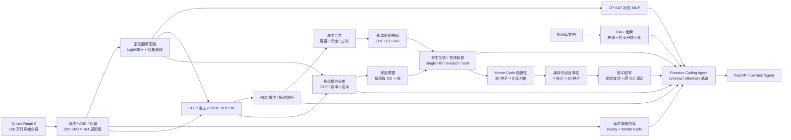

# 供应链智能体（Supply Chain Agent）

一个面向**电商仓配/履约算法**岗位的作品集项目：在自实现 RAG 管线与供应链工具链基础上，接入了公开真实交易数据、滚动回测框架、LightGBM 全局需求预测，以及**库存策略仿真 / 多周期补货 MILP / DC→门店分配 LP / 仓网选址 CFLP / 车辆路径 CVRP·VRPTW / 仓储槽位与拣选路径 / 多仓订单履约分单 / 波次拣选与订单合并 / 截单感知的波次释放排程 / 班中插单与在线波次释放 / 分单→逐 DC 拣选→在线释放的端到端联动 / 端到端 Monte Carlo 稳健性（置信区间 · 尾部风险 · 配对比较） / 库存布点执行风险反事实 / 班中回写恢复（锁定已开工波次 · 跨 DC 调拨未开工票据）**，并用 **LLM Function Calling** 把数据、预测、补货、报告与知识检索暴露为可校验、可审计的工具调用，附 12 用例 Agent 评测、15 条中文查询的检索质量评测、120 张真实发票的履约分单基准、200 张真实发票的波次拣选与 EDF/CP-SAT 排程基准、60/120/200 张发票的在线到达仿真基准，以及 400 张真实发票的端到端 OTIF 基准、30 种子 × 8 压力格的稳健性基准、4 种库存布点 × 30 种子的执行风险基准与 3 种布点 × 30 种子 × 4 压力格的班中回写基准。

## 诚实声明（先读这个）

这个项目**不是生产系统**，用之前请了解以下事实：

1. **数据来源分两层**——演示流程仍可用 `generate_realistic_data` 合成数据；需求预测、库存与仓配基准使用 UCI **Online Retail II** 真实交易数据（2009-12 至 2011-12，1,067,371 条；清洗后 1,014,625 行、4,707 个 SKU、104 个完整周），按销售额取 Top-200 SKU 聚合为周度面板。公开数据只有需求/价格/日历，**没有库存、提前期、仓网、车队、仓库布局、波次容量、拣选工时、履约时效、客户承诺与拣货员班次**；库存、网络、履约、波次与排程模块把这些全部放进显式假设层，并在报告中逐项标注“observed / assumed”。
2. **预测已从玩具模型升级为可回测的基线 + ML 模型**——支持 Naive、Seasonal Naive、MA(4/8)、Croston-SBA、Holt，以及单模型直接多步（direct multi-horizon）的全局 LightGBM；所有结果都在滚动起点（rolling-origin）回测下用 WMAPE/Bias/MAE/RMSE/RMSSE 评估。旧的 `ForecastEngine` 三模型集成仍保留给演示链路。
3. **Agent 已升级为 Function Calling 编排**——6 个工具以 JSON Schema 暴露，支持 OpenAI 兼容端点的原生 `tools/tool_calls` 循环；无 API Key 时回退到确定性规则规划器，演示与评测可离线复现。护栏包括工具 allowlist、参数 schema 校验、写操作开关与步数上限。但它仍不是长程自主规划：评测只有 12 个确定性用例，不代表模型在开放场景中的规划能力。
4. **Mock 嵌入只反映词汇重合**——无 API Key 时使用确定性词袋哈希向量（token 哈希到维度桶），检索按词汇重叠度排序，**无语义理解能力**（"库存"与"存货"不匹配）。配置 `OPENAI_API_KEY` 后自动切换真实嵌入。
5. **评估覆盖十二层，但仍是小样本**——预测有样本外滚动回测，库存有独立窗口的 replay + 300 条 Monte Carlo，Agent 有 12 用例的工具选择/参数/状态/引用正确性评测，检索有 15 条中文查询的 Recall@k/MRR 评测（含纯向量 vs 标题加权对比），履约分单有 120 张真实发票的贪心 vs MILP 对比（OTIF/满足率/拆单/成本），波次拣选有 200 张真实发票的按单/FCFS/节省算法/CP-SAT 对比（波次、行走距离、拣选工时），波次排程有同一批订单在 1/2/3 名拣货员下的 EDF vs CP-SAT 对比（准时率、迟到订单分钟、makespan/加班），在线释放有 60/120/200 张发票 × 5 种发波策略的班中到达仿真（准时率、等待、空闲产能、makespan），端到端联动有 400 张真实发票上 4 种分单 × 4 种释放策略 × 1/2/3 名拣货员的 OTIF/成本对比，端到端稳健性有 30 个到达种子 × 8 个压力格 × 3 种分单的 Monte Carlo（95% CI、P10/P90、最差 10% 均值、配对胜率），库存布点有 4 种 DC 库存占比 × 30 种子 × 4 压力格的反事实（每个布点重解分单，比较分单上界与端到端执行），班中回写有 3 种布点 × 30 种子 × 4 压力格 × 4 策略的两阶段重放（锁定已开工波次、同种子重放剩余班次，比较无回写 / 迟到调动 / 全队列再平衡 / 先知上界）；但检索语料只有 2 篇文档 / 34 个片段，标注是“最小必需片段”而非全量相关性判断，标题加权也只处理字面重合；履约的库存与时效是假设、MILP 在时间预算内返回可行解而非证明最优；波次的仓库布局、波次容量与拣选工时是假设，CP-SAT 只在候选池内证明最优；排程的承诺分层、截单时间、拣货员数量与目标权重同样是假设，CP-SAT 在时间预算内为 `FEASIBLE`；在线释放的班中到达时间、开班前到达占比与等待窗口是假设，离线参考只对同一条节省规则成立，不是跨规则下界；端到端的分单-拣选联动用“累计拣选分钟”线性代理接入 MILP，不是真实的波次仿真，且 CP-SAT 在 400 单上 gap 很大；稳健性只重抽样到达与拣选时长，分单/库存/槽位固定，尖峰与拥堵分布是声明值而非拟合值；布点反事实固定订单集与库存总量、只改 DC 占比，且每个布点重解 MILP，求解器差异会与布点效应混合；回写只调动审核时点后未开工的票据，投影为确定性 EDF，先知策略也只预知迟到集合，调拨前置时间/费用与库存随票据转移是声明假设，且不重新分单；真实模型下的 open-ended agent 评测仍待补（可用 `--planner openai` 单独跑，需 API Key）。

## 架构一览



数据侧全部来自公开交易或显式假设层；每个模块都有独立基准脚本与报告，Agent 只编排已有工具，不绕过参数校验与写操作开关。

## 功能

| 模块 | 能力 |
|---|---|
| 数据 | 模拟数据生成 / CSV·JSON 导入 / SQLite 持久化；Online Retail II 下载、清洗、ABC Top-N 周度面板 |
| 预测 | 滚动回测（WMAPE/Bias/RMSE/RMSSE）+ 6 个经典基线 + 全局 LightGBM 直接多步预测；SKU 级与仓库总量双口径 |
| 库存 | 显式假设层 + SKU 经济参数（EOQ/MOQ/安全库存）；（s,Q）/（R,S）/（s,S）三种策略的周度仿真、replay 与 300 路径 Monte Carlo（缺货率/周转/成本） |
| 补货优化 | OR-Tools CP-SAT 多 SKU × 多周期 MILP：提前期、MOQ、固定订货费、共享仓储/入库产能、缺货惩罚；支持完美信息与滚动时域（可选 z·σ 安全缓冲 API） |
| 仓配分配 | OR-Tools GLOP 运输 LP：2 DC × 8 门店 × SKU，DC 库存上限、门店收货容量、优先级加权缺货 |
| 仓网选址 | OR-Tools CP-SAT 容量约束选址（CFLP）：固定成本 + 运输成本、全开基线、固定成本敏感性 |
| 车辆路径 | OR-Tools CVRP/VRPTW + Clarke-Wright + 精确子集 DP；容量、车辆数、收货时间窗 |
| 仓储拣选 | ABC/随机槽位、return / S-shape / 最优 TSP 三种拣选路径、真实订单行 |
| 波次拣选 | 按单 / FCFS / Clarke-Wright 订单节省 / 候选池集合划分 CP-SAT；波次订单与行容量、行走距离、setup 与拣选工时、容量敏感性 |
| 波次排程 | 承诺分层（特快/标准/经济）+ 截单时间；同层节省合并、EDF 列表排程、并行拣货员 CP-SAT（迟到订单分钟 + makespan）、1/2/3 名拣货员敏感性 |
| 在线释放 | 班中到达过程（按承诺层的开班前占比 + 到达窗口）+ 事件驱动仿真：按单 / EDF 即时装满 / 节省重批 / 等待凑波 / 离线参考；准时率、等待、空闲产能、makespan，以及 60/120/200 订单负载与等待参数敏感性 |
| 履约分单 | 多 DC 订单-仓分配：CP-SAT（库存/产能/每单拆单上限/OTIF 权重）+ 时效优先贪心基线；输出 OTIF、订单/件数满足率、拆单率、迟到与成本拆分 |
| 端到端联动 | 分单结果拆成“每单每 DC”拣选票据 → 逐 DC 在线释放；端到端 OTIF = 整单满足 ∩ 承诺达标 ∩ 每张票据在 12:00/16:00/18:00 前完成；分单 MILP 可选累计拣选容量代理，并做释放策略与 1/2/3 名拣货员敏感性 |
| 稳健性 | 端到端 Monte Carlo：30 个到达种子 × 8 个压力格（均匀/尖峰到达、EDF/节省重批、拣选时长噪声 σ=0.25/0.40、加拣货员）× 3 种分单；输出 95% CI、P10/P50/P90、最差 10% 均值、超班次概率与配对胜率 |
| 库存布点 | 4 种 DC 库存占比（默认 / 均衡 / Rotterdam 偏重 / London 偏重）× 30 种子 × 4 压力格；每个布点重解拣选容量感知 MILP，比较分单上界、端到端 OTIF 分布、逐 DC 负载与加人后的排序反转 |
| 班中回写 | 审核时点锁定已开工波次 → 投影各 DC 剩余队列 → 跨 DC 调动未开工票据（无回写 / 迟到调动 / 全队列再平衡 / 先知上界）；库存随票据转移、调拨前置时间与费用、目标产能/时效校验；比较 OTIF、拣选准时、迟到分钟、makespan、调动票数与回写成本 |
| 报告 | 模板化决策报告 + 可选 LLM 执行摘要 + 预测/库存基准报告（Markdown/JSON/CSV） |
| 知识库 | 文档加载 → 分节切分 → 嵌入 → 向量检索 → 标题加权重排 → RAG 问答（返回来源/标题/检索分数引用） |
| Agent | 6 工具 Function Calling（JSON Schema）+ 原生 tool calling / 离线规则规划器 + allowlist / 参数校验 / 写操作开关 + 结构化引用 + 12 用例评测 |
| API | FastAPI：`/run` 决策流程、`/ask` 知识问答、`/agent` Function Calling、`/data` 数据操作 |
| 界面 | Streamlit：对话式 Agent、工具轨迹、引用表、只读开关（可选依赖） |

## 快速开始

环境要求：Python 3.9+（开发验证用 3.12/3.13）。

```bash
pip install -r requirements.txt

# 1) 下载公开数据并构建周度面板（首次约 45 MB，UCI 源较慢）
python scripts/prepare_data.py
#   已有 xlsx 时可跳过下载：
#   python scripts/prepare_data.py --xlsx data/raw/online_retail_II.xlsx

# 2) 跑滚动回测，输出 benchmarks/REPORT.md + summary/predictions
python scripts/run_backtest.py
#   只跑基线：python scripts/run_backtest.py --no-lgbm
#   调整窗口：python scripts/run_backtest.py --horizon 8 --folds 5

# 3) 跑库存/补货基准（策略仿真 + Monte Carlo + MILP + DC→门店分配）
PYTHONPATH=src;. python scripts/run_inventory_benchmark.py
#   小规模试跑：--sims 50 --milp-skus 5 --milp-weeks 8
#   跳过优化：--skip-milp --skip-allocation
#   输出：benchmarks/INVENTORY_REPORT.md + inventory_summary.json + inventory_policy_detail.csv

# 4) 跑仓网/路径/仓储基准
PYTHONPATH=src;. python scripts/run_network_benchmark.py
#   快速试跑：--orders 50 --routing-time 1 --location-time 2
#   输出：benchmarks/NETWORK_REPORT.md + network_summary.json

# 5) 跑多仓履约分单基准（真实订单 + 显式库存/时效假设）
PYTHONPATH=src;. python scripts/run_fulfillment_benchmark.py
#   快速试跑：--orders 60 --milp-time 5
#   输出：benchmarks/FULFILLMENT_REPORT.md + fulfillment_summary.json

# 6) 跑波次拣选基准（真实订单 + ABC 槽位 + 波次容量/工时假设）
PYTHONPATH=src;. python scripts/run_wave_benchmark.py
#   快速试跑：--orders 60 --milp-time 5 --skip-sensitivity
#   输出：benchmarks/WAVE_REPORT.md + wave_summary.json

# 7) 跑截单感知的波次释放排程（分层合并 + EDF / CP-SAT + 拣货员敏感性）
PYTHONPATH=src;. python scripts/run_wave_schedule_benchmark.py
#   快速试跑：--orders 60 --schedule-time 3 --skip-sensitivity
#   输出：benchmarks/WAVE_SCHEDULE_REPORT.md + wave_schedule_summary.json

# 8) 跑班中插单与在线波次释放（订单到达 + 事件驱动仿真 + 负载/等待敏感性）
PYTHONPATH=src;. python scripts/run_dynamic_wave_benchmark.py
#   快速试跑：--orders 60 --loads 60 --tuning-waits 0 15 --tuning-fills 4 6
#   输出：benchmarks/DYNAMIC_WAVE_REPORT.md + dynamic_wave_summary.json

# 9) 跑端到端履约联动（分单 → 逐 DC 拣选票据 → 在线释放）
PYTHONPATH=src;. python scripts/run_e2e_benchmark.py
#   快速试跑：--orders 100 --milp-time 5 --workers 4 --pickers 1 --picker-sweep 2
#   输出：benchmarks/E2E_REPORT.md + e2e_summary.json

# 10) 跑端到端稳健性（30 种子 × 8 压力格 × 3 分单的 Monte Carlo）
PYTHONPATH=src;. python scripts/run_e2e_robustness.py
#   快速试跑：--orders 80 --seeds 3 --milp-time 5 --workers 4
#   输出：benchmarks/E2E_ROBUSTNESS_REPORT.md + e2e_robustness_summary.json

# 11) 跑库存布点执行风险（4 布点 × 30 种子 × 4 压力格）
PYTHONPATH=src;. python scripts/run_e2e_deployment.py
#   快速试跑：--orders 80 --seeds 2 --milp-time 3 --service-time 2 --plans baseline,balanced
#   输出：benchmarks/STOCK_DEPLOYMENT_REPORT.md + stock_deployment_summary.json

# 12) 跑班中回写恢复（3 布点 × 30 种子 × 4 压力格 × 4 策略）
PYTHONPATH=src;. python scripts/run_e2e_recovery.py
#   快速试跑：--orders 80 --seeds 2 --milp-time 3 --service-time 2 --placements baseline,balanced --skip-review-sweep
#   输出：benchmarks/RECOVERY_REPORT.md + recovery_summary.json

# 13) 一键演示：数据→预测→库存→报告→RAG→Function Calling（无需 API Key）
PYTHONPATH=src;. python scripts/demo.py        # Windows
PYTHONPATH=src:. python scripts/demo.py        # Linux/macOS

# 14) Agent 评测（12 个确定性用例：工具选择/参数/护栏/引用）
PYTHONPATH=src;. python scripts/run_agent_eval.py
#   输出：benchmarks/AGENT_REPORT.md + agent_summary.json
#   真实模型评测：python scripts/run_agent_eval.py --planner openai

# 15) 检索评测（15 条查询：纯向量 vs 标题加权；Recall@1/3/5 + MRR）
PYTHONPATH=src;. python scripts/run_retrieval_eval.py
#   输出：benchmarks/RETRIEVAL_REPORT.md + retrieval_summary.json
#   真实嵌入：python scripts/run_retrieval_eval.py --embeddings openai

# 16) 测试（十七件套；UI 项需 streamlit，未安装会自动跳过）
PYTHONPATH=src;. python tests/quick_test.py
PYTHONPATH=src;. python tests/test_rag.py
PYTHONPATH=src;. python tests/test_comprehensive.py
PYTHONPATH=src;. python tests/test_supply.py
PYTHONPATH=src;. python tests/test_forecasting.py
PYTHONPATH=src;. python tests/test_inventory.py
PYTHONPATH=src;. python tests/test_network.py
PYTHONPATH=src;. python tests/test_fulfillment.py
PYTHONPATH=src;. python tests/test_wave.py
PYTHONPATH=src;. python tests/test_wave_schedule.py
PYTHONPATH=src;. python tests/test_dynamic_wave.py
PYTHONPATH=src;. python tests/test_e2e.py
PYTHONPATH=src;. python tests/test_e2e_robustness.py
PYTHONPATH=src;. python tests/test_e2e_deployment.py
PYTHONPATH=src;. python tests/test_e2e_recovery.py
PYTHONPATH=src;. python tests/test_function_agent.py
PYTHONPATH=src;. python tests/test_ui_smoke.py

# 16) API 服务
PYTHONPATH=src;. uvicorn app.main:app --reload --port 8000
# 文档: http://localhost:8000/docs

# 17) 交互界面（可选）
pip install "streamlit>=1.49"
streamlit run app/streamlit_app.py
# 浏览器打开 http://localhost:8501
```

### 接入真实 LLM（OpenAI 兼容端点）

设置环境变量即可，代码零改动；未设置时自动走 Mock：

```bash
# OpenAI
export OPENAI_API_KEY=sk-xxx

# DeepSeek（或任何 OpenAI 兼容服务）
export OPENAI_API_KEY=sk-xxx
export OPENAI_BASE_URL=https://api.deepseek.com
export LLM_MODEL=deepseek-chat
```

## 需求预测基准（Online Retail II）

**数据与清洗**：剔除取消单（`C` 开头）、非商品编码（POST/D/M 等）、非正数量/价格，以及两张年度表重叠期的重复行（22,252 条），得到 1,014,625 行、4,707 个 SKU；只保留完整自然周（周一为周起点），补零成 `SKU × 104 周` 面板。按销售额做 ABC 分析，保留 Top-200（至少 26 个非零周）。

**任务设定**：4 折滚动起点回测，每折预测未来 13 周；首折训练 52 周，后续递增。SKU 若在某折训练窗口内非零周数 < 13，则不进入该折评估（新品上市应走独立流程）。

**防泄漏**：滞后/滚动特征整体 shift 1 周；SKU 统计量使用截至当前周的扩展窗口（前 52 周封顶）；同周去年锚点（`target_week − 51/52/53 周`）只在训练中有覆盖时才启用；目标周日历特征（周序、月份、Q4、距圣诞周数）是确定性的。

**指标**：WMAPE/Bias 按需求量加权；RMSE/RMSSE 按行/序列汇总；RMSSE 使用 M5 的季节朴素尺度。

**结果（2026-10-27 实测，200 SKU / 104 周 / 4 折 × 13 周）**：

| 模型 | SKU 级 WMAPE | Bias | 仓库周度总量 WMAPE |
|---|---|---|---|
| LightGBM（全局直接多步） | **73.34%** | +8.53% | 31.93% |
| MA(8) | 80.68% | +8.27% | 39.51% |
| Croston-SBA | 83.02% | +11.73% | 29.66% |
| MA(4) | 85.22% | +15.10% | 45.09% |
| Seasonal Naive | 86.75% | +2.13% | **21.08%** |
| Naive | 89.44% | +0.30% | 53.27% |
| Holt | 97.10% | +30.84% | 50.05% |

**怎么读这张表**：

- **SKU 级（补货口径）**：LightGBM 比 Naive 低 18%（73.3% vs 89.4%），比 MA(8) 低 9%。
- **仓库总量（仓容/人力口径）**：把 200 个 SKU 的周需求加总，SKU 级误差部分抵消；Seasonal Naive 21.1% 最好，LightGBM 31.9%。两个口径服务不同决策，不能只看一个数。
- **绝对误差偏高的原因**：这是批发商的周度销售，17.96% 的 SKU-周需求为 0，且 2010-11 至 2011-01 有明显旺季断层。首折测试窗口（2010-12 至 2011-02）正好跨圣诞，Seasonal Naive 靠“去年同周”锚点最稳；第二折 LightGBM 略逊于 MA(8)（67.4% vs 64.7%），第三、四折 LightGBM 领先（63.9% / 56.4%）。
- **下一步动机**：预测窗口跨已知需求断层时，用季节锚点兜底、常规周用 ML 模型，比单模型更合理。

完整结果（Overall、仓库总量、按预测步长、按折、特征重要性、训练耗时）见 [`benchmarks/REPORT.md`](benchmarks/REPORT.md)。重新生成：

```bash
python scripts/prepare_data.py && python scripts/run_backtest.py
```

## 库存与补货优化基准（Week 2）

**评估设计**：用前 52 周估计 SKU 经济参数，最后 52 周（2010-12-06 → 2011-11-28）做样本外评估。200 个 SKU 中 175 个满足“历史非零周 ≥ 13 且周均需求 ≥ 1”，其余 25 个（新品/长尾/停售）不进入库存评估，避免用没有历史的需求去评价补货策略。预测同时跑 Seasonal Naive 与 Week-1 LightGBM 的样本外结果，默认用 LightGBM。

**显式假设层**（公开数据没有这些字段，全部可配置）：

| 参数 | 取值 | 说明 |
|---|---|---|
| 提前期 | 3 周 | 另做 2/4/6 周敏感性 |
| 目标周期服务水平 | 95% | 业务输入，不是优化结果；另做 80%–99% 扫描 |
| 持有成本 | 单位成本的 22%/年 | |
| 单次订货成本 | €75 | |
| 单位成本 | 售价的 60% | 隐含 40% 毛利 |
| 缺货成本 | 丢失毛利 × 1.0 | |
| 初始库存 | 3 周需求 | 按评估窗口首周预测计算 |
| MOQ | 0.5 周需求，最低 1 件 | |
| 复核周期 | 2 周 | 仅 (R,S) / (s,S) 使用 |
| Monte Carlo | 300 条路径，seed 42 | 零膨胀对数正态，情景均值 = 预测 |

**预测质量（175 SKU 评估子集）**：LightGBM WMAPE **74.18%**、bias **+11.77%**；Seasonal Naive 85.72%、+9.20%。与 Week-1 的 200 SKU 全量结果（73.34% / +8.53%）略有差异，原因是这里只保留有足够历史、均值 ≥ 1 的 SKU。Bias 定义为 `Σ(预测−实际)/Σ实际`，正值表示整体高估。

**策略对比（52 周 replay，单条真实需求路径）**：

| 策略 | Fill rate | SKU-周有货率 | 平均库存 | 年化周转 | 总成本 | 单位成本 |
|---|---|---|---|---|---|---|
| (s, Q) 连续补货 | **93.30%** | 95.51% | 241,424 | 5.65 | **258,764** | 0.190 |
| (R, S) 周期补货 | 91.57% | 94.40% | 141,844 | 9.44 | 481,359 | 0.360 |
| (s, S) 最小-最大 | 89.06% | 92.31% | 126,211 | 10.32 | 372,748 | 0.286 |

300 条 Monte Carlo 路径下，Fill rate 均值分别为 **91.65% / 90.21% / 88.15%**，P5–P95 区间约 2.5–3 个百分点；(s,Q) 同时给出最高的 fill 与最低的总成本，是本数据集上的强基线。

**多周期补货 MILP（OR-Tools CP-SAT）**：取历史均值最大的 20 个 SKU × 13 周，约束包括提前期、MOQ、固定订货费、共享仓储（5× 周均需求）与入库吞吐（3× 周均需求），目标为持有 + 订货 + 缺货成本。

| 方法 | Fill rate | 总成本 | 单位成本 | 年化周转 | 订货次数 | 求解时间 |
|---|---|---|---|---|---|---|
| 策略 (s, Q)（同一窗口） | 85.16% | **15,350** | 0.124 | 8.10 | 35 | — |
| 策略 (R, S) | 85.69% | 21,125 | 0.170 | 17.36 | 140 | — |
| 策略 (s, S) | 82.87% | 18,961 | 0.158 | 18.38 | 82 | — |
| MILP：滚动时域（点预测） | 76.97% | 21,083 | 0.189 | 17.98 | 45 | 52.9 s |
| MILP：完美信息（上界） | **93.17%** | **7,887** | 0.058 | 21.46 | 33 | 43.6 s |

**怎么读**：

- 完美信息与滚动时域的差距（93.2% vs 77.0%）主要来自**预测误差**，不是求解器：同一份真实需求下，完美信息能把总成本压到 (s,Q) 的约一半（7,887 vs 15,350）。
- 滚动 MILP 在本窗口**同时输给**规则策略：它直接按点预测规划，没有为预测误差备货；而共享仓储/入库吞吐是硬约束，MOQ 与固定订货费又限制了小批量补货。结果是缺货成本高于 (s,Q)，fill 也更低。这不是求解器质量问题，而是"点预测 + 确定性优化"缺少安全库存层。
- 带 `z·σ` 缓冲的滚动变体作为 API 保留（`rolling_horizon(..., safety_stock=...)`），但没有放进主表：在 13 周 × 20 SKU 的硬容量下，缓冲计划多次不可行（回退到无缓冲仍受容量约束），结果随求解预算漂移，不适合作为可复现的基准数字。
- 共享入库吞吐在旺季接近打满（滚动 97.0%，完美信息 99.7%），仓储峰值约 84%，说明约束确实在起作用。
- 求解用单 worker + 固定 seed + CP-SAT **确定性时间预算 10**，重跑计划与成本一致；表中求解时间是 wall-clock 耗时，会随机器负载波动（本次 52.9 s / 43.6 s）。结果仍是"预算内最优可行解"，不是已证明的最优解，加大预算可能改变计划。

**DC → 门店分配（OR-Tools GLOP）**：2 个 DC × 8 个门店 × SKU；DC 总库存覆盖 90% 门店需求，门店收货容量为自身需求的 95%，优先级按门店分层（1.6 / 1.0 / 0.6）。

| 场景 | Fill rate | 运输成本 | 缺货成本 | 总成本 |
|---|---|---|---|---|
| 无约束（成本下界） | 100.00% | 2,889 | 0 | 2,889 |
| 容量约束，等权重 | 90.00% | 3,238 | 22,493 | 25,732 |
| 容量约束，优先级加权 | 90.00% | 3,277 | **20,767** | **24,044** |

优先级不改变物理可供量（fill 都是 90%），但把短缺从高优先级门店转移到低优先级门店，缺货成本下降约 7.7%。线性目标会把短缺集中到某个低优先级门店（示例中 S7 为 0%），这是模型的已知行为，不是推荐策略；生产系统应加每店最低服务水平约束。

完整结果与假设表见 [`benchmarks/INVENTORY_REPORT.md`](benchmarks/INVENTORY_REPORT.md)。重新生成：

```bash
PYTHONPATH=src;. python scripts/run_inventory_benchmark.py
```

## 仓网、路径与仓储基准（Week 3）

**数据与假设**：沿用同一份 Top-200 面板，取最后 52 周（2010-12-06 → 2011-11-28）的年化单位需求；按国家聚合的真实需求覆盖 14 个国家、**97.44%** 的选定单位。订单行来自面板最后完整周 `2011-11-28`（200 张发票、5 条中位行数、179 个 SKU）。国家坐标、候选仓、运输费率、门店位置、车队与仓库布局都是假设，集中在 `src/supply/network/instances.py` 一处声明：

| 参数 | 取值 | 说明 |
|---|---|---|
| 国家坐标 | 20 个欧洲国家近似质心 | 仅用于构造运输距离 |
| 候选仓 | 8 个欧洲城市，容量 40–100 万 units/年 | 年固定成本 €19–38 万 |
| 运输成本 | €0.00018 / unit / road-km，道路系数 1.25 | |
| 门店网络 | 8 个门店，份额 28/19/14/11/9/7/6/6% | 周需求来自真实周篮子 |
| 车队 | 4 辆，容量 10,950 units，40 km/h | 20 min 服务、480 min 时窗 |
| 仓库布局 | 8 巷道 × 16 货位 × 2 侧 = 256 槽位 | bay 1.2 m，巷道间距 2.5 m |

**CFLP 选址（OR-Tools CP-SAT，整数单位流）**：

| 方法 | 状态 | 开放仓 | 固定成本 | 运输成本 | 总成本 | 平均陆运 km |
|---|---|---|---|---|---|---|
| 全部开放 + 最近分配 | HEURISTIC | 8 | 2,220,000 | 84,311 | 2,304,311 | 273 |
| CFLP 最优 | OPTIMAL | 2 | 710,000 | 150,315 | **860,315** | 486 |

CFLP 只保留 **London + Rotterdam**，年成本比全开方案低 **62.66%**。London 满载 100 万 units，Rotterdam 用掉 89.68% 容量。代价是平均陆运里程从 273 km 升到 486 km、运输成本增加约 6.6 万——但省下 151 万固定成本，在本假设下是明显的净收益。这个结论高度依赖“英国需求占 86.7%”这一真实分布，以及固定成本假设，所以同时做了敏感性：

| 固定成本倍率 | 开放仓 | 总成本 | 开放方案 |
|---|---|---|---|
| 0.25x | 3 | 318,168 | London, Manchester, Warsaw |
| 0.5x | 2 | 505,315 | London, Rotterdam |
| 1x | 2 | **860,315** | London, Rotterdam |
| 2x | 2 | 1,570,315 | London, Rotterdam |
| 4x | 2 | 2,990,315 | London, Rotterdam |

固定成本很低时，多开 Manchester/Warsaw 能把运输成本从 150,315 降到 110,668；在 0.5x–4x 区间，2 仓方案稳定占优。这不是“真实最优仓网”，而是把开放/关闭的权衡显式化。

**车辆路径（CVRP / VRPTW）**：

| 方法 | 距离 km | 车辆 | 最大装载 | 路径分钟 | 可行 |
|---|---|---|---|---|---|
| 每店一车 | 544.8 | 8 | 9,491 | 977 | 否（只有 4 车） |
| Clarke-Wright 节约法 | 365.3 | 4 | 9,491 | 708 | 是 |
| 精确子集 DP | 365.3 | 4 | 9,491 | 708 | 是 |
| OR-Tools CVRP | 365.3 | 4 | 9,491 | 708 | 是 |
| OR-Tools CVRP + 时间窗 | 413.4 | 4 | 10,508 | 780 | 是 |

精确 DP 与 OR-Tools 在 365.335 km **完全一致**，说明建模没有漏约束；Clarke-Wright 在这个 8 门店实例上也恰好达到同一解，所以“局部搜索的增量”在这里是 0，真正有价值的是相对每店一车的合并（544.8 → 365.3，且 4 车可行）。加入两小时收货时窗后，距离上升 **13.2%** 到 413.4 km，最大装载升到 10,508 units，说明时窗约束确实在改变路径结构。

**仓储槽位与拣选**（200 张真实发票，ABC 按 52 周速度排序）：

| 槽位策略 | return m | S-shape m | optimal m | return 节省 | optimal 节省 |
|---|---|---|---|---|---|
| random | 122.7 | 120.4 | 90.6 | — | — |
| ABC | **87.4** | 116.5 | **79.7** | **28.75%** | **12.02%** |

ABC 把高频 SKU 放到 1–2 号货位、离发货口 2.5–3.6 m，return 拣选距离下降 28.75%；在最优 TSP 路径下仍有 12.02% 的节省，说明槽位本身就是大头。S-shape 在这个场景反而更差：平均 6.3 行分散在 256 个槽位里，整条巷道穿越带来大量空走；它更适合密集拣选。

完整结果（逐仓吞吐、国家需求、敏感性与逐车路径）见 [`benchmarks/NETWORK_REPORT.md`](benchmarks/NETWORK_REPORT.md)。重新生成：

```bash
PYTHONPATH=src;. python scripts/run_network_benchmark.py --orders 200 --routing-time 2 --location-time 5
```

## Agent、护栏与评估（Week 4）

**工具契约**：6 个工具以 JSON Schema 声明参数、类型和上下界，模型只能调用这些工具；写操作单独标记，便于按请求收紧权限。

| 工具 | 参数 | 写操作 | 说明 |
|---|---|---|---|
| `get_data_stats` | — | 否 | 产品 / 需求 / 预测 / 订单计数 |
| `generate_data` | `weeks` 4–520，`products` 1–26 | 是 | 生成模拟周度需求（重置旧数据，避免脏产品残留） |
| `forecast_demand` | `horizon` 1–52 | 是 | 需求预测并写入预测表 |
| `plan_inventory` | `horizon` 1–52 | 是 | 安全库存 / 目标库存 / EOQ → 订单表 |
| `build_report` | — | 否 | 汇总预测与补货建议的 Markdown 报告 |
| `search_knowledge` | `question` 必填，`top_k` 1–10 | 否 | RAG 检索，返回来源 / 标题 / 检索分数引用 |

**两种规划器，同一套执行与护栏**：

- `openai`：调用 `chat.completions` 原生 `tools/tool_calls`，把助手消息与工具结果回填为 `tool` 消息，最多 8 步；配置 `OPENAI_API_KEY` 即启用（兼容 DeepSeek/Moonshot/vLLM 等端点）。
- `rules`：无 Key 时的确定性规划器，按中英文分号 / 换行 / “然后”切分意图，用正则抽取周数、产品数和 horizon。它只负责“选工具 + 填参数”，执行、校验、拦截和 trace 与 LLM 路径完全共用，因此评测可离线复现。

**护栏与可审计性**：

| 层 | 行为 |
|---|---|
| allowlist | 未注册工具直接拒绝，不进入执行 |
| 参数校验 | 类型 / 必填 / 上下界 / `additionalProperties`；`weeks=9999` 在边界被拦 |
| 写操作开关 | `allow_writes=false` 时 `generate_data`/`forecast_demand`/`plan_inventory` 被拦 |
| 危险意图 | 删除、清空、SQL、shell、`rm -rf` 等在任何工具执行前拒绝 |
| 步数上限 | `max_steps` 防止规划死循环 |
| 引用约束 | 知识类回答必须带检索引用，且 top-1 引用需命中期望片段；没有引用时明确说明“未检索到可引用内容” |
| 执行轨迹 | 每步记录工具名、参数、状态（success/blocked/error）与拦截原因 |

**评测结果（12 个确定性用例，离线规则规划器）**：

| 指标 | 结果 |
|---|---|
| 通过率 | **12/12（100%）** |
| 工具选择准确率 | **100%** |
| 参数准确率 | **100%** |
| 状态判定准确率 | **100%** |
| 引用覆盖率 | **100%**（2 个知识用例均带引用） |
| 引用正确率 | **100%**（2 个知识用例的 top-1 引用均命中期望片段） |
| 护栏用例 | **3/3 全部拦截**（删除、SQL、非法参数） |

用例覆盖单工具（统计 / 生成 / 预测 / 补货 / 报告 / 知识）、多步组合（统计→知识、生成→预测）、三种拦截（破坏性请求、SQL、非法参数）和无匹配输入。引用正确性要求知识类回答的 top-1 引用标题包含期望片段（如“安全库存（Safety Stock）”），而不只是“有引用”。**这组数字衡量的是编排、schema 校验、检索落地与护栏，不是模型质量分数**；真实模型请单独跑 `--planner openai`，结果依赖模型且会产生 token 成本。

**交互界面（Streamlit，可选）**：`streamlit run app/streamlit_app.py` 提供浏览器界面，包含对话式 Agent、状态 / 规划器 / 步数指标、逐步工具轨迹表、引用来源表，以及“允许写操作 / 最大步数”侧边栏开关和数据库概况。关闭写操作后，生成 / 预测 / 补货会被护栏直接拦截并显示原因。界面与 API 共用同一个 `FunctionCallingAgent`，写操作会持久化到 `data/supply_chain.db`。另有 `tests/test_ui_smoke.py`，用 Streamlit `AppTest` 在无浏览器环境下验证页面渲染、引用表与只读拦截。

**API 调用示例**：

```bash
curl -X POST http://localhost:8000/agent \
  -H "Content-Type: application/json" \
  -d '{"prompt": "生成 8 周、3 个产品的数据，再预测未来 6 周", "use_llm": false}'
```

响应包含 `status`（success / blocked / error / no_match）、`answer`、`planner`、`steps`、逐步 `tool_calls`（工具名 / 参数 / 状态）、`citations` 与 `blocked` 原因；`/ask` 也同步返回结构化 `citations`。

**Docker**：

```bash
docker compose up --build
# 或
docker build -t supply-chain-agent . && docker run -p 8000:8000 supply-chain-agent
```

容器内 `PYTHONPATH=/app/src:/app`，`data/` 通过 volume 挂载；未注入 `OPENAI_API_KEY` 时 Agent 自动走规则规划器，`/agent` 可直接调用。Streamlit 是可选本地依赖，未打包进默认镜像。

完整用例表、护栏说明与局限见 [`benchmarks/AGENT_REPORT.md`](benchmarks/AGENT_REPORT.md)。重新生成：

```bash
PYTHONPATH=src;. python scripts/run_agent_eval.py
```

**检索质量评测（15 条中文查询）**：知识库为 2 篇文档、按标题切成 34 个片段。每条查询标注“回答该问题所必需的最少片段”，用标题子串匹配计算 Recall@k 与 MRR。默认走离线 Mock 词袋嵌入，结果可复现；评测同时跑纯向量基线与标题加权重排：

| Retriever | Recall@1 | Recall@3 | Recall@5 | MRR@5 |
|---|---|---|---|---|
| 纯向量（Mock 词袋） | 86.7% | 90.0% | 100.0% | 0.917 |
| + 标题加权重排（boost=0.3） | **96.7%** | **96.7%** | **100.0%** | **1.000** |

这组对比是“先评测、再改进”的闭环。纯向量基线里，“安全库存怎么计算”只排第 4，前 3 是“服务水平 / 再订货点 / 库存管理”——“服务水平”片段同样反复出现“安全库存”，词袋无法区分它在讲哪个概念。标题里直接包含“安全库存”的片段经词重合加分后排到 **第 1**；“供应商选择要看哪些指标”的相关片段也从第 2 升到第 1。标题加权只加一个词法信号（查询词与首行标题的重合比例），不改变嵌入或语料。

仍有边界：供应商查询标注了两个相关片段，top-3 只覆盖其中一个，所以该条 Recall@3 为 0.5；标题加权对“同义改写”无效，真实语义检索请跑 `--embeddings openai`。作为参照，34 个片段随机取 3 个的期望 Recall@3 约 3/34 ≈ **8.8%**。`--title-boost 0` 可复现纯向量基线。

指标函数（Recall@k / MRR / 命中率）与标题加权检索器分别在 `src/rag/evaluation.py`、`src/rag/retrievers/title_boost.py`，用例集与标注校验有测试覆盖。完整逐条结果见 [`benchmarks/RETRIEVAL_REPORT.md`](benchmarks/RETRIEVAL_REPORT.md)。

## 多仓履约分单基准（Week 5）

**实例**：取面板最后完整周 `2011-11-28` 的 **120 张真实发票**当作订单（542 行、8,771 units、155 个 SKU），目的国当作收货地，配 3 个 DC（London / Rotterdam / Frankfurt）。库存覆盖需求的 **85%**，按 34/28/38 分配并叠加每 SKU 的确定性偏斜；DC 周产能为总件数的 55/40/35%。承诺分层为 2 天 30% / 3 天 50% / 5 天 20%，转运 = 1 天处理 + ceil(road km / 700)，实际落在 **2–5 天**。库存、产能、时效与费率都是显式假设，逐项写在 [`src/supply/fulfillment/instances.py`](src/supply/fulfillment/instances.py)：

| 参数 | 取值 | 说明 |
|---|---|---|
| 订单 | 120 张真实发票、542 行、8,771 units | 行数量与 SKU 组合来自交易数据 |
| DC 库存 | 需求的 85%，34/28/38 分配 + SKU 偏斜 | 制造 SKU×DC 错配 |
| DC 产能 | 总件数的 55/40/35% | 周吞吐上限 |
| 转运 | 1 天处理 + ceil(road km / 700) | 2–5 天 |
| 承诺 | 2 天 30%、3 天 50%、5 天 20% | 发票级 SLA 假设 |
| 运输成本 | road km × €0.0006 / unit + 每仓 handling | |
| 固定发运费 | €25 / shipment | 拆单的直接代价 |
| 惩罚 | 迟到 €0.35 / unit / day；缺货 €6 / unit | |

**方法**：贪心基线按承诺最紧优先，先找能整单满足的准时 DC，没有再按“准时 → 便宜”拆到最多 2 个 DC；MILP 用 CP-SAT 做行级整数分配，约束 DC 库存、周产能与每单最多 1/2 个 DC，目标含运输、固定发运费、按件天迟到惩罚与缺货惩罚，可选订单级 OTIF 奖励。

| 方案 | 件数满足 | 整单满足 | OTIF | 拆单率 | 发运数 | 运输 | 固定 | 迟到 | 缺货 | 总成本 |
|---|---|---|---|---|---|---|---|---|---|---|
| 贪心（时效优先） | 61.18% | 32.50% | 25.00% | 70.00% | 204 | 2,089 | 5,100 | 151 | 20,430 | 27,770 |
| MILP，每单最多 1 仓 | 47.04% | 14.17% | 12.50% | 0% | 119 | 1,710 | 2,975 | 50 | 27,870 | 32,606 |
| MILP，每单最多 2 仓 | 67.88% | 15.00% | 15.00% | 79.17% | 212 | 2,726 | 5,300 | 106 | 16,902 | **25,034** |
| MILP，2 仓 + OTIF 权重 | **69.29%** | 32.50% | **30.83%** | 89.17% | 224 | 2,825 | 5,600 | 132 | 16,164 | **24,721** |

> 固定发运费与发运数按“订单 × DC”计（Week 9 统一了评估口径与 MILP 目标），因此与早期版本按“行 × DC”计的数字不同；历史报告已同步重跑。

**怎么读这组结果**：

1. **成本优先 MILP** 把总成本从 27,770 降到 **25,034**（-9.9%），件数满足率从 61.2% 提到 67.9%，但 OTIF 只有 15%——目标只按件惩罚，模型愿意把订单拆开、让少部分件迟到，整单口径就掉了。
2. **服务优先 MILP** 在同一套约束上给每张订单加 OTIF 奖励并放大迟到权重：OTIF 从 25.0% 提到 **30.8%**，件数满足 **69.3%** 高于贪心的 61.2%，总成本 24,721，比贪心低 11.0%。这不是“免费提升”，而是把 SLA 权重显式化后的服务/成本前沿。
3. **不允许拆单**时件数满足只剩 47.0%：库存按 SKU 分散在 3 个仓，多行订单很难落在同一个仓。“允许拆几单”本身是业务决策，不是算法细节。
4. **85% 的库存只换来 69% 的件数满足**，差额来自 SKU×DC 错配与产能约束——把库存放对位置和把库存放够同样重要。
5. 迟到集中在 2 天承诺层（367 units），5 天层为 0，3 天层仅 9 units；OTIF 的上限主要由整单满足率和 2 天层的库存位置决定。

MILP 在 25s / 单 worker 下返回 `FEASIBLE`，不是证明最优；报告同时保留 solver bound。逐单差异、分承诺时效与各仓负载见 [`benchmarks/FULFILLMENT_REPORT.md`](benchmarks/FULFILLMENT_REPORT.md)。重新生成：

```bash
PYTHONPATH=src;. python scripts/run_fulfillment_benchmark.py
# 快速试跑：--orders 60 --milp-time 5
```

## 波次拣选与订单合并基准（Week 6）

**实例**：取面板最后完整周 `2011-11-28` 的 **200 张真实发票**（1,269 行、18,748 units、179 个 SKU），沿用 Week 3 的 ABC 槽位落到 8 aisle × 16 bay × 2 side 的仓库。波次容量、行走速度、拣选与 setup 工时都是显式假设，逐项写在 [`src/supply/wave/instances.py`](src/supply/wave/instances.py)：

| 参数 | 取值 | 说明 |
|---|---|---|
| 订单 | 200 张真实发票、1,269 行、18,748 units | 订单行与 SKU 组合来自交易数据 |
| 槽位 | ABC，8×16×2 = 256 槽 | Week 3 的 slotting 结果 |
| 波次容量 | 8 单 / 40 行 | 拣选车/周转箱容量假设 |
| 行走速度 | 72 m/min | 1.2 m/s，带车步行 |
| 拣选工时 | 0.35 min/行 + 0.02 min/unit | 假设 |
| 波次 setup | 3 min/波 | 释放、周转箱上线 |
| 人工成本 | 0.45 /min | 全负荷人工费率 |

**方法**：按单拣选作为基线；FCFS 按合成到达顺序填满波次；Clarke-Wright 订单节省在“合并后 return 路径更短”时合并订单，并受单数/行数上限约束；CP-SAT 在候选池（单订单、高节省订单对、多组随机节省解）上做集合划分，目标为行走分钟 + 波次 setup。候选池由节省解构造，并且把节省解作为 hint 注入，因此求解结果不会劣于启发式。

| 方案 | 波次 | 单/波 | 行/波 | 每单行走 | 行走节省 | 单均工时 | 工时节省 | 单/工时 | 成本 |
|---|---|---|---|---|---|---|---|---|---|
| 按单拣选 | 200 | 1.0 | 6.3 | 87.4 m | 0% | 8.31 min | 0% | 7.2 | 748 |
| FCFS 波次 | 37 | 5.4 | 34.3 | 36.5 m | 58.3% | 5.16 min | 37.9% | 11.6 | 464 |
| 节省算法波次 | 36 | 5.6 | 35.2 | 28.6 m | 67.3% | 5.03 min | 39.4% | 11.9 | **453** |
| 集合划分 CP-SAT | 36 | 5.6 | 35.2 | 28.6 m | 67.3% | 5.03 min | 39.4% | 11.9 | **453** |

**容量敏感性**（同一批订单，收紧波次容量后重跑；MIP 预算 8s）：

| 容量（单/行） | 节省波次 | MIP 波次 | 波次变化 | 节省单均工时 | MIP 单均工时 | 工时变化 | MIP 状态 |
|---|---|---|---|---|---|---|---|
| 8/25 | 53 | 53 | 0 | 5.420 | 5.420 | 0.00% | FEASIBLE |
| 4/19 | 74 | 71 | -3 | 5.872 | 5.822 | -0.86% | FEASIBLE |
| 3/19 | 81 | 75 | -6 | 6.000 | 5.903 | -1.62% | FEASIBLE |

**怎么读这组结果**：

1. **合并订单的收益主要来自行走与 setup**：200 个订单按单拣选要走 87.4 m/单、付 200 次 3 分钟 setup；合并成 36 波后行走降到 28.6 m/单（**-67.3%**），单均工时从 8.31 降到 5.03 分钟（**-39.4%**），每小时可处理订单从 7.2 提到 11.9。这里拣选时间本身不变，差异全部来自路径与波次管理。
2. **FCFS 不够**：同样 37 波，FCFS 的每单行走是 36.5 m，比按槽位邻近合并的 28.6 m 高 28%。波次释放需要合并规则，不能只按到达顺序装满。
3. **CP-SAT 在宽松容量下证明了节省解已最优**：主场景 2,516 个候选波次，`OPTIMAL`、gap 0。这不是“求解器一定更强”，而是说明 Clarke-Wright 在这个规模上已经接近候选池最优；把它作为生产基线是合理的。
4. **容量收紧后求解器才有重排空间**：3 单/19 行时，节省算法产生 81 波，CP-SAT 压到 75 波，单均工时从 6.000 降到 5.903 分钟；4 单/19 行时 74→71 波（-0.86%）。当行容量成为瓶颈时，启发式的贪心合并会留下碎片，集合划分能重新打包。
5. **setup 与容量是对冲的**：只按 8 单/波算，波次下界是 25；但 1,269 行 / 40 行上限把下界抬到 32，实际 36 波。行容量与拣选路径阻止无限合并，波次容量不是免费的旋钮，必须和拣选区容量一起调。

主场景 CP-SAT 在 15s 内返回 `OPTIMAL`（候选池口径）；敏感性场景在 8s 内均为 `FEASIBLE`，换机器或重跑可能落在不同可行解上。逐波明细、最大波次构成与完整假设见 [`benchmarks/WAVE_REPORT.md`](benchmarks/WAVE_REPORT.md)。重新生成：

```bash
PYTHONPATH=src;. python scripts/run_wave_benchmark.py
# 快速试跑：--orders 60 --milp-time 5 --skip-sensitivity
```

## 波次释放排程与截单时间基准（Week 7）

**实例**：直接复用 Week 6 的 200 张真实发票与 36 个全量合并波次，给每张发票加一层**承诺/截单假设**（特快 20% 截单 12:00、标准 50% 截单 16:00、经济 30% 截单 18:00，按种子随机分配），并假设 08:00 开班、2 名同质拣货员、班次 600 分钟；加班不禁止，只作为指标报告。排程参数与目标权重集中在 [`src/supply/wave/scheduling.py`](src/supply/wave/scheduling.py)。

**方法**：

- **按单拣选 + EDF**：200 个波次，每个订单独立释放。
- **全量合并 + EDF**：沿用 Week 6 的 36 波，按波次内最早截单时间做 EDF 列表排程。
- **全量合并 + CP-SAT**：并行机可选区间、同一拣货员不重叠，目标为“订单迟到分钟 × 100 + makespan”；EDF 作为整数一致的 hint 注入。
- **承诺分层合并 + EDF/CP-SAT**：Clarke-Wright 只在同一承诺层内合并，禁止跨截单时间拼波。

| 方案 | 波次 | 单均工时 | 准时率 | 迟到单 | 迟到订单分钟 | Makespan | 加班 | 状态 |
|---|---|---|---|---|---|---|---|---|
| 按单拣选 + EDF | 200 | 8.31 min | 50.0% | 100 | 10,950 | 833 | 233 | HEURISTIC |
| 全量合并 + EDF | 36 | 5.03 min | 86.5% | 27 | 1,707 | 504 | 0 | HEURISTIC |
| 全量合并 + CP-SAT | 36 | 5.03 min | 86.5% | 27 | 1,707 | 504 | 0 | FEASIBLE |
| 承诺分层合并 + EDF | 36 | 5.05 min | **100.0%** | **0** | **0** | 509 | 0 | HEURISTIC |
| 承诺分层合并 + CP-SAT | 36 | 5.05 min | **100.0%** | **0** | **0** | **505** | 0 | FEASIBLE |

**承诺分层看全量合并的代价**：特快订单准时率只有 **47.5%**（19/40），标准 **94.0%**（94/100），经济 **100%**（60/60）。也就是说，合并本身没有让订单变慢，而是把特快订单和更晚截单的订单绑在同一波，波次完成时间被后者拉长。

**拣货员数量敏感性**（同一分层波次，EDF vs CP-SAT）：

| 拣货员 | EDF 准时率 | EDF 迟到分钟 | CP-SAT 准时率 | CP-SAT 迟到分钟 | CP-SAT makespan |
|---|---|---|---|---|---|
| 1 | 41.5% | 24,794 | **53.0%** | **22,130** | 1,011 |
| 2 | 100.0% | 0 | 100.0% | 0 | 505 |
| 3 | 100.0% | 0 | 100.0% | 0 | 342 |

**怎么读这组结果**：

1. **合并省工时，但会把截单时间绑在一起**：按单拣选 8.31 min/单，全量合并降到 5.03 min/单；代价是特快订单只有 47.5% 准时。省下来的 39% 工时不能直接兑现成服务水平。
2. **按承诺层合并几乎是免费的**：同样 36 波，分层合并的单均工时只从 5.03 涨到 5.05 分钟，却把准时率从 86.5% 提到 **100%**。这说明瓶颈不是“合并”本身，而是“跨截单时间合并”；修复点在分波规则，不在加人。
3. **容量宽松时 EDF 已足够**：2 名拣货员下 EDF 已 100% 准时，CP-SAT 只把 makespan 从 509 压到 505 分钟。此时排程优化的空间很小，先把分波做对更重要。
4. **容量紧张时排程才值钱**：1 名拣货员时 EDF 准时率 41.5%、迟到 24,794 订单分钟；CP-SAT 把准时率提到 **53.0%**、迟到降 **10.7%**。EDF 只看最早截单，容易把长波次塞进关键路径；集合划分式排程能重排整条时间线。
5. **必须保留的诚实说明**：承诺分层、截单时间、拣货员数量与 100:1 的目标权重都是假设；订单池是一周静态数据，没有班中到达、二次调度与拣货员请假；CP-SAT 在 10s 内为 `FEASIBLE`，混合目标的 bound 很松（约 90% gap），不能宣称最优。排程结论只对这套假设成立。

完整假设、分承诺层明细、逐波开始/结束时间与局限见 [`benchmarks/WAVE_SCHEDULE_REPORT.md`](benchmarks/WAVE_SCHEDULE_REPORT.md)。重新生成：

```bash
PYTHONPATH=src;. python scripts/run_wave_schedule_benchmark.py
# 快速试跑：--orders 60 --schedule-time 3 --skip-sensitivity
```

## 班中插单与在线波次释放基准（Week 8）

**实例**：复用 Week 6/7 的 200 张真实发票与同一套承诺分层，但订单不再在开班前全部到达：特快 70%、标准 50%、经济 40% 的订单在 08:00 前到达，其余在各自窗口内均匀到达（特快 120 min、标准 360 min、经济 480 min，均早于对应截单时间），最终 **102 张开班前 + 98 张班中到达**。假设 2 名同质拣货员、600 分钟班次；到达过程、等待窗口与最小成波单数都是显式假设。代码在 [`src/supply/wave/dynamic.py`](src/supply/wave/dynamic.py)。

**方法**：事件驱动仿真，在线策略只能看到“已到达且未拣”的订单。

- **按单释放**：有空闲拣货员就发一张发票，不合并。
- **EDF 即时装满**：取最早截单的可用订单，用同承诺层的可用订单补满波次容量后立即释放。
- **节省重批**：对当前可用池重跑同层 Clarke-Wright，释放包含最早订单的簇。
- **等待凑波**：同一簇规则，但候选波次小于最小成波单数且下一张订单在窗口内时，空闲拣货员继续等待。
- **离线参考**：开班时已知全部订单，做一次同层节省合并 + EDF；它只隔离“未来信息”的价值，不是跨规则下界。

| 方案（200 单） | 波次 | 单均工时 | 准时率 | 迟到订单分钟 | 平均等待 | 空闲分钟 | Makespan |
|---|---|---|---|---|---|---|---|
| 按单释放 | 200 | 8.31 min | 57.5% | 8,632 | 319.4 | 1 | 831 |
| EDF 即时装满 | 35 | 5.10 min | **100.0%** | **0** | 147.5 | 6 | 513 |
| 节省重批 | 41 | 5.16 min | **100.0%** | **0** | 150.4 | 14 | 524 |
| 节省 + 等待（15 min / ≥4 单） | 39 | 5.13 min | **100.0%** | **0** | 170.6 | 100 | 563 |
| 节省 + 激进等待（30 min / ≥6 单） | 36 | 5.07 min | 71.0% | 2,048 | 244.2 | 356 | 685 |
| 离线参考（全量已知） | 36 | 5.05 min | **100.0%** | **0** | — | 6 | 509 |

**负载敏感性**（同一到达假设，改变订单池大小）：

| 订单数 | 策略 | 波次 | 单均工时 | 准时率 | 迟到订单分钟 | 平均等待 | Makespan |
|---|---|---|---|---|---|---|---|
| 60 | 按单释放 | 60 | 9.12 min | 100.0% | 0 | 54.9 | 373 |
| 60 | 节省重批 | 32 | 7.35 min | 100.0% | 0 | 30.0 | 373 |
| 60 | 激进等待（30 min / ≥6 单） | 15 | 6.26 min | 100.0% | 0 | 91.8 | 378 |
| 60 | 离线参考 | 13 | 6.09 min | 100.0% | 0 | — | 185 |
| 120 | 按单释放 | 120 | 8.46 min | 100.0% | 0 | 162.9 | 510 |
| 120 | 节省重批 | 36 | 5.77 min | 100.0% | 0 | 71.6 | 467 |
| 120 | 激进等待（30 min / ≥6 单） | 24 | 5.34 min | 100.0% | 0 | 174.3 | 500 |
| 120 | 离线参考 | 24 | 5.32 min | 100.0% | 0 | — | 319 |
| 200 | 按单释放 | 200 | 8.31 min | 57.5% | 8,632 | 319.4 | 831 |
| 200 | 节省重批 | 41 | 5.16 min | 100.0% | 0 | 150.4 | 524 |
| 200 | 激进等待（30 min / ≥6 单） | 36 | 5.07 min | 71.0% | 2,048 | 244.2 | 685 |
| 200 | 离线参考 | 36 | 5.05 min | 100.0% | 0 | — | 509 |

**怎么读这组结果**：

1. **先合并再谈在线**：200 单时按单释放只有 57.5% 准时（8,632 迟到订单分钟），EDF 即时装满把波次压到 35、单均工时降到 5.10 min，并保持 100% 准时；它没有使用任何未来信息。60/120 单时按单释放也能 100%，说明真正的瓶颈是产能与合波，而不是“信息是否提前”。
2. **在线装满已接近离线参考**：同一次运行中，EDF 装满 35 波 / 5.10 min/单 / 100%，离线参考 36 波 / 5.05 min/单 / 100%，单均工时差 1.0%。但两者使用不同的分波规则，这不是同规则上界，也不能证明在线规则最优。
3. **未来信息在节省规则下值 5 个波次**：同为节省规则，离线看到全部订单可把 41 波压到 36 波、单均工时从 5.16 降到 5.05（-0.11 min/单）；在线版本仍 100% 准时，因此在这个负载下信息差体现在工时而非服务。
4. **等待凑波不是免费工时旋钮**：15 min / ≥4 单只省 0.03 min/单（0.6%），却增加 20.3 min 平均等待、86 空闲拣货员分钟与 40 min makespan；30 min / ≥6 单省 0.09 min/单（1.8%），但准时率跌到 71.0%、迟到 2,048 订单分钟。等待窗口应被视为服务水平决策。
5. **同样的激进等待随负载翻转**：60 单时它仍 100% 准时并省 1.09 min/单（7.35 → 6.26）；120 单时 24 波 / 5.34 min/单，与离线参考的 24 波 / 5.32 基本持平；200 单时同样参数把准时率打到 71.0%。固定等待窗口无法同时适配低负载与高负载。
6. **必须保留的诚实说明**：班中到达时间、开班前到达占比、等待窗口与最小成波单数都是假设；订单到达是分层均匀抽样，没有日内尖峰、取消/改址与二次调度；离线参考只对同一条节省规则成立；单周、单布局、单种子，未报告置信区间。

完整假设、到达画像、等待参数网格（4 个窗口 × 3 个填单目标）、逐波明细与局限见 [`benchmarks/DYNAMIC_WAVE_REPORT.md`](benchmarks/DYNAMIC_WAVE_REPORT.md)。重新生成：

```bash
PYTHONPATH=src;. python scripts/run_dynamic_wave_benchmark.py
# 快速试跑：--orders 60 --loads 60 --tuning-waits 0 15 --tuning-fills 4 6
```

## 端到端履约联动基准（Week 9）

**实例**：取面板最后完整周 `2011-11-28` 的 **400 张真实发票**（2,477 行、33,060 units、189 个 SKU），沿用 Week 5 的 3 个 DC 与 85% 库存覆盖、Week 6 的 ABC 槽位与波次工时。Week 9 的关键设计是**只保留一个承诺字段**：承诺 2/3/5 天同时决定分单的迟到惩罚与仓库的拣选截单（12:00 / 16:00 / 18:00，即开班后 240/480/600 分钟）。开班前到达占比为特快 70%、标准 50%、经济 40%，其余在 120/360/480 分钟窗口内均匀到达，得到 **216 张开班前 + 184 张班中到达**；每 DC 1 名拣货员、600 分钟班次、波次容量 8 单/40 行。代码在 [`src/supply/e2e/instances.py`](src/supply/e2e/instances.py) 与 [`src/supply/e2e/pipeline.py`](src/supply/e2e/pipeline.py)。

**方法**：

- **分单（Week 5）**：每单最多 2 个 DC，约束库存、周产能与拆单上限；对比时效优先贪心、成本 MILP、服务优先 MILP（迟到权重 ×5 + OTIF 奖励）。
- **票据层**：每条已发运的订单行变成一张“发票@DC”票据，拆单订单在每个 DC 各有一张；数量直接来自分单结果，不重新优化。
- **在线释放（Week 8）**：逐 DC 用事件驱动仿真，把已到达订单合成波次并分配给该 DC 的拣货员；票据在波次完成时判定是否早于截单。
- **端到端 OTIF**：整单全部发运 ∩ 所有已发运件都在承诺内 ∩ 每张票据都在截单前完成。因此分单 OTIF 是端到端 OTIF 的**上界**。
- **拣选容量感知分单**：在 MILP 里按 DC 加累计拣选分钟预算（240/480/600），每行 0.35 min、每件 0.02 min、每 shipment 0.5 min；超载是软约束，按 €5/拣选分钟计价，并用服务优先解热启动。
- **敏感性**：同一分单重放 4 种释放策略，并对比每 DC 1/2/3 名拣货员，把“分单问题”和“仓内执行问题”拆开。

| 方案（400 单，1 拣货员/DC，EDF） | 分单 OTIF | 端到端 OTIF | 拣选准时 | 拣选丢失单 | 票据 | 波次 | 单票工时 | Makespan | 分单成本 | 拣选成本 | 总成本 |
|---|---|---|---|---|---|---|---|---|---|---|---|
| 贪心（时效优先） | 35.0% | 31.5% | 89.2% | 14 | 576 | 79 | 2.98 min | 665 | 69,281 | 772 | 70,054 |
| MILP 成本最优 | 28.2% | 17.5% | 74.4% | 43 | 602 | 83 | 3.23 min | 732 | 62,962 | 875 | 63,837 |
| MILP 服务优先 | **54.5%** | 38.0% | 77.5% | 66 | 619 | 85 | 3.19 min | 737 | 61,370 | 888 | 62,258 |
| MILP 拣选容量感知 | **54.5%** | **39.0%** | 79.1% | **62** | 617 | 84 | 3.19 min | 734 | **61,309** | 885 | **62,194** |

**拣选容量感知分单的逐 DC 负载**：

| DC | 票据 | 波次 | 拣选工时 | 准时票据 | 迟到票据 | 迟到分钟 | Makespan |
|---|---|---|---|---|---|---|---|
| London | 233 | 31 | 733.8 | 148 | 85 | 5,958 | 734 |
| Rotterdam | 181 | 24 | 542.1 | 181 | 0 | 0 | 542 |
| Frankfurt | 203 | 29 | 690.0 | 159 | 44 | 1,762 | 690 |

**释放策略扫描**（同一份拣选容量感知分单）：

| 释放策略 | 波次 | 单票工时 | 拣选准时 | 迟到票据 | 迟到分钟 | Makespan | 端到端 OTIF | 总成本 |
|---|---|---|---|---|---|---|---|---|
| 按单释放 | 617 | 6.37 min | 24.1% | 468 | 164,758 | 1,482 | 9.5% | 63,079 |
| EDF 即时装满 | 84 | 3.19 min | 79.1% | 129 | 7,720 | 734 | 39.0% | 62,194 |
| 节省重批 | 92 | 3.17 min | **81.8%** | **112** | **6,960** | **729** | **43.0%** | 62,189 |
| 节省 + 等待凑波（15 min / ≥4 单） | 91 | 3.16 min | 77.6% | 138 | 9,450 | 742 | 40.5% | 62,188 |

**拣货员敏感性**（同一份分单与到达）：

| 每 DC 拣货员 | 分单 OTIF | 拣选准时 | 端到端 OTIF | 拣选丢失单 | 波次 | 单票工时 | 拣选工时 | Makespan |
|---|---|---|---|---|---|---|---|---|
| 1 | 54.5% | 79.1% | 39.0% | 62 | 84 | 3.19 min | 1,966 | 734 |
| 2 | 54.5% | **100%** | **54.5%** | 0 | 142 | 3.54 min | 2,187 | 476 |
| 3 | 54.5% | **100%** | **54.5%** | 0 | 214 | 3.97 min | 2,446 | 476 |

**怎么读这组结果**：

1. **分单 OTIF 是端到端 OTIF 的上界，链路会改写方案排序。** 1 名拣货员/DC 时，拣选容量感知分单有 54.5% 的订单在分单层达标，但只有 **39.0%** 同时在仓内截单前完成，62 单丢在拣选层；贪心的分单 OTIF 只有 35.0%，票据更少（576 vs 617）、单票工时更低，端到端仍有 31.5%，反而高于成本 MILP 的 17.5%。只看分单指标会选错方案。
2. **“成本优先”的分单目标不等于“履约最优的分单”。** 成本 MILP 把分单成本从贪心的 69,281 降到 62,962，但拆单多、票据多（602），拣选准时率只有 74.4%，端到端 OTIF 跌到 17.5%；服务/容量感知分单的分单成本更低（61.3–61.4k），分单 OTIF 54.5%，端到端 38.0–39.0%。60s 内成本 MILP 的 gap 为 0.32，它没有收敛到真正的最低成本解，这一行说明的是“时间预算内的可行解质量”，不是成本目标的极限。
3. **线性拣选代理只买到 1 个百分点。** 容量感知比服务优先的端到端 OTIF 高 1.0 pp（38.0% → 39.0%）、拣选丢失少 4 单，但 DC 仍不均衡：London 733.8 分钟、85 张迟到票据，Rotterdam 只有 542 分钟且全部准时。代理是软的（€5/分钟），且未建模合波与行走共享，它只能提示“别把特快单堆到一个仓”，不能替代仓内仿真。
4. **释放策略比“再多跑一版分单”更值钱。** 同一分单下，节省重批把端到端 OTIF 从 EDF 的 39.0% 提到 **43.0%**，迟到票据从 129 降到 112；按单释放则跌到 9.5%，makespan 拉到 1,482 分钟（超过 600 分钟班次）。在这个负载下“等待凑波”反而更差（40.5%），因为积压已经很深，等待只会把更多订单推过截单。
5. **拣选产能是 1 名/DC 时的硬瓶颈。** 加到 2 名/DC 后拣选准时率 100%、端到端 OTIF 回到分单上界 54.5%，makespan 从 734 降到 476；代价是波次从 84 增到 142、拣选工时 +11%（1,966 → 2,187），因为更多拣货员会从同一个池里拆出更小的波次。3 名/DC 不再提升服务，只增加波次与工时。
6. **必须保留的诚实说明**：400 单的 CP-SAT 在 60s 预算内全部返回 `FEASIBLE`，gap 在 0.32–2.50 之间，重跑会落在不同可行解；容量代理是累计线性预算，不是真实波次；承诺→截单映射、到达过程、库存/产能与拣选工时都是假设；单周、单种子、单布局，没有置信区间（Week 10 用 30 个种子补上了区间，见下节）。

完整假设、逐 DC 负载、释放与拣货员扫描、解释与局限见 [`benchmarks/E2E_REPORT.md`](benchmarks/E2E_REPORT.md)。重新生成：

```bash
PYTHONPATH=src;. python scripts/run_e2e_benchmark.py
# 快速试跑：--orders 100 --milp-time 5 --workers 4 --pickers 1 --picker-sweep 2
# 只改释放策略参数：--policy savings --wait-minutes 10 --min-fill 4
```

## 端到端稳健性基准（Week 10）

**问题**：Week 9 只报了一个到达种子和确定性拣选时长，所以“39.0%”是一个点估计，不是区间。Week 10 固定同一份 400 单实例、同一份库存/槽位/分单，只重抽样**到达时间**与**拣选时长**，用 30 个种子 × 8 个压力格 × 3 种分单回答三个问题：单种子结果离均值多远？策略排序在种子上稳定吗？风险落在均值还是尾部？

**实例**：与 Week 9 相同的 `2011-11-28` 周 **400 张真实发票**（2,477 行、33,060 units、189 SKU）、3 个 DC、85% 库存覆盖、ABC 布局、波次容量 8 单/40 行、1 名拣货员/DC、600 分钟班次。三种分单的分单 OTIF 上界分别是贪心 35.0%、服务优先 MILP 54.5%、拣选容量感知 MILP 55.2%。代码在 [`src/supply/e2e/robustness.py`](src/supply/e2e/robustness.py) 与 [`src/supply/e2e/robustness_report.py`](src/supply/e2e/robustness_report.py)。

**随机性与压力格**：

- **到达重抽样**：每层（特快/标准/经济）保持 Week 9 的开班前占比，其余订单在该层到达窗口内重新抽样；种子 1–30。另有一个**尖峰画像**：每层 60% 的班中订单压到窗口相对位置 `0.50 ± 0.125` 内（声明式日内曲线，不是观测值）。
- **拣选时长噪声**：波次分钟数乘 `exp(σZ)`，截断在 `[0.5, 2.0]`；σ=0.25 为中度拥堵、σ=0.40 为重度，中位数不变、期望超时 `exp(σ²/2) − 1`。每个 DC 独立抽样。
- **压力格**：基准（均匀到达 · EDF）、节省重批、到达尖峰、尖峰 + 节省、拣选噪声 σ=0.25、尖峰 + 噪声、重度拥堵 σ=0.40、每 DC 加 1 名拣货员。
- **统计**：均值 ± 正态 95% CI、P10/P50/P90、最差 10% 均值（服务指标取下尾，时间/成本取上尾）、超班次概率，以及固定到达抽样的**配对**种子差值（胜/负/平率）。
- **不做的事**：分单在所有种子与压力格上固定，不模拟“发现晚点后再分单”的闭环；库存、槽位、布局也不变。Week 10 衡量的是**执行风险**，不是分单-不确定性联合优化。

**分单上界 vs 端到端均值（1 拣货员/DC，EDF 基准格）**：

| 分单方案 | 分单 OTIF（上界） | 端到端 OTIF 均值 | 95% CI | 最差 10% 均值 | 区间 |
|---|---|---|---|---|---|
| 贪心（时效优先） | 35.0% | 32.4% | ±0.2% | 31.5% | 31.2–34.0% |
| MILP 服务优先 | 54.5% | 38.5% | ±0.5% | 35.7% | 35.0–41.2% |
| MILP 拣选容量感知 | 55.2% | **39.1%** | ±0.5% | 36.0% | 35.5–41.5% |

**拣选容量感知分单的端到端 OTIF 分布**：

| 压力格 | 均值 | 95% CI | P10 | P50 | P90 | 最差 10% 均值 |
|---|---|---|---|---|---|---|
| 基准：均匀到达 · 确定性 | 39.1% | ±0.5% | 37.2% | 39.4% | 40.8% | 36.0% |
| 节省重批 · 均匀到达 | 39.5% | ±0.7% | 37.2% | 39.4% | 41.8% | 36.5% |
| 到达尖峰 · 确定性 | 39.5% | ±0.5% | 38.0% | 39.8% | 41.0% | 37.1% |
| 到达尖峰 · 节省重批 | **40.9%** | ±0.7% | 38.2% | 40.8% | 43.5% | 37.7% |
| 拣选噪声 σ=0.25 | 36.7% | ±0.9% | 33.9% | 36.5% | 40.0% | 32.7% |
| 尖峰 + 噪声 σ=0.25 | 37.0% | ±1.0% | 34.2% | 36.8% | 40.1% | 32.8% |
| 重度拥堵 σ=0.40 | 34.2% | ±1.3% | 30.8% | 33.8% | 38.8% | 28.6% |
| 加 1 名拣货员/DC · 均匀到达 | **55.2%** | ±0.0% | 55.2% | 55.2% | 55.2% | 55.2% |

**执行风险（同一分单）**：

| 压力格 | 拣选准时 | 迟到票据分钟 | Makespan 均值 | Makespan P90 | 超班次概率 |
|---|---|---|---|---|---|
| 基准 | 76.7% | 8,024 | 725 | 727 | 100% |
| 节省重批 | 78.0% | 7,000 | 721 | 724 | 100% |
| 拣选噪声 σ=0.25 | 72.2% | 11,274 | 756 | 800 | 100% |
| 重度拥堵 σ=0.40 | 68.1% | 15,872 | 788 | 860 | 100% |
| 加 1 名拣货员/DC | **100%** | **0** | **476** | 486 | **0%** |

**配对比较（同一到达种子，右 − 左）**：

| 对比 | 指标 | 差值均值 | 95% CI | 胜率 | 负率 |
|---|---|---|---|---|---|
| 节省 − EDF（均匀） | 端到端 OTIF | +0.4% | ±0.8% | 56.7% | 36.7% |
| 节省 − EDF（尖峰） | 端到端 OTIF | **+1.4%** | ±0.7% | **70.0%** | 30.0% |
| 尖峰 − 均匀 | 端到端 OTIF | +0.4% | ±0.4% | 60.0% | 20.0% |
| 含噪声 − 确定性 | 端到端 OTIF | −2.4% | ±0.9% | 23.3% | 76.7% |
| 重度拥堵 − 确定性 | 端到端 OTIF | −5.0% | ±1.3% | 10.0% | 90.0% |
| 2 名 − 1 名拣货员 | 端到端 OTIF | **+16.1%** | ±0.5% | 100% | 0% |

**怎么读这组结果**：

1. **Week 9 的单种子数字落在区间内，但单次运行不能当预测。** 容量感知分单的基准端到端 OTIF 是 39.1% ±0.5%，30 个种子从 35.5% 到 41.5%，最差 10% 均值 36.0%；Week 9 的 39.0% 只是其中一次抽样。对外报“约 39%”，同时给出 35–42% 的区间，才不误导。
2. **释放策略的排序依赖到达形态。** 均匀到达下节省重批只高 +0.4%（±0.8%，区间含 0），尖峰下高 +1.4%（±0.7%，胜率 70%），并且迟到票据分钟稳定下降（均匀 −1,024 分钟，尖峰 −1,157 分钟，负率 96.7%）。结论不是“节省永远更好”，而是“积压集中时节省的合并收益才显著”。
3. **1 名拣货员时，到达时点不是主因。** 尖峰相对均匀只改变 +0.4%（±0.4%），迟到分钟反而少 107；总产能不足时，订单在窗口内何时到达只改变排队顺序，不改变截单命中数。
4. **拥堵风险先出现在尾部。** σ=0.25 让端到端 OTIF 掉 2.4%，但迟到分钟 +3,249、makespan +30 分钟、P90 makespan 从 727 升到 800；σ=0.40 时 OTIF 掉 5.0%、P90 makespan 860、迟到分钟 15,872。均值被分单上界托住，真正的运营代价在迟到分布和加班时长。
5. **加人仍然是最强杠杆，但收益取决于分单。** 每 DC 加 1 名拣货员让容量感知分单的端到端 OTIF +16.1%（100% 种子获胜）、迟到分钟归零、makespan 476，正好回到分单上界 55.2%；贪心分单只提升 +2.6%，因为它的票据本来就少（576 张）。也就是说，“加人”买到的是**把分单上界兑现**，不是无条件提升。
6. **必须保留的诚实说明**：尖峰形状、拥堵 σ 与到达窗口都是声明值，不是从数据拟合；分单、库存、槽位固定，未建模“晚点后重新分单”；不同策略的拥堵抽样因波次结构不同而不同，配对只共享到达抽样；30 个种子的最差 10% 均值仍有噪声，尾部结论只作方向性参考。

完整假设、分单 × 压力格分布、执行风险、全部配对表与局限见 [`benchmarks/E2E_ROBUSTNESS_REPORT.md`](benchmarks/E2E_ROBUSTNESS_REPORT.md)。重新生成：

```bash
PYTHONPATH=src;. python scripts/run_e2e_robustness.py
# 快速试跑：--orders 80 --seeds 3 --milp-time 5 --workers 4
# 改噪声/尖峰：--noise-sigma 0.3 --severe-sigma 0.5 --spike-share 0.7 --spike-width 0.2
```

## 库存布点 × 执行风险基准（Week 11）

**问题**：Week 10 显示执行风险不是加人的免费替代品——1 名拣货员时拣选 makespan 100% 超过 600 分钟班次，且同一个分单里 London 730 分钟、Rotterdam 564 分钟。Week 11 把**库存布点本身**当作决策：订单集、库存总量、承诺、布局、槽位、拣货员与释放策略全部固定，只改三个 DC 的库存占比，回答三个问题：挪库存能否提升端到端服务？更高的分单上界能否穿过拣选层？排序在拥堵与加人后是否稳定？

**实例与布点**：仍是 `2011-11-28` 周 **400 张真实发票**（2,477 行、33,060 units、189 SKU）、85% 库存覆盖、ABC 布局、波次容量 8 单/40 行、1 名拣货员/DC、600 分钟班次。四种布点（London / Rotterdam / Frankfurt）：**基线 34/28/38**（Week 5 默认）、**均衡 33/33/34**、**Rotterdam 偏重 30/40/30**、**London 偏重 40/24/36**；库存总量不变，每 SKU 按最大余数法拆分并带确定性抖动，所以实际占比与声明值略有偏差。每个布点先用 30s 解服务优先 MILP，再用 60s 解拣选容量感知 MILP（累计 240/480/600 分钟预算，€5/拣选分钟软惩罚）。代码在 [`src/supply/e2e/deployment.py`](src/supply/e2e/deployment.py) 与 [`src/supply/e2e/deployment_report.py`](src/supply/e2e/deployment_report.py)。

**压力格与统计**：到达种子 1–30 × 4 个压力格（基准 EDF、拣选噪声 σ=0.25、重度拥堵 σ=0.40、每 DC 加 1 名拣货员）；均值 ± 正态 95% CI、P10/P50/P90、最差 10% 均值、超班次概率。不同布点的分单可行集不同，因此**不做逐种子配对**，只比较分布；每个布点重解 MILP，布点效应与求解器差异混合。

**分单结果**：

| 库存布点（L/R/F） | 声明占比 | 实际占比 | 票据 | 件数满足 | 分单 OTIF（上界） | 分单成本 (€) |
|---|---|---|---|---|---|---|
| 基线 34/28/38 | 34/28/38 | 35/28/37 | 647 | 83.2% | 53.8% | 62,332 |
| 均衡 33/33/34 | 33/33/34 | 34/33/33 | 673 | 82.8% | **55.5%** | 63,282 |
| Rotterdam 偏重 30/40/30 | 30/40/30 | 31/40/29 | 666 | 82.5% | 53.8% | 63,568 |
| London 偏重 40/24/36 | 40/24/36 | 41/24/35 | 668 | 83.2% | 54.0% | **62,264** |

**端到端 OTIF 分布**（1 拣货员/DC）：

| 库存布点 | 压力格 | 均值 | 95% CI | P10 | P50 | P90 | 最差 10% 均值 |
|---|---|---|---|---|---|---|---|
| 基线 | 基准 | **39.6%** | ±0.5% | 37.7% | 39.8% | 41.0% | 37.0% |
| 基线 | 噪声 σ=0.25 | 37.6% | ±1.0% | 34.7% | 37.6% | 41.0% | 32.8% |
| 基线 | 重度拥堵 σ=0.40 | **35.0%** | ±1.4% | 30.0% | 35.5% | 39.3% | 28.7% |
| 基线 | 加 1 名拣货员/DC | 53.7% | ±0.0% | 53.8% | 53.8% | 53.8% | 53.8% |
| 均衡 | 基准 | 38.8% | ±0.5% | 36.8% | 39.0% | 40.2% | 36.3% |
| 均衡 | 噪声 σ=0.25 | 35.8% | ±1.2% | 31.9% | 35.5% | 39.9% | 30.2% |
| 均衡 | 重度拥堵 σ=0.40 | 32.6% | ±1.6% | 27.5% | 32.5% | 37.1% | 24.8% |
| 均衡 | 加 1 名拣货员/DC | **55.5%** | ±0.0% | 55.5% | 55.5% | 55.5% | 55.5% |
| Rotterdam 偏重 | 基准 | 36.1% | ±0.5% | 33.8% | 36.4% | 38.0% | 33.6% |
| Rotterdam 偏重 | 噪声 σ=0.25 | 33.5% | ±1.0% | 30.5% | 33.9% | 36.9% | 28.7% |
| Rotterdam 偏重 | 重度拥堵 σ=0.40 | 31.6% | ±1.4% | 25.9% | 31.5% | 36.0% | 24.7% |
| Rotterdam 偏重 | 加 1 名拣货员/DC | 53.7% | ±0.0% | 53.8% | 53.8% | 53.8% | 53.8% |
| London 偏重 | 基准 | 37.3% | ±0.6% | 35.2% | 37.2% | 39.5% | 34.7% |
| London 偏重 | 噪声 σ=0.25 | 35.2% | ±1.1% | 31.0% | 35.2% | 39.6% | 30.8% |
| London 偏重 | 重度拥堵 σ=0.40 | 33.3% | ±1.4% | 28.2% | 33.2% | 38.6% | 27.3% |
| London 偏重 | 加 1 名拣货员/DC | 54.0% | ±0.0% | 54.0% | 54.0% | 54.0% | 54.0% |

**执行风险（基准 / 重度拥堵 / 加人）**：

| 库存布点 | 压力格 | 拣选准时 | 迟到票据分钟 | Makespan 均值 | Makespan P90 | 超班次概率 |
|---|---|---|---|---|---|---|
| 基线 | 基准 | 79.9% | 7,437 | 731 | 734 | 100% |
| 基线 | 重度拥堵 | 71.3% | 14,636 | 780 | 840 | 100% |
| 基线 | 加 1 名 | **100%** | **0** | **476** | 486 | **0%** |
| 均衡 | 基准 | 75.5% | 6,808 | 718 | 722 | 100% |
| 均衡 | 重度拥堵 | 65.6% | 16,198 | 771 | 819 | 100% |
| 均衡 | 加 1 名 | **100%** | **0** | 475 | 485 | **0%** |
| Rotterdam 偏重 | 基准 | 76.5% | 8,414 | 738 | 741 | 100% |
| Rotterdam 偏重 | 重度拥堵 | 67.8% | 17,174 | 792 | 837 | 100% |
| Rotterdam 偏重 | 加 1 名 | **100%** | **0** | 476 | 486 | **0%** |
| London 偏重 | 基准 | 78.2% | 9,484 | 756 | 757 | 100% |
| London 偏重 | 重度拥堵 | 71.6% | 16,683 | 801 | 855 | 100% |
| London 偏重 | 加 1 名 | **100%** | **0** | 476 | 486 | **0%** |

**逐 DC 负载（种子 1，基准格，1 拣货员/DC）**：

| 库存布点 | DC | 票据 | 波次 | 拣选工时 | 准时/迟到票据 | 迟到分钟 | Makespan |
|---|---|---|---|---|---|---|---|
| 基线 | London | 239 | 32 | 730.5 | 147 / 92 | 6,071 | 730.5 |
| 基线 | Rotterdam | 198 | 26 | 563.8 | 198 / 0 | 0 | 563.8 |
| 基线 | Frankfurt | 210 | 32 | 673.9 | 171 / 39 | 1,378 | 673.9 |
| 均衡 | London | 237 | 31 | 716.3 | 156 / 81 | 4,311 | 716.3 |
| 均衡 | Rotterdam | 231 | 30 | 647.6 | 176 / 55 | 1,495 | 647.6 |
| 均衡 | Frankfurt | 205 | 30 | 647.4 | 176 / 29 | 657 | 647.4 |
| Rotterdam 偏重 | London | 226 | 30 | 666.4 | 180 / 46 | 1,831 | 666.4 |
| Rotterdam 偏重 | Rotterdam | 242 | 31 | 735.5 | 144 / 98 | 5,863 | 735.5 |
| Rotterdam 偏重 | Frankfurt | 198 | 27 | 593.2 | 198 / 0 | 0 | 593.2 |
| London 偏重 | London | 249 | 33 | 756.6 | 147 / 102 | 7,571 | 756.6 |
| London 偏重 | Rotterdam | 207 | 27 | 555.7 | 207 / 0 | 0 | 555.7 |
| London 偏重 | Frankfurt | 212 | 34 | 687.3 | 171 / 41 | 1,957 | 687.3 |

**怎么读这组结果**：

1. **库存布点确实是服务杠杆，但默认布点已经在前沿。** 四种布点在基准格的端到端 OTIF 从 36.1% 到 39.6%，跨度 3.5 个百分点；最优仍是 Week 5 的 34/28/38（39.6%），均衡 38.8%、London 偏重 37.3%、Rotterdam 偏重 36.1%。基线 vs 均衡的 0.9pp 差距大于两侧 CI 的正态合成，说明“把库存平均分”不是免费改进。
2. **分单上界更高，不等于端到端更好。** 均衡布点把分单上界从 53.8% 抬到 55.5%（+1.7pp），但端到端反而低 0.9pp，并且多出 26 张拣选票据；Rotterdam 偏重的分单上界与基线相同（53.8%），端到端却低 3.5pp——它的 Rotterdam 仓在种子 1 就要 735.5 分钟、98 张迟到票据，而基线同一仓只有 563.8 分钟、0 张迟到。分单 MILP 的价格里没有“多出来的波次与单仓热点”。
3. **布点前沿不是单调的：往任一方向集中都会制造新瓶颈。** Rotterdam 偏重最差（36.1%），London 偏重次差（37.3%）；前者把压力推给 Rotterdam（735.5 分钟、98 张迟到），后者把压力推给 London（756.6 分钟、102 张迟到）。四种布点都呈现“一个仓过载、一个仓有余量”，只是热点落在哪个仓不同。
4. **拥堵不改变排序，但放大了代价。** σ=0.40 时基线 35.0% 仍领先 London 偏重 33.3%、均衡 32.6%、Rotterdam 偏重 31.6%；σ=0.25 让每个布点的端到端 OTIF 下降约 2pp，P90 makespan 从 722–757 升到 775–819。
5. **尾部排序与均值一致。** Rotterdam 偏重既有最低均值（36.1%）也有最低最差 10% 均值（33.6%），基线的最差 10% 均值是 37.0%；布点排序不是均值造成的假象。
6. **加人会把排序翻回分单上界。** 每 DC 加 1 名拣货员后，四种布点都回到各自的分单上界（最大偏差 0.0pp）；此时均衡布点以 55.5% 领先基线 53.7%。也就是说：**1 名拣货员时应保留默认布点；一旦拣选产能足够，均衡布点才变成更好的选择**——库存布点与拣选产能是联合决策，不能分开给结论。
7. **必须保留的诚实说明**：库存占比、每 SKU 抖动、DC 产能、转运天数与拣选工时都是声明值，不是观测库存；订单集与库存总量固定，未建模补货、DC 间调拨、需求迁移与供应商约束；每个布点重新求解 60s MILP，布点效应与求解器差异混合，四种布点之间不能做逐种子配对；30 个种子的正态 CI 与最差 10% 均值仍是近似；1 名拣货员时所有布点 100% 超班次，表中的服务水平是用未计价的加班换来的；单周、单布局、单劳动力模型，绝对 OTIF 不可迁移。

完整假设、16 行分布表、执行风险、逐 DC 负载、解释与局限见 [`benchmarks/STOCK_DEPLOYMENT_REPORT.md`](benchmarks/STOCK_DEPLOYMENT_REPORT.md)。重新生成：

```bash
PYTHONPATH=src;. python scripts/run_e2e_deployment.py
# 快速试跑：--orders 80 --seeds 2 --milp-time 3 --service-time 2 --plans baseline,balanced
# 只跑部分布点：--plans baseline,rotterdam --seeds 10
```

## 班中回写恢复基准（Week 12）

**问题**：Week 9–11 里分单一旦生成就冻结，拣选层只能报告“计划是否可执行”。Week 12 把链路改成两阶段：在声明的审核时点读取各 DC 的班中状态，锁定已开工波次，只把**未开工票据**跨 DC 调动，然后从审核状态重放剩余班次。回答三个问题：发现晚点后回写能救回多少端到端 OTIF？提前再平衡与只救迟到票据谁更好？回写能否替代拣选产能，或弥补库存布点的失衡？

**实例与协议**：仍是 `2011-11-28` 周 **400 张真实发票**（2,477 行、33,060 units、189 SKU）、85% 库存覆盖、ABC 布局、波次容量 8 单/40 行、1 名拣货员/DC、600 分钟班次。审核时点 **120 分钟**，调拨前置 **30 分钟**，调拨费 **€10/票据**，最小预计改善 **5 分钟**；每周产能与承诺时效仍作为硬约束。票据调动时**库存随票据内部调拨**到目标 DC，因此不要求目标 DC 有额外 SKU 库存，但受目标 DC 周产能约束，且目标 DC 的转运天数必须仍满足客户承诺。代码在 [`src/supply/e2e/recovery.py`](src/supply/e2e/recovery.py) 与 [`src/supply/e2e/recovery_report.py`](src/supply/e2e/recovery_report.py)。

**四种策略**：`none` 冻结分单但仍重放第二阶段；`reroute` 只动投影会迟到的票据；`balance` 动任何投影完成时间可改善的未开工票据；`oracle` 用第一阶段实际迟到集合作为候选（只预知“谁迟到”，不预知第二阶段噪声）。三种布点（**基线 34/28/38**、**均衡 33/33/34**、**London 偏重 40/24/36**）× 30 个到达种子 × 4 个压力格（基准 / 拣选噪声 σ=0.25 / 重度拥堵 σ=0.40 / 每 DC 加 1 名拣货员）。所有策略共享第二阶段同一噪声种子，差异只来自调动决策；策略与本策略的 `none` 在同一布点、同一压力格、同一种子上配对。

**分单上界**：

| 库存布点（L/R/F） | 实际占比 | 分单 OTIF（上界） | 分单成本 (€) |
|---|---|---|---|
| 基线 34/28/38 | 35/28/37 | 53.00% | 62,309 |
| 均衡 33/33/34 | 34/33/33 | 57.25% | 63,177 |
| London 偏重 40/24/36 | 41/24/35 | 54.50% | 62,612 |

**端到端 OTIF（30 种子均值；括号为相对同格 `none` 的配对差值）**：

| 库存布点 | 压力格 | 无回写（95% CI） | 迟到调动 | 全队列再平衡 | 先知上界 |
|---|---|---|---|---|---|
| 基线 | 基准 | 38.8% ±0.5% | 38.9% (+0.1%) | 38.9% (+0.1%) | 38.9% (+0.1%) |
| 基线 | 噪声 σ=0.25 | 36.7% ±1.1% | 36.8% (+0.1%) | 36.9% (+0.2%) | 36.8% (+0.0%) |
| 基线 | 重度拥堵 σ=0.40 | 34.1% ±1.4% | 34.1% (+0.0%) | 34.1% (+0.1%) | 34.1% (+0.0%) |
| 基线 | 加 1 名拣货员 | 53.0% ±0.0% | 53.0% (+0.0%) | 53.0% (+0.0%) | 53.0% (+0.0%) |
| 均衡 | 基准 | 44.1% ±0.5% | 44.1% (+0.0%) | 44.2% (+0.1%) | 44.1% (+0.0%) |
| 均衡 | 噪声 σ=0.25 | 40.5% ±1.4% | 40.4% (-0.0%) | 40.5% (+0.1%) | 40.4% (-0.0%) |
| 均衡 | 重度拥堵 σ=0.40 | 37.1% ±1.7% | 37.1% (+0.0%) | 37.1% (-0.0%) | 37.2% (+0.1%) |
| 均衡 | 加 1 名拣货员 | 57.3% ±0.0% | 57.3% (+0.0%) | 57.3% (+0.0%) | 57.3% (+0.0%) |
| London 偏重 | 基准 | 35.3% ±0.5% | **37.5% (+2.2%)** | **38.7% (+3.3%)** | 37.5% (+2.2%) |
| London 偏重 | 噪声 σ=0.25 | 33.2% ±0.9% | 35.2% (+2.0%) | **36.0% (+2.8%)** | 35.2% (+2.0%) |
| London 偏重 | 重度拥堵 σ=0.40 | 30.8% ±1.3% | 32.5% (+1.7%) | **32.9% (+2.1%)** | 32.5% (+1.7%) |
| London 偏重 | 加 1 名拣货员 | 54.5% ±0.0% | 54.5% (+0.0%) | 54.5% (+0.0%) | 54.5% (+0.0%) |

**调动行为（London 偏重；每种子均值，救回/丢失为 30 个种子合计）**：

| 压力格 | 策略 | 调动票据 | 调动件数 | 调拨费 (€) | 运输差 (€) | 救回/丢失订单 |
|---|---|---|---|---|---|---|
| 基准 | 迟到调动 | 16.7 | 586 | 167 | 90 | 259 / 0 |
| 基准 | 全队列再平衡 | 33.8 | 1,518 | 338 | 236 | 402 / 0 |
| 噪声 σ=0.25 | 迟到调动 | 16.5 | 570 | 165 | 87 | 245 / 3 |
| 噪声 σ=0.25 | 全队列再平衡 | 30.8 | 1,400 | 308 | 218 | 345 / 7 |
| 重度拥堵 σ=0.40 | 迟到调动 | 15.7 | 572 | 157 | 89 | 210 / 8 |
| 重度拥堵 σ=0.40 | 全队列再平衡 | 28.3 | 1,298 | 283 | 206 | 259 / 8 |
| 加 1 名拣货员 | 全队列再平衡 | 30.2 | 1,157 | 302 | 182 | 0 / 0 |

**审核时点扫描（`reroute`，每布点 30 种子）**：

| 库存布点 | 60 min | 120 min | 180 min | 240 min |
|---|---|---|---|---|
| 基线 | 38.83% | **38.87%** | 38.82% | 38.78% |
| 均衡 | 44.14% | 44.14% | 44.14% | 44.14% |
| London 偏重 | **37.77%** | 37.49% | 37.35% | 37.08% |

**怎么读这组结果**：

1. **回写的收益取决于布点是否留下“备用 DC”。** London 偏重时，基准格从 35.3% 提到 38.7%（+3.3pp，30/30 种子获胜）；而基线 34/28/38 与均衡 33/33/34 只提高 0.1pp 左右，且逐种子胜负接近平局。33/33/34 把每个 DC 都装到中等负载，没有明显空队列可接；London 偏重把 41% 库存压在 London，Rotterdam/Frankfurt 反而留有队列余量，回写才有地方送——**库存布点与班中回写是联合决策**。
2. **回写只能捞回拣选层的损失，碰不到分单上界。** London 偏重的分单上界是 54.5%，无回写端到端 35.3%，中间 19.2pp 全部丢在仓内；全队列再平衡拿回 3.3pp，只弥补了其中 17%。即使拣选层完全修复，端到端也只能到 54.5%——库存/时效不可行的订单不会因为调拨而变可行。
3. **提前再平衡优于只救迟到票据。** London 偏重基准格：`reroute` +2.2pp、`balance` +3.3pp；噪声格 +2.0pp vs +2.8pp；重度拥堵 +1.7pp vs +2.1pp。只动“已经投影迟到”的票据时，目标 DC 的截止窗口往往也已被占满；提前把队列搬空才留得出分钟。代价是调动量翻倍（16.7 → 33.8 票/班）、回写成本 €257 → €573/班，并且全队列再平衡在噪声/拥堵格分别出现 7/8 单“本来能赶上却被调走”的损失。
4. **预知迟到集合几乎不增加收益。** `oracle` 与 `reroute` 在三个布点、三个压力格上同值（London 基准 37.5% vs 37.5%），因为瓶颈是目标 DC 的可用拣选分钟与截止窗口，而不是“猜不到哪张票会晚”。这比“先知策略带来大幅提升”的叙事更可信：调度信息不是主要约束。
5. **加人仍然是最硬的杠杆，回写不能替代产能。** 每 DC 加 1 名拣货员后，三种布点的 `none` 都回到各自分单上界（53.0% / 57.3% / 54.5%），四种策略完全同值；London 偏重的 `balance` 仍会调 30.2 票/班，但救回 0 单——只是把已经在截止前完成的票搬来搬去。**队列再平衡不能创造拣选分钟。**
6. **审核时点要跟布点一起选。** London 偏重越早审核越好（60 min 37.8% → 240 min 37.1%，约 0.7pp）；基线在 120 min 略高；均衡完全平坦。早审核锁定波次少、可动票据多，但投影更长；晚审核信息更全、可动空间更小。没有跨布点通用的“最佳审核时点”。
7. **必须保留的诚实说明**：审核时点、调拨前置时间/费用、投影规则、承诺→截单映射与拣选工时都是声明值；回写不重新求解分单，不改变客户承诺、截单时间或总库存；库存随票据调拨在 lead time 内完成、调拨运力与装卸拥堵未建模；`oracle` 只预知第一阶段迟到集合；30 个种子的正态 CI 与最差 10% 均值仍是近似；3 种布点、4 个压力格、3 个审核时点的组合仍小于真实运营空间；1 名拣货员时所有格子仍 100% 超班次，表中的服务水平由未计价的加班换来。

完整假设、逐格分布、调动方向与逐 DC 负载见 [`benchmarks/RECOVERY_REPORT.md`](benchmarks/RECOVERY_REPORT.md)。重新生成：

```bash
PYTHONPATH=src;. python scripts/run_e2e_recovery.py
# 快速试跑：--orders 80 --seeds 2 --milp-time 3 --service-time 2 --placements baseline,balanced --skip-review-sweep
# 只跑部分布点/策略：--placements baseline,london --policies none,reroute,balance
```

## 目录结构

```
供应链智能体/
├── src/
│   ├── rag/                  # RAG 核心（自实现，非 LangChain）
│   │   ├── loaders/          # 文本/JSON/CSV 加载
│   │   ├── splitters/        # 递归/字符/Markdown/按标题分节切分
│   │   ├── embeddings/       # OpenAI 兼容 / HuggingFace / Mock 词袋
│   │   ├── vectorstores/     # 内存 / FAISS
│   │   ├── retrievers/       # 向量 / 多查询 / 标题加权 / 混合(BM25)
│   │   ├── llms/             # OpenAI 兼容 / Mock
│   │   ├── chains/           # RAG / 对话 / 决策 / Agentic 链
│   │   ├── evaluation.py     # Recall@k / MRR / 命中率
│   │   └── utils/            # 日志/缓存/重试/配置/管道构建器
│   └── supply/               # 供应链域
│       ├── agent.py          # SupplyChainAgent 统一入口（规则路由）
│       ├── function_agent.py # Function Calling：工具 schema/规划器/护栏/轨迹
│       ├── tools.py          # 数据/预测/库存/报告工具
│       ├── rag_tool.py       # RAG 检索工具（结构化引用 + 标题加权重排）
│       ├── database.py       # SQLite（预测/订单幂等写入）
│       ├── data_import.py    # CSV/JSON 导入与模拟生成
│       ├── forecast_models.py# 演示用三模型集成
│       ├── i18n.py           # 中英文案
│       ├── data/             # 公开数据 ETL（Online Retail II）
│       │   └── online_retail.py
│       ├── forecasting/      # 回测与需求预测
│       │   ├── metrics.py    # WMAPE/Bias/MAE/RMSE/RMSSE
│       │   ├── baselines.py  # Naive/SNaive/MA/Croston-SBA/Holt
│       │   ├── features.py   # 滞后/滚动/日历/SKU 统计特征
│       │   ├── lgbm.py       # 全局 LightGBM
│       │   ├── backtest.py   # 滚动起点回测编排
│       │   └── report.py     # Markdown/JSON/CSV 基准报告
│       ├── inventory/        # Week 2：库存与补货优化
│       │   ├── assumptions.py# 假设层 + SKU 经济参数（EOQ/MOQ/安全库存）
│       │   ├── evaluation.py # 历史/评估切分与预测加载
│       │   ├── policies.py   # (s,Q)/(R,S)/(s,S) 参数
│       │   ├── simulation.py # 周度仿真 + Monte Carlo + KPI
│       │   ├── milp.py       # CP-SAT 多周期补货（滚动/完美信息/可选安全缓冲）
│       │   ├── allocation.py # GLOP DC→门店运输 LP
│       │   └── report.py     # INVENTORY_REPORT.md / JSON / CSV
│       ├── network/          # Week 3：仓网、路径与仓储
│       │   ├── instances.py  # 需求/订单实例 + 坐标/成本/车队/布局假设
│       │   ├── facility.py   # CP-SAT CFLP、全开基线、固定成本敏感性
│       │   ├── routing.py    # OR-Tools CVRP/VRPTW + Clarke-Wright + 精确 DP
│       │   ├── warehouse.py  # ABC/随机槽位、return/S-shape/最优拣选
│       │   └── report.py     # NETWORK_REPORT.md / JSON
│       ├── fulfillment/      # Week 5：多仓订单履约分单
│       │   ├── instances.py  # 真实订单 + DC 库存/产能/时效/SLA 假设
│       │   ├── solvers.py    # 时效优先贪心 + CP-SAT（拆单/OTIF 权重）
│       │   └── report.py     # FULFILLMENT_REPORT.md / JSON
│       ├── wave/             # Week 6–8：波次拣选、合并、截单排程与在线释放
│       │   ├── instances.py  # 真实订单 + ABC 槽位 + 波次容量/工时假设
│       │   ├── solvers.py    # FCFS / 订单节省 / 候选池集合划分 CP-SAT
│       │   ├── scheduling.py # 承诺分层、EDF、并行拣货员 CP-SAT、准时指标
│       │   ├── dynamic.py    # 班中到达、事件驱动在线仿真、等待凑波、离线参考
│       │   ├── report.py     # WAVE_REPORT.md / JSON
│       │   ├── schedule_report.py # WAVE_SCHEDULE_REPORT.md / JSON
│       │   └── dynamic_report.py  # DYNAMIC_WAVE_REPORT.md / JSON
│       └── e2e/              # Week 9–12：分单 → 逐 DC 拣选票据 → 在线释放 → 稳健性 → 布点 → 回写
│           ├── instances.py  # 共享承诺字段 + 截单映射 + 到达计划/尖峰画像
│           ├── pipeline.py   # 票据层、逐 DC 仿真、端到端 OTIF 与成本
│           ├── robustness.py # Monte Carlo 重放、统计汇总、配对差值
│           ├── deployment.py # DC 库存布点方案 + 实际占比/件数
│           ├── recovery.py   # 审核时点锁定波次、跨 DC 票据调动、剩余班次重放
│           ├── report.py     # E2E_REPORT.md / JSON
│           ├── robustness_report.py # E2E_ROBUSTNESS_REPORT.md / JSON
│           ├── deployment_report.py # STOCK_DEPLOYMENT_REPORT.md / JSON
│           └── recovery_report.py   # RECOVERY_REPORT.md / JSON
├── app/
│   ├── main.py               # FastAPI 统一入口（/run /ask /agent /data）
│   └── streamlit_app.py      # Streamlit 交互界面（可选）
├── scripts/
│   ├── prepare_data.py       # 下载 + ETL CLI
│   ├── run_backtest.py       # 回测 CLI
│   ├── run_inventory_benchmark.py  # 库存/补货基准 CLI
│   ├── run_network_benchmark.py    # 仓网/路径/仓储基准 CLI
│   ├── run_fulfillment_benchmark.py # 多仓履约分单基准 CLI
│   ├── run_wave_benchmark.py # 波次拣选/订单合并基准 CLI
│   ├── run_wave_schedule_benchmark.py # 截单感知波次排程基准 CLI
│   ├── run_dynamic_wave_benchmark.py  # 班中到达 / 在线释放仿真基准 CLI
│   ├── run_e2e_benchmark.py  # 分单 → 拣选 → 在线释放端到端基准 CLI
│   ├── run_e2e_robustness.py # Monte Carlo 稳健性基准 CLI（种子 × 压力格 × 分单）
│   ├── run_e2e_deployment.py # 库存布点执行风险基准 CLI（布点 × 种子 × 压力格）
│   ├── run_e2e_recovery.py   # 班中回写恢复基准 CLI（布点 × 种子 × 压力格 × 策略）
│   ├── run_agent_eval.py     # 12 用例 Agent 评测 CLI
│   ├── run_retrieval_eval.py # 15 条查询的 Recall@k/MRR 评测 CLI
│   └── demo.py               # 一键演示
├── benchmarks/               # 回测/库存/网络/履约/波次/排程/端到端/稳健性/布点/Agent/检索基准产物
├── config/config.yaml        # 配置（默认 mock，密钥走环境变量）
├── data/
│   ├── raw/                  # 原始 zip/xlsx（gitignored）
│   ├── processed/            # 周度面板 parquet（gitignored）
│   └── documents/            # 知识库文档
├── Dockerfile                # 多阶段构建（FastAPI + OR-Tools + LightGBM）
├── docker-compose.yml        # 本地一键启动，data/ 挂载
└── tests/                    # 测试十七件套（含 Streamlit AppTest 冒烟测试）
```

## 合并时修复的原项目缺陷

| # | 缺陷 | 修复 |
|---|---|---|
| 1 | `rag` 包循环导入（utils ↔ chains），**任何 `import rag` 必崩**，README 示例全部不可运行 | `pipeline_builder` 改为从具体子模块导入 + PEP 562 延迟加载 |
| 2 | `库存周期=N` 被预测工具截走（"周期"关键词过宽） | 预测工具增加排他条件 |
| 3 | 递归切分器 overlap 回填后超出 `chunk_size` | 三处 overlap 逻辑统一改为"放不下则放弃 overlap" |
| 4 | Mock 嵌入用整文本 MD5 随机向量，检索结果纯随机 | 改为确定性词袋哈希（中文单字+二元组），检索反映词汇重合 |
| 5 | 中文知识文档按行硬切，语义条目被切断 | 新增 `HeadingSectionSplitter` 按标题分节切分 |
| 6 | 旧 examples 会往知识库目录写文件，污染检索源 | 删除 examples，统一由 `scripts/demo.py` 演示 |
| 7 | `gpt-3.5-turbo` / `text-embedding-ada-002` 过时默认值 | `gpt-4o-mini` / `text-embedding-3-small`，且全部可配 |
| 8 | API Key 只能写死在 config.yaml | 环境变量回退（`OPENAI_API_KEY`/`DEEPSEEK_API_KEY`/`OPENAI_BASE_URL`） |
| 9 | 重复执行 `decision_report` 会让预测/订单表翻倍，订单量被旧预测污染 | `save_forecast`/`save_order` 改为同键覆盖；预测起始日改为最后一条历史需求日，重跑幂等 |
| 10 | 提前期以“天”存储却直接乘周需求，安全库存/目标库存量纲错误 | 统一换算为周（`lead_time/7`），EOQ 改用年化需求（`×52`） |
| 11 | 指令只按英文分号切分，中文分号整段送给一个工具 | 路由按中英文分号/换行切分 |
| 12 | API 的 `generate_data` 与 `lang` 参数被忽略 | `decision_report` 支持跳过数据生成；请求级切换并恢复 I18n 语言 |
| 13 | `quick_test.py` 在 Windows GBK 控制台因 `✓/✗` 崩溃 | stdout 强制 UTF-8；CI 补齐 RAG/综合/预测测试 |

## 已知局限与升级路径

- **检索**：词袋 Mock 无语义理解；换 `OpenAIEmbeddings` 或本地 `sentence-transformers` 即有真语义检索。数据量大后把 `MemoryVectorStore` 换 `FAISSVectorStore`。
- **Agent**：已支持原生 Function Calling，但默认评测使用的是确定性规则规划器；真实模型的多轮/开放意图规划未量化。当前只暴露单轮 `run(prompt)`，没有跨会话记忆与人工确认环节；生产化还需加工具级权限、超时/重试、事务回滚与审计日志。
- **预测**：当前为单变量 SKU 级模型，未接入促销档期、价格弹性、天气/节假日外部变量；LightGBM 直接多步已能利用跨 SKU 的全局模式。下一步做“季节锚点 + ML 残差”的混合预测，并加分位数目标（P50/P90）与预测区间。
- **数据**：Online Retail II 缺库存、提前期、仓库、波次容量、拣选工时、时效、成本、客户承诺、截单时间与拣货员班次字段；库存、网络、履约、波次与排程模块已用显式假设层隔离，并在报告中标注 observed/assumed。网络侧的坐标、费率、车队、布局，履约侧的库存/时效，波次侧的容量/工时，以及排程侧的承诺/截止时间/班次均不是数据，结论只能用于演示方法与代码。
- **仓网/路径/仓储**：单仓、8 门店、8 候选仓的小规模实例；欧氏距离而非真实路网；CFLP 结论受固定成本假设主导（已做敏感性）；VRPTW 只有 4 个两小时收货块；拣选距离为网格模型。Week 6 波次模块补上了拣选工时与订单合并，但仍未建模拥堵、补货与真实拣货员差异。精确 DP 只用于验证小实例，大规模需要 OR-Tools + 更长搜索预算。
- **库存/MILP**：单级库存、Top-N SKU、单仓共享容量；未建模多级库存、箱规取整、整车拼载与随机规划。滚动时域用点预测，`z·σ` 缓冲只是可选 API（硬容量下经常不可行），不是机会约束/鲁棒优化；求解使用确定性时间预算，不保证已证明最优；13 周窗口的周转率不可与全年口径直接比较。
- **分配 LP**：线性缺货惩罚会把短缺集中到低优先级门店（示例 S7 为 0%），生产系统应加每店最低服务水平；门店份额、DC 成本矩阵是假设。
- **履约分单**：单周、固定库存快照，未建模多日承诺滚动、取消/改址与承运商容量；库存分配、SLA 分层、转运天数与费率都是假设；CP-SAT 在 25s 内返回 `FEASIBLE`，未证明最优；迟到/缺货惩罚是线性费率，不区分客户价值与 backorder。Week 9 已把分单接进逐 DC 拣选与在线释放，但分单模型里只有线性拣选容量代理，没有联合优化。
- **波次拣选**：单周、静态订单池，容量只约束订单数与行数，未建模周转箱体积/重量；拣选工时对行数与件数线性，未建模拥堵与补货；CP-SAT 是候选池集合划分，`OPTIMAL` 只对候选池成立，且候选池偏向节省算法风格；敏感性场景在 8s 内均返回 `FEASIBLE`，换机器或重跑可能落在不同的可行解上。
- **波次排程**：承诺分层、截单时间、拣货员数量与目标权重都是假设；Week 7 的订单在开班前已全部到达，班中插单由 Week 8 补上，但仍无二次调度、拣货员请假/换区与发车截止；拣货员同质且不被阻塞；分波在排程前固定，未做“分波 + 释放时间”联合优化；CP-SAT 在 10s 内为 `FEASIBLE`，混合目标 bound 很松，排程结论只对这套假设成立。
- **在线释放**：班中到达时间、分层开班前占比、到达窗口、等待窗口与最小成波单数都是假设；到达在层内均匀抽样，没有日内尖峰、批量释放、取消/改址与截单时间变更；等待策略只看下一张到达，不做到达预测或动态规划；离线参考与在线节省共用同一规则，不是跨规则下界；单周、单布局、单种子，未做随机稳健性/置信区间。
- **端到端联动**：分单一旦生成就固定，拣选层不会回头要求重新分单，也不会在 DC 之间调拨拣货员；容量代理是累计线性分钟（0.35/行 + 0.02/件 + 0.5/shipment），忽略合波、行走共享与 setup，和真实波次仿真可能给出不同判断；承诺→截单映射、到达过程与拣选工时都是假设；400 单的 CP-SAT 在 60s 内为 `FEASIBLE`（gap 0.32–2.50），重跑可能换一个可行解。Week 10 已在同一链路上补上到达/拣选时长的 Monte Carlo，但分单仍固定，未做分单-不确定性联合优化；Week 11 进一步把库存占比当决策，但仍固定订单集与库存总量；Week 12 在审核时点回写未开工票据，但不重新分单，也不改变承诺与库存总量。
- **端到端稳健性**：只重抽样到达时间与拣选时长乘子，订单、库存快照、槽位、布局与分单全部固定；尖峰形状（60% 班中订单压到窗口相对位置 0.50±0.125）与拥堵 σ（0.25/0.40）是声明值，没有从 Online Retail II 拟合；拥堵是每个波次一个乘子，没有分区、休息、技能差异或队列反馈；不同释放策略的拥堵抽样因波次结构不同而不同，配对比较只共享到达抽样；30 个种子的正态 CI 是近似，最差 10% 均值仍有抽样噪声，尾部结论只作方向性参考；绝对 OTIF 水平不可迁移到其他周/布局/劳动力模型。
- **库存布点**：库存占比、每 SKU 抖动、DC 产能、转运天数与拣选工时都是声明值，不是观测库存；订单集与库存总量固定，未建模补货、DC 间调拨、需求迁移与供应商约束；每个布点重新求解 60s `FEASIBLE` MILP，布点效应与求解器差异混合，四种布点之间分单可行集不同，不能做逐种子配对；30 个种子的正态 CI 与最差 10% 均值仍是近似；1 名拣货员时四种布点均 100% 超班次，表中的服务水平由未计价的加班换来；单周、单布局、单劳动力模型，绝对 OTIF 不可迁移。
- **班中回写**：审核时点、调拨前置时间/费用、投影规则、目标选择贪心与最小改善阈值都是声明值；回写只调动审核时点后未开工的票据，已开工波次锁定，不重新分单、不改承诺/截单/库存总量；库存随票据内部调拨在 lead time 内完成，未建模调拨运力、装卸拥堵、补货与需求迁移；投影是确定性 EDF，`oracle` 也只预知第一阶段迟到集合；只覆盖 3 种布点、4 个压力格与 3 个审核时点，30 个种子的正态 CI 仍是近似；1 名拣货员时所有格子仍 100% 超班次，回写收益是在未计价的加班基线上测得的。
- **评估**：Agent 侧已有 12 用例的工具选择/参数/状态/引用正确性评测，但仍是小样本、单轮、模板化输入，引用正确性只覆盖 2 个知识用例；检索侧已有 15 条查询的纯向量 vs 标题加权对比，但语料只有 34 个片段、标注非全量，标题加权只处理字面重合，Mock 嵌入也没有同义词语义能力；履约侧只覆盖一周 120 张发票、3 个 DC，波次侧只覆盖一周 200 张发票与一个 ABC 布局，排程侧只覆盖同一周 200 张发票与 1/2/3 名拣货员，在线释放侧只覆盖 60/120/200 三档负载、一个到达种子与 4×3 的等待参数网格，端到端侧只覆盖一周 400 张发票、一个 60s 求解预算与 1/2/3 名拣货员，稳健性侧只覆盖 30 个种子 × 8 个压力格且分布是声明的，布点侧只覆盖 4 种声明占比、30 个种子与 1/2 名拣货员，回写侧只覆盖 3 种布点 × 4 压力格 × 4 策略与 3 个审核时点，库存侧可继续加 P90 需求分位数与随机优化基准。

## 项目亮点（简历版）

- 用 UCI Online Retail II（106 万行清洗交易）构建 200 SKU × 104 周面板，搭建 4 折滚动起点回测；LightGBM 直接多步预测把 SKU 级 WMAPE 从 Naive 的 89.4% 降到 **73.3%**。
- 在显式假设层上对比 (s,Q)/(R,S)/(s,S) 三种库存策略并做 300 路径 Monte Carlo；用 OR-Tools CP-SAT 建多周期补货 MILP（提前期/MOQ/固定订货费/共享容量），量化“完美信息 vs 点预测”的收益差距（fill 93.2% vs 77.0%）。
- 用 CP-SAT 求解容量约束选址，在 8 候选仓中将年成本降低 **62.7%**（2,304,311 → 860,315），并做固定成本敏感性；用 OR-Tools Routing 解 CVRP/VRPTW，并用精确子集 DP 验证建模正确性。
- 用 ABC 槽位 + return/S-shape/最优 TSP 对比拣选路径，ABC 使 return 拣选距离下降 **28.75%**；全部基准脚本可复现、关键约束有单元测试。
- 用 CP-SAT 做多仓订单履约分单（库存/产能/每单拆单上限/OTIF 权重），在 120 张真实发票上对比时效优先贪心：OTIF **25.0% → 30.8%**、件数满足 **61.2% → 69.3%**，总成本同时下降 **11.0%**；并量化不拆单、成本优先与 SLA 优先三种策略的服务/成本前沿。
- 用 Clarke-Wright 订单节省 + 候选池集合划分 CP-SAT 做波次拣选，在 200 张真实发票上把 **200 个单订单波次合并为 36 波**：每单行走 **87.4 → 28.6 m（-67.3%）**、单均工时 **8.31 → 5.03 min（-39.4%）**；CP-SAT 在候选池内证明节省解最优，并在行容量收紧时把 81 波重排为 75 波，量化“宽松容量靠启发式、紧张容量靠求解器”的边界。
- 在波次划分上加入承诺分层与截单时间（20/50/30，12:00/16:00/18:00），对比 EDF 与并行拣货员 CP-SAT：全量合并虽把单均工时压到 5.03 min，但特快准时率仅 **47.5%**；同层合并保持 36 波、仅增加 0.02 min/单，把整体准时率从 **86.5% 提到 100%**；1 名拣货员时 CP-SAT 又把准时率从 **41.5% 提到 53.0%**。
- 把静态排程扩展成班中到达的事件驱动在线仿真（60/120/200 单、按单/EDF 装满/节省重批/等待/离线参考）：200 单时按单释放准时率仅 **57.5%**，EDF 即时装满把波次压到 **35**、单均工时 **5.10 min** 并保持 **100%** 准时；同规则离线参考为 36 波/5.05 min，量化出 5 波/0.11 min 单的信息价值；等待凑波在 60 单时省 **1.09 min/单**且不误单，在 200 单时同样参数把准时率打到 **71.0%**，给出“等单凑波 vs 准时释放”的负载边界。
- 把履约分单接进逐 DC 波次拣选与在线释放，在 400 张真实发票上定义端到端 OTIF（整单满足 ∩ 承诺达标 ∩ 每张拣选票据在 12:00/16:00/18:00 前完成）：1 名拣货员/DC 时分单 OTIF 54.5% 只有 **39.0%** 落到端到端，62 单丢在仓内；以成本为目标的分单端到端仅 17.5%，低于贪心的 31.5%，说明只看分单指标会选错方案；节省重批把端到端提到 **43.0%**，加到 2 名拣货员/DC 后拣选准时率 **100%**、端到端回到分单上界 **54.5%**，量化出“分单上界 vs 仓内产能”的责任边界。
- 对同一条履约链跑 30 个到达种子 × 8 个压力格 × 3 种分单的 Monte Carlo，把单种子结论升级为区间与尾部风险：容量感知分单的基准端到端 OTIF 为 **39.1% ±0.5%**（35.5–41.5%，最差 10% 均值 36.0%）；节省重批仅在到达尖峰下显著（**+1.4% ±0.7%**，胜率 70%，均匀到达 +0.4% ±0.8% 不显著）；拣选拥堵 σ=0.25 使 OTIF −2.4% 但迟到分钟 +3,249、P90 makespan 727→800；每 DC 加 1 名拣货员 **+16.1% ±0.5%**、100% 种子获胜并回到分单上界 55.2%，把“加人 vs 改策略”的收益边界量化出来。
- 把库存布点当作决策变量，在 400 张真实发票上对 4 种 DC 库存占比各重解分单并跑 30 种子 × 4 压力格：默认 34/28/38 的端到端 OTIF 最高（**39.6%**）；均衡 33/33/34 虽把分单上界从 53.8% 抬到 **55.5%**，端到端反低 0.9pp 且多 **26 张拣选票据**；Rotterdam 偏重把单仓推到 735.5 分钟/98 张迟到，端到端仅 **36.1%**；每 DC 加 1 名拣货员后各布点回到分单上界、均衡反超（**55.5% vs 53.7%**），量化“库存布点 × 拣选产能”的联合边界。
- 把班中回写做成“锁定已开工波次 + 跨 DC 调动未开工票据 + 同种子重放剩余班次”的两阶段闭环，在 400 张真实发票 × 3 布点 × 30 种子 × 4 压力格上对比 4 种策略：London 偏重时全队列再平衡把端到端 OTIF 从 **35.3% 提到 38.7%（+3.3pp，30/30 种子获胜）**，但基线/均衡只提高 **0.1pp**；`reroute` 仅 +2.2pp，说明提前再平衡优于只救迟到票据；先知迟到集合与投影策略同值（37.5%），瓶颈是目标 DC 拣选分钟而非信息；每 DC 加 1 名拣货员后所有策略回到分单上界（54.5%），量化“回写 ≠ 产能”。
- 将 6 个供应链工具以 JSON Schema 接入 LLM Function Calling，实现 allowlist、参数校验、写操作开关、危险意图拦截与结构化引用；构建 12 用例评测，离线基线 **12/12** 通过，并支持一键 Docker 部署。
- 为 RAG 知识库建立 15 条中文查询的检索评测，并用标题加权重排把 Recall@1 从 **86.7%** 提升到 **96.7%**、MRR@5 从 **0.917** 提升到 **1.000**；Agent 知识问答的 top-1 引用正确率达到 **100%**，指标与重排器均可复用、支持切换真实嵌入。

## 技术栈

Python 3.9+ · numpy · pandas · pyarrow · LightGBM · statsmodels · OR-Tools（CP-SAT / GLOP / Routing）· pydantic · PyYAML · openai（兼容 SDK，原生 Function Calling）· FastAPI · uvicorn · httpx · Streamlit（可选）· rank-bm25 · SQLite · Docker · pytest
